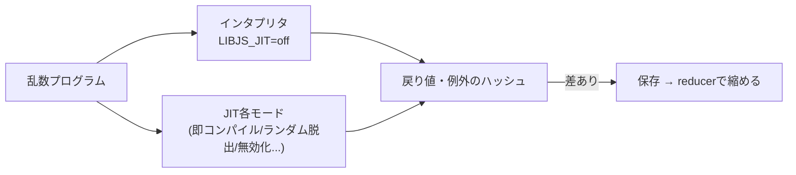

# 2026-10-12（月）

> 今日のひとこと：LadybirdがLibJSのJITを既定でオンにしました。昨日の号で「資料の間で食い違う」と書いた点は、設計書どおり「既定でオン」に実コードが揃った形で決着しています。新規の脆弱性はありません。

## 今日のリリース

- 【TypeScript】ts-rust v0.3.0（tsc-rs）：Windows x64 / Windows arm64 / Intel macOS向けの `tsc` バイナリとCIが中心。互換性・速度の数字はリリースノートに無し（出典: https://github.com/pingdotgg/ts-rust/releases/tag/v0.3.0 ）

## トップニュース

### LadybirdがJITを既定でオンにし、「インタプリタと突き合わせる」テストを一気に積む

【Ladybird】`LibJS: Turn the JIT on by default`（749bc2f）で、JITが入ったビルドは `LIBJS_JIT=off` と言わない限りJITを使うようになった。同じ日に、JITの正しさを確かめる差分ファザーなどのテスト基盤も入っている。

**何が変わる**

- `Libraries/LibJS/JIT/Rust/src/options.rs` の `Options::default()` で `enabled: false` が `enabled: true` になった。しきい値は `threshold: 400`、`warmup: 8` のまま
- 昨日の号で食い違っていた設計書（既定でオン）と実コード（既定でオフ）が、実コード側を直して揃った
- ブラウザは `LIBJS_` で始まる環境変数をすべて子プロセスに渡すので、ヘルパープロセスでも同じ設定になる

**なぜ変えた**：コミットメッセージが挙げるのは、テストツールが「インタプリタの実行側は `LIBJS_JIT=off`」で比較する構造になっていたことだけ。速度の数字は付いていない（不明）。

**テストの組み立て（8838d17の前後、いずれも2026-10-11）**

- 差分ファザー（1504ab6）：型・shape・プロトタイプ・accessor・proxyなどを途中で変える乱数プログラムを作り、呼び出しや例外のハッシュがインタプリタとJITの各モードで一致するかを見る。差が出たプログラムは行の削除などで縮める
- ストレスモード（fbdf1cf）：すぐコンパイル、ランダムな箇所で脱出、全バックエッジでループに入る、ランダムにコードを無効化、などのモードで、`test-js` と test262 を回す
- 型が変わったときの比較テスト（5997b75）、IR（中間表現）をLLVMのFileCheck風に検査するテスト（3805622）

**何に効く・誰が困る**：JSの重い処理が速くなる見込み。ただし投機が外れる経路は、実行環境ごとの差が出やすい。ファザーとストレスモードを同じ日に積んでいるのは、既定オンにする前提を作る動きに見える（推測）。

**ここまでの経緯**

- 2026-10-09：LibJSのC++製ランタイムを削除してRust製に一本化（[10-09の号](2026-10-09.md)）
- 2026-10-11：`libjs_jit` クレートと設計書 `ARCHITECTURE.md` が入る。既定でオンかは資料の間で食い違っていた（[10-11の号](2026-10-11.md)）
- 2026-10-11（JST夜）：既定オンへ。JITの組み込み関数（`Math.min` / `max`、`RegExp.prototype.exec`、文字列の `indexOf` など）の呼び出しが、ランタイムヘルパーを通る形に

出典: https://github.com/LadybirdBrowser/ladybird/commit/749bc2f 、https://github.com/LadybirdBrowser/ladybird/commit/1504ab6 、https://github.com/LadybirdBrowser/ladybird/commit/fbdf1cf

## 今日の深掘り

### 投機JITの正しさを「インタプリタとの差分」で守る：Ladybirdの差分ファザー

**選んだ理由**：JITは「速いが間違えやすい」部品で、既定オンにする条件はテストの作りにある。今日入った3種類のテストは、その考え方が読める。

**背景**：JITは「この引数はいつもint32」「このオブジェクトはこのshape」と投機する。前提が破れたら、インタプリタに戻る（脱出）。この戻り道が間違っていると、結果が静かに変わる。

**変更点（コミットメッセージを読む）**

- 基準を「言語仕様どおりに動くインタプリタ」に置く。JITがあってもなくても、プログラムが返す値と投げる例外が同じでなければバグ、という単純な定義（fbdf1cf）
- 乱数プログラムは「安定した型で温めてコンパイルさせ、その後に型・shape・プロトタイプ・callee などを変える」形に偏らせる。投機が破れる場所を狙う（1504ab6）
- 差が出たら、再現するコマンドを付けて保存し、行の削除やブロックの展開で縮める（reducer）。見つけた既知の不具合は、別の一覧に置いて差を無視できる（fbdf1cf）
- IRのテスト（3805622）は、パス（チェック削減、GVN、ループ不変式の移動、エスケープ解析、インライン化など）の後のIRが、コメントに書いた形になっているかを見る。結果の値だけでは、最適化が効いているかが分からないため

**この変更から分かる設計思想**：最適化の正しさを、アルゴリズムの証明ではなく「別の実装との差分」で担保する。インタプリタという、遅いが単純な基準があるから成り立つ。JITを既定にする前に、基準との比較を機械で回し続ける仕組みを先に作っている。

出典: https://github.com/LadybirdBrowser/ladybird/commit/1504ab6 、https://github.com/LadybirdBrowser/ladybird/commit/fbdf1cf 、https://github.com/LadybirdBrowser/ladybird/commit/3805622

## OSSのPR

### Ladybird

#### オーディオを専用のAudioServerプロセスに移す（renderer から音声スタックを外す）

【Ladybird】`AudioServer` プロセスが新設された（2b89ef0 ほか約30コミット、Zaggy1024）。再生、WebAudio、マイクのキャプチャが、レンダラではなく専用プロセス経由になる。レンダラのサンドボックスからオーディオの許可が外された（be5fc5b）。マイクなどの権限は、UIプロセスがユーザーに許可を尋ねる（3c08deb）。
なぜ変えたか：信頼しないデータを扱うプロセスがオーディオスタックに触れなくて済むようにするため（2b89ef0のメッセージ）。権限の要求元は、レンダラの自己申告ではなく、UIが表示しているURLのオリジンで示す。
出典: https://github.com/LadybirdBrowser/ladybird/commit/2b89ef0 、https://github.com/LadybirdBrowser/ladybird/commit/3c08deb

#### スクロールを合成スレッド（Compositor）で動かす：なめらかなスクロールと端の伸び

【Ladybird】マウスホイール、Home / End、`overflow: hidden` の箱のスクロールがCompositorでアニメーションする（6ade353、3649afc、f48df08 ほか）。端を越えたときのバネ状の伸びと跳ね返りも入った（1f8ea50、35f8142、a054554）。
なぜ変えたか：メッセージには目的の記述が少ない。メインスレッドを待たずに動かす、合成スレッド化の流れの続き（推測）。
出典: https://github.com/LadybirdBrowser/ladybird/commit/6ade353 、https://github.com/LadybirdBrowser/ladybird/commit/35f8142

その他：

- GCのsweepでセルサイズによる除算をやめた。割り算が、割り当ての多いJSベンチでメインスレッドの最大9%を占めていた（[f9ec33c](https://github.com/LadybirdBrowser/ladybird/commit/f9ec33c)）
- JIT周辺：配列の反復・push・長さ読み出しのインライン化、`Math.min` / `max`、型付き配列の最適化など約30コミット（[c8a3d3c](https://github.com/LadybirdBrowser/ladybird/commit/c8a3d3c) ほか）
- 空の HTTP 400〜599 応答でエラーページを出す（[1842eb7](https://github.com/LadybirdBrowser/ladybird/commit/1842eb7)）
- Service Workerのジョブキューと登録ストレージの安定化（[a593d2b](https://github.com/LadybirdBrowser/ladybird/commit/a593d2b)）
- 高DPIでスクリーンサイズをCSSピクセルで報告（[8320448](https://github.com/LadybirdBrowser/ladybird/commit/8320448)）
- flexの非shrinkable項目のmin-content計算とgrow/shrinkの選択を修正（[975740c](https://github.com/LadybirdBrowser/ladybird/commit/975740c)、[386f991](https://github.com/LadybirdBrowser/ladybird/commit/386f991)）
- WebUIページ（Welcome、設定）の見た目の統一（[79daaf3](https://github.com/LadybirdBrowser/ladybird/commit/79daaf3) ほか）
- 約120コミットのうち、上記以外はこれらの周辺

### oxc

#### oxfmtに `associations` が入る：ファイル名ではなく言語を指定してフォーマットする

【oxc】`associations[].files` に当たるファイルを `language`（Shikiのid）で扱う設定が入った（#27437）。dprintの設定が発想元。`overrides[].parser` からの移行も用意された（#27475）。優先順位は配列の後ろが勝つ。
なぜ変えたか：拡張子が標準と違うファイル（`.wxml`、`.conf` など）を、パーサーを指定して扱えるようにするため。#17852、#26257 を閉じる。
出典: https://github.com/oxc-project/oxc/pull/27437

その他：

- 同梱するprettierとprettier-plugin-astroを更新（[#27553](https://github.com/oxc-project/oxc/pull/27553)、[#27552](https://github.com/oxc-project/oxc/pull/27552)）
- minifierの `AGENTS.md` に対応構文のメモを追加（[#27540](https://github.com/oxc-project/oxc/pull/27540)）

### Biome

#### lintルールが一気に増える（週末にCarson McManusが約10件）

【Biome】`noPromiseExecutorReturn`（#12112）、`noAccidentalBitwiseOperators`（#12223）、`noUselessDateGetTime`（#12186）、`noUselessAssignment`（#12107）、`noExcessiveStatementsPerFunction`（#12061）、`useMatchingFunctionName`（#12129）、`useNamedFunction`（#12133）、`noSvelteUselessDerivedBy`（#12092）、`noVueVText`（#12134）、`useConsistentBlockLang`（html、#12094）。多くはESLintなど他ツールのルールの移植で、各PRの詳細は読んでいない（なぜ変えたかは不明）。
出典: https://github.com/biomejs/biome/pull/12112

その他：

- `biome migrate` が、Prettierの `semi` と `singleQuote` の既定値を使うようにした（[#12266](https://github.com/biomejs/biome/pull/12266)）
- `for` ループの真リテラル条件を無限ループとして扱う（[#12240](https://github.com/biomejs/biome/pull/12240)）
- `noVueDuplicateKeys` が `withDefaults` 由来の変数を誤検出しない（[#12244](https://github.com/biomejs/biome/pull/12244)）
- TanStack Queryのルールソースを追加（[#12263](https://github.com/biomejs/biome/pull/12263)）

### TypeScript（ts-rust / bun check）

【TypeScript】ts-rust：約415コミット。大半はマージとエージェント運用の記録（docs、goport のビルド整理）。`UPSTREAM.json` の `current` ピンは `dc37b5249ab6`。v0.3.0はWindows / Intel Macのバイナリ整備（上の「今日のリリース」）。互換性や速度の数字の変化は、今回は確認していない。
【TypeScript】bun check：immerの `Draft<this>`、ts-pattern、交差型のユニオンでの3つの誤エラーを修正（[#44955](https://github.com/oven-sh/bun/pull/44955)）。tscとの差分を潰す作業が続いている。
出典: https://github.com/pingdotgg/ts-rust 、https://github.com/oven-sh/bun/pull/44955

動きなし：microsoft/TypeScript（本体）

### react-hook-form

- `setValues` がフィールド配列に通知し、行が新しい値に追従するように（[#13842](https://github.com/react-hook-form/react-hook-form/pull/13842)）
- `useFieldArray` の disabled ガードのテスト追加（[#13841](https://github.com/react-hook-form/react-hook-form/pull/13841)）

### Servo / Stylo

- `DecompressionStream` で出力のコピーを避ける（[#48754](https://github.com/servo/servo/pull/48754)）
- `` のスタイル計算で source set を同期的に更新（[#48790](https://github.com/servo/servo/pull/48790)）
- `Crypto` を `script_webcrypto` に移動、スクリプト関連を `scripting` モジュールに移動（[#48803](https://github.com/servo/servo/pull/48803)、[#48801](https://github.com/servo/servo/pull/48801)）
- `FetchCanceller` を `FetchController` に改名（[#48799](https://github.com/servo/servo/pull/48799)）
- WPTでacid testsとecmascriptフォルダを有効化（[#48813](https://github.com/servo/servo/pull/48813)、[#48810](https://github.com/servo/servo/pull/48810)）
- Stylo：Servo向けに `justify-items:legacy` の伝播を有効化（[#482](https://github.com/servo/stylo/pull/482)）

### GHC

その他：

- `GHC.Tc.Errors` のエラー抑制の仕組みを簡略化（Simon Peyton Jones、`41e80f4120`）
- クロスGHCの `--info` 出力に target unit id を保証（`f217fc315b`）
- マージリクエストはGitLabにあり、読めていない。コミットメッセージのみを根拠にした

動きなし：facebook/react, vitejs/vite, sveltejs/svelte, vuejs/core, solidjs/solid, vercel/next.js（canary のみ）, wado-lang/wado の docs 以外の設計変更は未確認（約150コミット。件数のみ。`docs/wep-*.md` は読んでいない）

## 仕様の変更

### w3c/csswg-drafts

- `css-sizing-4` の oversight 修正が1件（[50337328](https://github.com/w3c/csswg-drafts/commit/50337328)）。内容は読んでいない（不明）

動きなし：whatwg/html, whatwg/dom, whatwg/fetch, whatwg/streams, whatwg/url, tc39/ecma262, tc39/proposals, w3c/aria, w3c/ServiceWorker, w3c/wcag3（前回の号以降のコミットなし）

## ブラウザの実装

取得できず（chromestatus.com・groups.google.comはegressでブロック）。今回は `runtime_enabled_features.json5` の履歴もblink-devの検索も行っていない（不明）。

## 議論ウォッチ

今回は確認していない（日曜から月曜早朝で、WebFetchでの議論の場の確認を省略した）。

## 続報

- [10-11の号](2026-10-11.md)で「既定で有効かは資料の間で食い違う」と書いたLadybirdのJITは、749bc2f で既定オンに決着した
- [10-11の号](2026-10-11.md)で扱ったUIプロセスの権限チェックの流れが、AudioServerとマイク許可の確認ダイアログ（3c08deb）に続いた
- [10-10の号](2026-10-10.md)で触れたts-rustは、v0.3.0でWindows / Intel Macのバイナリが揃った

## 脆弱性

新規のアドバイザリはなし。react / next / vite / svelte / vuejs/core / oxc / astro / nuxt / TanStack(router) のアドバイザリ一覧を確認した。最新の公開日は、Next.js 9/30、Vite 10/6（[10-07の号](2026-10-07.md)）、TanStack Start 9/30、astro 8/27、nuxt 7/27、Vue 8/31、Svelte 5/14、React 7/21で、10-11以降に公開されたものはなかった。oxc は公開済みのアドバイザリなし。

## 仕様を読む会の候補

1. **LibJS JITの差分ファザー（`Tests/LibJS/JIT` と1504ab6のメッセージ）**：投機JITをどう検証するかを、短い文書とテストで読める。JIT本体より入りやすい。
2. **oxfmtの `associations`（#27437）**：「拡張子ではなく言語を指定する」設定の設計。dprintの設計と並べて読む。
