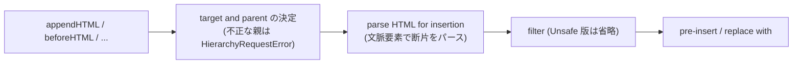

# 2026-10-13（火）

> 今日のひとこと：whatwg/htmlに `appendHTML()` / `beforeHTML()` など、位置ごとにHTMLを挿入する新メソッド群が入りました（2024年2月のIssueから約2年8か月）。Astroには新規のアドバイザリが3件（Moderate 2、Low 1）あります。

## トップニュース

### HTMLに「位置別のHTML挿入メソッド」5種類が入る

【DOM】【HTML】whatwg/htmlに `appendHTML`、`prependHTML`、`beforeHTML`、`afterHTML`、`replaceWithHTML` と、それぞれの `*Unsafe` 版が入った（e88f8aa、Noam Rosenthal）。`insertAdjacentHTML()` の位置文字列を、メソッド名で表す形になる。

**何が変わる**

- `Element` の `append()` / `before()` などと同じ位置関係を、HTML文字列を受け取るメソッドで表せる。`*Unsafe` 版は従来どおりサニタイズなし、無印はフィルター（Sanitizer API）を通る、という2系統
- `before` / `after` / `replaceWith` 系は `NonDocumentTypeChildNode` のメソッドで、`CharacterData` にも公開される
- 親がない要素に対する呼び出しは、DOMの `before()` などと同じく何も起こらない。親が不正（`template`、`html` 要素）なら `HierarchyRequestError`
- 内部では「filter and set HTML」「pre-insert HTML」「parse HTML for insertion」などの補助アルゴリズムが追加され、旧名「set and filter HTML」は処理の順に合わせて改名された

**なぜ変えた**：コミットメッセージは「Closes #10122」とだけ書く。元のIssueは、`insertAdjacentHTML()` の位置文字列（`beforebegin` など）が長く、`before()` / `after()` と名前が揃わず、引数の既定値もないことへの不満から始まった。メソッドを足す案は「APIが増える」が、既存メソッドの引数を変える案と違い、`append()` のような既存メソッドを新しいXSSの入口にしないで済む、という理由で支持された。

**`template` と `html` が親になれない理由**（コミットメッセージより）：`template` はHTMLを設定すると子ではなくテンプレート内容に効くため。`html` 要素を文脈にしたパースは、必ず `head` と `body` を作ってしまうため。

**ここまでの経緯**

- 2024-02-03：Lea VerouがIssue #10122で `insertAdjacentHTML()` の改善案を提起
- 2024-02-04：Anne van Kesteren がHTMLリポジトリに移し、位置別メソッドの案を支持
- 2024-02-12：Simon Pieters が、既存の `append()` / `before()` を多重定義する案はXSSの入口を増やすとして退ける
- 2025-09-18：Noam Rosenthal が、安全/非安全・ストリーミング/一括・挿入/置換の組み合わせでメソッドが最大8つになる懸念を書く
- 2026-10-12：PR #12753 としてマージ。ブラウザ各社の立場や実装状況は、読めた範囲では不明

出典: https://github.com/whatwg/html/commit/e88f8aa 、https://github.com/whatwg/html/issues/10122

## 今日の深掘り

### 「HTMLを挿入する」操作を位置ごとに分けると、アルゴリズムはどう共通化されるか

**選んだ理由**：5メソッド×2系統＝10個のAPIを、少数の補助アルゴリズムの組み合わせで定義している。仕様の書き方が分かる。

**背景**：従来は `insertAdjacentHTML(position, text)` が位置を文字列で受け、`innerHTML` / `setHTMLUnsafe()` は「子を丸ごと置換」しかできなかった。`setHTML()` 系（Sanitizer API）が入ったことで、「パースして、フィルターして、入れる」の手順を位置ごとに増やす必要が出た。

**変更点**（コミットメッセージで確認できた範囲。仕様本文の差分は、浅いcloneの境界のため `git show` で取れず、読めていない）

- 名前付きの補助アルゴリズムを足し、Web公開メソッドはそれを呼ぶだけにする。メッセージが挙げる名前は「filter and set HTML」「pre-insert HTML」「replace with HTML」「parse HTML for insertion」「the target and parent for HTML insertion」
- 「target and parent」は、メソッドごとに違う「どこに入れるか」を最初に決める段階。ここで不正な親（`template`、`html`）をはじく、と読める（推測）
- 順序を名前に出すため「set and filter HTML」を「filter and set HTML」に改名した。フィルターしてから設定する、という実際の処理順に合わせたもの

（図は、メッセージの記述から組み立てた概念図で、仕様本文のステップ順そのものではない）

**この変更から分かる設計思想**：APIの数は増えても、仕様の中身は「位置を決める」「パースする」「フィルターする」「挿入する」の組み合わせに畳む。安全な版と危険な版を名前で分け（`*Unsafe`）、危険な版を既存メソッドの引数に紛れ込ませない。

出典: https://github.com/whatwg/html/commit/e88f8aa 、https://github.com/whatwg/html/issues/10122

### Ladybirdがサイトごとに専用のRequestServerを持つ：HTTPキャッシュをサイト単位に閉じる

**選んだ理由**：ブラウザのネットワーク層を「サイト分離」に合わせて分ける設計の変更で、HTTPキャッシュの安全性の考え方が読める。

**背景**：これまでRequestServer（ネットワークと各種キャッシュを受け持つプロセス）は共有だった。共有キャッシュは、あるサイトが入れた応答を別のサイトが読める（キャッシュによるサイト間の情報漏れ）経路になる。

**変更点**（3ddfa68、f6f53e3 ほか、2026-10-12）

- UIプロセスが、ドキュメントを持つトップレベルのサイトごとにRequestServerを起動する。サイトを持たないものは、UIプロセス自身の分と、まだサイトを持たないプロセスの分
- プロセスは、そのサイトのドキュメントを最初に持つ直前に、サイトのRequestServerへ移る。ワーカーは持ち主のものを使う
- サイトのRequestServerは、そのサイトの応答だけを専用ディレクトリにキャッシュする（サンドボックスがそのディレクトリに閉じ込める）。別サイトへのナビゲーションで取った応答は、そのサイトのRequestServerに引き渡してから、ドキュメントのプロセスが受け取る
- 1セッション最大16個。超えたサイトは「サイトなし」の分を共有し、1分使われないものは終了する。プライベートセッションはディスクに何も残さない

同じ流れで、HTTPキャッシュの境界の穴をふさぐコミットが数十件続いた。例：

- `Cookie` で `Vary` する応答はキャッシュしない（c079f2a）。RequestServerはキャッシュを引いた後にCookieを付けるので、Cookie込みで選ばれた応答が、Cookieなしの要求に合ってしまうため
- URLに埋め込まれた資格情報を、curlが `Authorization` ヘッダにするのを止める（88c475c）。Fetchの資格情報モードを無視してしまうため
- 要求元のIDや、ポート、メソッド、ヘッダ名と値の検証を、RequestServer側で行う（4c8d149、5e412d2、85278af ほか）

**この変更から分かる設計思想**：クライアント（レンダラ）を信用せず、ネットワークプロセス側で検査し直す。キャッシュの共有をやめて、「サイト＝信頼の単位」にそろえる。速度の数字や、この変更の動機の公式な説明は、コミットメッセージ以外では見つかっていない（不明）。

出典: https://github.com/LadybirdBrowser/ladybird/commit/3ddfa68 、https://github.com/LadybirdBrowser/ladybird/commit/f6f53e3 、https://github.com/LadybirdBrowser/ladybird/commit/c079f2a

## 仕様の変更

### whatwg/html

#### 文字列のタイマーハンドラのCSPを、同期的に1回だけ確かめる

【HTML】`setTimeout("code", …)` のような文字列ハンドラで、CSPの検査を呼び出しの時点で同期的に1回だけ行う。ブロックされたときは、例外を報告せず `0` を返す（86190a4、Simon Pieters。「実装に合わせた」とメッセージにある）。#13018 を閉じる。
なぜ変えたか：仕様と実装の挙動が食い違っていたため。
出典: https://github.com/whatwg/html/commit/86190a4

トップニュース/深掘りで扱った変更：位置別のHTML挿入メソッド（上記）

### w3c/csswg-drafts

#### CSS Overscroll Module Level 2 の最初のドラフトが入る

【CSS】`css-overscroll-2` が新設された（2c470fff、Robert Flack）。コンテナの内容がずれる、重ね順が逆になる、などの注記が付く。ドラフトの全文は読んでおらず、機能の中身は不明。
出典: https://github.com/w3c/csswg-drafts/commit/2c470fff

#### 識別子のシリアライズを、パース規則の変更に合わせる

【CSS】CSSOMの「serialize an identifier」を、識別子のパース規則の変更に合わせた（a8a0b410、#7129）。css-syntax-3 は、パースのアルゴリズムが入力全体を消費するのか、末尾が空であることを確かめるのかを統一して書いた（87c9dbaa、#11730）。
出典: https://github.com/w3c/csswg-drafts/commit/a8a0b410 、https://github.com/w3c/csswg-drafts/commit/87c9dbaa

その他：

- ポップオーバー系ドラフトの用語や参照の整理（[01e9acb7](https://github.com/w3c/csswg-drafts/commit/01e9acb7)）

動きなし：whatwg/dom, whatwg/fetch, whatwg/url, whatwg/streams, tc39/ecma262, tc39/proposals, w3c/ServiceWorker, w3c/wcag3（w3c/aria はeditorialのみ）

注：whatwg/streams、tc39/proposals、w3c/ServiceWorker は、今回のcloneができなかったため、動きの有無は未確認。

## ブラウザの実装

取得できず（chromestatus.com・groups.google.comはegressでブロック）。Chromiumの `runtime_enabled_features.json5` のコミット履歴、blink-devの検索、web-platform-tests/interop のIssueは、今回は確認していない（未取得）。

## OSSのPR

### React

#### 休眠（dehydrated）状態のActivityを隠すとき、後ろの兄弟まで隠してしまう不具合を修正

【React】`hideOrUnhideDehydratedBoundary` はActivityのインスタンスも受け取るのに、Suspenseのマーカーしか見ていなかった。そのため `<!--/&-->` を通り過ぎ、親にある後続の兄弟すべてに `display: none` を付け、Activityを再表示しても戻らなかった（#37814、#37813を修正）。終端を `<!--/&-->` とし、深さを `<!--&-->` で数える形に直した（`clearHydrationBoundary` と同じ）。
なぜ変えたか：Activityが閉じた後の兄弟が、見えなくなったまま戻らないため。
出典: https://github.com/facebook/react/pull/37814

その他：

- `use()` に拡張不可（non-extensible）なthenableを渡すとDEVでクラッシュする不具合を修正（[#37796](https://github.com/facebook/react/pull/37796)）
- コンパイラ：ref を読む関数の比較を、refアクセスとして扱わない（[#37688](https://github.com/facebook/react/pull/37688)）
- `facebook/react` への言及を新しい場所へ移行（[#37778](https://github.com/facebook/react/pull/37778)）

### Next.js

#### turbo-tasksの実行キューから、低優先度タスクのグローバルロックを外す

【Next.js】ゼロからのビルドでは、ほぼすべてのタスクが最低優先度（`TaskPriority::Initial`）になる。それらを、ロックなしのMPMCキュー（`ConcurrentQueue`）に入れ、それ以外の優先度だけ `Mutex<BinaryHeap>` に残した。`pop` はヒープを先に空にし、空ならヒープのロックを取らない（#99773、Tobias Koppers）。
なぜ変えたか：従来は `schedule` と `pop` が1つの `Mutex<Queue>` を通り、ワーカー数が多いほど競合の点になるため。速度の数字はPR本文に付いていた可能性があるが、読めていない。
出典: https://github.com/vercel/next.js/pull/99773

その他：

- `turbopackGc` を無効にできるようにした（[#100067](https://github.com/vercel/next.js/pull/100067)）
- durable `use cache` のパス/コードハッシュからコンテキストを除外し、デプロイ間のテストを拡充（[#99898](https://github.com/vercel/next.js/pull/99898)、[#99900](https://github.com/vercel/next.js/pull/99900)）
- root params の検出をWindowsで修正（[#100065](https://github.com/vercel/next.js/pull/100065)）、`generateStaticParams` で `workStore.page` を正規化前にそろえる（[#99881](https://github.com/vercel/next.js/pull/99881)）
- codemodのagents-mdが、同梱ドキュメントを見つける方法の修正（[#100017](https://github.com/vercel/next.js/pull/100017)、[#100016](https://github.com/vercel/next.js/pull/100016)）
- アップグレード用のエージェント評価の整理（[#99990](https://github.com/vercel/next.js/pull/99990)、[#100074](https://github.com/vercel/next.js/pull/100074)、[#100075](https://github.com/vercel/next.js/pull/100075)）
- 開発時のコードフレームがターミナルの大きさ変更に追従（[#99916](https://github.com/vercel/next.js/pull/99916)）、`next/image` の非推奨propの注釈（[#98597](https://github.com/vercel/next.js/pull/98597)）、非LTSリリースへの対応（[#99948](https://github.com/vercel/next.js/pull/99948)）、docsの整理

### TypeScript

#### `ValueSymbolLinks` を16バイト小さくする

【TypeScript】チェッカーのシンボルごとの補助データを小さくした（#64739、Anders Hejlsberg）。メモリ使用量の数字は読めておらず不明。
出典: https://github.com/microsoft/TypeScript/pull/64739

その他：

- 宣言出力で、`exports` を使う前にパッケージの到達可能性を確かめる（[#64599](https://github.com/microsoft/TypeScript/pull/64599)）
- ダウンレベルした静的ブロック内の関数で `this` を保つ（[#64738](https://github.com/microsoft/TypeScript/pull/64738)）
- デコレータ付きクラスで、privateメンバーが自分を参照するときのクラス名の不具合（[#64505](https://github.com/microsoft/TypeScript/pull/64505)）
- 置き換えlibの並び順を保つ（[#64693](https://github.com/microsoft/TypeScript/pull/64693)）、JSDocコンストラクタのプロパティの修飾子（[#64696](https://github.com/microsoft/TypeScript/pull/64696)）、`lib.decorators.d.ts` の例の修正（[#64353](https://github.com/microsoft/TypeScript/pull/64353)）

### ts-rust

マージコミットが約476件（goportの統合R205・R206、チェッカーの移植R204〜R206など）。多くはエージェント運用の記録で、個別には読んでいない。`UPSTREAM.json` の `current` は `dc37b5249ab6`。READMEの互換性・速度の数字は自己申告で、今回は確認していない。
その他：

- Wasm実行環境の修正：クラッシュ時のstderrのUTF-8保持、空のメモリルートディレクトリの維持、ファイル/ディレクトリ衝突を通る書き込みの拒否（[#78](https://github.com/pingdotgg/ts-rust/pull/78)、[#77](https://github.com/pingdotgg/ts-rust/pull/77)、[#75](https://github.com/pingdotgg/ts-rust/pull/75)）

### Ladybird

#### HTTPキャッシュを仕様に沿って厳しくする（約50コミット）

【Ladybird】`Vary` のキー作りを長さ付きの正規形にし（2a2c6c2）、`Vary` のフィールド数と変種数に上限を置く（550460a）。304で `Vary` が変わった再検証は失敗扱いにする（3bc440b）。未終端の `Cache-Control` や `Connection` が指すフィールドを持つ応答を保存しない（ddb98a6、c352b8e）。安全でないメソッドの後に保存済みの応答を無効にする（7bfb3cd、27d58b5）。
なぜ変えたか：個別のメッセージが示すのは、仕様どおりでない場合に古い応答や他の要求向けの応答を返す穴をふさぐこと。全体の動機は、上の深掘りのサイト別RequestServerと同じ流れと読める（推測）。
出典: https://github.com/LadybirdBrowser/ladybird/commit/2a2c6c2 、https://github.com/LadybirdBrowser/ladybird/commit/7bfb3cd

その他：

- アニメーションの「clock lanes」の更新を、iframeのドキュメントや疑似要素のボックスにも広げる（[c3021ba](https://github.com/LadybirdBrowser/ladybird/commit/c3021ba)、[4b2e874](https://github.com/LadybirdBrowser/ladybird/commit/4b2e874) ほか）
- プロキシの環境変数のパーサーを追加し、DNS設定を迂回するプロキシを表示（[bf4cbf4](https://github.com/LadybirdBrowser/ladybird/commit/bf4cbf4)、[8a1f994](https://github.com/LadybirdBrowser/ladybird/commit/8a1f994)）
- 固定位置のボックスのためにビューポートをスクロールしない（[3d003d2](https://github.com/LadybirdBrowser/ladybird/commit/3d003d2)）
- 全体で177コミット。上記以外の内訳は、個別には読んでいない

### oxc

#### JS製コード生成器（`packages/codegen`）に、メガモーフィックな `type` 読み出しの削減が続く

【oxc】overlookmotelによる `perf(packages/codegen)` が20件以上。`type` の読み出しを減らし、分岐を減らし、不要な `printSpaceBeforeIdentifier` 呼び出しを消す、という局所的な調整の積み重ね（#27586〜#27620）。数字は読めておらず不明。lexerではキーワードや演算子の定義を `KeywordDef` / `OpDef` にまとめるリファクタ（#27615、#27616）。
なぜ変えたか：メガモーフィック（多くの型が同じ場所を通る）なプロパティ読み出しをJSエンジンが最適化しにくいため、と各PRの題名から読める（推測）。
出典: https://github.com/oxc-project/oxc/pull/27586

その他：

- `arguments` の解決を通常の関数で止める（[#26929](https://github.com/oxc-project/oxc/pull/26929)）、`bad-array-method-on-arguments` で参照を1回だけ調べる（[#26930](https://github.com/oxc-project/oxc/pull/26930)）
- minifier：mapped `arguments` を通るパラメータへの書き込みを保つ（[#27494](https://github.com/oxc-project/oxc/pull/27494)）、ガイドを現在の実装に合わせる（[#27584](https://github.com/oxc-project/oxc/pull/27584)）
- codegen：`V8IntrinsicExpression` の出力、`ArrayPattern` の `RestElement` 前の余分な空白の削除（[#27597](https://github.com/oxc-project/oxc/pull/27597)、[#27613](https://github.com/oxc-project/oxc/pull/27613)）

### Biome

#### lintルールの追加が続く（今回は約12件）

【Biome】`noInvalidThis`（#12120）、`noObjectConstructor`（#12111）、`noArgumentsCallerOrCallee`（#12114）、`noDoubleComparison`（#12175）、`useSimplifiedBooleanReturn`（#12169）、`useLowercaseTestTitle`（#12154）、`useTailwindStaticClassStrings`（#11961）、`useSvelteReactiveClasses`（#12235）、`useSvelteShorthandDirective`（#12172）、`noSvelteAddEventListener`（#12070）、`useVueMatchingComponentFileName`（#12137）。多くは他ツールのルールの移植で、個別のPRは読んでいない（なぜ変えたかは不明）。
出典: https://github.com/biomejs/biome/pull/12120

その他：

- プラグインの `includes` のglobを、定義した設定ファイルからの相対にする（[#12264](https://github.com/biomejs/biome/pull/12264)）
- `noTailwindRawColors` が、利用者のデザインシステムの色を提案（[#12272](https://github.com/biomejs/biome/pull/12272)）
- `noUnusedVariables` に `ignoreUsingDeclarations`（[#12206](https://github.com/biomejs/biome/pull/12206)）、`noUnusedImports` のSvelte store対応（[#12280](https://github.com/biomejs/biome/pull/12280)）
- Markdown の embeds の挙動を設定可能に（[#12262](https://github.com/biomejs/biome/pull/12262)）
- SCSS：複合プレースホルダーセレクタ、計算されたmedia feature名（[#12276](https://github.com/biomejs/biome/pull/12276)、[#12283](https://github.com/biomejs/biome/pull/12283)）

### react-hook-form

#### `useFieldArray` と `reset` まわりの不具合修正が続く

【RHF】値なしで登録したフィールドが配列の行を増やす不具合を修正（#13846、#13849で改良）。`trigger` 後に `reset` した際、保持している `isValid` を再計算（#13847）。`useFieldArray` で、親の配列が再インデックスしている間を除き、アンマウント時に登録を解除する（#13843）。`Form` で `Content-Type` ヘッダ名を大文字小文字を区別せずに照合（#13848）。
なぜ変えたか：個別の不具合の報告への対応。各PRの本文は読んでいない。
出典: https://github.com/react-hook-form/react-hook-form/pull/13846

### Servo

#### 保存されたタブを `white-space: pre-wrap` で「条件付きハンギング」として扱う

【Servo】`pre-wrap` で行末のタブを条件付きハンギングにする（#48753、Martin Robinson）。ほか、`input` を複製したときのchecked状態の複製、フォームオーナーの変更時のラジオグループの更新など。
なぜ変えたか：個別のPR本文は読んでいない（不明）。
出典: https://github.com/servo/servo/pull/48753

その他：

- ラジオボタンがフォームオーナーを変えたときにグループを更新（[#48069](https://github.com/servo/servo/pull/48069)）、`input` の複製時にchecked状態を設定（[#48845](https://github.com/servo/servo/pull/48845)）
- URLの文字列化を速くする（[#48838](https://github.com/servo/servo/pull/48838)）、CORSキャッシュの掃除でキャッシュ全体を複製しない（[#48828](https://github.com/servo/servo/pull/48828)）
- フォントのメモリマップ領域をmacOSでコピーしない（[#48841](https://github.com/servo/servo/pull/48841)）、ピクセルのスナップショットのコピー削減（[#48836](https://github.com/servo/servo/pull/48836)）
- layout：`Direction` を `LogicalAxis` に置き換える（[#48815](https://github.com/servo/servo/pull/48815)）、a11yのファイル分割（[#48830](https://github.com/servo/servo/pull/48830)）
- Styloを `legacy justify-align` の修正入りに更新（[#48806](https://github.com/servo/servo/pull/48806)）

### Wado

120コミット弱。`docs/wep-*.md` の更新が9本（cm-binding-synthesis、effect-handler、resource-ownership、elaborator-rearchitecture、local-item-definitions、cm-post-return、loam、eval、contract-checks）。新しいWEPの追加はなし。コンパイラでは、ジェネリックなnewtypeでエフェクト行を引き継ぐ修正（ffca2b2、cc1fa127）が目立つ。個別のWEPの中身は読んでいない。
出典: https://github.com/wado-lang/wado/commit/ffca2b2

動きなし：vuejs/core の `minor`、solidjs/solid、oven-sh/bun（`bun check`）、sveltejs/svelte、vitejs/vite（docs/test/依存のみ）、ghc/ghc（2件のみ）、servo/stylo
注：solid、vue、bun は今回cloneできておらず、動きの有無は未確認。

## 議論ウォッチ

取得できず：今回は議論系の対象（WICG、standards-positions、各RFC、Discussions）のページを確認していない。

## 脆弱性

### Astro：新規のアドバイザリ3件

【脆弱性】2026-10-12に公開。いずれもGitHubのアドバイザリのページを根拠にしている。

**1. `@astrojs/node` の `/_image` で全文を読めるSSRF（GHSA-m8p5-r7qv-cx4c、Moderate、CWE-918）**

- 影響：`@astrojs/node` ≦ 11.1.6。修正は 11.1.7
- 原理：`createRequestFromNodeRequest()` が `req.headers.host` を検証せずURLのホストにしていた。`security.allowedDomains` は `X-Forwarded-*` しか検査しないので、素の `Host` ヘッダで `Astro.url` を攻撃者の指定するホストにできる。結果、`Astro.url` から作る絶対URLにも効く（パスワードリセットのリンク、canonical/og、キャッシュの汚染）
- 成立条件：`@astrojs/node` の既定のスタンドアロンのサービング。`allowedDomains` を設定した環境で再現されている。`Astro.url` から絶対URLを作るアプリ
- 修正：アドバイザリは `da8b5735` を挙げるが、この時点で内容を読めていない。ページによれば、そのコミットは `X-Forwarded-Host` の検証であり、`Host` の扱いは変えていないとあり、`Host` 側の修正の有無は不明

**2. View TransitionsのCSSインジェクション（GHSA-mpr7-6m5w-76rw、Low）**

- 影響：`astro` 7.1.0〜7.3.2。修正は 7.3.3
- 原理：サーバー側のView Transition用CSS生成が、文字列のアニメーション値の `;`、`{`、`}` を無害化していなかった。`<` は無害化されるので、`<style>` を抜けてHTML/JSは足せない
- 成立条件：リクエスト由来の値をそのまま `duration` などに渡すアプリ。影響はCSS（見た目の改変、DOM属性値の漏えいの可能性）に限る
- 修正：PR #17970。CSS宣言の区切りを符号化し、`calc()` / `var()` と文字列は保つ、とPR説明にある

**3. MDX/JSXの `` が入ると、要素を閉じて任意のHTML/JSを注入できる
- 成立条件：攻撃者が制御できる値（クエリや CMSのフィールド）を、MDXや `astro:jsx` で `<script>` / `<style>` の動的な子として直接埋め込むアプリ。ユーザーの操作が必要。ほかのJSX式の文脈は、もともとエスケープされていて影響しない
- 修正コミット（GitHubのコミット差分ページから。cloneして読んだものではない）：a548223（PR #17896）
  - `packages/astro/src/runtime/server/jsx.ts` と `render/streaming.ts`：「信頼する文字列の子」の分岐を `style` だけにし（`escapeStyleText` を通す）、`script` は通常のエスケープの経路に戻した
  - MDX側は、リテラルだけの `script` / `style` の子を、`set:html` に畳むrehypeプラグイン（`rehype-collapse-script-style.ts` ほか）を足し、補間のあるものはエスケープ側に回す

**同種のパターン**：「テンプレートの中の、構文が別の言語になる要素（`script` / `style`）の子」に、通常のHTMLのエスケープが効かない。ここで正しいのは、文脈ごとに別の無害化を持つか、生HTMLにしたい場合を明示的な `set:html` に限ることだ。`Host` ヘッダの件は、「信頼できる入力と、ヘッダの自己申告」を混ぜない、という別のパターン。

出典: https://github.com/withastro/astro/security/advisories/GHSA-m8p5-r7qv-cx4c 、https://github.com/withastro/astro/security/advisories/GHSA-mpr7-6m5w-76rw 、https://github.com/withastro/astro/security/advisories/GHSA-98hj-9722-w3j8

他の対象（react / next / vite / svelte / vuejs/core / oxc / nuxt / TanStack(router)）に、10-12以降に公開されたアドバイザリはなかった。

## 仕様を読む会の候補

1. **whatwg/html の位置別HTML挿入（appendHTML ほか）**：Issue #10122 から約2年8か月の議論と、`*Unsafe` の系統分けを、仕様本文のアルゴリズムで読める。`insertAdjacentHTML()`、`setHTMLUnsafe()`、Sanitizer APIと並べると、HTMLの挿入APIの全体像が見える。
2. **HTTPキャッシュの `Vary` 周り（Ladybird の LibHTTP）**：RFC 9111 の `Vary` の規則を、実装のコミット（キーの作り方、上限、`Cookie` の除外）で読み比べられる。
