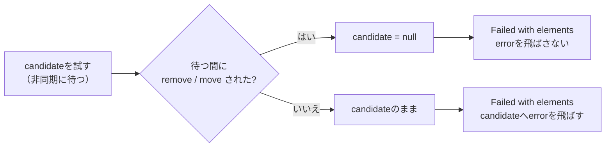

# 2026-10-14（水）

> 今日のひとこと：Ladybirdが、`navigate` アルゴリズムの「進行中のナビゲーション」を仕様の定義どおり（null、`"traversal"`、ナビゲーションID）に持ち直し、UIプロセスとページ側の二重管理を直しています。新規の脆弱性はなく、今日のリリースはVue v3.5.44、oxlint v1.88.0、ts-rust v0.6.0などです。

## 今日のリリース

- 【Vue】v3.5.44：リリースページに変更の一覧はなく、CHANGELOG.mdへの案内だけ。同日の `main` には、非同期 `setup` のエラーをサーバーレンダラーで伝える修正（#15857）などが入った（出典: https://github.com/vuejs/core/releases/tag/v3.5.44 ）
- 【oxc】oxlint v1.88.0 / oxfmt v0.73.0：ASTにコメントの紐づけを持たせる破壊的変更、LSPが設定エラーを表示、`sort-keys` をESLintと同じ自然順に（出典: https://github.com/oxc-project/oxc/releases/tag/oxlint_v1.88.0 ）
- 【TypeScript】ts-rust v0.6.0：エディタ（言語サーバー）のメモリ増加の抑制、ビルドモードの `--fast`、モジュール解決の移植など。数字（1000回の編集あたり3.1〜4.6 MiB、0.5.0は約20 MiB）はリリースノートの自己申告（出典: https://github.com/pingdotgg/ts-rust/releases/tag/v0.6.0 ）

## トップニュース

### Ladybirdが、ナビゲーションの「進行中」の状態を仕様どおりの3値で持つ

【Ladybird】LibWeb / LibWebViewで、ナビゲーションまわりのコミットが約50件続いた。中心は、navigable（ブラウジングコンテキストを一般化した単位）の「ongoing navigation」を、仕様の定義どおり「null、`"traversal"`、ナビゲーションID」のどれか1つの値として持つ変更（26eafad）。

**何が変わる**

- `navigate` の各ナビゲーションの手順は、ongoing navigationとは別に持つ。仕様どおり、ongoing navigationが自分を指さなくなったナビゲーションの手順は、完了手順がfinalizationを積んでいない限り終わる
- ongoingが `"traversal"` のときに始まったナビゲーションは、以前は「走査が終わるまで保留」していた。今は仕様のstep 18どおり、ページ側でも、UIプロセスが受け付けた時点でも「そこで戻る」（b332db1）
- 履歴操作のfinalizationは、キュー上の位置のnavigableから取るのではなく、ナビゲーションIDで探す
- UIプロセスが終わらせたナビゲーションを、ページ側に「取り消せ」と伝える（2c3d2bb）。以前は、unloadの確認中に止まったナビゲーションが、ページ側の `"traversal"` 化まで残っていた

**なぜ変えた**：コミットメッセージが挙げるのは「仕様がそう書いているのに、ページとUIプロセスの両方が走査の終わりまで待っていた」というずれ。Ladybirdはマルチプロセスで、ナビゲーションの状態がUIプロセスとWebContentに分かれる。仕様は1プロセス前提で書かれているため、どちらがどの状態の持ち主かを決め直す必要がある（この部分は筆者の解釈）。

**何に効く・誰が困る**：リンク遷移・戻る/進む・リロード・`javascript:` URLが重なる場面の取りこぼしや二重実行が減る見込み。テストの追加や挙動の数字はコミットから読み取れなかった（不明）。

**ここまでの経緯**

- 2026-10-12：LibJSのJITが既定でオン（[10-12の号](2026-10-12.md)）
- 2026-10-13：HTTPキャッシュを仕様に沿って厳しくする約50コミット、サイトごとのRequestServer（[10-13の号](2026-10-13.md)）
- 2026-10-13〜14：ナビゲーションと履歴走査のプロセス間の持ち分を、仕様の手順に寄せる約50コミット（今日）

出典: https://github.com/LadybirdBrowser/ladybird/commit/26eafad 、https://github.com/LadybirdBrowser/ladybird/commit/b332db1 、https://github.com/LadybirdBrowser/ladybird/commit/2c3d2bb

## 今日の深掘り

### 取り除かれた `<source>` に `error` を飛ばさない：メディア要素の「リソース選択」の小さな修正

**選んだ理由**：`<video>` / `<audio>` のリソース選択アルゴリズムは、DOMの変更と非同期の手順が絡む古い仕様で、「非同期に待つ間にDOMが変わる」ときの書き方を学べる。差分が小さく、全体を読み切れる。

**背景**：メディア要素は、子の `<source>` を順に試して、読み込めたものを使う（resource selection algorithm）。試している途中でその `<source>` が取り除かれたり、別の場所へ動かされたりしたとき、失敗の通知（`error` イベント）をどこへ飛ばすかが、仕様に書かれていなかった。Issue #12986（「取り除かれた/動かされた `source` にも、メディア要素が `error` を発火する」）がこれを指摘している。Issueの本文と議論は取得できなかった（ページの要約に本文が含まれず）。ブラウザごとの挙動は不明。

**変更点**（98753fa、`source` ファイルに +8 / −3）：

```html
<p>If <var>candidate</var> is removed from the media element, or moved out of it,
then set <var>candidate</var> to null.</p>
...
<li><i>Failed with elements</i>: If <var>candidate</var> is not null, then queue a media
element task given the media element to fire an event named error at <var>candidate</var>.</li>
```

- 「`candidate`（いま試している `source`）が、メディア要素から取り除かれるか外へ動かされたら、`candidate` を null にする」という文が、DOMの変化の影響を説明する段落（「Other changes don't affect *pointer*」の直後）に入った
- 失敗の手順（Failed with elements）は、これまで無条件に `error` を飛ばしていた。今は `candidate` が null でないときだけ飛ばす



**周辺コード**：`concept-node-remove-ext`（DOMの「remove」から呼ばれる拡張点）と `concept-node-move-ext`（`moveBefore()` 由来の「move」の拡張点）を参照している。つまり、DOMが提供するフックに乗って「要素が外れたら自分の参照を捨てる」書き方だ。2026-10-10の号で扱ったMutationObserverの「一時的な登録」の修正とは別の変更だが、どちらも「`remove` と `move` を別々に考える」作りになっている（[10-10の号](2026-10-10.md)）。

**この変更から分かる設計思想**：非同期の手順が参照を持ち続けるとき、仕様は「参照が指すものが外れたら、その参照を無効にする」方式で整合させる。通知（`error`）は「まだ文書の一部である要素にだけ」飛ばす。コミットには AI（Claude）との共著の記載がある。

出典: https://github.com/whatwg/html/commit/98753fa 、https://github.com/whatwg/html/issues/12986

### Fizzの `prerender` を途中で中断したとき、再開で子の1つだけが描かれる

**選んだ理由**：React Fizz（サーバーレンダラー）の「postpone（延期）」の仕組みで、中断した作業をどこから再開するかの記録が、タスクのどのフィールドにあるかを読める。

**背景**：`prerender` は、中断（abort）された部分を「postponed（穴）」として残し、あとで `resume` で埋められる。再試行される描画タスク（`retryRenderTask`）の最中に中断すると、タスクは「試行を始めた位置」までセグメントを巻き戻す。ところが、タスクの `keyPath` と `childIndex` は、描いていた最も内側の子の位置のままだった。結果、親の要素の下の「その子の枠」だけが延期として記録され、resumeはその子だけをバウンダリのセグメントに描いた（PR本文より。Issue #37709）。テストでは `<section>` 全体のはずが `<div>World</div>` だけになっていた。

**変更点**（07dde64、`ReactFizzServer.js`、+2行）：

```js
const startKeyPath = task.keyPath;
const startChildIndex = task.childIndex;
...
task.keyPath = startKeyPath;
task.childIndex = startChildIndex;
abortUnwoundTask(task, request);
```

- 試行の開始時に `keyPath` と `childIndex` を控え、abort処理（`abortUnwoundTask`）に入る前に戻す
- `task.node` は戻さない。DEVの非同期デバッグ情報が、オーナースタックのために読むため（PR本文）

**この変更から分かる設計思想**：「巻き戻す」ときは、状態を持つすべてのフィールドを揃えて戻す必要がある。セグメントだけ戻して、位置の記録（`keyPath`、`childIndex`）を戻し忘れると、後で「穴」の位置がずれる。一方で、デバッグ情報のように別の読み手がいるフィールドは、わざと戻さない。

出典: https://github.com/facebook/react/commit/07dde64da1abd1525120b9ae49672386486e33c3 、https://github.com/facebook/react/pull/37710

## 仕様の変更

### whatwg/html

#### 取り除かれた `<source>` に `error` を飛ばさない

深掘りを参照。
出典: https://github.com/whatwg/html/commit/98753fa

### w3c/csswg-drafts

#### CSSOMの宣言ブロックのパースを「parse a list of declarations」に戻す

【CSS】`parse a CSS declaration block` が呼ぶアルゴリズムを、`parse a block's contents` から `parse a list of declarations` へ戻した（5823c7a）。コミットメッセージは「ea43cbf の変更を戻す。fbd84ec での見落とし」とだけ書いている。
なぜ変えたか：理由の詳細は読めなかった（不明）。`style` 属性や `cssText` のような宣言だけを受ける入力に、ネストした規則も受けるパース手順を使うのは過剰だったから、と読めるが、これは推測。
出典: https://github.com/w3c/csswg-drafts/commit/5823c7a7c3401c6b434dbf3ef88077ea45e30303

動きなし：whatwg/dom, w3c/aria（editorialのみ）, whatwg/fetch, whatwg/streams, whatwg/url, tc39/proposals, tc39/ecma262, w3c/ServiceWorker, w3c/wcag3

## ブラウザの実装

### Chromium

`runtime_enabled_features.json5` のコミット履歴（10-12〜13）から拾った。題名と作者だけを根拠にし、Intentのスレッドは読んでいない。

#### XSLTが既定で無効になる

【ブラウザ】Chromiumが `Disable XSLT by default` のコミットで、XSLTを既定で無効にした（mfreed7）。どの仕様の、どの段階の話かは、WHATWGがXSLTの削除を決めた流れとつながると考えられるが、コミットの題名だけでは確かめられなかった（不明）。revertは10-13までの履歴にはない。
出典: https://github.com/chromium/chromium/commit/61634354c22bc1db67b24e17b3690a8130fd09e2

その他：

- WebTransportの信頼性属性（reliability attributes）を既定で有効に（[08322942](https://github.com/chromium/chromium/commit/08322942c3e33b814d9984cc2a373d17d4083ab8)）
- WebHIDをAndroidで既定で有効に、EyeDropperをAndroidで有効に（[3faefe34](https://github.com/chromium/chromium/commit/3faefe341d971a2abb4d028adea297ec50b489a1)、[c3744761](https://github.com/chromium/chromium/commit/c37447613629055fffb8828e3e1f27c22e28e733)）
- `focusreset` イベントを実装（フラグの裏）（[8d5ba17](https://github.com/chromium/chromium/commit/8d5ba1795f0c50b90072399d0403389df6eebbd6)）
- ProgressEventをService Workerで公開、`OfflineAudioContext.close()` を実装（[1f7a8b2](https://github.com/chromium/chromium/commit/1f7a8b255f6275dbc6c40aaef221b964e4f38071)、[31de0dd](https://github.com/chromium/chromium/commit/31de0dd32de46bcddb1e7884547ff3dcd4b8d29d)）
- `document.requestStorageAccessFor` のBlink実装とIDLを削除（[064bca2](https://github.com/chromium/chromium/commit/064bca2b1e8bc9dfdd45d6f6175b67df938e52b7)）
- Global Privacy Controlの接続をrelandした（10-09にrevertされたもの）（[abaef1b](https://github.com/chromium/chromium/commit/abaef1bca0ee4cef4cfcb1fc18e6208164553daa)）
- フラグの削除、View Transitionの描画、`UnboundedElement` のiframe制約などの小さな変更

取得できず（chromestatus.com・groups.google.comはegressでブロック。上記はコミット履歴から。blink-devのIntentは今回の検索では確認していない）。

## OSSのPR

### React

#### Fizzで、中断したタスクを開始位置から延期する

深掘りを参照。
出典: https://github.com/facebook/react/pull/37710

### TypeScript

【TypeScript】マージ6件（Go版の移植）。

#### 総称マップ型 + 名前型（name type）の `keyof` 簡約を移植

`keyof` を総称マップ型（`as` 句つき）に適用したとき、JS版にあった簡約がGo版に抜けていたので移植（#64772）。「移植漏れを埋める」種類の修正。
なぜ変えたか：JS版とGo版の出力を揃えるため（タイトルより。本文は読んでいない）。
出典: https://github.com/microsoft/TypeScript/pull/64772

その他：

- `stripInternal` が型エイリアスの右辺を落とすときのnilパニックを修正（[#64770](https://github.com/microsoft/TypeScript/pull/64770)）
- シンボルテーブルの種別マスクを修正（[#64762](https://github.com/microsoft/TypeScript/pull/64762)）
- リリースパイプラインで全プラットフォームを並列にビルド（[#64563](https://github.com/microsoft/TypeScript/pull/64563)）
- 依存の深さ順のビルドスケジューリングを復活（[#64615](https://github.com/microsoft/TypeScript/pull/64615)）
- JSXのimportアクションの題名にシンボル名を戻す（[#64588](https://github.com/microsoft/TypeScript/pull/64588)）

### Bun（`bun check` のみ）

#### `bun check` がtscと食い違う3か所と、`-b` のスケジューリング

【TypeScript】[#45097](https://github.com/oven-sh/bun/pull/45097) は、`bun check`（Go版チェッカーの移植）がtscと食い違っていた3か所を直す。①`infer` を含む循環した総称型で偽のエラーが出る（条件型の `extends` 側どうしの推論で分散（variance）を計算するときに、結果が「どちらの型を先に聞くか」で変わっていた）。②同名の型パラメータを持つ総称関数を総称呼び出しに渡すと、TS2589が出ずに `@ts-expect-error` が未使用になる。③`skipLibCheck` で、宣言ファイルの再帰型に対するネストしたオブジェクトリテラルに偽のTS2353が出る。
`-b` は、64ファイル以下のプロジェクトを1スレッド1プロジェクトで処理する。PR本文の数字（自己申告）では、16コアで1,000プロジェクトの解決が85.6秒/90.2秒から26.6秒/37.6秒になった。一方、①の修正で mikro-orm の `bun check` は命令数が約1.5%増える。
なぜ変えたか：tscとの出力差をなくすため。小さなプロジェクトが多いsolutionでスレッドが遊ぶ問題への対処。
出典: https://github.com/oven-sh/bun/pull/45097

### ts-rust

マージコミットを含め約190件（goportの統合R213〜R216、チェッカーの移植R213〜R216など）。多くはエージェント運用の記録で、個別には読んでいない。`UPSTREAM.json` の `current` は `dc37b5249ab6` のままで、上流のピンは動いていない。READMEや公式文書の数字は自己申告。

その他：

- v0.6.0を公開（上の「今日のリリース」）
- テストの並列実行、テストボックスの一時失敗の再試行など、検証基盤の修正が続く

### Ladybird

トップニュースを参照（ナビゲーション）。ほかに次のものが入った。

#### URLPatternなどをRustのバインディングに移す

【Ladybird】`URLPattern` のC++実装を消し、`libweb_bindings_rust` に移した（dc63328）。URLPatternは、オーバーロードされたコンストラクタ、union、双方向に変換するdictionaryを持つ、Rustバックエンドで初めてのインターフェースだとコミットは書く。同時期に `TextDecoder`、`SpeechRecognitionPhrase`、queuing strategiesもRustに移り、Rustのバインディング側でunion・dictionary・コンストラクタのオーバーロードの解決が使えるようになった（f14fe61、7165a9f、a887f98、d89e38c）。
なぜ変えたか：コミットは動機を書かず、「C++の挙動（どのコンストラクタが選ばれるか、メンバの読む順、結果のプロパティの順）を保つ」とだけ書く。移行を進めるための基盤整備と読める（推測）。
出典: https://github.com/LadybirdBrowser/ladybird/commit/dc63328

その他：

- スタイル計算まわりのFFI（C++とRustの境界）から `unsafe` を減らす約20コミット（例：[c38a8fa](https://github.com/LadybirdBrowser/ladybird/commit/c38a8fa)）
- ピンチズーム時のスクロールとコンポジターの調整（[78f9c9a](https://github.com/LadybirdBrowser/ladybird/commit/78f9c9a)、[6531b21](https://github.com/LadybirdBrowser/ladybird/commit/6531b21)）
- ARIAが参照するidを、木の中で索引にする（[21629cc](https://github.com/LadybirdBrowser/ladybird/commit/21629cc)）
- LibJSのOSRポーリングが別のループで止まる不具合を修正（[7f3827a](https://github.com/LadybirdBrowser/ladybird/commit/7f3827a)）

### oxc

#### リンタのルールメタに、フラグを1つにまとめる

【oxc】`RuleMeta` の真偽値のフィールド群を、1つの `flags` に置き換え、`IS_RECOMMENDED` フラグと、`declare_oxc_lint` マクロから推奨ルールを指定できる仕組みを足した（#27629、#27630、#27631）。
なぜ変えたか：PR本文は読んでいない（不明）。真偽値を足すたびにフィールドが増える形を避けたかったと読めるが、推測。
出典: https://github.com/oxc-project/oxc/pull/27629

その他：

- 字句解析のaarch64向けNEON分類を追加（「NEON v1」。今後さらに速くする予定とPR本文にある）（[#27642](https://github.com/oxc-project/oxc/pull/27642)）
- 負の定数の `Math.cbrt` を `NaN` に畳み込んでいた不具合を修正（[#27621](https://github.com/oxc-project/oxc/pull/27621)）
- codegenの `printDecorators` と `printParams` の書き込みを減らす（[#27651](https://github.com/oxc-project/oxc/pull/27651)、[#27652](https://github.com/oxc-project/oxc/pull/27652)）
- フォーマッタ：CSS-in-JSのプレースホルダの扱い、`export default class|function` の括弧、`TSInstantiationExpression` の括弧の修正が続く（[#27640](https://github.com/oxc-project/oxc/pull/27640)、[#27628](https://github.com/oxc-project/oxc/pull/27628)、[#27626](https://github.com/oxc-project/oxc/pull/27626)）
- `sort-keys` をESLintと同じ自然順にする（[#27579](https://github.com/oxc-project/oxc/pull/27579)）

### Vue（`minor` ブランチ）

#### ウォッチャのコールバックが、別のeffectの中で実行されても依存を追跡しない

【Vue】`watch` のコールバックが別のeffectの中から走ると、コールバック内の読み取りが外側のeffectの依存として追跡されていたのを、追跡しないようにした（#15782、Issue #5009）。
なぜ変えたか：Issue #5009 を閉じる修正（PR本文は「close #5009」のみ）。
出典: https://github.com/vuejs/core/pull/15782

その他：

- 非同期 `setup` のエラーをサーバーレンダラーで伝える（[#15857](https://github.com/vuejs/core/pull/15857)）
- コメントで包まれたコンポーネントのルートを `Transition` で扱う（[#15853](https://github.com/vuejs/core/pull/15853)）
- Vaporの動的なネイティブ要素の子を、SSRで静的なものと同様に描く（[#15852](https://github.com/vuejs/core/pull/15852)）
- `v-memo` のキャッシュ判定で、`v-for` のkeyを括弧で包む（[#15724](https://github.com/vuejs/core/pull/15724)）
- `v-html` で `0` と `false` を正しく文字列化（[#15571](https://github.com/vuejs/core/pull/15571)）
- `v-show` のdisplayが、同じ文字列のstyle更新で消えないようにする（[#15794](https://github.com/vuejs/core/pull/15794)）
- v3.5.44のリリースコミット（[bf5f0dd](https://github.com/vuejs/core/commit/bf5f0dd8)）

### Biome

#### フォーマッタとサービスの高速化

【Biome】コメントのない部分木をスキップしてコメントを集める（#12325）。整形済みコードを再パースしない（構文の診断がないとき）（#12322）。
なぜ変えたか：性能改善。数字は確認できなかった（不明）。
出典: https://github.com/biomejs/biome/pull/12325

その他：

- lintルールの追加：`noUselessCall`、`noVueLifecycleAfterAwait`、`noVueShadowNativeEvents`、GraphQLの `useSortedArguments` / `useSortedVariables`（[#12082](https://github.com/biomejs/biome/pull/12082)、[#12229](https://github.com/biomejs/biome/pull/12229)、[#12136](https://github.com/biomejs/biome/pull/12136)、[#12282](https://github.com/biomejs/biome/pull/12282)、[#12055](https://github.com/biomejs/biome/pull/12055)）
- CSS/SCSSの対応：`if()` の条件の補間、色でないSCSSのハッシュ値の保持、計算された `@supports` 名（[#12312](https://github.com/biomejs/biome/pull/12312)、[#12321](https://github.com/biomejs/biome/pull/12321)、[#12307](https://github.com/biomejs/biome/pull/12307)）
- HTMLの処理命令（processing instruction）を専用の文脈で字句解析（[#12292](https://github.com/biomejs/biome/pull/12292)）

### Svelte

【Svelte】Rich Harrisによる非同期まわりの整理が続く。`#dirty_effects` と `#maybe_dirty_effects` を `#dirty_reactions` に統合（[#18979](https://github.com/sveltejs/svelte/pull/18979)）、`Batch` の `prev` / `next` / `started` を公開（[#18982](https://github.com/sveltejs/svelte/pull/18982)）、`batch.js` / `sources.js` のコメントと型の整理（[#18980](https://github.com/sveltejs/svelte/pull/18980)）。残りは非同期テストの追加（[#18981](https://github.com/sveltejs/svelte/pull/18981)、[#18989](https://github.com/sveltejs/svelte/pull/18989)、[#18990](https://github.com/sveltejs/svelte/pull/18990)）。個別には読んでいない。

### Vite

#### bundled-devで、ユーザーの `import.meta.env.*` 定義が `import.meta.env` に入る

【Vite】実験的なbundled-devで、`define` に書いたユーザー定義の `import.meta.env.*` が、`import.meta.env` オブジェクトに含まれない不具合を修正（#23713、`define.ts` の1行）。
なぜ変えたか：PR本文は読んでいない（不明）。
出典: https://github.com/vitejs/vite/pull/23713

その他：

- bundled-devのスキップをplaygroundのテストで印づけ（[#23740](https://github.com/vitejs/vite/pull/23740)）

### react-hook-form

【RHF】`deepEqual` の修正が続く（疎な配列の長さを比べる（[#13857](https://github.com/react-hook-form/react-hook-form/pull/13857)）、nullプロトタイプの空オブジェクトを内容で比べる（[#13853](https://github.com/react-hook-form/react-hook-form/pull/13853)））。そのほか、`url-encoded` のcontent typeで本文をURLエンコードして送る（[#13854](https://github.com/react-hook-form/react-hook-form/pull/13854)）、フォーム単位の検証エラーの型をそろえる（[#13860](https://github.com/react-hook-form/react-hook-form/pull/13860)）、数値の0の `maxLength` を強制する（[#13851](https://github.com/react-hook-form/react-hook-form/pull/13851)）。

### Servo / Stylo

#### `writing-mode` の `sideways-*` 値だけを別の設定で切れる

【Servo】Styloに `layout.writing-mode.sideways.enabled` の設定が入り（stylo #486）、Servo側にも通した（#48865、#48866）。`writing-mode` を有効にしつつ `sideways-lr` / `sideways-rl` だけを除ける。
なぜ変えたか：コミットメッセージの理由は「`sideways` の値を除いて `writing-mode` を有効にできるようにするため」。
出典: https://github.com/servo/stylo/pull/486 、https://github.com/servo/servo/pull/48865

その他：

- `:indeterminate` 擬似クラスを正しく実装（[#48070](https://github.com/servo/servo/pull/48070)）
- ダブル/トリプルクリックによる選択範囲の拡張（[#48767](https://github.com/servo/servo/pull/48767)）
- ARIAのroleをAccessKitのroleへ対応づける（[#48839](https://github.com/servo/servo/pull/48839)）
- FCP / LCP / Container Timingでは `paintable` な要素だけを考慮（[#48856](https://github.com/servo/servo/pull/48856)）
- HTTPキャッシュヒットでヘッダの複製を避ける、キャッシュにMIMEタイプの直列化を強制しない（[#48867](https://github.com/servo/servo/pull/48867)、[#48842](https://github.com/servo/servo/pull/48842)）
- `beforeinput` の `insertCompositionText` をキャンセル不可に（[#48825](https://github.com/servo/servo/pull/48825)）
- `TracedDOMString` への置き換え、`safe_borrow_mut` への移行などの内部整理と依存更新

### GHC

【GHC】Simon Peyton Jonesによる型・コアーションの走査の整理（3コミット）。`TyCoMapper` を環境とモナドの2つではなくモナド1つでパラメータ化し、環境が要るときはリーダーモナドを使う。効率のため、`oneShot` と環境への正格性を持つ `StrictReaderT` を新設した（34165e2）。個別のMR（GitLab）は読めないので、コミットメッセージを根拠にした。
出典: https://github.com/ghc/ghc/commit/34165e23ec

### Wado

【Wado】コミットは約60件。`docs/wep-2026-10-13-borrowed-places.md`（借用の生存期間と、借用された場所への代入）が新設された（8f44684）。参照が場所を指すという仕様と、実装が「その場」の型では代入先を差し替える、という食い違いを、6つのfixtureが「意図した挙動」として固定していた。このWEPは、借用の保持者が後で読まれうるなら「その場で書く」、それ以外は「差し替える」と決める。借用の生存期間の解析も、Resource Ownership のWEPからここへ移した。
なぜ変えたか：WEPの「Context」に、すべてを「その場で書く」と正しいが遅い（値コピーの省略が使えなくなる）とある。
その他：

- `#![wasm_module]` から出る呼び出しを拒否するコンパイラの検査（[98d1854](https://github.com/wado-lang/wado/commit/98d1854fe4)、[7efd277](https://github.com/wado-lang/wado/commit/7efd2778e2)）
- `export use` で、自パッケージの型をComponent Modelに公開（[129106c](https://github.com/wado-lang/wado/commit/129106c82c)、[c87dc8a](https://github.com/wado-lang/wado/commit/c87dc8ad3a)）
- 整数型に `div_floor` と `div_ceil` を追加（[861469a](https://github.com/wado-lang/wado/commit/861469a9a5)）
- docの生成：implのメソッドに、traitの契約を引き継ぐ（[bab0a67](https://github.com/wado-lang/wado/commit/bab0a6777c)、[940fe49](https://github.com/wado-lang/wado/commit/940fe497e6)）

出典: https://github.com/wado-lang/wado/commit/8f4468204b

動きなし：solidjs/solid（`main`）

## 続報

- 10-13の号で取り上げたLadybirdのHTTPキャッシュとサイト単位のRequestServerに続き、今日はナビゲーションの持ち分の整理が来た。「ネットワーク層 → ナビゲーション層」と、仕様の手順に実装を合わせる作業が続いている（[10-13の号](2026-10-13.md)）。
- 10-10の号のMutationObserverの「一時的な登録」の修正に続き、メディア要素の `source` も、`remove` / `move` を別に考える形になった（[10-10の号](2026-10-10.md)）。
- 10-10の号で扱ったts-rust v0.2.0から、v0.6.0まで進んだ。`bun check` のtscとの差分修正は10-09〜13の号に続く流れ（[10-09の号](2026-10-09.md)）。

## 仕様を読む会の候補

1. **メディア要素のリソース選択アルゴリズム（whatwg/html）**：非同期に待つ間にDOMが変わる、という古典的な難所を、今日の差分（`remove` / `move` で `candidate` を null にする）から読み始められる。`await a stable state` と同期セクションの規則も一緒に読める。
2. **navigate アルゴリズムと session history の走査（whatwg/html）**：Ladybirdの約50コミットが、仕様のstep 18、ongoing navigation、history step runのどこに対応するかを、仕様本文とコミットを並べて読める。
