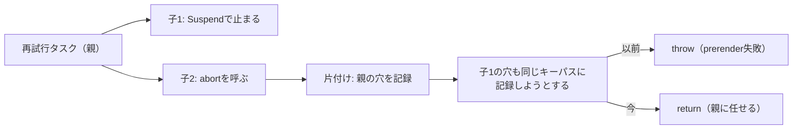

# 2026-10-15（木）

> 今日のひとこと：Next.jsが、認証なしでリモートコード実行（RCE）に至る重大な脆弱性2件（Image OptimizationのSVG、`use cache` の型付き配列）とServer ActionsのDoSを直すセキュリティリリース v16.4.1 / v15.5.28 を出しました。Reactも同日、RSCの転送プロトコルを改善する4系統のリリースを出しています。

## 今日のリリース

- 【Next.js】v16.4.1 / v15.5.28：セキュリティリリース。アドバイザリ3件（Critical 2件、High 1件）を修正（出典: https://github.com/vercel/next.js/releases/tag/v16.4.1 ）
- 【React】v19.3.1 / v19.2.9 / v19.1.10 / v19.0.9：リリースノートは「React Server Components：転送プロトコルを改善」の1行だけ。セキュリティ修正とは明記されていない（出典: https://github.com/facebook/react/releases ）
- 【TypeScript】ts-rust v0.7.0：wasmビルドの落ちる不具合の修正、読み込みとバインドの高速化など。数字（バインド時間 約6〜7%減、エディタ長時間編集のメモリ増加 1000編集あたり約1.8 MiB）はリリースノートの自己申告（出典: https://github.com/pingdotgg/ts-rust/releases/tag/v0.7.0 ）

## トップニュース

### Next.jsが、認証なしRCEを含む3件の脆弱性を一度に直す

【Next.js】【脆弱性】10/14（UTC）に、Next.jsのアドバイザリ3件が公開され、修正版 v16.4.1 と v15.5.28 が出た。うち2件は、認証なしで攻撃でき、CVSS v4で9.5（Critical）。

**何が変わる**

- Image OptimizationのSVG（GHSA-2464-fhr4-w9xw）：上流ライブラリのメモリ関連の欠陥が、リモートコード実行につながりうる。対象は `next` 10.0.0〜15.5.27 と 16.0.0〜16.4.0。glibcベースのLinuxで、Image Optimization APIを使う構成。回避策は、Next.jsが使う `sharp` を 0.35.5 以上にすること
- `use cache` の型付き配列（GHSA-673q-mjm6-r5xr）：App RouterのCache Componentsで、型付き配列を複数返す `use cache` 関数があると、RCEにつながりうる。対象は 16.0.0〜16.4.0。回避策なし
- Server ActionsのDoS（GHSA-p3m5-59mp-jv5r）：細工したリクエストでCPUを使い切り、同じプロセスの他のリクエストが止まる。High、CVSS 8.2。対象は 13.0.0〜15.5.27 と 16.0.0〜16.4.0。Pages Routerのみ、またはServer Actionなしなら影響しない。回避策なし

**なぜ変えた**：脆弱性の修正。アドバイザリは攻撃の細部を書いていない（技術的な原理は不明）。

**何に効く・誰が困る**：セルフホストでも、Vercel以外の環境でも、バージョンを上げるのが唯一の確実な対応。`use cache` のアドバイザリは「該当する関数がなくても直ちに上げる」と書いている。

**ここまでの経緯**

- 2026-09-22：`next/og` のRCE（Critical）のアドバイザリ
- 2026-09-30：Image OptimizationのSSRF（High）、`use cache` のキャッシュ漏えいなど6件
- 2026-10-14：今回の3件。同日、React側もRSCの転送プロトコルを改善した4リリースを出した（下の続報、脆弱性の節）

出典: https://github.com/vercel/next.js/releases/tag/v16.4.1 、https://github.com/vercel/next.js/security/advisories/GHSA-2464-fhr4-w9xw 、https://github.com/vercel/next.js/security/advisories/GHSA-673q-mjm6-r5xr 、https://github.com/vercel/next.js/security/advisories/GHSA-p3m5-59mp-jv5r

## 今日の深掘り

### 中断した `prerender` の「再開の穴」が二重に記録される問題を、親だけ残して直す

**選んだ理由**：昨日の号で扱ったFizzの `prerender` 中断の修正（#37710）の、翌日の続きの修正。「中断した作業をどこから再開するか」の記録が、1つのフィールドの扱いでどう壊れるかが小さな差分で読める。

**背景**：`prerender` は、中断（abort）された部分を「postponed（穴）」として記録し、あとで `resume` で埋める。#37710は、中断した再試行タスクを「試行を始めた位置」から再開できるようにした。ところが、再試行の最中に子のタスク（Suspenseで止まった子）が生まれていると、片付けの処理が「親のタスク全体」の穴と「その子」の穴を同じキーパスに記録しようとした。PR本文によると、親の再開が子もすでに描くため、既存のassertionが再開可能な中断を `prerender` のエラーにしてしまっていた（#37710の後で表に出た問題）。

**変更点**（e25b4a4、`packages/react-server/src/ReactFizzServer.js`の`trackPostpone`）：

```js
} else if (typeof slots === 'number') {
-  throw new Error(
-    'It should not be possible to postpone both at the root of an element ' +
-      'as well as a slot below. This is a bug in React.',
-  );
+  // The parent task was aborted after it spawned this child task.
+  // Resuming the parent also renders this child, so its slot is redundant.
+  return;
}
```

- `slots` が数字のとき、その要素は「根ごと延期」と記録されている。以前は「根と、その下の枠の両方を延期するのはありえない」としてバグ扱いだった
- 今は、親の記録を残し、子の記録は捨てる。親を再開すれば子も描かれるので、情報は失われない
- 追加テストは、片方の子が `React.use` で止まり、もう片方が `controller.abort()` を呼ぶ構成。再開後に `First` と `Second` の両方が描かれることを確かめる



**周辺コード**：`trackPostpone` は、延期の位置を木（`resumableNode`）に書き込む関数。木の各ノードは、根ごと延期なら数字、一部の枠だけなら `{index: number}` のオブジェクトを持つ。上の分岐は「すでに数字なら、その下の枠は要らない」という包含関係を扱っている。

**この変更から分かる設計思想**：再開の記録は「範囲が広いほうが狭いほうを含む」。不変条件をassertで守っていた箇所が、中断のタイミングという新しい経路で破られたとき、assertを緩めて包含関係を明示する方向で直している。なおこの節はPRの説明とdiffに基づく読みで、`resume` 側の処理までは追っていない（不明）。

出典: https://github.com/facebook/react/commit/e25b4a4c4 、https://github.com/facebook/react/pull/37850

## 仕様の変更

### whatwg/html

#### 構造化クローンが「同じagent clusterの中だけ」と宣言できるようになる

【HTML】シリアライズと転送の手順が、結果を「同じagent clusterに制限」できるようになった。`[SameAgentCluster]` を付けたインターフェースは、別のagent clusterで `StructuredDeserialize` するとスローする。`SharedArrayBuffer` が従来から持っていた扱いを、同じ仕組みに統一した。保存用のシリアライズもスローする。
なぜ変えたか：`VideoFrame` や `MediaSourceHandle` は別のagent clusterに出せないが、これまでは `[Exposed=(Window,DedicatedWorker)]` で近似していた。Windowは別のagent clusterのものと通信でき、共有ワーカーが作った専用ワーカーは共有ワーカーのagent clusterに入るため、近似では足りなかった（コミットメッセージより。webcodecs#717 のため）。
出典: https://github.com/whatwg/html/commit/790ce89

### w3c/csswg-drafts

その他：

- `::interest-invoker` の初期ドラフトを追加（HTML側のPRを支えるため。[#12437](https://github.com/w3c/csswg-drafts/issues/12437) への言及あり、コミット 9f78c40）
- css-images-5に2Dグラデーションの解説を追加（47c467e）
- css-overflowのテストの対応表を更新（3コミット）

動きなし：whatwg/dom, whatwg/fetch, whatwg/streams, whatwg/url, tc39/ecma262, w3c/aria, w3c/ServiceWorker, w3c/wcag3（前回以降のコミットなし。cloneの `--shallow-since` が失敗した対象は、コミット履歴ページで確認できなかったため、見落としがありうる）

tc39/proposals：取得できず（WebFetchで読めたページの最新が9/30で、10/14以降の変更は確認できなかった。Stage変更の有無は不明）

## ブラウザの実装

取得できず（chromestatus.com・groups.google.comはegressでブロック）。`runtime_enabled_features.json5` の履歴と blink-dev の検索は、今回は実行しなかった。web-platform-tests/interop も未確認（不明）。

## OSSのPR

### Ladybird（`master`、約76コミット）

#### WebGLがC++からRustへ移る

【Ladybird】WebContent側のWebGL（C++で9.8K行、32のWebIDLインターフェース）を、Rustのバインディングcrateへ移した（9c19683）。スクリプトの要求の検証、読み戻せる状態の追跡、Compositorへ送るコマンドの記録がRust側になる。
同じ系列で、バインディング生成器がRust実装のインターフェースの継承、オーバーロード解決、定数、セッター、型変換、世界（world）ごとのラッパーを扱えるようになった（8421621、2f7a4b6、bb27f06 ほか約10件）。
なぜ変えたか：コミットメッセージは「LibWebの他の部分とは十数個の関数とcanvas、1つの転送路でしか接していない」ことを挙げる。境界が細いので移しやすい、という読みは筆者の推測。
出典: https://github.com/LadybirdBrowser/ladybird/commit/9c19683

#### 履歴走査まわりの不要なヘルパーを整理（昨日の続き）

【Ladybird】昨日の号のナビゲーションの整理の続きで、履歴操作で使われなくなったヘルパー、テストだけが使っていたセッション履歴の補助、使われないセッターを削除し、「ドキュメントからの差分(delta)での走査」に一本化した（a100db5、33872cf、384cfdd、8304ee5、9ec1728）。[10-14の号](2026-10-14.md)の続き。
出典: https://github.com/LadybirdBrowser/ladybird/commit/a100db5

その他：

- アライメント系プロパティの文法を全面的にパースし、`place-*` と `justify-items` のWPTを取り込み（baf204b、371dbb5）
- IPCの実装を別のソースファイルに生成する形へ（a157fff、ecbe869、41ffa62）
- LibGCの割り当て改善：未使用セルをバンプ割り当て、ブロックへの返却をO(1)に（5a6b531、12c3a64、74565cf）
- LibJSのJIT：コンパイルスレッド上でデッドコードの跡を捨てる（ac8ceab）
- スタイル計算の高速化（591c740、6f89c7f、d7bb683）、DOMParserの単純な文書に断片パースの近道（904c877）
- 動画シンクの再開、動画のペイント情報の更新頻度などLibMediaの修正（fd50c34、4c7752f、539d7ee）
- macOSのテキスト編集のネイティブ割り当てに対応（309574e）
- Function の記憶域をゼロ埋めしてから構築（2972e1a）、GCテストのスタックの掃除（8a56210）

### TypeScript（microsoft/TypeScript、約23コミット）

#### 型チェッカーのメモリ配置を「ホット/コールド」に分ける連続PR

【TypeScript】Jake Baileyが、Go版チェッカーのレコードから、めったに使わないフィールドを別の領域（cold storage）へ出すPRを連続で入れた（#64797〜#64804。例：#64800は構造型の任意の形、#64799は任意のシンボル表）。型メタデータの圧縮（#64774）、型リストキャッシュキーの事前確保（#64794）、共通の型のまとめて確保（#64793）、ASTノードアクセサの生成（#64773）も同じ系列。
なぜ変えたか：PR本文は読んでいない。コミット題名からは、頻繁にたどるレコードを小さくして、キャッシュとGCの負荷を減らす狙いが読めるが、狙いの記述としては推測。数字は取得できず。
出典: https://github.com/microsoft/TypeScript/pull/64800

その他：

- `getSimplifiedConditionalType` にキャッシュ（[#64648](https://github.com/microsoft/TypeScript/pull/64648)）
- `compareNodes` の近道で同じ親コンテナを速く比較（[#64551](https://github.com/microsoft/TypeScript/pull/64551)）
- 交差型の簡約で順序つきプロパティ数を再利用（[#64804](https://github.com/microsoft/TypeScript/pull/64804)）、アリーナの保持をオブジェクト数ではなくバイト数で制限（[#64802](https://github.com/microsoft/TypeScript/pull/64802)）
- 同一ファイルの ambient モジュールの import を解決しない（Strada互換、[#64491](https://github.com/microsoft/TypeScript/pull/64491)）、デコレータ付きの無名クラス宣言のクラッシュ修正（[#63971](https://github.com/microsoft/TypeScript/pull/63971)）
- 出力拡張子のcontent mapperを追加（[#64581](https://github.com/microsoft/TypeScript/pull/64581)）、APIでconfigが自身の拡張元に入らないよう修正（[#64755](https://github.com/microsoft/TypeScript/pull/64755)）、JSDocの `@extends` の型引数の再パース修正（[#64072](https://github.com/microsoft/TypeScript/pull/64072)）

### ts-rust

ピンは R220（microsoft/TypeScript `fed0bf24149f`）で v0.7.0 を公開（上のリリース参照）。コミット約47件は、大半が運用記録（`docs(state)` など）と上流追従（`chore(goport)`）。内容のあるものは、`--singleThreaded` のシンボリックリンクキャッシュを初回使用時に作る最適化と、wasm用CIの追加。READMEの互換性・速度の数字は自己申告。

### oxc（約34コミット）

#### 文字列リテラル・プロパティ名が孤立サロゲートを保つ

【oxc】`{ "\uD800": 1 }` のような、孤立サロゲートを含むキーを、ASTが失わずに持つようになった。`PropertyKey::static_name()` などは `StaticPropertyName` を返し、重複キーや重複クラスメンバーを見逃さない。文字列リテラルとテンプレートは `JSStr` に移行（#27095、#26677、#26548。破壊的変更）。
なぜ変えたか：以前は、このようなキーが「動的」とみなされ、重複を検出するルールが見逃していた（PR本文より）。
出典: https://github.com/oxc-project/oxc/pull/27095

その他：

- リンター：unicorn / typescript / eslint のルールを recommended に指定（[#27670](https://github.com/oxc-project/oxc/pull/27670)、[#27634](https://github.com/oxc-project/oxc/pull/27634)、[#27632](https://github.com/oxc-project/oxc/pull/27632)）
- フォーマッター：コメントの近くにないノードのコメント処理を省略（[#27557](https://github.com/oxc-project/oxc/pull/27557)）、アリーナへの文字列書き込みと走査の省略など性能改善（[#27558](https://github.com/oxc-project/oxc/pull/27558)、[#27561](https://github.com/oxc-project/oxc/pull/27561)、[#27673](https://github.com/oxc-project/oxc/pull/27673)）、論理式のインデントとJSXのコメントのみの式のグループ化（[#27667](https://github.com/oxc-project/oxc/pull/27667)、[#27666](https://github.com/oxc-project/oxc/pull/27666)）
- ミニファイア：デッドなforの字句初期化子の保持、呼び出し先への畳み込みで間接アクセスを保持、式文の平坦化、`Number.isInteger` / BigInt緩い等価の畳み込みの修正（[#27676](https://github.com/oxc-project/oxc/pull/27676)、[#27082](https://github.com/oxc-project/oxc/pull/27082)、[#27663](https://github.com/oxc-project/oxc/pull/27663)、[#27622](https://github.com/oxc-project/oxc/pull/27622)、[#27656](https://github.com/oxc-project/oxc/pull/27656)）
- リンター修正：`catch-error-name`、`no-var` の自動修正の衝突回避（[#27702](https://github.com/oxc-project/oxc/pull/27702)、[#27697](https://github.com/oxc-project/oxc/pull/27697)）、`parseFloat` の小数前置の走査（[#27695](https://github.com/oxc-project/oxc/pull/27695)）
- レキサーのARM Neon実装のCIとテスト、リファクタ（[#27706](https://github.com/oxc-project/oxc/pull/27706)、[#27705](https://github.com/oxc-project/oxc/pull/27705)、[#27703](https://github.com/oxc-project/oxc/pull/27703)、[#27686](https://github.com/oxc-project/oxc/pull/27686)、[#27685](https://github.com/oxc-project/oxc/pull/27685)、[#27684](https://github.com/oxc-project/oxc/pull/27684)）
- Node.jsのTypeScriptサポート範囲の表記修正（[#27699](https://github.com/oxc-project/oxc/pull/27699)）

### Next.js（`canary`、約39コミット）

セキュリティリリースは上のトップニュース。canaryでは以下。大半はdocs・CI・テストで、除外の判定に当たるものは載せない。

その他：

- Turbopack：watcherのバッチで親ディレクトリだけを理由にイベントを関連づけない（[#99782](https://github.com/vercel/next.js/pull/99782)）、`<head>` だけでチャンクタグを探す（[#100175](https://github.com/vercel/next.js/pull/100175)、[#100047](https://github.com/vercel/next.js/pull/100047)）、`connect_child` で集約グラフを最適化しない（[#100147](https://github.com/vercel/next.js/pull/100147)）、集約更新キューの制御フロー整理（[#100146](https://github.com/vercel/next.js/pull/100146)）、起動時のCSS更新の取りこぼしでリロード（[#99963](https://github.com/vercel/next.js/pull/99963)）
- `staticInfo.rsc` と未使用の `getParams` キャッシュを削除（[#100172](https://github.com/vercel/next.js/pull/100172)、[#100078](https://github.com/vercel/next.js/pull/100078)）
- アナライザーがルートの要約をルート索引として使う（[#100081](https://github.com/vercel/next.js/pull/100081)）、HTTP fetch失敗をspanのエラーに（[#99877](https://github.com/vercel/next.js/pull/99877)）
- リポジトリのpnpmをv10からv12へ（[#99827](https://github.com/vercel/next.js/pull/99827)）

### React（約7コミット）

#### RSCの転送プロトコルを改善（Flight）

【React】`ReactFlightClient` / `ReactFlightReplyClient` / サーバー側にまたがる変更で、リリースノートの文言は「Improve transport protocol」だけ。PR本文はミラーリポジトリ（非公開）への参照のみで、中身の動機は不明。Next.jsの `lts-active` ブランチにも同じ変更が入った（a4cea6a、v16.4.1に含まれる）。セキュリティ修正かどうかはアドバイザリに明記されておらず、不明。
出典: https://github.com/facebook/react/pull/37846

その他：

- Compilerの refs 検出で、IntersectionObserver のコールバックに対する誤検知を修正（[#37764](https://github.com/facebook/react/pull/37764)）
- 深掘り：Fizzの再生スロットの二重記録（[#37850](https://github.com/facebook/react/pull/37850)）

### Biome（約15コミット）

#### Svelteの `class:` ディレクティブを禁止するlintルール

【Biome】`noSvelteClassDirective` を追加（[#12254](https://github.com/biomejs/biome/pull/12254)）。そのほか、GraphQL文書のソートと診断改善（[#12318](https://github.com/biomejs/biome/pull/12318)、[#12350](https://github.com/biomejs/biome/pull/12350)）。なぜ変えたかはPR本文を読んでおらず不明。
出典: https://github.com/biomejs/biome/pull/12254

その他：

- 埋め込みコンテンツのない場合の探索を省略、終了時のworkspace解放を省略、rowanのスロット読み取りなど性能改善（[#12341](https://github.com/biomejs/biome/pull/12341)、[#12327](https://github.com/biomejs/biome/pull/12327)、[#12331](https://github.com/biomejs/biome/pull/12331)、[#12339](https://github.com/biomejs/biome/pull/12339)）
- CSS/SCSS：keyframes内のat-root、Sassの非ASCII識別子、単要素リストのカンマ保持（[#12352](https://github.com/biomejs/biome/pull/12352)、[#12324](https://github.com/biomejs/biome/pull/12324)、[#12330](https://github.com/biomejs/biome/pull/12330)）
- `useReactCompiler` が型/interface/enumのexportを含むファイルも解析（[#12340](https://github.com/biomejs/biome/pull/12340)）、LSPの空メッセージ、診断の改善、rustlsの更新（[#12346](https://github.com/biomejs/biome/pull/12346)、[#12353](https://github.com/biomejs/biome/pull/12353)、[#12359](https://github.com/biomejs/biome/pull/12359)）

### react-hook-form（6コミット）

その他（すべてバグ修正）：

- `useFormState` に `isReady` を渡す（[#13866](https://github.com/react-hook-form/react-hook-form/pull/13866)）
- onBlurモードで `useFieldArray` の操作後に再検証（[#13867](https://github.com/react-hook-form/react-hook-form/pull/13867)）
- `getDirtyFields` がnull/undefinedの値を扱う（[#13868](https://github.com/react-hook-form/react-hook-form/pull/13868)）
- field arrayを埋める `setValues` で `isDirty` を更新（[#13870](https://github.com/react-hook-form/react-hook-form/pull/13870)）
- `delayError` の遅延エラーをblur時に出す（[#13861](https://github.com/react-hook-form/react-hook-form/pull/13861)）
- `useWatch` が名前の変更時に新しい `defaultValue` を使う（[#13859](https://github.com/react-hook-form/react-hook-form/pull/13859)）

### Servo / Stylo（15 / 1コミット）

その他：

- `<source>` が取り除かれたときに `` の寸法を更新（[#48902](https://github.com/servo/servo/pull/48902)）
- 祖先の不透明度をpaintableに累積（[#48898](https://github.com/servo/servo/pull/48898)）
- `CryptoKey` / `SubtleCrypto` を `script_webcrypto` へ移動（[#48826](https://github.com/servo/servo/pull/48826)）
- fetchとImageCacheのクローン削減、`script_bindings` の遅延DOMString、`JS_DefineProperty` の安全なラッパー、`safe_borrow_mut` への移行、rustls更新など（[#48899](https://github.com/servo/servo/pull/48899)、[#48840](https://github.com/servo/servo/pull/48840)、[#48881](https://github.com/servo/servo/pull/48881)、[#48868](https://github.com/servo/servo/pull/48868)、[#48912](https://github.com/servo/servo/pull/48912)、[#48910](https://github.com/servo/servo/pull/48910)）
- OHOSのフォント一覧ソート、テストの`reset`修正（[#48900](https://github.com/servo/servo/pull/48900)、[#48895](https://github.com/servo/servo/pull/48895)）
- Stylo：`layout.unimplemented` で内部プロパティをコンテンツに見せない（[#491](https://github.com/servo/stylo/pull/491)）

### GHC（6コミット）

その他（マージリクエストの議論は読めず、コミットメッセージのみが根拠）：

- QuickLookの順序依存を直す（5f7b304755）、`simpleUnifyCheck` と `check_ty_eq_rhs` を揃える（97adaf89b0）、`RuntimeUnk` のコメント追加（c391c70c7d）
- `runGhcWithSignalHandlers` を追加し、`runGhc[T]` からシグナル処理を外す（7df3ba2fc2）
- `ExternalUnitDatabases` のunit databaseパスを正規化（#27836、3a72b8a28a）、古いHPC型を削除（8ddbc6f9b3）

### wado（約74コミット）

#### コンパイラが points-to 解析で「閉じ込められた引数」のコピー要否を決める

【Wado】コンパイラに points-to 解析が入り、confinedな引数をコピーするかどうかを、解析結果で決めるようになった（52d9d404cb）。続けて、書き込み先の記憶域を points-to で解決し（38d3af14ff）、大きなプログラムでも解析がほぼ線形で済むようにした（ee7b2e1c33）。呼び出し結果のフィールドへの代入でクラッシュする不具合も直した（afe8f5b299）。
なぜ変えたか：コミット題名からは、不要なコピーを減らす最適化と読めるが、WEPや動機の記述は読んでおらず不明。`docs/wep-*.md` の変更は今回のコミットでは確認していない。
出典: https://github.com/wado-lang/wado/commit/52d9d404cb

残りのコミットは件数のみ（約64件）。

### Vite（3コミット）

その他：

- upgradeリクエストをHMRサーバーが取らない場合のソケットエラーを処理（[#23728](https://github.com/vitejs/vite/pull/23728)）
- `resolve.exports` を 2.0.4 へ更新（[#23739](https://github.com/vitejs/vite/pull/23739)）
- optimizerが `oxc.jsxInject` のimportを走査（[#23758](https://github.com/vitejs/vite/pull/23758)）

### Svelte

その他：エラー `hydratable_serialization_failed` の `devalue` リンクを修正（[#18999](https://github.com/sveltejs/svelte/pull/18999)）

### Bun（`bun check`）

取得できず（`bun check` に絞ったコミット一覧が、WebFetchで読めた範囲に出てこなかった）。件数・内容は不明。

動きなし：vuejs/core の `minor` ブランチ、solidjs/solid（`main`・`next`。cloneが失敗しており、未確認の可能性がある）

## 議論ウォッチ

取得できず（WICG、standards-positions、tc39/notes、各RFC・Discussionsは、今回の実行では確認していない）。動きの有無は不明。

## 続報

- [10-14の号](2026-10-14.md)で扱ったFizzの `prerender` 中断の修正（#37710）は、翌日に再開の穴の二重記録を直す#37850が続いた（深掘り参照）。「実装」の段階の追加修正
- [10-14の号](2026-10-14.md)で扱ったLadybirdのナビゲーション状態の整理は、履歴走査の不要コードの削除に進んだ（OSSのPR参照）
- [10-14の号](2026-10-14.md)のts-rust v0.6.0は、1日おいて v0.7.0（R220）が出た

## 脆弱性

### Next.js：Critical 2件、High 1件（修正版 v16.4.1 / v15.5.28）

| GHSA | 内容 | 深刻度 | 対象 |
|---|---|---|---|
| GHSA-2464-fhr4-w9xw（CVE-2026-96889） | Image Optimization APIのSVGでRCE | Critical 9.5 | 10.0.0〜15.5.27、16.0.0〜16.4.0 |
| GHSA-673q-mjm6-r5xr | 型付き配列を返す `use cache` でRCE | Critical 9.5 | 16.0.0〜16.4.0 |
| GHSA-p3m5-59mp-jv5r | Server ActionsでDoS | High 8.2 | 13.0.0〜15.5.27、16.0.0〜16.4.0 |

**攻撃原理**：SVGの件は、アドバイザリによると上流ライブラリのメモリ関連の欠陥（回避策の記述から `sharp` が該当すると読めるが、アドバイザリは名指ししていない）。`use cache` の件は、複数の型付き配列を返す関数がある構成が条件。DoSの件は、細工したリクエストでCPUを使い切る。いずれも技術的な詳細は書かれておらず、不明。

**成立条件**：SVGの件はglibcのLinuxでImage Optimization APIを使うとき。`use cache` の件はApp RouterのCache Components。DoSの件はApp Routerと1つ以上のServer Action（Pages Routerのみなら影響なし）。

**修正コミットのdiff解説**：アドバイザリに修正コミットのリンクはない。公開されているのは、`lts-active` ブランチの `sharp` の `^0.35.4` から `^0.35.5` への更新（9571ec8、`packages/next/package.json` とロックファイル。SVGの件に対応する修正と読めるが、アドバイザリがこのコミットを名指ししているわけではなく、推測）と、RSCの転送プロトコル改善のバックポート（a4cea6a）。`use cache` とServer Actionsの件の修正コミットは不明（修正コミット未公開）。React側のFlightの変更が関係するかも不明。

**同種の脆弱性パターン**：ネイティブ依存（画像処理ライブラリ）経由のメモリ破壊、サーバー側のシリアライズ／デシリアライズ（RSCの転送路）の扱い、の2つ。9/22の `next/og` のRCE と同じく、画像生成・加工系の経路が繰り返し狙われている（筆者の整理）。

他の対象（react, vite, svelte, vue, oxc, astro, nuxt, TanStack Start）のアドバイザリ一覧は、今回確認していない（不明）。

出典: https://github.com/vercel/next.js/security/advisories

## 仕様を読む会の候補

1. HTML Standard「Structured data」の節（`StructuredSerializeInternal` と、今日入った「同じagent clusterに制限」の仕組み）：`SharedArrayBuffer` の例外扱いが、一般の仕組みに整理された。`postMessage()` が `messageerror` を出す条件まで一続きで読める
2. React Fizz の postpone / resume（`trackPostpone`、`resumableNode` の木）：2日続けて中断まわりの修正が入っており、再開の記録の不変条件を読むのに向く
