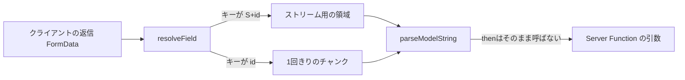

# 2026-10-16（金）

> 今日のひとこと：昨日「中身は不明」と書いたReactのRSC転送プロトコル改善（#37846）が、認証なしRCE（Critical、CVSS v4 9.5）とDoSを直すセキュリティ修正だったとアドバイザリで確定しました。Fizzの `prerender` 中断の修正（#37710）は、完全でないとして取り消されています。

## 今日のリリース

- 【Next.js】v16.4.2：`lts-active` のバックポート8件。Turbopackのスナップショット整合性やGC、チャンクリスト衝突の修正、`next-code-frame` の修正、ドキュメント修正。リリースページにセキュリティの記載はない（出典: https://github.com/vercel/next.js/releases/tag/v16.4.2 ）

## トップニュース

### Reactの「転送プロトコル改善」はRCEの修正だった

【React】【脆弱性】10/14に公開されたReactのアドバイザリ2件が、同日のリリース（v19.3.1 / v19.2.9 / v19.1.10 / v19.0.9）の中身を説明した。リリースノートが「Flightの転送プロトコルを改善」とだけ書いていた変更は、認証なしのリモートコード実行（RCE）とDoSの修正だった。

**何が変わる**

- GHSA-xqc2-xf4c-x3h3：RSCでの認証なしRCE。Critical、CVSS v4 9.5。アドバイザリによると、複数の型付き配列と攻撃者が制御する値を一緒に転送する応答が引き金になる（本人たちは「きわめて稀」と書く）
- GHSA-h3gv-c5rc-p453：Server FunctionsのDoS。High、CVSS v4 8.2。細工したリクエストでメモリ不足やCPU枯渇を起こす
- 対象は `react-server-dom-webpack` / `-turbopack` / `-parcel` の 19.0.0〜19.0.8、19.1.0〜19.1.9、19.2.0〜19.2.8、19.3.0。修正版は 19.0.9 / 19.1.10 / 19.2.9 / 19.3.1。回避策はなし

**なぜ変えた**：脆弱性の修正。ただし、アドバイザリは修正コミットを名指ししておらず、攻撃の細部も書いていない。#37846 が修正の本体かどうかは、同じリリースに入った変更という状況証拠による推測（コミットの中身は下の深掘り）。

**何に効く・誰が困る**：Next.jsなどRSC対応のフレームワークを使うアプリ。サーバーを持たない、またはRSC対応のフレームワーク・バンドラを使わないアプリは影響しないとアドバイザリは書いている。Next.jsは同じ変更を `lts-active` に取り込み、v16.4.1 に含めた（[10-15の号](2026-10-15.md)）。

**ここまでの経緯**

- 2026-10-14：#37846 とバックポート（#37845）がマージされ、4系統のリリースが出る。リリースノートは1行
- 2026-10-14：Next.jsが別の3件のアドバイザリ（RCE 2件、DoS）を公開（[10-15の号](2026-10-15.md)）
- 2026-10-15の号：「セキュリティ修正かは不明」と書いた。今日、Reactのアドバイザリ一覧を確認して判明（アドバイザリの公開日は10-14）

出典: https://github.com/facebook/react/security/advisories/GHSA-xqc2-xf4c-x3h3 、https://github.com/facebook/react/security/advisories/GHSA-h3gv-c5rc-p453 、https://github.com/facebook/react/pull/37846

## 今日の深掘り

### React Flight の返信（Reply）サーバー側が「外から来た値を信用しない」形に変わった

**選んだ理由**：上のトップニュースの変更そのもの。リリースノートは1行だが、差分は1,497行ある。RSCの「クライアントからサーバーへの返信」の経路が、何を前提にしていたかが読める。

**背景**：Flightは、サーバーからクライアントへ渡すだけでなく、Server Functionの引数などをクライアントからサーバーへ送り返す（Reply）。Replyは `FormData` の形で届き、サーバー側は `ReactFlightReplyServer.js` で、キーに応じてチャンク（部分データ）に組み立て直す。ここで受け取るのは、攻撃者が自由に作れる入力。PR本文はミラーの非公開リポジトリへの参照だけで、動機は書かれていない（不明）。以下は差分から読める範囲。

**変更点1：ストリームのチャンクを別の名前空間に置く**（`packages/react-server/src/ReactFlightReplyServer.js`、0c9913ae8）

```js
// Stream chunks are written under a dedicated namespace so they can be
// told apart from one-shot chunks at append time.
const key = prefix + 'S' + id;
```

- 以前は、ストリームのチャンクも1回きりのチャンクも `prefix + id` という同じ形のキーで、`getAllBackingEntries` で「そのキーの全エントリ」を取っていた
- 今は `S` を挟んだ別のキーに分け、`resolveField` が書き込みの時点で両者を見分ける。`FormData` の参照も、専用のイテレータを手で進める読み取りをやめ、`consumeBackingEntries(formData, formPrefix)` に寄せた
- 狙いはコミットのコメントどおり「追加の時点で区別する」こと。読み取り側が文字列の中身で推測する形より、書き込み側で型を決める形に変えた、と読める

**変更点2：外から来た `then` を呼ばない**（`ReactFlightClient.js`、同コミット）

```js
if (key === 'then' && typeof model === 'function') {
  // This should never happen because we always serialize objects with then-functions
  // as "thenable" which reduces to a chunk with no other fields.
  return null;
}
```

- `loadServerReference` でも、束ねた引数（`bound`）を `await` するのは、自前のチャンク（`ReactPromise`）のときだけにした。コメントは「それ以外は `then` を呼んではいけない外部のthenableかもしれない」
- JavaScriptでは `then` を持つオブジェクトを `await` すると、その `then` が呼ばれる。デシリアライズした値が勝手にコードを呼ぶ入口になりうるので、自前のものだけ待つ

**変更点3：チャンクが握る `Response` を包む**

```js
const RESPONSE_SYMBOL = Symbol();
// reason: Response  →  reason: {[RESPONSE_SYMBOL]: Response}
```

- 解決待ちチャンクの `reason` に `Response` を直接入れていたのを、シンボルをキーにしたオブジェクトで包んだ。入力から作られたオブジェクトが `reason` の位置に紛れても、`Response` と取り違えない狙いと読めるが、PRに説明はなく推測



**この変更から分かる設計思想**：Reactは「サーバーが受け取る値は敵のもの」という前提を、プロトコルの形（名前空間、型の区別）で担保する方向に動いた。ただし、型付き配列と攻撃者の値の組み合わせという、アドバイザリが挙げる引き金に、この差分のどこが対応するかは、コードからは特定できなかった（不明）。

出典: https://github.com/facebook/react/commit/0c9913ae87283f96e868a8f1c20a3389827632d0

### LibJSの「fuse」をwatchpoint setに統合：JITが依存する前提を一つの仕組みにする

**選んだ理由**：JavaScriptエンジンが「配列のイテレーションは組み込みのままだ」という前提を、どう安く確かめ、壊れたらどう戻すかが、コミットメッセージだけで読める。

**背景**：`for (x of array)` は仕様上、`array[Symbol.iterator]` を引き、イテレータの `next` を呼ぶ。だが、誰も `Array.prototype[Symbol.iterator]` を書き換えていなければ、エンジンはその手順を飛ばして直接ループできる。問題は「誰も書き換えていない」をどう保証するか。

**変更点**（f9caf37、db84b07）：

- 以前のLibJSには、保証の仕組みが2つあった。`next` / `return` を見張る「fuse」と、watchpoint set。fuse側は、すべてのオブジェクトのすべてのプロパティ変更で、キーが `next` / `return` かを比べていた（`Object.assign` には専用のフックもあった）
- 今は、watchpoint setが他のsetを「見張り役」に持てるようにして、fuseを2つのsetに置き換えた。片方は `%ArrayIteratorPrototype%` の `next` スロット、もう片方はそのプロトタイプチェーンの有効性に依存する
- チェーンの有効性は無関係な変更でも無効になるので、発火したsetは次に問い合わせられたとき「本当に前提が崩れたか」を調べ、崩れていなければ見張りをやり直す
- 同じ日の db84b07 は、`%Array.prototype%[@@iterator]` が `%Array.prototype.values%` のままである間だけ有効なsetを足した。コンパイル済みコードの短い配列の `for-of` が、最大35%速くなったとメッセージにある（コミットの自己申告）

**この変更から分かる設計思想**：最適化の前提を「監視する対象（set）」として一本化し、壊れたら無効化してJITコードを捨てる。「速い経路を、安い無効化とセットで持つ」というJITの定石を、仕組みの数を減らす方向で整理している。

出典: https://github.com/LadybirdBrowser/ladybird/commit/f9caf37a8cfc6a2f1c0eeea1d71ffac9f678c1b3 、https://github.com/LadybirdBrowser/ladybird/commit/db84b07925cd50812f9002018956c1ed83be2038

## 仕様の変更

### whatwg/dom

#### 「fire an event」の所要時間を、long animation frameの計測に含める

【DOM】`fire an event` のアルゴリズムが、Long Animation Frames（LoAF）の計測のためにtask風のタイミングを記録するようになった。イベント発火中に描画が予約され、それがlong animation frameになったとき、タスクの区切りに関係なくイベント発火全体の時間をそのperformance entryに数える。
なぜ変えたか：「implicit document」という、非推奨で実装間の互換もない用語に頼らずに、フレームのタイミング監視をまとめるため。
出典: https://github.com/whatwg/dom/commit/94f3fee

### w3c/csswg-drafts

#### `@layer` はmixinの本体で無効になる

【CSS】`css-mixins-1` で、mixin本体の中の `@layer` は無効とし、適用時に中身は捨てられる。
なぜ変えたか：将来のレベルで mixin 内の `@layer` を許す余地を残すため（仕様の注記）。Issue #12417。
出典: https://github.com/w3c/csswg-drafts/commit/16377320

その他：

- `css-pseudo-4` / `css-ui-4` / `selectors-5` で `interest`（`interest-invoker` 系）の定義をCSS側に取り込む調整（[#12347](https://github.com/w3c/csswg-drafts/commit/247bc6b2)）
- `corner-shape` と `border-radius` の順序を、#11623 の決定に合わせて修正（[#14607](https://github.com/w3c/csswg-drafts/commit/9defc4a4)）
- `css-overflow`：視覚的な抑制がベースラインに与える影響を明確化（[#14609](https://github.com/w3c/csswg-drafts/commit/26180f5e)）
- `animation-triggers-1` の定義の名前空間を修正（[90e797a4](https://github.com/w3c/csswg-drafts/commit/90e797a4)）

動きなし：whatwg/html, whatwg/fetch, whatwg/streams, whatwg/url, tc39/proposals, w3c/ServiceWorker, w3c/wcag3（`w3c/aria` と `tc39/ecma262` は editorial のみ）

## OSSのPR

### React

#### 中断した `prerender` の再開位置の修正を、完全でないとして取り消す

【React】[10-14の号](2026-10-14.md)で扱った#37710と、[10-15の号](2026-10-15.md)で扱った#37850を、gnoffがまとめてrevertした（#37852、99c106c43）。
- 中断した作業の根を再開点として記録すると、子タスクの延期と重なりうる。#37850は重なりの1形態しか抑えず、「親の添字つきスロットが子孫の再開ノードと同居する」ケースは再開時に失敗する
- 意図的に#37709の症状（シェルの一部を描いた後に中断すると、再開後にその部分が欠ける）を戻している。後続の#37853（シェルを保持する修正）が必要とPRにある
なぜ変えたか：不完全な修正を残すより、再開の記録の不変条件をまとめて見直すため。
出典: https://github.com/facebook/react/pull/37852

その他：

- Flightの転送プロトコル改善（#37846）は、トップニュースと深掘り参照
- リリース手順で、成果物の検証前に `gh` の有無の確認を待つよう修正（[#37855](https://github.com/facebook/react/pull/37855)）

### Next.js

#### Cached Navigationsで、完全にキャッシュされた応答からもシェルを取り出す

【Next.js】Andrew Clarkによる積み重ねのPR。#99619は、完全にキャッシュされたナビゲーション応答が、シェルを取り出して書き込まれずにキャッシュへ入っていた見落としを直す。同じ系列で、ナビゲーションの取得とデコードの層の整理（#99618）、静的ステージを取り出さない変更（#99617）、Partial Prefetchingの小さな最適化（#99695）、動的データを含む応答ではvary paramsを報告しない変更（#99700）、`FetchStrategy` にかかわらず非partialのエントリを優先する変更（#99705）が入った。
なぜ変えたか：#99619についてはPR本文が見落としの修正と述べるだけで、シェルの役割の説明はなく、動機の詳細は不明。
出典: https://github.com/vercel/next.js/pull/99619

その他：

- Turbopack：API routeの設定が親レイアウトから継承されないよう修正（[#100243](https://github.com/vercel/next.js/pull/100243)）
- Turbopack：`turbo-tasks-backend` の集約更新をロックの外で最適化（[#100165](https://github.com/vercel/next.js/pull/100165)）
- Turbopack：PPRの再開にもCSP nonceつきでshared-runtimeのブートストラップを出力（[#100102](https://github.com/vercel/next.js/pull/100102)）
- Turbopack：落とされたentrypointのcollectiblesを内側のoperationに隔離（[#100187](https://github.com/vercel/next.js/pull/100187)）
- Turbopack：`serde_json::RawValue` の変換を減らす（[#97713](https://github.com/vercel/next.js/pull/97713)）
- Turbopack：同一spanへの再入でバイナリtraceのself-timeがずれる不具合を修正（[#100205](https://github.com/vercel/next.js/pull/100205)）
- ミドルウェアを通るリクエストを1つのOpenTelemetry traceにまとめる変更を入れ、`lts-active` ではrevert（[#100136](https://github.com/vercel/next.js/pull/100136)、[#100269](https://github.com/vercel/next.js/pull/100269)）
- 拡張子なしのGoogle FontsのURLを両バンドラで修正（[#100158](https://github.com/vercel/next.js/pull/100158)）
- webpackのdevマニフェストを原子的に書く（[#100112](https://github.com/vercel/next.js/pull/100112)）
- エラーオーバーレイのエディタ操作を見つけやすくし、狭い画面ではラベルを隠す（[#100206](https://github.com/vercel/next.js/pull/100206)、[#100266](https://github.com/vercel/next.js/pull/100266)）
- app pageのリクエストURLをrender contextに引き上げ（[#99269](https://github.com/vercel/next.js/pull/99269)）
- `package.json#workspaces` の削除、Turbopackテストのskip解除など、ツール・テスト・ドキュメントの整理が約12件

### Solid（`next` ブランチ）

#### `createDeferred`：遅れてもよいが、先走らない非同期メモ

【Solid】Solid 2.0の保留（hold）モデルでは、非同期メモは再取得のたびに、それを読む側を保留する。`createDeferred(fn)` は、最初の読み込みでは普通の非同期メモとして`<Loading>`に落とすが、2回目以降の再取得では最後に確定した値を返したまま、`isPending` で更新中を示す。保留された入力を読んだ再取得は、その保留と同時に着地する。サーバーでは `createMemo` と同じ。
なぜ変えたか：ダッシュボードのパネルのように独立した部分が、最後の答えを見せたまま更新中の印を出し、画面の他の部分を止めないため。既存のエンジンの部品（loading window、`CONFIG_REDERIVE`）を再利用し、「遅れる」を規則F-1/F-2の宣言された例外として扱う。import時に約1.6 KB minified増える（PR本文の数字）。
出典: https://github.com/solidjs/solid/pull/4067

その他：

- 保持されたエラーはそのフレームを待つ（D-41、[#4085](https://github.com/solidjs/solid/pull/4085)）
- 種なしの派生ストア（[#4073](https://github.com/solidjs/solid/pull/4073)）
- `until` / `refresh` がレーンエンジンを保持しない（[#4076](https://github.com/solidjs/solid/pull/4076)）
- `createRoot` のdispose関数が `init` を保持しない（[#4097](https://github.com/solidjs/solid/pull/4097)）
- helloworldのサイズを10 KB以内に戻す（[#4104](https://github.com/solidjs/solid/pull/4104)）
- 非同期ストアの `NotReadyError` を捕まえた読み手が着地時に再実行（[#4079](https://github.com/solidjs/solid/pull/4079)）
- ストリームされたフラグメントの遅延アセットを、再開前に読み込む（[#4093](https://github.com/solidjs/solid/pull/4093)）
- サーバー関数の引数は `Response`/`Request` を復号せず、既定で `nosniff`（[#3809](https://github.com/solidjs/solid/pull/3809)）
- 他に、`GRAPH_GROWTH` の診断、babel-pluginのSSR、型、サンプル、docsの修正（約8件）

### Vite

- 開発環境をTypeScript 7に更新。理由はOxlintがTypeScript 7を使うため（[#23778](https://github.com/vitejs/vite/pull/23778)、[#23746](https://github.com/vitejs/vite/pull/23746) でOxlintへ移行）
- 欠けたチャンクのimport mapを処理（[#23777](https://github.com/vitejs/vite/pull/23777)）
- CSSの `url()` の中の `%` で失敗しない（[#23676](https://github.com/vitejs/vite/pull/23676)）
- `bundled-dev`：転送されたエラーのスタックをバンドルのソースマップで対応づける（[#23741](https://github.com/vitejs/vite/pull/23741)）
- 他に、optimizerのロックファイル、依存の置き換え、docs、テストの整理が5件

### oxc

#### linterの推奨ルールが広がる

【oxc】`import`、`jest`/`vitest`、`jsdoc`、`jsx-a11y`、`nextjs`、`node` の各プラグインのルールが、recommendedに入った（Cam McHenry、[#27671](https://github.com/oxc-project/oxc/pull/27671)、[#27672](https://github.com/oxc-project/oxc/pull/27672)、[#27689](https://github.com/oxc-project/oxc/pull/27689)、[#27690](https://github.com/oxc-project/oxc/pull/27690)、[#27691](https://github.com/oxc-project/oxc/pull/27691)、[#27692](https://github.com/oxc-project/oxc/pull/27692)）。既定の挙動が変わりうるが、PR本文を読んでおらず、なぜ今かは不明。
出典: https://github.com/oxc-project/oxc/pull/27692

その他：

- フォーマッタ：`Buffer` トレイトを削除し、具象 `Formatter` で要素スタックに書く（[#27716](https://github.com/oxc-project/oxc/pull/27716)、[#27559](https://github.com/oxc-project/oxc/pull/27559)）
- minifier：`void` 式のde Morgan最適化（[#27375](https://github.com/oxc-project/oxc/pull/27375)）、import/exportの最小化を別ファイルへ（[#27655](https://github.com/oxc-project/oxc/pull/27655)）
- linterの誤検知・見逃しの修正が約15件（`no-unused-vars`、`no-param-reassign`、`prefer-regexp-test`、`id-length` ほか。例：[#27755](https://github.com/oxc-project/oxc/pull/27755)）
- coverageのV8 test262リストをNodeのV8版に固定（[#27674](https://github.com/oxc-project/oxc/pull/27674)）

### TypeScript

- ATAを、ユーザーキャッシュがないとき無効化（[#64836](https://github.com/microsoft/TypeScript/pull/64836)）
- ネットワークパスをまとめて禁止（[#64832](https://github.com/microsoft/TypeScript/pull/64832)）
- 実行済みジェネレータにWeakSetを使わない（[#64830](https://github.com/microsoft/TypeScript/pull/64830)）
- `[api]` 名前付きパイプ・UDSの作成を修正（[#64818](https://github.com/microsoft/TypeScript/pull/64818)）、リリースパイプラインの修正（[#64831](https://github.com/microsoft/TypeScript/pull/64831)）

### Bun（`bun check` のみ）

- Windowsで、ディレクトリ列挙時にリンクごとのシステムコールをやめる（[#45147](https://github.com/oven-sh/bun/pull/45147)）
- Windowsで `package.json` がないとき `bun check` / `lint` / `fmt` がdebug panicしない（[#45150](https://github.com/oven-sh/bun/pull/45150)）

### Biome

- SCSS：補間つきのat-ruleプレリュード名に対応（[#12357](https://github.com/biomejs/biome/pull/12357)）
- JSフォーマッタ：returnとthrowの連接式を括弧で包む（[#12379](https://github.com/biomejs/biome/pull/12379)）
- 診断メッセージの改善（[#12354](https://github.com/biomejs/biome/pull/12354)、[#12355](https://github.com/biomejs/biome/pull/12355)）、ルールのメタデータ更新・YAMLフォーマッタのテスト更新

### react-hook-form

- `Form`：JSONのContent-Typeを大文字小文字を区別せず判定（[#13874](https://github.com/react-hook-form/react-hook-form/pull/13874)）
- `deepEqual`：キーを `in` ではなく自身のプロパティとして比較（[#13855](https://github.com/react-hook-form/react-hook-form/pull/13855)）
- `register`：フォーム準備前に選ばれた `select` の選択肢を保持（[#13872](https://github.com/react-hook-form/react-hook-form/pull/13872)）
- 型の不要なアサーションを削除（[#13871](https://github.com/react-hook-form/react-hook-form/pull/13871)）

### Svelte

- 非同期まわりのテストを `main` から持ち込む作業のみ（[#19014](https://github.com/sveltejs/svelte/pull/19014) ほか5件）。利用者に見える変更なし

### Vue（`minor` ブランチ）

- Vaporの `runtime-vapor`：スロットの退場（leave）の管理を整理し、`out-in` で中身が空になったスロットのfallbackを即座に解決、構造的ラッパーの下のスロットのrootを見つける修正（edison、8件。例：[2ecd6acd](https://github.com/vuejs/core/commit/2ecd6acd)、[f229bbd7](https://github.com/vuejs/core/commit/f229bbd7)）

### Ladybird

#### `beforeunload` のダイアログが、ブラウザプロセスの同期的な判断を通る

【Ladybird】`beforeunload` で離脱確認を出すための配線が入った（3543dc9ほか）。有効化された可視の現在のドキュメントが離脱のキャンセルを要求し、モーダルが許されるとき、ブラウザプロセスに同期的な判断（Stay / Leave）を求める。未対応のフロントエンドでは既定でLeave。ナビゲーションのタイムアウトはダイアログが開いている間は進まない。UI/Qtにダイアログの表示、ウィンドウを閉じる前の確認、WebDriverでの自動承認が付いた。
なぜ変えたか：メッセージに明記なし。Stay/Leave/activation/opaque originの統合テストが付いている。
出典: https://github.com/LadybirdBrowser/ladybird/commit/3543dc926d6739ddc822ada9d93e26ca14556083

その他（約125件中、主なもの）：

- LibJS：イテレータのfuseをwatchpoint setに統合（深掘り参照）、配列の反復を、イテレータを介さず行う（[f5aaac9](https://github.com/LadybirdBrowser/ladybird/commit/f5aaac9)）、`Set`/`Map` コンストラクタが値を直接追加（[1134e5e](https://github.com/LadybirdBrowser/ladybird/commit/1134e5e)）、ジェネレータを `%GeneratorPrototype%.next` を呼ばずに進める（[75e9536](https://github.com/LadybirdBrowser/ladybird/commit/75e9536)）
- Compositor：`ContextState` から、スクロールのfling、弾性オーバースクロール、キャレット点滅、ホイールなどの状態を切り出すリファクタを約13件
- LibWeb：fully activeでないドキュメントのイベントリスナーとコールバックを実行しない（[5833cbb](https://github.com/LadybirdBrowser/ladybird/commit/5833cbb)、[5524f5a](https://github.com/LadybirdBrowser/ladybird/commit/5524f5a)）、保留中のCSS transitionをstyle changeイベント時刻に開始（[2b719df](https://github.com/LadybirdBrowser/ladybird/commit/2b719df)）、transformのkeyframeをcompositor向けのプリミティブに下ろす（[36c668c](https://github.com/LadybirdBrowser/ladybird/commit/36c668c)）
- LibWebのCSSのスタイル値のシリアライズやパースの整理が約10件、依存の更新

### Servo

- Servo と Stylo：`text-decoration-line: spelling-error / grammar-error` に対応（[servo#48883](https://github.com/servo/servo/pull/48883)、[stylo#488](https://github.com/servo/stylo/pull/488)）
- 埋め込み側がオンライン/オフラインの変化を報告できる（[#47568](https://github.com/servo/servo/pull/47568)）
- WebGL 2 の `UNPACK_*` ピクセルストアに対応（[#48911](https://github.com/servo/servo/pull/48911)）
- DOM要素のサイズを削減（[#48082](https://github.com/servo/servo/pull/48082)）
- HTTPキャッシュ：再検証時に一致するキャッシュを全て置き換え（[#48927](https://github.com/servo/servo/pull/48927)）
- `PerformanceResourceTiming` のdurationを動的に計算（[#48936](https://github.com/servo/servo/pull/48936)）
- stylo：`layout.unimplemented` を個別の設定に分け、Geckoの命名に合わせる（[stylo#492](https://github.com/servo/stylo/pull/492)、取り込みは [#48915](https://github.com/servo/servo/pull/48915)）
- `borrow_mut` を `safe_borrow_mut` に置き換える作業が数件、他にレイアウト・フォント・scriptの小さな修正

### Wado

- 「borrow」を「reference」に呼び方を統一する広範な書き換え（コンパイラ、stdlib、WEP、テスト）。WEP `wep-2026-10-13-referenced-places` ほかの用語が変わる
- 無名のshapeを作る置換・由来を記録する修正（`wep-2026-01-10-tagged-template-literals` も更新）、コールド関数のインライン化に関する性能改善PR（#2359）
- コミットは約115件。それ以外は件数のみ

出典: https://github.com/wado-lang/wado

動きなし：vuejs/core の `main`、solidjs/solid の `main`、ts-rust（新規コミットを確認できず。v0.7.0 は昨日の号）

## ブラウザの実装

取得できず（chromestatus.com・groups.google.comはegressでブロック）。Chromiumの `runtime_enabled_features.json5` のコミット履歴とWebSearchでの確認は、今回の実行では行っていない（不明）。

## 続報

- [10-15の号](2026-10-15.md)で「セキュリティ修正かは不明」と書いたReactのFlight転送プロトコル改善（#37846）は、RCEとDoSを直すアドバイザリが公開済みと確認できた（トップニュース参照）
- [10-14の号](2026-10-14.md)の#37710と[10-15の号](2026-10-15.md)の#37850は、翌日に取り消された（OSSのPR、React参照）。「実装」から「見直し」に戻った
- [10-15の号](2026-10-15.md)のNext.js v16.4.1の続きとして、v16.4.2（バックポートのみ）が出た

## 脆弱性

### React：Critical 1件、High 1件（修正版 19.3.1 / 19.2.9 / 19.1.10 / 19.0.9）

| GHSA | 内容 | 深刻度 | 対象 |
|---|---|---|---|
| GHSA-xqc2-xf4c-x3h3 | RSCで認証なしRCE | Critical 9.5（CVSS v4） | `react-server-dom-webpack/-turbopack/-parcel` 19.0.0〜19.0.8、19.1.0〜19.1.9、19.2.0〜19.2.8、19.3.0 |
| GHSA-h3gv-c5rc-p453 | Server FunctionsでDoS | High 8.2（CVSS v4） | 同上（影響範囲の記述は19.x.7までと、一覧が一致しない） |

**攻撃原理**：RCEは、複数の型付き配列と攻撃者が制御する値を転送する応答が条件。DoSは細工したリクエストでメモリ不足やCPU枯渇。どちらも、それ以上の技術的な詳細は書かれておらず、不明。
**成立条件**：サーバーがあり、RSC対応のフレームワーク・バンドラを使うこと。ネットワークから、認証なしで届く。回避策なし。
**修正コミットのdiff解説**：アドバイザリは修正コミットを名指ししていない。同じリリースの #37846（0c9913ae8）が候補で、ストリームのチャンクの名前空間分離、外部thenableの `then` を呼ばない変更などが入っている（深掘り参照）。型付き配列の経路との対応は確認できず、推測にとどまる。
**同種の脆弱性パターン**：Flightのデシリアライズ（RSCの転送路）。Reactのアドバイザリ一覧には4月・5月・7月にもRSC・Server FunctionsのDoSが並んでおり、同じ経路が繰り返し狙われている（一覧の題名のみの確認）。

### TanStack Start：Critical 1件（GHSA-qx66-fv34-fjm8、CVE-2026-102989、公開 2026-09-30）

過去の号には載せていなかったため、今回まとめる。
- 影響：`@tanstack/react-start`、`solid-start`、`vue-start`、`@tanstack/start-server-core`（1.143.12 から修正版の前まで。修正版は react-start 1.168.60、solid-start 1.168.57、vue-start 1.168.56、start-server-core 1.169.39）。CVSS 3.1で9.3
- 攻撃原理：server-functionの転送が、リクエストのペイロードのフィールドを内部のミドルウェア状態にコピーしうる。不正なペイロードが攻撃者の値をエラー経路に残し、応答処理が「応答の形をしたオブジェクト」を本物のHTTP応答として扱い、攻撃者のHTMLがアプリのオリジンから返る（反射型XSS）
- 成立条件：細工したURLを被害者が開くこと。認証は不要
- 修正：クライアントの入力を公開フィールドに制限し、サーバーで応答を検証する。修正コミットのdiffは読んでいない（不明）。回避策は `/_serverFn/*` に対するWAFルール、CSP
- 出典: https://github.com/TanStack/router/security/advisories/GHSA-qx66-fv34-fjm8

他の対象（vite, svelte, vue, oxc, astro, nuxt）：新規なし。Viteの最新は10/6のもの（[10-07の号](2026-10-07.md)）。Astro・Nuxt・Svelte・Vue・oxcは一覧を確認しておらず、不明。

出典: https://github.com/facebook/react/security/advisories

## 仕様を読む会の候補

1. React Flight の Reply プロトコル（`ReactFlightReplyServer.js` の `parseModelString` と `resolveField`）：今日の脆弱性を受けて、クライアントからの返信がどうチャンクに組み立て直されるかを、`FormData` のキーの規約から読める
2. LibJSのwatchpoint set（`f9caf37` と `db84b07` の前後）：JITが依存する前提を、どう登録し、どう無効化するか。fuseの統合前後の差を読むと、仕組みの数を減らす設計の意味が見える
