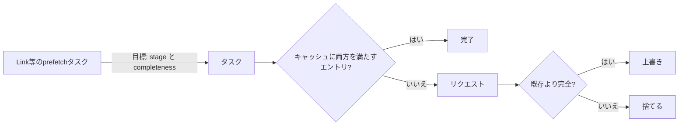

# 2026-10-17（土）

> 今日のひとこと：Nuxtが5件のアドバイザリを一斉に公開しました。中心は、ルートルールが生のパスで照合されるため、パーセントエンコードしたURLでミドルウェアを素通りできる問題です（Moderate）。Vue 3.6.0-rc.12 も出ています。

## 今日のリリース

- 【Vue】v3.6.0-rc.12：Vapor Modeの `Transition` / `KeepAlive` / スロットまわりの修正が大半。watcherのクリーンアップを、コールバックが再実行されるまで保持する修正も入った（出典: https://github.com/vuejs/core/releases/tag/v3.6.0-rc.12 ）

## トップニュース

### Nuxtのルートルールが「生のパス」で照合され、`%61dmin` で素通りできる

【Nuxt】【脆弱性】Nuxtは10/16（UTC）に5件のアドバイザリを公開した。最も設計に近いのは GHSA-6gq8-jgmh-3ffp（Moderate、CVSS 3.1 で 6.5）で、サーバー側のルートルールの照合と、ルーターのパラメーター解決で「パスの見方」が食い違っていた。

**何が変わる**

- 対象は `nuxt` の 4.0.0〜4.4.3 と 3.11.0〜3.21.3（アドバイザリの記載）。修正版は 4.4.4 / 3.21.4。ページには、照合そのものの修正は 4.5.2 / 3.21.11 とも書かれている
- ルートルールのキー（`appMiddleware`、`redirect`、`appLayout`、`ssr`、`prerender`、`cache` / `isr` / `swr` 由来のフラグ）が、パーセントデコードされる前の生のパスと比べられていた

**なぜ起きた**：照合側は生のパス、ルーターはデコード後にパラメーターを解決する。たとえば `/users/admin` に掛けたルールは、`/users/%61dmin` には一致しない。しかしこのリクエストは `users/[id].vue` を描画できる。結果として `auth` ミドルウェアがSSR時を含め走らない（CWE-436 解釈の不一致、CWE-863 不適切な認可）。

**何に効く・誰が困る**：動的ルートやcatch-allルートの保護を `routeRules` の `appMiddleware` に頼っているアプリ。静的なASCIIのルートだけなら影響しない。回避策は、`routeRules` ではなく `definePageMeta` でページにミドルウェアを直接つけること。

**ここまでの経緯**

- 2026-10-16：Nuxtが同日に5件を公開（下の脆弱性の節）。アドバイザリに修正コミットのリンクはなく、diffは読めていない（不明）
- 過去の号に同じ件はなし

出典: https://github.com/nuxt/nuxt/security/advisories/GHSA-6gq8-jgmh-3ffp

## 今日の深掘り

### Next.js：`FetchStrategy` を「ステージ」と「完全さ」に分ける

**選んだ理由**：Partial Prefetchingのクライアントキャッシュで、1つのenumに詰め込まれていた2つの概念を分ける設計の整理が、PR本文だけで読めるため。

**背景**：クライアントのsegment cacheは、`Link` などが起こすprefetchの結果を溜める。`FetchStrategy` は `LoadingBoundary` / `StaticShell` / `RuntimeShell` / `PPR` / `PPRRuntime` / `Full` を1本の順序つきenumとして持ち、「どのエントリがどれだけ内容を持つか」の比較に使っていた。旧コードのコメントは、数値の大小で「より具体的か」を比べる前提と、`Full` と `LoadingBoundary` を同じ梯子に載せた妥協（「accepted convenience」）を書いていた。

**変更点**（`packages/next/src/client/components/segment-cache/types.ts`、f09aa18f8a、#99706）：

```ts
export const enum AppStage { Shell = 0, Prefetch = 1, Navigation = 2 }
export const enum Completeness { NeedsRuntime = 0, /* ... */ }
```

- `AppStage`：どの公開ステージまで描画したか。シェル（全リンクで共有、パラメーター依存の内容はフォールバック）、`prefetch()` が解決するところまで、`navigation()` が解決するところまで。公開ドキュメントの `ensureStatic` / `prefetch()` / `navigation()` に対応し、サーバー内部の描画ステージとは別物なので名前を分けた、とPR本文にある
- `Completeness`：そのステージで、まだ何が足りないか。ランタイムのリクエストが必要／キャッシュ済みだが動的な穴がある／穴のない完全、の3段（コメントで確認できたのは `NeedsRuntime` の定義まで。残りの名前はPR本文の言い換えに依る）。`isPartial` フィールドも置き換える
- コメントは、両者を「比較してはいけない」と明記する。2つの型を別にすることで、取り違えをコンパイル時に防ぐ狙いと読める

**周辺コード**：



- prefetchタスクは目標のステージと完全さを持ち、キャッシュに「両方の目標を満たす」エントリが揃うと終わる
- 上書きの規則：より不完全なエントリは、たとえ後のステージのものでも、より完全なエントリを上書きしない。例として、Navigationステージで描画した応答がCookie依存のデータを含まないなら、Prefetchステージの応答を上書きできず、捨てて新しくリクエストする（PR本文）

**この変更から分かる設計思想**：1つの順序で足りるように見えても、設計が育つと軸が2本になる。PR本文は、挙動の変更を先行するPRに切り出し、この差分は型の整理に絞ったと書く。差分は31ファイル、+2029/-1969。テストの大半は移行の追従で、新規の `loading-boundary-prefetch-in-flight.test.ts` が付いた。

出典: https://github.com/vercel/next.js/commit/f09aa18f8ac286230a507102753c8e1373a45149

### WHATWG：複製したDocumentの「ベースURL」の持ち方が仕様になる

**選んだ理由**：`baseURI` が、DOMからHTMLの値を直接引く形をやめ、DOMが呼ぶアルゴリズムをHTMLが上書きする形になった。仕様どうしの依存の向きを整える例として読める。

**背景**：`document.cloneNode()` で作った浅い複製には `<base>` 要素がない。そのため、複製の `baseURI` が元のドキュメントと食い違いうる（whatwg/dom#454）。

**変更点**（dom 8b51527、html de953a7）：

- DOM側：`baseURI` のgetterは、ノード文書の「get the base URL」を呼び、nullなら文書のURLにフォールバックして、シリアライズして返す。「get the base URL」の既定はnull
- DOM側：文書を複製するとき、複製の「base URL override」に元のベースURLを入れる
- HTML側：「get the base URL」を上書きして「document base URL」を返す。document base URLは、このoverrideを考慮する。複製時に「about base URL」もコピーするので、複製の中の `<base>` が元と同じに解決される。ついでに、`DOMParser` が `iframe srcdoc` の中で作るDocumentがトリガーしうる、フォールバックのベースURLのassertを外した
- テストはWPTの #61231、#61232

**この変更から分かる設計思想**：コミットメッセージにあるとおり、DOMが「HTMLの値を返すDOM API」のためにHTMLへ手を伸ばす形をやめ、DOMにフックを置いてHTMLが埋める。ブラウザ側の実装への影響は、このコミットからは不明。

出典: https://github.com/whatwg/dom/commit/8b51527 、https://github.com/whatwg/html/commit/de953a7

## 仕様の変更

### whatwg/dom

#### 複製したDocumentが元のベースURLを引き継ぐ

【DOM】深掘り参照。出典: https://github.com/whatwg/dom/commit/8b51527

### whatwg/html

#### 複製したDocumentのベースURLを考慮する

【HTML】深掘り参照。出典: https://github.com/whatwg/html/commit/de953a7

### w3c/csswg-drafts

#### `display-mode` のメディアクエリに「application」の文脈が足される

【CSS】`mediaqueries-5` に、アプリケーションの文脈の検出と、`display-mode` の値を独立に（同時に複数）一致させる定義が入った。子の文脈での継承は保つ。
なぜ変えたか：Issue #14125 の議論を受けて（コミットメッセージに議論先のみ。理由の詳細は不明）。
出典: https://github.com/w3c/csswg-drafts/commit/070e0210

その他：

- `css-fonts-4`：カーニングは等幅でないグリフにだけ適用と明確化し、「OpenTypeは既定でオンを勧める」という不正確な記述を削除（[#6723](https://github.com/w3c/csswg-drafts/commit/b1af0bd2)）
- `css-syntax-3`：残っていた「parse a block's contents」への参照を削除（[9d0bb83d](https://github.com/w3c/csswg-drafts/commit/9d0bb83d)）
- `animation-triggers`・`css-images-5`・`css-overflow` のeditorialやテスト更新は除外

動きなし：whatwg/fetch, whatwg/streams, whatwg/url, tc39/proposals, tc39/ecma262, w3c/aria, w3c/ServiceWorker, w3c/wcag3

## ブラウザの実装

取得できず（chromestatus.com・groups.google.comはegressでブロック）。Chromiumの `runtime_enabled_features.json5` のコミット履歴とWebSearchでの確認は、今回の実行では行っていない（不明）。

## OSSのPR

### Next.js

#### 深掘り参照：`FetchStrategy` を `AppStage` と `Completeness` に分ける（[#99706](https://github.com/vercel/next.js/pull/99706)）

その他：

- Server Actionのリクエスト情報をApp描画に渡す（[#100274](https://github.com/vercel/next.js/pull/100274)）
- ミドルウェアを通るリクエストを1つのOpenTelemetry traceにまとめる変更をrevert（[#100302](https://github.com/vercel/next.js/pull/100302)）
- 使われていない `NextNodeServer.renderHTML` を削除（[#100284](https://github.com/vercel/next.js/pull/100284)）
- アップグレードCLIのピン留めでリリース経過日数を尊重（[#100256](https://github.com/vercel/next.js/pull/100256)）、評価用worktreeの依存リンク修正（[#100257](https://github.com/vercel/next.js/pull/100257)）
- 古いデプロイ用ゲートをテストから削除（[#100285](https://github.com/vercel/next.js/pull/100285)）

### Vue（`minor` ブランチ）

#### Vaporのスロットのfallbackと退場（leave）の順序づけが、vdomと同じ形に揃えられる

【Vue】edisonの連続した約12件。スロットの内容とfallbackを、`Transition` 下でvdomと同じ順序で扱い（[44e85564](https://github.com/vuejs/core/commit/44e85564)）、fallbackの退場が走っている最中なら再度退場させずに使い回し（[4b2a6406](https://github.com/vuejs/core/commit/4b2a6406)）、無効なスロット内容はDOMに残す（[740d4cc1](https://github.com/vuejs/core/commit/740d4cc1)）。`out-in` で中身が空になったら、fallbackを即座に解決する（[c1091d4b](https://github.com/vuejs/core/commit/c1091d4b)）。
なぜ変えたか：個々のコミットメッセージに理由の記載はなく、Vapor Modeとvdomの相互運用の挙動をそろえる狙いと推測（推測）。
出典: https://github.com/vuejs/core/commit/44e85564

その他：

- 3.6.0-rc.12 のリリース（上のリリース節）。リリースノートにある、watcherのクリーンアップ保持（[#15766](https://github.com/vuejs/core/issues/15766)）ほか
- `KeepAlive` 後の移動（[#15901](https://github.com/vuejs/core/pull/15901)、[#15902](https://github.com/vuejs/core/pull/15902)）、`Transition` の枝切り替えの扱い（[#15897](https://github.com/vuejs/core/pull/15897)、[#15895](https://github.com/vuejs/core/pull/15895)）
- スロットまわりのリファクタ（[#15887](https://github.com/vuejs/core/pull/15887)、[#15888](https://github.com/vuejs/core/pull/15888)、[#15889](https://github.com/vuejs/core/pull/15889)、[#15858](https://github.com/vuejs/core/pull/15858)）

### oxc

その他（約79件中、主なもの）：

- codegen：分岐やhashmap引きを減らす小さな高速化が5件（[#27840](https://github.com/oxc-project/oxc/pull/27840) ほか）
- linterの誤検知・見逃しの修正が約10件（`no-lonely-if` [#27759](https://github.com/oxc-project/oxc/pull/27759)、`sort-imports` [#27749](https://github.com/oxc-project/oxc/pull/27749)、`prefer-at` [#27762](https://github.com/oxc-project/oxc/pull/27762) ほか）
- formatter：コメントと括弧の扱い、`sort_imports`、YAML・CSS in JSの修正が約8件（[#27823](https://github.com/oxc-project/oxc/pull/27823)、[#27812](https://github.com/oxc-project/oxc/pull/27812) ほか）
- 診断のspan検索を高速化（[#27770](https://github.com/oxc-project/oxc/pull/27770)）、`unreachable` の削除やコメント整理のリファクタが約30件

### TypeScript

- 合成したモジュール指定子の引用符をエスケープ（[#64839](https://github.com/microsoft/TypeScript/pull/64839)）
- グローバルファイル削除後のincrementalな診断を修正（[#64845](https://github.com/microsoft/TypeScript/pull/64845)）
- リリースworkflowの空白チェックでCRLFを許可（[#64840](https://github.com/microsoft/TypeScript/pull/64840)）

### Bun（`bun check` / `bun fmt` のみ）

- `bun lint` / `bun fmt` / `bun check` の未解決Issueをまとめて修正。137ファイル、+4886/-906、Prettier比較のテストの更新を含む（[#45482](https://github.com/oven-sh/bun/pull/45482)）。PR本文は読んでおらず、個々の修正内容は不明

### Biome

- SCSSのカスタムプロパティ内のURLノードを保持（[#12398](https://github.com/biomejs/biome/pull/12398)）
- HTMLフォーマッタ：Svelteのバインディング（[#12393](https://github.com/biomejs/biome/pull/12393)）
- JSパーサー：Astroの短縮属性で任意の式を許可（[#12394](https://github.com/biomejs/biome/pull/12394)）
- 旧型推論エンジンを削除（[#12391](https://github.com/biomejs/biome/pull/12391)）
- YAML：フロー形式マッピングのキー後のコメント、プレーンスカラーの末尾空白（[#12366](https://github.com/biomejs/biome/pull/12366)、[#12365](https://github.com/biomejs/biome/pull/12365)）
- 他に、`domains` と `overrides` の修正、lintルールの高速化2件、依存の整理

### react-hook-form

- `useFieldArray`：`rules` があるとき行のフィールドを再インデックス（[#13873](https://github.com/react-hook-form/react-hook-form/pull/13873)）
- `cloneObject`：`constructor` キーを持つ素のオブジェクトをコピー（[#13875](https://github.com/react-hook-form/react-hook-form/pull/13875)）

### Solid（`next` ブランチ）

- 診断の各findingにソース位置を付け、コードごとのdocsページを追加（[#4107](https://github.com/solidjs/solid/pull/4107)）
- SSRのwaterfall待ちを、作業の開始時刻で判定（[#4108](https://github.com/solidjs/solid/pull/4108)）

### Vite

- hmrプレイグラウンドのテストと開発ツール一覧のdocs更新のみ（[#23788](https://github.com/vitejs/vite/pull/23788)、[#23786](https://github.com/vitejs/vite/pull/23786)）

### Ladybird

#### Picture-in-Pictureと、`beforeunload` に続くブラウザ側UIの配線

【Ladybird】`:picture-in-picture` 擬似クラス、メディアのコンテキストメニューからのPiP、Qt側のPiPウィンドウ（コントロール、アスペクト比の維持）、フルスクリーンとPiPの相互排他が連続して入った。メディアコントロールが別の要素を操作できるようにする下準備のコミットも付く。
なぜ変えたか：コミットメッセージから、理由の説明は読み取れない（不明）。
出典: https://github.com/LadybirdBrowser/ladybird/commit/2b4589d 、https://github.com/LadybirdBrowser/ladybird/commit/f973bfc

#### セッション履歴の「history step job」を仕様の分岐に合わせて整理

【Ladybird】LibWebとLibWebViewにまたがる約15件。履歴操作のpush/replace、長さ・インデックスの取得、継続（continuation）の適用を、仕様が分岐する単位で書き直した（例：[0d29815](https://github.com/LadybirdBrowser/ladybird/commit/0d29815)、[cbb65f5](https://github.com/LadybirdBrowser/ladybird/commit/cbb65f5)）。
なぜ変えたか：「as spec」とメッセージにあるとおり、仕様との対応を直すため。
出典: https://github.com/LadybirdBrowser/ladybird/commit/0d29815

その他（約150件中、主なもの）：

- Text Fragment（`:~:text=`）：テキストディレクティブの許可、可視フラグメントの追跡、範囲のスクロール、Copy Link to Highlight（[39ea81e](https://github.com/LadybirdBrowser/ladybird/commit/39ea81e)、[f8bfd39](https://github.com/LadybirdBrowser/ladybird/commit/f8bfd39)）
- LibJS/JIT：ループ外へのチェックの巻き上げ、int32チェックの畳み込みなど（[f242af2](https://github.com/LadybirdBrowser/ladybird/commit/f242af2)、[cfe33a1](https://github.com/LadybirdBrowser/ladybird/commit/cfe33a1)）
- `js` ユーティリティにデバッガー（ステップ実行、例外での一時停止）（[dcda444](https://github.com/LadybirdBrowser/ladybird/commit/dcda444)）
- URLの `search` setterで結果のクエリをパース（[8fbe8f3](https://github.com/LadybirdBrowser/ladybird/commit/8fbe8f3)）
- ホイール入力のcompositor経路のトレースとテストの追加、他

### Servo

- 絶対配置のfragmentを、親のcontent boxを基準に配置（[#48846](https://github.com/servo/servo/pull/48846)）
- percentage heightの計算quirkと、`<html>` / `<body>` のstretch quirkを実装（[#39869](https://github.com/servo/servo/pull/39869)、[#48942](https://github.com/servo/servo/pull/48942)）
- `justify-content: left/right` をブロック軸で正しく揃える（[#48746](https://github.com/servo/servo/pull/48746)）
- Service Workerの「update worker state」を実装（[#48749](https://github.com/servo/servo/pull/48749)）
- モジュールスクリプトのメモリリークを修正（[#48952](https://github.com/servo/servo/pull/48952)）
- テキストfragment間でグリフバッファを使い回す（[#48969](https://github.com/servo/servo/pull/48969)）
- WebGL：カラーアタッチメントのないframebufferへの描画、エラー警告に呼び出し位置（[#48972](https://github.com/servo/servo/pull/48972)、[#48973](https://github.com/servo/servo/pull/48973)）
- `safe_borrow_mut` への置換、`TracedDOMString` への変更、安全なラッパー追加が約10件

### Wado

- コミットは約118件。`wep-*.md` の新規追加は確認できなかった。`core:value` の `Inspect` の整理、モジュール指定子のエスケープ解決（パーサー）、インラインgit指定子の二重束縛をエラーにする修正などが目立つ。ほかは件数のみ（[13e7d005](https://github.com/wado-lang/wado/commit/13e7d0051a) など）

動きなし：facebook/react, sveltejs/svelte, vuejs/core の `main`, solidjs/solid の `main`, ts-rust, ghc/ghc, servo/stylo

## 議論ウォッチ

取得できず（今回の実行では、WICG・standards-positions・各RFC・Discussionsのページを確認していない）。

## 続報

- [10-16の号](2026-10-16.md)の「動きなし：ts-rust」は、今回もコミットなし
- [10-16の号](2026-10-16.md)でBunの `bun check` / `fmt` として触れた作業の続きとして、#45482 が入った

## 脆弱性

### Nuxt：Moderate 3件、Low 2件（いずれも10/16公開）

| GHSA | 内容 | 深刻度 |
|---|---|---|
| GHSA-6gq8-jgmh-3ffp | ルートルールが生のパスで照合され、パーセントエンコードで `appMiddleware` を回避できる | Moderate（CVSS 3.1 で 6.5） |
| GHSA-vjh5-4x84-xrqp | 大文字小文字を区別しないルーティングで、大文字小文字違いのパスだとサーバー側のルートルールが適用されない | Moderate |
| GHSA-xfq5-w38q-pc2x | サーバーアイランド内の `useHeadSafe` の入力が無害化されず、保存型XSSになる | Moderate（CVSS 3.1 で 5.4） |
| GHSA-w7gw-66vg-99gq | パスに `%3F` を含むと `getRouterParam` がh3の照合と別のパラメーターを返す | Low |
| GHSA-jjm6-p2m9-9w4x | GHSA-934w-87qh-qr26 の修正漏れ。`pages` 無効時の `<NuxtLink>` で、先頭に制御文字のある `javascript:` URLが実行される | Low |

- **GHSA-6gq8-jgmh-3ffp**：トップニュース参照。影響は `nuxt` 4.0.0〜4.4.3、3.11.0〜3.21.3。修正版は 4.4.4 / 3.21.4。回避策は `definePageMeta` での直接指定
- **GHSA-xfq5-w38q-pc2x**：影響は `nuxt` 4.0.0〜4.6.1 と 3.13.0〜（4.0.0未満）。修正版は 4.6.2。Nuxt 3は2026-07-31にEOLで修正なし。サーバーコンポーネント（`.server.vue`、または `experimental.componentIslands` の `<NuxtIsland>`）の中で、攻撃者が制御できる値を `useHeadSafe` に渡すアプリだけが対象。アイランドの描画が `useHeadSafe` の入力を安全フィルターなしでシリアライズし、`<NuxtIsland>` がそのままheadに足す。修正は、サーバー側でUnheadの安全なフィルターを適用してからアイランドの応答に入れること
- 他の3件（GHSA-vjh5-4x84-xrqp、GHSA-w7gw-66vg-99gq、GHSA-jjm6-p2m9-9w4x）は、一覧の題名のみ確認。詳細は不明
- 修正コミット：どのアドバイザリにもリンクがなく、diff解説は「不明（修正コミット未確認）」
- **同種のパターン**：「照合する層」と「解決する層」でURLの正規化が食い違う。大文字小文字、パーセントエンコード、`%3F` と、3件が同じ型

他の対象（React、Next.js、Vite、Astro、TanStack Start、Svelte、Vue、oxc）は、前回の実行以降の新規なし。

## 仕様を読む会の候補

- 「get the base URL」と `Node.baseURI`（dom#454）：DOMとHTMLの責務の置き方と、clone時のアルゴリズムが短く読める
- WHATWG URLの `search` setter：Ladybirdの修正（8fbe8f3）と並べて、仕様の手順と実装を比べられる
