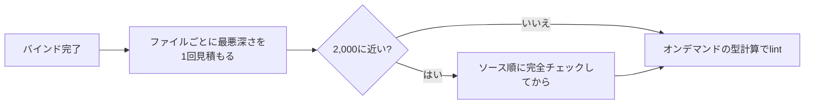

# 2026-10-18（日）

> 今日のひとこと：Go版TypeScriptの移植が、また一つ「配布物」になりました。VercelのLabsが tsc-ts の v0.0.1 / v0.0.2 を出し、Bunは `bun check` の制御フロー解析の深さ制限を `tsc` と同じ位置に合わせました。新規の脆弱性はありません。

## 今日のリリース

- 【TypeScript】vercel-labs/tsc-ts v0.0.1 / v0.0.2：TypeScript 7.0.2（Go版）をTypeScriptで移植し、scriptcでネイティブ化した実験的コンパイラの初版。v0.0.2 はglibc 2.34以降への対応など（出典: https://github.com/vercel-labs/tsc-ts/releases ）
- 【TypeScript】vercel-labs/scriptc v0.3.6：`node:readline` / `node:http` / `node:test` などNode.js APIの対応範囲を拡大。リリースノートは、大きな型チェッカーのワークロードが「約12%速く、メモリ約5%減」と書く（自己申告）（出典: https://github.com/vercel-labs/scriptc/releases/tag/v0.3.6 ）
- 【oxc】oxc-project/tsrs v0.16.0：前回の実行より前（10/16 16:30 UTC）の公開だが、この対象は今号が初出なのでここに記す（出典: https://github.com/oxc-project/tsrs/releases ）

## トップニュース

### tsc-ts：TypeScript 7をTypeScriptで書き直し、ネイティブにコンパイルして配る試みが初リリース

【TypeScript】VercelのLabsが tsc-ts を v0.0.1 として公開した。TypeScript 7.0.2（Go版、tsgo）のコンパイラを「普通のTypeScript」に移植し、同じLabsの scriptc でネイティブ実行ファイルにしてnpmで配る。

**何が変わる**

- `npm install -D tsc-ts` → `npx tsc-ts -p tsconfig.json` で、型チェックとJS・`.d.ts` の出力ができる。インクリメンタルビルド、プロジェクト参照、watch、`--api` サーバーを含む（CHANGELOG 0.0.1）
- 配布はプラットフォーム別の8つのnpmパッケージ（macOS・Linux glibc/musl・Windows）で、ランチャーが選ぶ
- 検証は「tsgoとの出力比較」。READMEの表では、スキャナー、パーサー、バインダー、モジュール解決、emit、`--build`、型チェッカー（ファイルごとの診断）のすべてが、TypeScriptのテストコーパス（約12,500ファイル）でtsgoと一致するとしている。**この表は自己申告で、こちらでは再現していない**
- v0.0.2：Linuxのglibc 2.34以降への対応、型チェックを飛ばしたファイル（`// @ts-nocheck`）のemitを、チェッカースレッドが他のファイルを検査している間に行う、診断出力のバッチ化

**なぜ作ったか**：READMEは目的を明言していない（不明）。scriptc側の「TypeScriptの型情報でネイティブコードを作る」実証として、自分自身のようなTypeScript製の大きなプログラムを通す題材にしている、とは読める（推測）。README末尾の「tsc --api を使うツール（scriptc など）が `tsc-ts` を代わりに使える」という記述は、scriptcが型チェックにtsgoを使っていることの裏返しである。

**何に効く・誰が困る**：実験段階（0.0.x）で、READMEもLabsの実験と位置づけている。いま使う話ではなく、「Go版チェッカーをGo以外の言語へ移す」流れの三つ目の実例として読む価値がある。

**ここまでの経緯**

- 2026-10-06：Bunが `bun check`（typescript-goの型チェッカーの移植）を入れた（#44361）
- 2026-10-08〜：pingdotgg/ts-rust（Rust移植）を追跡開始。10/17に oxc-project/tsrs も対象に追加
- 2026-10-16〜17：tsc-ts が v0.0.1（10/17 01:14 UTC）、v0.0.2（同02:25 UTC）を公開。コミットはこの期間で126件、ほぼすべてが1人の著者による型チェッカー・emitの一致度の修正と高速化
- 過去の号に tsc-ts の記事はなし

出典: https://github.com/vercel-labs/tsc-ts

## 今日の深掘り

### Bun：`bun check` が「制御フロー解析の深さ制限」を tsc と同じ位置で打ち切る

**選んだ理由**：型チェッカーを移植するとき、「結果が同じ」の裏にある「実装上の上限まで同じにする」難しさが、PR本文と差分で読めるため。

**背景**：TypeScriptの制御フロー解析（control flow analysis）は、1回の探索が2,000段ネストすると諦めて TS2563 を報告する。諦めた後は、型が「問い合わせた順序」に依存するようになる。Bunの型対応lintは #45451 以降、型を必要になったとき計算するため、ルールごとにファイル全体を走査する順序では、順序に依存する型が結果を変えうる。そこで、順序依存になりうるファイルだけは先に「ソース順の完全なチェック」をかけていた。

**変更点**（Jarred Sumner、788087c0a、#45595。引用は私が要約した）：

- 旧判定は「ファイル全体のフローノードが2,000を超えたら順序依存かもしれない」。しかし探索は1つの関数とその外側の中にとどまるので、50ノードの関数が100個あるファイルが上限に届くことはない。つまり**慎重すぎた**
- 逆に**甘すぎる**面もあった。旧判定は「探索は各フローノードを高々1回通る」と仮定していた。実際はループのバックエッジをたどり、最初の通過がスタックに残ったままループ本体をもう一度通る。`while` の中に `asserts` 関数の呼び出しが並ぶ例で、`tsc` は997文ほどで TS2563 を出すが、`bun check` は約2,000まで出さなかった
- 新しい判定は、探索が実際に届きうる深さを「フローグラフを逆にたどる最長経路 ＋ ループのネスト1段ごとにループ本体1つ分」で見積もる。ファイルごとにバインド完了時に1回、線形時間で計算し、上限に近いファイルだけ精密に再計算する。判定に使う5か所を同じ数字に揃えた
- PR本文は、6種類のループ形（単一ループ、ネストしたループ、3段にネストしたループへの `continue`、ループ内の関数宣言など）で、`bun check` が `tsc` と同じサイズで諦めるようになったと書く

**周辺コード**：同じPRには、`bun check -b`（solution全体のビルド）で、emit済み出力の表を各プロジェクトに複製せず1つ共有する、`.d.ts` を1回だけ読む、といった変更がある。PR本文の数字（自己申告）では、20,000プロジェクト・既定の `lib` で 173秒 → 5.13秒、深い構成のメモリ 5.0GB → 1.85GBで、旧コードはプロジェクト数の2乗に比例してパス表をコピーしていたという。一方、VS Code規模の単一プロジェクトは「ほぼ同じ」。自動レビューが、関数をまたぐ見積もりの合成に懸念を挙げていて、マージ時点でも議論は残る。

**この変更から分かる設計思想**：「出力が同じ」だけでは足りず、tscが**どこで諦めるか**まで合わせている。上限に達した後に型が順序依存になる、というtsc自体の穴を知ったうえで、その穴に落ちうるファイルだけ遅い経路に回す。正確さと速さを、ファイル単位の見積もりで両立させている。

出典: https://github.com/oven-sh/bun/pull/45595

## OSSのPR

### Bun（`bun check` / `bun fmt` のみ）

#### `bun fmt` が `package.json` と `.svelte` をPrettierなしで整形する

【Bun】`.prettierrc` があるときも、`package.json` と `.svelte` はBun自身が整形する。Svelteは `prettier-plugin-svelte` 4.1.1 の出力に合わせ、`package.json` は `sort-package-json` 3.7.1 の移植で並べ替える。並べ替えは要素を動かすだけで、値は元のテキストから出力するため、`12345678901234567890` が `12345678901234567000` に化けない。AstroなどBunが読めない言語は引き続きPrettierへ渡す。速度の数字はPR本文にない。
なぜ変えたか：プロジェクトに入れた `prettier` パッケージに回さずに済ませるため（PR本文）。
出典: https://github.com/oven-sh/bun/pull/45595

その他：

- `bun lint` が `@eslint/json` の全6ルールと `@eslint/markdown` の全21ルールを内蔵し、JSON・Markdownのlintに `eslint` が要らなくなった（同じ #45595）
- 上記以外のランタイムのPRは対象外のため件数を書かない

### oxc-project/oxc

#### oxlint のリンターは `unreachable!` を整理し、関数の種類を `FunctionKind` で表す

【oxc】`function-component-definition` など多数のルールから `unreachable` を取り除き、コンポーネント関数の「名前がない宣言」を型で表現できなくする一連の整理（Cam McHenry）。
なぜ変えたか：到達しない分岐をパニックで済ませず、型で不可能にするため（コミット列からの読み取り。PR本文は読んでいない）。
出典: https://github.com/oxc-project/oxc/pull/27874

その他：

- リンターのunicorn/Vue/React/jsx-a11y系ルール約30件で `unreachable` を除去（[#27870](https://github.com/oxc-project/oxc/pull/27870)〜[#27901](https://github.com/oxc-project/oxc/pull/27901)）
- `prefer-spread` が `super` のメソッド呼び出しを無視する修正（[#27868](https://github.com/oxc-project/oxc/pull/27868)）
- minifierが、波括弧のない本体の `debugger` 文を落とす修正（[#27867](https://github.com/oxc-project/oxc/pull/27867)）
- パーサー内部の簡素化、レキサーの機能検出の整理（[#27869](https://github.com/oxc-project/oxc/pull/27869)、[#27851](https://github.com/oxc-project/oxc/pull/27851) ほか）
- この期間のコミットは約55件。上記以外の多くはリンターとパーサーのリファクタリング

### Biome

#### CSS-in-JS の中身をパース・整形できるようになる

【Biome】テンプレートリテラルの中のCSSを、補間（`${...}`）込みでパースして整形する。#12210 でCSSの字句解析・構文解析がメタ変数を扱えるようにし、#12212 で整形を足し、#12215 でPrettierとの互換を詰めた（Naoki Ikeguchi）。
なぜ変えたか：PR本文は読んでいない（不明）。コミット列は、GritQLのメタ変数の仕組みをCSSの補間に流用する形に読める（推測）。
出典: https://github.com/biomejs/biome/pull/12212

その他：

- SCSSで動的な `attr()` の単位に対応（[#12429](https://github.com/biomejs/biome/pull/12429)）
- SCSSで計算されたダッシュ付きat-rule名を許可（[#12406](https://github.com/biomejs/biome/pull/12406)）
- 解析フェーズごとに、使うノード種だけを歩くように変更（[#12362](https://github.com/biomejs/biome/pull/12362)）、制御フローグラフの構築も文と関数のノードだけに（[#12425](https://github.com/biomejs/biome/pull/12425)）
- YAMLフォーマッターがディレクティブ後・フローマッピング内のコメント位置を維持（[#12368](https://github.com/biomejs/biome/pull/12368)、[#12367](https://github.com/biomejs/biome/pull/12367)）
- `useVueDefineMacrosOrder`、`useTailwindShorthandClasses`、Tailwindテーマのプロパティ順の修正（[#12402](https://github.com/biomejs/biome/pull/12402)、[#12401](https://github.com/biomejs/biome/pull/12401)、[#12411](https://github.com/biomejs/biome/pull/12411)）
- `migrate` が `eqeqeq` のnull比較オプションを移行（[#12404](https://github.com/biomejs/biome/pull/12404)）

### Solid（`main` / `next`）

#### `next` ブランチで「binding slots」を削除する破壊的変更

【Solid】Solid 2.0に向けた `next` ブランチで、`feat(web)!: remove binding slots`（コミット 3f36f77）が入った。コンパイラも binding slot の claim を出さなくなり（60fb386）、サイズの上限値が引き下げられた（0c16f28）。他に、`mapArray` が変更のあった範囲だけを準備してその場でコミットする最適化（#4114）、サスペンドした読み取りが少ないハンドラフレームで境界に巻き戻る最適化（#4122）、サーバーのエラーフックが「リクエストごと・種類ごとに1回」だけ呼ぶ修正（#4130）など。
なぜ変えたか：コミットメッセージは「サイズの上限を下げた」とあり、バンドルサイズの削減が目的に見える（推測。PR本文は読んでいない）。多くのコミットの著者が `Claude` である点も記録しておく。
出典: https://github.com/solidjs/solid/commit/3f36f77

その他：

- `<Errored>` がサーバーで子を巻き込まない修正（[#4119](https://github.com/solidjs/solid/pull/4119)）、サーバートレースIDを `Math.random` から引く（[#4115](https://github.com/solidjs/solid/pull/4115)）、並行アクションの競合で推測が絡み合う修正（[#4123](https://github.com/solidjs/solid/pull/4123)）
- 計測ボードの更新（docs）。ほかにサンプルアプリ（チャット）の変更が多数

### Vue（`minor`）

その他：

- Vapor：非同期setupの後に描画された子のルートへtransitionフックを適用（[#15907](https://github.com/vuejs/core/pull/15907)）、マウントされるvnodeのためにinteropのフォールバックhookを解決（[#15903](https://github.com/vuejs/core/pull/15903)）

### microsoft/TypeScript

その他：

- 上位1000リポジトリで過去約2年に出た未カバーの失敗を、ローカルのテストに落とし込む（[#64850](https://github.com/microsoft/TypeScript/pull/64850)）
- APIから渡される `pathsBasePath` を正しく転送（[#64843](https://github.com/microsoft/TypeScript/pull/64843)）
- APIのタイミング計測を環境変数で出力（[#64846](https://github.com/microsoft/TypeScript/pull/64846)）

### Next.js

その他：

- turbo-persistence：複数ページにまたがるSSTブロックを `MADV_WILLNEED` で先読み（[#100283](https://github.com/vercel/next.js/pull/100283)）

### vercel-labs/tsc-ts

#### 高速化と、tsgoとの一致を詰める修正が続く

【TypeScript】v0.0.1 から v0.0.2 までに126コミット。型マッパーのソースをインデックスで引く、フロー探索の共有ノードをインデックス化、候補の綴り提案を割り当てなしで比較、といった高速化と、`isolatedModules` / `verbatimModuleSyntax` / `erasableSyntaxOnly` の診断を tsgo と揃える修正が中心。watchの初回プログラムと大量ファイルの再ビルドを、チェッカースレッドで動かす変更もある。件数の多くは1人の著者による小さな修正。
なぜ変えたか：コミットメッセージに理由は少なく、tsgoとの差分を潰す目的に見える（推測）。
出典: https://github.com/vercel-labs/tsc-ts/commits/main

### vercel-labs/scriptc

#### Node.js API と JS 組み込みの対応が広がる

【TypeScript】この期間のコミットは143件。`Error.isError`、`Promise.try`、`Object.groupBy` / `Map.groupBy`、`switch` を使ったオブジェクト値の比較、`net.SocketAddress` / `net.BlockList` などをネイティブコードに落とせるようになった。タプルの `filter` / `find` / `some` / `every`、`shift` / `splice(0, n)` / `unshift` を償却O(1)にする配列の余白確保といった、コード生成の最適化も並ぶ（著者は Chris Tate と Malte Ubl）。リリースノートの数字は自己申告。
なぜ変えたか：個別の理由はコミットメッセージにない（不明）。
出典: https://github.com/vercel-labs/scriptc/releases/tag/v0.3.6

### oxc-project/tsrs

その他：

- ASTのサイズ計測用の計装と古い実験ツールを削除（[#584](https://github.com/oxc-project/tsrs/pull/584)、[#583](https://github.com/oxc-project/tsrs/pull/583)）
- npm パッケージに標準ライブラリの型定義を埋め込まない（[#578](https://github.com/oxc-project/tsrs/pull/578)）
- CI：リリース後にplaygroundをデプロイ、Criterion2とCodSpeedでメモリ内コンパイルのベンチを追加、Clippy lintの強制（[#526](https://github.com/oxc-project/tsrs/pull/526)、[#571](https://github.com/oxc-project/tsrs/pull/571)、[#577](https://github.com/oxc-project/tsrs/pull/577)）
- 古いベンチ結果の削除（[#576](https://github.com/oxc-project/tsrs/pull/576)）。READMEは、TypeScript 7.1に向けた100%の一致を目標に掲げる（自己申告）

### ghc/ghc

その他：

- EPA（Exact Print Annotations）：`FamilyInfo` にTTGフィールドを追加（`7dedcf135e`）

### wado-lang/wado

その他：

- この期間のコミットは125件。多くは `labeled_block_fusion`（ラベル付きブロックの融合）の最適化パスの修正、パッケージのID解決、`float_parse_bench` の追加、`wado.toml` の `[workspace]` からのmanifest指定、bot整形。`docs/wep-*.md` の変更は拾えなかった

動きなし：facebook/react、vitejs/vite、sveltejs/svelte

## 続報

- 10月6日の号で追った `bun check`（#44361）が、制御フロー解析の深さ制限をtscと揃える段階まで来た（上の深掘り）。「移植 → tscとの差分を潰す」の後半に入っている
- 10月8日の号から追っているGo版チェッカーの移植（ts-rust）に、tsrs（oxc）と tsc-ts（Vercel Labs）が加わり、Rust・Rust・TypeScript(scriptc) の3系統がそろった。ts-rust は今期間、コミットを取得できなかった（取得の失敗か更新なしかは不明）

## 脆弱性

新規のアドバイザリはなし。確認した範囲：Nuxtは10/16公開の5件のみ（10/17の号で扱い済み）、Next.jsの最新は10/14（10/15の号で扱い済み）、Astroの最新は10/12、Viteは10/6、TanStack Router（Start）は9/30、Svelteは5/14。React・vuejs/core・oxcの一覧は確認しなかった（取得せず）。

## 仕様の変更

動きなし：whatwg/html, whatwg/dom, whatwg/fetch, whatwg/streams, whatwg/url, tc39/ecma262, tc39/proposals, w3c/csswg-drafts, w3c/aria, w3c/ServiceWorker, w3c/wcag3（cloneしたリポジトリのgit logで、前回の実行以降のコミットが0件）

## 議論ウォッチ

取得できず：今回の実行では、WICG、standards-positions、各フレームワークのRFC・Discussionsを巡回していない。

## 仕様を読む会の候補

- TypeScriptの制御フロー解析（`checker.ts` の flow node 探索と TS2563 の深さ制限）：今日の深掘りで、各実装がどこで諦めるかの差が見えたため、ソースで原典を読む価値がある
- 移植の検証の仕組み（tsc-ts の `*-corpus.mjs` と `packages/tsgo`）：「tsgoの出力と全ファイルで一致」をどう機械的に確かめるのか、実装を読む
