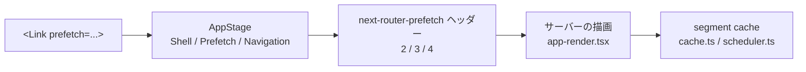

# 2026-10-20（火）

> 今日のひとこと：Next.jsが `<Link prefetch="navigation">` を入れ、`await navigation()` の境界を越えて先読みできるようになった。HTML仕様では、popupと `data:` 文書の「secure context」判定が実装に合わせて直った。

## 今日のリリース

- 【oxc】oxlint v1.89.0 / oxfmt v0.74.0：lone surrogate（対にならないサロゲート）を保ったまま文字列を扱う修正が中心（出典: https://github.com/oxc-project/oxc/releases ）
- 【Vite】create-vite 9.3.0：テンプレートで、使える場合は TypeScript 7 を使うようになった（出典: https://github.com/vitejs/vite/releases/tag/create-vite%409.3.0 ）
- 【oxc】oxc-project/tsrs v0.17.0 / v0.18.0：tsrsは1日で2回リリース。中身はアロケータの統一や `tsoptions` の高速化などの整理（出典: https://github.com/oxc-project/tsrs/releases/tag/v0.18.0 ）
- 【TypeScript】vercel-labs/tsc-ts v0.0.4：プログラムAPI（`tsc-ts/api`）の型を公開（出典: https://github.com/vercel-labs/tsc-ts/releases/tag/v0.0.4 ）

## トップニュース

### Next.js：`<Link prefetch="navigation">` で、`await navigation()` の先まで先読みできる

【Next.js】`<Link>` の `prefetch` に `"shell"` `"prefetch"` `"navigation"` の3つの文字列が加わった。新しいのは `"navigation"` だけで、先読みの深さをリンクごとに最大まで上げられる。

**何が変わる**

- `"shell"` は従来の指定なし（`"auto"`）と同じ、`"prefetch"` は `true` と同じ。名前を揃えるための別名
- `"navigation"` は、`await navigation()` で区切られた部分まで先読みする。`prefetch={true}` はその手前で止まる
- クライアントでは `AppStage.Shell` / `Prefetch` / `Navigation` の3段階に対応させている（`packages/next/src/client/app-dir/link.tsx`）
- サーバーへの要求は `next-router-prefetch` ヘッダーの値で段階を伝える。今回 `'1'`（静的）、`'2'`（runtime prefetch）、`'3'`（runtime shell）、`'4'`（runtime navigation）が定義された（`app-router-headers.ts`）
- 公開APIの `onRouterTransitionStart` に渡す `prefetchIntent` は、`true` / `"prefetch"` / `"navigation"` をすべて `'full'` にまとめる（コード内コメントによる）

**なぜ変えた**：PR本文によると、`await navigation()` はページの一部を先読みから外すための印だが、「ユーザーがこのリンクを押す確信が高い」場合には、その境界をあえて越えたい、という要望があるため。名前は16.4で入った `await prefetch()` / `await navigation()` と対応させている。

**何に効く・誰が困る**：Cache Componentsで、先読みと実際のナビゲーションの境界を設計している人。Partial Prefetchingを使わない場合、`"navigation"` は `true` と同じ（型のコメントより）。

**ここまでの経緯**

- 16.4：`await prefetch()` / `await navigation()` が入る（PR本文の記述。リリース日はこの号では未確認）
- 2026-10-19：#99871 がマージ。同日に `remove Static render stage`（#100388）も入り、段階の整理が続いている

出典: https://github.com/vercel/next.js/pull/99871

## 今日の深掘り

### 「先読みの深さ」は、1つの列挙型とヘッダーで運ばれている

選んだ理由：UIの小さな文字列指定が、クライアントの段階・HTTPヘッダー・サーバーの描画段階までどう繋がるかが、差分1つで読めるため。

**背景**：Next.jsのApp Routerは、リンクが画面に入る、またはホバーされると先読みする。従来は `prefetch` が `true`（全部）か、`auto`（静的ならすべて、動的なら `loading.js` まで）の二択に近かった。そこへ16.4で、サーバーコンポーネント内から区切りを宣言する `await prefetch()` / `await navigation()` が入り、描画に「段階」ができた。

**変更点**：`link.tsx` では、以前は `prefetchProp === true ? Prefetch : Shell` の三項演算子だった段階の決定が、`switch` になった。

```ts
switch (prefetchProp) {
  case true:
  case 'prefetch':
    prefetchStage = AppStage.Prefetch
    break
  case 'navigation':
    prefetchStage = AppStage.Navigation
    break
  // false / 'auto' / 'shell' / null は Shell
}
```

（`packages/next/src/client/app-dir/link.tsx`、コミット cdb48f7641）

`router.prefetch()` の内部関数 `prefetchRoute` も同じ形で `'shell'` `'prefetch'` `'navigation'` を受ける。`kind` が `never` になるよう `satisfies never` で網羅性を確認している。



**周辺コード**：差分は `segment-cache/cache.ts`（約200行）、`scheduler.ts`、`app-render.tsx`、`collect-segment-data.tsx`、`dynamic-rendering-utils.ts` にも及ぶ。ここは今回読み切れていない。段階ごとにキャッシュのキーや保存の単位がどう分かれるかは不明。

**設計思想**：公開APIは「名前」で、内部は「段階」で持つ。公開側に数値や真偽値を増やさず、サーバー側の `await` の名前（`prefetch` / `navigation`）をそのままクライアントの指定名にしている。サーバーで決めた境界を、クライアントが「どこまで越えるか」を選ぶ設計になっている。

出典: https://github.com/vercel/next.js/commit/cdb48f76410b8a734a133ef03757aa6f3ef1bff8

### HTML仕様：popupの初期 about:blank は、作った側のsecure contextを引き継ぐ

選んだ理由：secure contextの判定のように「当たり前に動いているもの」が、仕様ではずれていた例で、仕様と実装の合わせ方が読めるため。

**背景**：コミットメッセージによると、`window.open()` で作られるpopupの最初の `about:blank` は、仕様上は「`about:blank`」を自分の top-level creation URL にしていた。そのため仕様どおりに読むと、httpsのページが開いたpopupがsecure contextにならない。ブラウザはそうしておらず、web-platform-tests もブラウザの挙動を期待していた。Issue #6369 と #12091 を閉じる。

**変更点**：`source` の「新しい browsing context を作る」手順で、`topLevelCreationURL` を次の順で決める。

1. `embedder` があれば、その relevant settings object の top-level creation URL
2. なければ `creator` があれば、`creator` の top-level creation URL
3. どちらもなければ `about:blank`

もう1つ、「secure contextか」を決める手順に、「top-level creation URL の scheme が `data` なら false」という1行が入った。トップレベルの `data:` 文書とその中身はsecure contextでなくなる。`secure-contexts` の webappsec 側 Issue #69 に沿った変更で、secure contextに入れ子になった `data:` 文書は従来どおりsecure contextのまま。

**設計思想**：「どこから来たか」で信頼を決める。作成者が信頼できるならpopupも信頼でき、`data:` のように出自を持たない文書は、単独では信頼しない。テストはpopup側は追加済み、トップレベルの `data:` は、ブラウザがそこへのナビゲーションを止めるため「テストが難しい」とコミットメッセージにある。

出典: https://github.com/whatwg/html/commit/c97dc912b4121294569d6701a21e88880b1e4e1f

## 仕様の変更

### whatwg/html

#### popupと `data:` 文書のsecure context判定が、ブラウザの挙動に揃う

【HTML】上の深掘りを参照。
出典: https://github.com/whatwg/html/commit/c97dc912b4121294569d6701a21e88880b1e4e1f

その他：

- 文書を作るときの未定義変数を直すeditorial（Shannon Booth、26f733f。editorialのため詳細は省略）

動きなし：whatwg/dom, whatwg/fetch, whatwg/streams, whatwg/url（リポジトリ設定の更新のみ）, tc39/proposals, tc39/ecma262, w3c/csswg-drafts, w3c/aria, w3c/ServiceWorker, w3c/wcag3

## OSSのPR

### Next.js

#### `prefetch="navigation"` の追加

トップニュース参照。出典: https://github.com/vercel/next.js/pull/99871

#### `proxy.ts` で app-page ランタイムを読み込まなくなる

【Next.js】`proxy.ts`（旧middleware）の実行時に、使わない app-page ランタイムを読み込んでいた。それをやめて起動の負荷を下げる。なぜ変えたか：PR本文は未確認（不明）。
出典: https://github.com/vercel/next.js/pull/100384

その他：

- 開発ツールが「コンパイル中」の状態をissue表示と並べて出す（[#100178](https://github.com/vercel/next.js/pull/100178)）
- 初期のHMRバージョンを開発時の描画コンテキストに保持（[#100407](https://github.com/vercel/next.js/pull/100407)）
- 段階的なfallback paramsをApp描画に渡す（[#100408](https://github.com/vercel/next.js/pull/100408)）
- 「Static」描画段階を削除（[#100388](https://github.com/vercel/next.js/pull/100388)）
- Turbopackのloader変更による無効化を取り消し（[#100414](https://github.com/vercel/next.js/pull/100414)）
- swc v82へ更新（[#100270](https://github.com/vercel/next.js/pull/100270)）
- Pages RouterでISRマニフェストがrouterより先に届くとHMRが落ちる問題を修正（[#100095](https://github.com/vercel/next.js/pull/100095)）
- Turbopack：直接evalを使うモジュールをscope hoistしない（[#100308](https://github.com/vercel/next.js/pull/100308)）、マージ済みモジュール計算のbitmapを共有（[#100236](https://github.com/vercel/next.js/pull/100236)）、turbo-persistenceのSSTメタデータを1回のpreadで読む（[#100288](https://github.com/vercel/next.js/pull/100288)）
- `os.availableParallelism()` を使う（[#100258](https://github.com/vercel/next.js/pull/100258)）

### React

#### Fizz：prerenderの出力がバックプレッシャーで途切れる問題を修正

【React】ストリームの読み手が遅いときに、prerenderの出力が途中で切れた。修正は#37901。なぜ変えたか：コミットメッセージに理由の記載なし（不明）。
出典: https://github.com/facebook/react/pull/37901

#### `resumeAndPrerender` が、すでに出した境界を再びpostponeできる

【React】prerenderで中断したSuspense境界を、まだ中断する状態で再開し、もう一度中断すると、postponementのメタデータがなく失敗した。再開した境界の追跡を初期化し、すでにHTMLが参照している境界IDを保つ。残る穴がある間は、完成したsegmentを部分出力として流し、fallbackを残す。
なぜ変えたか：#37853 以前から壊れていた組み合わせのため。
出典: https://github.com/facebook/react/pull/37876

その他：

- 同期的なprerender中断時に描画済みのシェルを保つ（[#37853](https://github.com/facebook/react/pull/37853)）
- Flightで I/O 名の `<anonymous>.` 接頭辞を取り除く（[#37856](https://github.com/facebook/react/pull/37856)）

### Vite

- create-viteがTypeScript 7を使える場面で使う（[#23794](https://github.com/vitejs/vite/pull/23794)）
- create-viteでTanStackのプロジェクトにViteを使う（[#23838](https://github.com/vitejs/vite/pull/23838)）

### oxc

#### lone surrogate を壊さない対応が揃う（oxc v0.155.0）

【oxc】JavaScriptの文字列には、対にならないサロゲートが入りうる。これをUTF-8に変換すると情報が失われる。ASTが静的なプロパティ名のlone surrogateを保つ変更（`!`、BREAKING）、JSXのentityをlone surrogateにデコードする変更、linterが文字列をUTF-8へ変換せずに探す変更、minifierが文字列の添字をUTF-16のコード単位で畳む変更が、同じ日に入った。
なぜ変えたか：JavaScriptの文字列はUTF-16のコード単位の並びで、UTF-8のRustの文字列とは表せる範囲が違う、という前提のずれを埋めるため（推測。PR本文は未確認）。
出典: https://github.com/oxc-project/oxc/pull/26712 , https://github.com/oxc-project/oxc/pull/27096

その他：

- linterのpapayaで `fast-barrier` を無効にし、Linuxの `membarrier` 待ちを避ける（[#27954](https://github.com/oxc-project/oxc/pull/27954)）
- minifierが `Array.prototype.join` を畳む（[#27905](https://github.com/oxc-project/oxc/pull/27905)）
- formatter関連の修正：Markdownのcode span・YAMLのroot scalar・front matter・空のstatic blockなど（[#27948](https://github.com/oxc-project/oxc/pull/27948)、[#27947](https://github.com/oxc-project/oxc/pull/27947)、[#27946](https://github.com/oxc-project/oxc/pull/27946)、[#27945](https://github.com/oxc-project/oxc/pull/27945)）、`is_quiet` の高速化（[#27952](https://github.com/oxc-project/oxc/pull/27952)）
- JSDocのcode spanの解釈修正（[#27955](https://github.com/oxc-project/oxc/pull/27955)）、`to_primitive` がsequence expressionを見通す（[#27837](https://github.com/oxc-project/oxc/pull/27837)）

### TypeScript

- 動きは CI 設定のみ（[#64874](https://github.com/microsoft/TypeScript/pull/64874)、[#64866](https://github.com/microsoft/TypeScript/pull/64866)）

### TypeScript移植（Bun / tsrs / tsc-ts / scriptc）

#### `bun check` が大規模プロジェクトで1.4〜7.8倍速くなる（Bun）

【Bun】PR本文は、Bun 1.4.3比で5つの大きなプロジェクトが速くなったと書く。mui(docs)は10.28秒→1.31秒、メモリは11.2GB→1.3GB。8スレッド・コールド・3回の最良値で、**自己申告**。小さな1プロジェクトは遅くなる（既知の問題）。
- 設計の変更：1.4.3は処理を「ステップ」に分け、ステップの間で全スレッドが待ち合わせてマージしていた。今回は1つのキューからスレッドがファイルを取り（重いファイルを先に）、結果を小さく共有しながら進める。古い計画と設定、デバッグ用スイッチ約8,000行を削除
- unionのメンバーを型ごとに持ち、「そのプロパティを持つメンバー」を位置の集合で引く。数百のオブジェクト型のunionで全部を見に行かなくなる
- 型に関する変わらない事実を、ハッシュ表ではなく型の隣のビットに置く。式は20バイト、symbolは24バイトなど、メモリの配置も詰めた
- 出力がスレッドの実行順に依存しないよう修正。2スレッド以上での偽の TS2321 "Excessive stack depth"（#45733）など。型の並びを、作られた順ではなく中身で決めるようにした

なぜ変えたか：スレッドで共有すると、TypeScriptの「答えがチェックの順序に依存する」性質が表に出て、実行ごとにエラーが出たり出なかったりするため。`tsc` と同じ出力を、スレッド数によらず出すことを目指している。
出典: https://github.com/oven-sh/bun/pull/45800

その他：

- Bun：`bun check`/`lint`/`fmt` のコマンドライン読み取りの修正も #45800 に含まれる。それ以外のBunのPRは対象外
- oxc-project/tsrs：v0.17.0・v0.18.0。アロケータ（mimalloc）の方針を統一（[#612](https://github.com/oxc-project/tsrs/pull/612)）、コンパイラオプション変更の走査を共有（[#610](https://github.com/oxc-project/tsrs/pull/610)）、Unicode大文字小文字表を小さくする（[#602](https://github.com/oxc-project/tsrs/pull/602)）、ビルド済みプロジェクトのprogramを解放（[#607](https://github.com/oxc-project/tsrs/pull/607)）、READMEに「pinned TypeScriptとの差」を追記（[#579](https://github.com/oxc-project/tsrs/pull/579)）、コントリビューション方針の更新（[#621](https://github.com/oxc-project/tsrs/pull/621)）。数字は自己申告
- vercel-labs/tsc-ts：v0.0.4。`tsc-ts/api` に programs・checkers・node の関数を追加（[#243](https://github.com/vercel-labs/tsc-ts/pull/243)）、種類の違うenumリテラルを別の値として比べる（[#242](https://github.com/vercel-labs/tsc-ts/pull/242)）、パースセッションのスレッドを止めたら捨てる（[#240](https://github.com/vercel-labs/tsc-ts/pull/240)）、watch再ビルドで最後のシグネチャを計算（[#238](https://github.com/vercel-labs/tsc-ts/pull/238)）ほか
- vercel-labs/scriptc：約90コミット。主なもの：`node:test` に `getTestContext` 追加（[#1393](https://github.com/vercel-labs/scriptc/pull/1393)）、イテレータとイテレータヘルパーをNodeと同じに表示（[#1377](https://github.com/vercel-labs/scriptc/pull/1377)）、AsyncLocalStorageのストアを timer・microtask のコールバックへ引き継ぐ（[#1365](https://github.com/vercel-labs/scriptc/pull/1365)）、実験的な「young-in nursery」（[#1319](https://github.com/vercel-labs/scriptc/pull/1319)）。細かい修正は件数のみ
- pingdotgg/ts-rust：新しいコミットなし（最後は10-14の v0.7.0）

### Biome

- noUnknownFunction などlintルールの二乗時間を直す（[#12462](https://github.com/biomejs/biome/pull/12462)）
- `noTsIgnore` を、TypeScriptがディレクティブとみなすコメントだけに絞る（[#12451](https://github.com/biomejs/biome/pull/12451)）
- CSSで特殊な空白文字を含む文字列・trivia を扱う（[#12434](https://github.com/biomejs/biome/pull/12434)）
- grepの `json` クエリ束縛（[#12461](https://github.com/biomejs/biome/pull/12461)）、daemonの修正（[#12441](https://github.com/biomejs/biome/pull/12441)）、unstableリリースを有効化（[#12463](https://github.com/biomejs/biome/pull/12463)）

### Solid（`next` ブランチ）

#### フレーム（streaming）の配線を、レコードのバッチにする

【Solid】`next` ブランチで、サーバーとクライアントを結ぶ「フレーム」の配線を、サーバーが直接書くレコードのバッチにした（#4154）。range morph とライブholeの適用処理を「lazy wire tier」へ移し、初期ロードから外す（#4150、#4149）。
なぜ変えたか：コミットの題名からは、配信を遅延読み込みの層に分けて初期サイズを減らす意図が読める（推測）。本文は未確認。
出典: https://github.com/solidjs/solid/commit/e4edd340

その他：

- async-modeのSSR出力が、完了順に依存しないようにする（[#4161](https://github.com/solidjs/solid/pull/4161)）
- streamingフレームのflight originを、遅れてマウントした消費者のために保つ（[#4160](https://github.com/solidjs/solid/pull/4160)）、lane frameのメンバーの再ステージを無視（[#4153](https://github.com/solidjs/solid/pull/4153)）、passのエラーをflushの前にステージ（[#4156](https://github.com/solidjs/solid/pull/4156)）
- 空のストリームを同期的に平らにしたときの扱い（[#4144](https://github.com/solidjs/solid/pull/4144)）、動的タグの属性名がraw textモードを開く問題（[#4152](https://github.com/solidjs/solid/pull/4152)）
- Provider を使うよう docs 更新（[#4141](https://github.com/solidjs/solid/pull/4141)）

### Vue（`minor` ブランチ）

- Vapor：非同期setupが保留中のコンポーネントの更新を保留（[#15925](https://github.com/vuejs/core/pull/15925)、[#15927](https://github.com/vuejs/core/pull/15927)）
- Vapor：out-in transitionの離脱を、transitionがunmountされても続ける（[#15923](https://github.com/vuejs/core/pull/15923)）、vdom transitionのrelayされたhookの下で離脱するslot分岐（[#15916](https://github.com/vuejs/core/pull/15916)）
- runtime-core：離脱中にunmountされたtransitionのout-in再描画を飛ばす（[#15919](https://github.com/vuejs/core/pull/15919)）
- Vapor：hydration時のテキストの改行を正規化（[#15906](https://github.com/vuejs/core/pull/15906)）、v-forのソースのrefを行の要素として保つ修正と、refチェックの重複を省くperf（コミット df4e86ce、9c887923。PR番号は不明）

### GHC

- JS backend：`h$ap_gen_fast` の `pushAllRegs` のスタック破壊を修正（#27624、コミット 3d326d7d28。https://github.com/ghc/ghc/commit/3d326d7d28 ）
- 型システム：coercion zapping を慎重に実装（コミット 70dc4e611b、sheaf）

### Wado

- 2026-10-19のコミットは100件超。内訳は、`docs(loam)`（8GB GPUと携帯を目標にするMoEの計画）が大半。`core:kiln` のジェネレータworld関連の修正、グローバル初期化子の順序を直すコンパイラ修正（コミット b643320079）、Gale・Kilnのパーサー/メタデータ再生成など。`docs/wep-*.md` の新規追加は今回確認できず。リリース v0.0.37 は前回実行の前（10-18）

動きなし：facebook/react 以外のReact関連、sveltejs/svelte（最後のコミットは10-15）

## 議論ウォッチ

### WICG/proposals：Platform Health API（#296）

【WICG】10-18に更新があった。内容は今回読めていない（本文は未取得）。
出典: https://github.com/WICG/proposals/issues/296

## 仕様を読む会の候補

1. **Secure Contexts と whatwg/html の creation URL の手順**：今日の変更を足がかりに、「top-level creation URL」が何に使われているかを、HTML仕様の該当箇所とwebappsec-secure-contextsを並べて読む。popup・`data:`・iframeで信頼がどう引き継がれるかを追える。
2. **Next.jsのAppStageとsegment cache**：`link.tsx` の段階から `segment-cache/cache.ts` まで、先読みの深さがキャッシュに入る道を読む。今日は差分の外側を読み切れていないので、その続きになる。
