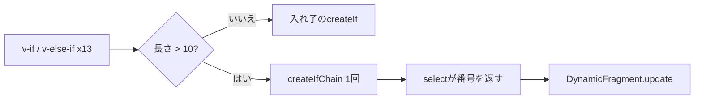

# 2026-10-22（木）

> 今日のひとこと：Vite 6.4.5 が、`server.fs.deny` を `?raw` などのクエリですり抜けられる問題（Moderate）を直した。原因は、v6.4.4 でセキュリティ修正を「半分だけ」バックポートしたことだった。

## 今日のリリース

- 【Vite】v8.3.5：バンドル版dev serverの修正が中心。チャンクのimport mapのハッシュにpreloadの依存を含める、`#` を複数含むsubpath importを解決する、など（出典: https://github.com/vitejs/vite/releases/tag/v8.3.5 ）
- 【Vite】v6.4.5：`server.fs.deny` のクエリ付きバイパス（GHSA-8g5g-mxqh-grgj）の修正（出典: https://github.com/vitejs/vite/releases/tag/v6.4.5 ）
- 【Biome】@biomejs/biome 2.6.2：リリース作業が壊れて、同日に `ci: release` が2回やり直された版。変更の中身はCHANGELOGで確認できず、不明（出典: https://github.com/biomejs/biome/commit/0d9aef6a5 ）
- 【TypeScript】pingdotgg/ts-rust v0.8.0：`@tsc-rs/typescript` のdrop-inパッケージと、増分ビルド（noEmit）の高速化（出典: https://github.com/pingdotgg/ts-rust/releases/tag/v0.8.0 ）
- 【TypeScript】vercel-labs/tsc-ts v0.0.6：scriptc 0.4.1 とコミット済みのプロファイル（PGO）でネイティブ版をビルド（出典: https://github.com/vercel-labs/tsc-ts/commit/9117c48 ）
- 【TypeScript】vercel-labs/scriptc v0.4.1：コンパイラ自体をプロファイル誘導最適化（PGO）でビルドするようになった（出典: https://github.com/vercel-labs/scriptc/commit/3cc72ac9 ）

## トップニュース

### Vite 6.4.5：セキュリティ修正の「半分のバックポート」が穴になっていた

【Vite】Vite 6.4.5 が、dev serverの `server.fs.deny` を `?raw` や `?import&url&inline` のクエリですり抜けられる問題を直した。アドバイザリ GHSA-8g5g-mxqh-grgj によると、原因は6.4.4で別の修正（#20410）だけをバックポートし、それが前提にしていた #22160 を入れ忘れたことだった。

**何が変わる**

- `isServerAccessDeniedForTransform`（`packages/vite/src/node/server/middlewares/transform.ts`）が、IDをそのまま調べるだけでなく、`cleanUrl(id)`（クエリを取り除いたID）でも `checkLoadingAccess` を呼ぶ
- どちらかが `allowed` でなければ拒否する

**なぜ変えた**：アドバイザリによれば、`.env` や `*.crt` のように `server.fs.deny` に当たるファイルでも、`?raw` などを付けるとHTTP 200で返った。クエリ付きの文字列は「deny のパターンに当たらない別のファイル名」に見えるため。

**何に効く・誰が困る**：Vite 6.4.4 を使い、`--host` か `server.host` でdev serverをネットワークに公開している人。アドバイザリが挙げる成立条件は、機密ファイルが `server.fs.allow` の許す場所にあり、`server.fs.deny` のパターンに当たること。

**ここまでの経緯**

- 2026-04-06：`server.fs.deny` のクエリ付きバイパスが公開される（同日、optimized depsの `.map` のパストラバーサルなども。アドバイザリ一覧より）
- 2026-10-06：v6.4.4 などのセキュリティリリース。[10-07の号](2026-10-07.md)で取り上げた GHSA-rq7h-c2jc-7f22 の修正を6系にも入れた
- 2026-10-21：6.4.5 で、バックポートされていなかった #22160 相当を追加（#23855）

出典: https://github.com/vitejs/vite/security/advisories/GHSA-8g5g-mxqh-grgj 、https://github.com/vitejs/vite/commit/91e40d7bf9777057bbd31c3eb036a54c9465697e

## 今日の深掘り

### Vue Vaporは、長い `v-else-if` の鎖を1つのフラグメントにまとめる（`createIfChain`）

選んだ理由：`v-if` の鎖を「入れ子の関数呼び出し」にしたときの問題と、フラットにしたときのキー割り当ての工夫が、コンパイラとランタイムの両方のコードで読める。

**背景**

Vapor Mode のコンパイラは、`v-if` を `createIf(条件, 肯定ブロック, 否定ブロック)` に変換する。`v-else-if` は否定側にまた `createIf` を入れる形になる。鎖が長いと、入れ子がそのまま呼び出しの深さになる。

コミット（`packages/compiler-vapor/src/utils.ts`）のコメントは、入れ子の `createIf` は各ブランチを前のブランチのエフェクトの中で作り、長い鎖ではスタックを使い切る、と書いている。

**変更点**

コンパイラ側。`genIf` は、鎖の長さが `IF_CHAIN_THRESHOLD`（10）を超えたら `genIfChain` に切り替える。

```ts
// packages/compiler-vapor/src/utils.ts
export const IF_CHAIN_THRESHOLD = 10
export function isLongIfChain(head: IfIRNode): boolean {
  return getIfChainLength(head) - 1 > IF_CHAIN_THRESHOLD
}
```

`genIfChain` は、条件を三項演算子の連なりにして「どのブランチか」の番号を返す関数を作る。どれにも当たらなければ `blocks.length` を返す。生成物はスナップショットで読める。

```js
const n0 = _createIfChain(() => (_ctx.c0) ? 0
  : (_ctx.c1) ? 1
  : ...
  : (_ctx.c11) ? 11
  : 12, [() => {/* ブランチ0 */}, /* ... */], ...)
```

ランタイム側（`packages/runtime-vapor/src/apiCreateIfChain.ts`）。`createIfChain(select, blocks, branchFlags, flags)` は `DynamicFragment` を1つだけ作り、`renderEffect` の中で `select()` を呼び、返った番号のブロックに `update` する。

```ts
renderEffect(() => {
  const i = select()
  const flag = branchFlag(i)
  ...
  dynamicFragment.update(blocks[i], keyBase + i, !!(flag & VaporIfFlags.TRUE_NO_SCOPE))
})
```

エフェクトは鎖全体で1つ。入れ子が消えるので、再帰の深さも一定になる。

**周辺コード：キーの予約**

`createIf` は1つのインデックスで2つのキー（肯定・否定）を使う。鎖を1つのフラグメントにすると、全ブランチと「どれにも当たらない状態」に連続したキーが要る。そのため `transform.ts` の `finalizeIfChains` が、木を作り終えたあとで鎖ごとに `Math.ceil((長さ + 1) / 2)` 個のインデックスをまとめて予約する。途中で入れ子の `v-if` に配ったインデックスは、隙間として残す（コードのコメントより）。



**この変更から分かる設計思想**

- 見た目の構文（`v-if` の鎖）が同じでも、コンパイラが長さを見て生成物の形を変える。ランタイムの制約（スタック）を、ユーザーに書き方を変えさせずに避ける
- `v-once`（`ONCE` フラグ）、ハイドレーション、`Transition`、`KeepAlive` の各テストがこのコミットで足されている。フラットにしても、入れ子のときの挙動を保つ必要があった
- なぜ閾値が10なのかは、コミットからは分からない（不明）

出典: https://github.com/vuejs/core/pull/15965 、https://github.com/vuejs/core/commit/7fad6c5ee1e518635535d15e1801c8b97ccb61f0

## 仕様の変更

### w3c/csswg-drafts

#### CSS Alignment 3 / Grid 3に `flow-start` / `flow-end` の整列エイリアスが入る

【CSS】`css-align-3` と `css-grid-3` で、`flow-start` / `flow-end` の整列エイリアスが定義された。本文の中身は未確認（コミットのタイトルと関連Issue #14052 の番号だけを確認した）。
なぜ変えたか：不明（Issue本文は未読）
出典: https://github.com/w3c/csswg-drafts/commit/3110cd02

その他：

- css-color-5：`alpha()` では `<alpha>` が必須だと明記（[#14070](https://github.com/w3c/csswg-drafts/issues/14070)）
- css-overflow-5：`scroll-axis-lock` がルートからviewportに伝播することを明示（[#13207](https://github.com/w3c/csswg-drafts/issues/13207)）
- css-masking-1：フラグメンテーション時のclip・maskの扱いを明確化（[コミット 0c7a1a2a](https://github.com/w3c/csswg-drafts/commit/0c7a1a2a)）
- selectors-5：クラスのprefixセレクターの文法を追加（[コミット 37db3e68](https://github.com/w3c/csswg-drafts/commit/37db3e68)）
- pages-3：margin ruleは `@page` に対するものだと修正（[コミット 7261a168](https://github.com/w3c/csswg-drafts/commit/7261a168)）

動きなし：whatwg/html, whatwg/dom, whatwg/fetch, whatwg/streams, whatwg/url, w3c/ServiceWorker, w3c/aria（editorialのみ）, tc39/ecma262, tc39/proposals, w3c/wcag3

## OSSのPR

### Vite

#### バンドル版dev serverのテストと修正がまとまって入る

【Vite】v8.3.5 のリリースノートの中心は、Rolldownを使うバンドル版dev server（bundled dev）の修正。`server.origin` のアセットURLへの適用、フォールバックページのutf-8宣言（#23846）、HMRの伝播が「もう importされていないモジュール」で止まる、など。
なぜ変えたか：不明（各PR本文は未読）
出典: https://github.com/vitejs/vite/releases/tag/v8.3.5

その他：

- チャンクのimport mapのハッシュにpreloadの依存を含める（[#23793](https://github.com/vitejs/vite/pull/23793)）
- subpath importが `#` を複数含む場合に対応（[#23631](https://github.com/vitejs/vite/pull/23631)）
- yarn.lockへのフォールバック時にpatchesディレクトリの確認を省く（[#23725](https://github.com/vitejs/vite/pull/23725)）
- SSRのインラインsource mapを正規表現なしで取り出す（[#23775](https://github.com/vitejs/vite/pull/23775)）
- dev側のModuleURL・ファイルパス変換を整理（[#23790](https://github.com/vitejs/vite/pull/23790)、[#23791](https://github.com/vitejs/vite/pull/23791)、[#23815](https://github.com/vitejs/vite/pull/23815)、[#23828](https://github.com/vitejs/vite/pull/23828)）
- bundled devのテストの除外・タグ付け（[#23857](https://github.com/vitejs/vite/pull/23857)、[#23835](https://github.com/vitejs/vite/pull/23835)、[#23831](https://github.com/vitejs/vite/pull/23831)、[#23801](https://github.com/vitejs/vite/pull/23801)）

### Next.js

#### Turbopack：遅延 `import.meta.glob` が、本当にコード分割されるようになる

【Next.js】`import.meta.glob` の非eager（遅延）マッチが、以前は並列のチャンクとして参照され、マッチした全モジュールが読み込み側のチャンクに入っていた。評価だけが遅れ、コード分割にはなっていなかった。今回、遅延マッチは動的 `import()` と同じ非同期エッジで読み込まれ、マッチごとに別チャンクになる（#100522）。続けて、`experimental.turbopackLazyDynamicImports` が有効なら、各マッチのコンパイル自体も、thunkが最初に呼ばれたときまで遅らせる（#100523）。
なぜ変えたか：「遅延」と名乗りながらバンドルサイズが減らなかったため（PR本文より）。
出典: https://github.com/vercel/next.js/pull/100522 、https://github.com/vercel/next.js/pull/100523

#### Turbopack：チャンク読み込みのPromiseの同一性を保つ

【Next.js】Node向けdevランタイムで、未キャッシュのチャンクを読むたびに新しいPromiseが作られていた。`__next_chunk_load__` が返すPromiseの同一性にReactが依存しているため、`loadChunkAsync` 自体を `__turbopack_ensure_chunk__` に対応させる形に直した（#100421）。
なぜ変えたか：#98836 の上書きが、Reactの前提（同じチャンクなら同じPromise）とReactのdev非同期追跡を壊していた。
出典: https://github.com/vercel/next.js/pull/100421

その他：

- リクエストspanを経路の準備より前に開始し、middlewareとrenderを同じOpenTelemetryトレースの兄弟にする（[#100349](https://github.com/vercel/next.js/pull/100349)、[#100294](https://github.com/vercel/next.js/pull/100294)、[#100350](https://github.com/vercel/next.js/pull/100350)）
- Pages RouterのISRエントリで `cacheControl` を永続化（[#100495](https://github.com/vercel/next.js/pull/100495)）
- Server Actionsを `getStaticProps` から呼ぶと `__next_require__ is not a function` になる問題を修正（[#99912](https://github.com/vercel/next.js/pull/99912)）
- devでprerender manifestの更新競合を修正（[#100521](https://github.com/vercel/next.js/pull/100521)）
- 最後のruntime prerenderでキャッシュ値を保持（[#100447](https://github.com/vercel/next.js/pull/100447)）
- Durable use cacheがNode workerでクラッシュしないよう修正（[#100505](https://github.com/vercel/next.js/pull/100505)）
- turbo-tasksの無効化まわりの高速化・整理（[#100485](https://github.com/vercel/next.js/pull/100485)、[#100460](https://github.com/vercel/next.js/pull/100460)、[#100465](https://github.com/vercel/next.js/pull/100465)、[#100515](https://github.com/vercel/next.js/pull/100515)）
- TurboMallocとtraceにプロセスのRSSを記録（[#99527](https://github.com/vercel/next.js/pull/99527)）
- Turbopack：`import.meta.glob` の実行テスト（[#100532](https://github.com/vercel/next.js/pull/100532)）
- swc v82.2.0 へ更新（[#100508](https://github.com/vercel/next.js/pull/100508)）
- フォントデータの更新はbot、docsとテストの変更は対象外

### oxc

#### minifierが、範囲外の文字列インデックスを `void 0` に畳む

【oxc】`"abc"[5]` のような範囲外の添字を、コンパイル時に `void 0` にする（#28004）。
なぜ変えたか：不明（PR本文は未読）
出典: https://github.com/oxc-project/oxc/pull/28004

#### formatterの `FormatElement` が16バイトに縮む

【oxc】`FormatElement` を16Bに縮め（#28012）、`AstNode` をスタックに置いて、リンクだけをアリーナに入れる形にした（#27963）。メモリ使用量と速度のための変更。数字はPRでは未確認。
出典: https://github.com/oxc-project/oxc/pull/28012 、https://github.com/oxc-project/oxc/pull/27963

その他：

- minifier：restの分割代入の副作用を保持（[#27981](https://github.com/oxc-project/oxc/pull/27981)）
- ecmascript：`parseFloat` / `parseInt` / `trim` の畳み込みでECMAScriptの空白を使う（[#27719](https://github.com/oxc-project/oxc/pull/27719)）
- semantic・linter：lone surrogateを含む名前をenumとlintのチェックで報告（[#27991](https://github.com/oxc-project/oxc/pull/27991)）
- react-compiler：`try` 内のthrowがリアクティビティを制御するよう修正（[#28005](https://github.com/oxc-project/oxc/pull/28005)）
- linter：`jest/no-conditional-expect` が関数式のコールバックも検査（[#28055](https://github.com/oxc-project/oxc/pull/28055)）、`prefer-const` はreassignされる宣言子があるときfixerを出さない（[#28008](https://github.com/oxc-project/oxc/pull/28008)）
- linter・astのヘルパー再利用リファクタ約30件（#28009〜#28053）、`is_await` を `is_await_using` に改名（[#28043](https://github.com/oxc-project/oxc/pull/28043)）
- コメント整理（[#28030](https://github.com/oxc-project/oxc/pull/28030)、[#28028](https://github.com/oxc-project/oxc/pull/28028)、[#28046](https://github.com/oxc-project/oxc/pull/28046)）、formatterコアのAPI縮小（[#28017](https://github.com/oxc-project/oxc/pull/28017)）

### Svelte

- a11yチェックで、`role` の最初の有効なフォールバック値を使う（[#19045](https://github.com/sveltejs/svelte/pull/19045)）
- `batch` の交差ロジックの整理、`batch.#is_skipped` の追加（[#19061](https://github.com/sveltejs/svelte/pull/19061)、[#19058](https://github.com/sveltejs/svelte/pull/19058)）
- AGENTS.md にセキュリティポリシー、CIの整理（[#19067](https://github.com/sveltejs/svelte/pull/19067)、[#19046](https://github.com/sveltejs/svelte/pull/19046)）

### Vue（minor ブランチ）

（深掘りの `createIfChain` の #15965 が中心）

- Vaporの `v-else-if` 鎖でも `v-once` の挙動をvdomに合わせる（[#15966](https://github.com/vuejs/core/pull/15966)）
- Vaporのkeyed `v-for` 行のルートが、収集時とブランチ再描画時で同じキーになるよう修正（[#15968](https://github.com/vuejs/core/pull/15968)）
- Vaporで、スロット内容の兄弟 `v-if` ルートを1つのTransition子として切り替える（[#15945](https://github.com/vuejs/core/pull/15945)）
- Transitionの同一性と「leave」状態をブロックに持たせるリファクタ（[#15961](https://github.com/vuejs/core/pull/15961)）

### Solid（next ブランチ）

#### `broadcast()` で、複数の閲覧者が1つのサーバーレンダーを共有する

【Solid】`frames` の `broadcast()` 宣言は「答えはどの閲覧者でも同じ」という約束。同じ引数のライブ呼び出しは1回のレンダーを共有し、メッセージを1回だけシリアライズして、全員の接続に書く。後から入った人は、キーごとの最新のレコードを再生してから、共有のバッチに追いつく。
なぜ変えたか：サーバーのCPU負荷のため。コミットメッセージによれば、dbmon（400行、1tickで10%更新、毎秒5tick）で、50人の閲覧者は1106〜1110 ms/s（飽和）から171〜181 ms/s に、10人は304〜335 から71〜81 になった（作者の計測）。solidjs/solid-start#2359 の移植。
出典: https://github.com/solidjs/solid/pull/4191

その他：

- リッチなサーバー関数の引数のどこにでもファイルを送れるように（[#4208](https://github.com/solidjs/solid/pull/4208)）
- シグナル：クリーンアップが投げた後に延期された解放を戻す（[#4176](https://github.com/solidjs/solid/pull/4176)）、読まれていないpendingメモが、判定済みでマウントされたLoadingを握らない（[#4207](https://github.com/solidjs/solid/pull/4207)）、リアクションのarmを追跡前に捕まえる（[#4188](https://github.com/solidjs/solid/pull/4188)）
- `renderToStream` のシリアライザ・クリーンアップのエラーを、ambientなフックへ渡す（[#4206](https://github.com/solidjs/solid/pull/4206)）
- devで、stateful bindingが未コミットの編集を上書きしたときに警告（[#4205](https://github.com/solidjs/solid/pull/4205)）
- `createDeferred` などのドキュメントとchangeset（[#4183](https://github.com/solidjs/solid/pull/4183)、[#4209](https://github.com/solidjs/solid/pull/4209)）

### microsoft/TypeScript

- 変更のないビルドで、ルートの繰り返しスキャンを避ける（[#64898](https://github.com/microsoft/TypeScript/pull/64898)）
- プロパティのhoverで、index signatureの詳細を復元（[#64586](https://github.com/microsoft/TypeScript/pull/64586)）
- 未リリースのタグがあるときの扱いを修正（[#64887](https://github.com/microsoft/TypeScript/pull/64887)）

### Go版チェッカーの移植（ts-rust / tsrs / tsc-ts / scriptc）

#### tsc-ts v0.0.6：scriptc 0.4.1 とコミット済みのプロファイルでビルドする

【TypeScript】tsc-ts のネイティブ版が、`profiles/tsc-ts.profdata` を使うプロファイル誘導最適化（PGO）つきでビルドされるようになった。プロファイルは `scripts/refresh-profile.mjs` が、tsc-ts自身と、tRPC・TypeORM・Playwright・Excalidrawのチェックから集める（コミットメッセージより）。
同日の主な変更は、パーサースレッドが返したファイルから順に読み込む、tsgoの順序で先読みする、型引数リストをチェッカー内で共有する、など。速度の数字はコミットにはなく、不明。
出典: https://github.com/vercel-labs/tsc-ts/commit/0c64133 、https://github.com/vercel-labs/tsc-ts/commit/9117c48

#### scriptc v0.4.1：コンパイラ自身をPGOでビルドする

【TypeScript】scriptc のネイティブコンパイラが、プロファイル誘導最適化でビルドされる（コミット 2b48451c）。同日に約65コミット。配列ヘッダを32バイトに縮める、ASCII文字列の `charAt` / `indexOf` / `slice` を速くする、`tls.connect` / `tls.createServer` のALPNとTLSバージョンの扱い、`fs.promises.rm` のオプションなど。数字は自己申告で、コミットから取れたものはない。
出典: https://github.com/vercel-labs/scriptc/commit/3cc72ac9

#### ts-rust v0.8.0：`@tsc-rs/typescript` のdrop-inパッケージ

【TypeScript】READMEでは、`tsc-rs` がT3 Codeの全体チェックで14.30秒、`--fast` で9.77秒、`tsc` 7（`@effect/tsgo`）が42.55秒と、自己申告されている（READMEはv0.6.0の時点の記載）。v0.8.0 のマージ（#96）は、`@tsc-rs/typescript` のdrop-inパッケージと、増分noEmitの高速化。個別の数字は未確認。
出典: https://github.com/pingdotgg/ts-rust/releases/tag/v0.8.0

その他：

- oxc-project/tsrs：unknown-likeなunionのmemoヒットをインライン化（[#658](https://github.com/oxc-project/tsrs/pull/658)）、上位400リポジトリのconformance CIを復活（[#644](https://github.com/oxc-project/tsrs/pull/644)）、脆弱なTLSクレートを更新（[#648](https://github.com/oxc-project/tsrs/pull/648)）、CodSpeedのmemory/walltimeを計測（[#643](https://github.com/oxc-project/tsrs/pull/643)）
- oven-sh/bun：`bun check` / `bun fmt` に関わるPRはなし

### Biome

#### 新しいlintルールが1日で20個近く入る

【Biome】Carson McManus氏が2026-10-21（米東部時間）に、`noNewRequire`、`noPathConcat`、`useMathTrunc`、`useMathAbs`、`useIteratorZip`、`noEagerArrayMethodsInLoops`、`noUselessSplice`、`useExpectToContain`、`noPlaywrightNthMethods`、`useVueTypedRef`、`noVueUnusedEmitDeclarations`、`noZeroLengthUnit`、`noShortTimeValues`、`noDanglingUnderscore`、`useConsistentUnicodeBom`、`useReactNativeValidPlatformColors`、`noTanstackQueryRestDestructuring`（TanStack Queryのdomainも追加）などをまとめて追加した。ほぼすべてがESLint系プラグインのルールの移植とみられる（推測）。
なぜ変えたか：不明
出典: https://github.com/biomejs/biome/pull/12121 ほか（#12113、#12216、#12224、#12248、#12258、#12270、#12286、#12287、#12289、#12293、#12298、#12299、#12304、#12311、#12387、#12499）

#### Vueのセマンティックモデルが入り、HTMLルールから使えるようになる

【Biome】Vueファイルの意味情報を持つ「Vue Semantic Model」を追加し（#12260）、HTMLのlintルールから参照できるようにした（#12520）。`useVueTypedRef` や `noVueUnusedEmitDeclarations` のような、宣言の使われ方を見るルールの土台とみられる（推測）。
出典: https://github.com/biomejs/biome/pull/12260

その他：

- JSフォーマッター：instantiation expression のオペランドの括弧を保つ（[#12496](https://github.com/biomejs/biome/pull/12496)）
- TLS脆弱性のアドバイザリに対応して依存を更新（[#12490](https://github.com/biomejs/biome/pull/12490)）
- 壊れたリリースのやり直し・CHANGELOG修正（[#12494](https://github.com/biomejs/biome/pull/12494)、[#12497](https://github.com/biomejs/biome/pull/12497)）

### GHC / Wado

- ghc/ghc：動きなし
- wado-lang/wado：約50コミット（`wado-bot` の `chore: tidy` を含む）。`docs/wep-*.md` の追加・変更は確認できなかった。内容は、divergence（`!` 型）の扱いをmove checkとmissing-returnの検査で共有する、関数ローカルのstructを型システムに伝える、`gale`（パーサー生成）のATN verify検査など。設計の変更として拾えるものは今日はなし

動きなし：facebook/react（Rustコンパイラの診断位置の修正 [#37898](https://github.com/facebook/react/pull/37898) のみ）

## 続報

- 10月7日の号で取り上げた Vite の `server.fs` まわり（GHSA-rq7h-c2jc-7f22 など）のバックポートが、v6.4.5 で漏れ分まで反映された（[10-07の号](2026-10-07.md)）
- 10月21日の号の Solid 2.0.0-rc.16 の `createDeferred` について、ドキュメントとchangesetが `next` に入った（#4183、#4209）（[10-21の号](2026-10-21.md)）
- 10月19日の号の tsc-ts は、scriptc 0.4.0 でのビルドから、0.4.1 とPGOでのビルドへ進んだ（[10-19の号](2026-10-19.md)）

## 脆弱性

### Vite 6.4.4：`server.fs.deny` がクエリ付きリクエストで回避される（GHSA-8g5g-mxqh-grgj、2026-10-21公開）

【脆弱性】影響は npm `vite` の 6.4.4。修正版は 6.4.5。深刻度は Moderate（CVSS v4 で 6.9）。CVEなし。弱点の分類は CWE-180（正規化の前に検証）と CWE-284。報告者は Hama1cco。

**攻撃原理**

`?raw`、`?import&raw`、`?import&url&inline` のようなクエリを、deny対象のファイルへのリクエストに付ける。`isServerAccessDeniedForTransform` は `rawRE`・`urlRE`・`inlineRE`・`svgRE` のどれかに当たるときだけ `checkLoadingAccess` を呼び、そのとき渡すIDにクエリが残っていた。クエリが付いたIDは `server.fs.deny` のパターン（`.env` や `*.crt`）に当たらず、許可と判定されて内容が返る。

**影響バージョンと成立条件**

- 6.4.4 のみ（アドバイザリの記載）
- dev serverを `--host` / `server.host` でネットワークに公開している
- 機密ファイルが `server.fs.allow` の許す場所にあり、`server.fs.deny` のパターンに当たる

**修正コミット**（`vitejs/vite`、91e40d7bf）

```ts
// packages/vite/src/node/server/middlewares/transform.ts
return (
  checkLoadingAccess(config, cleanUrl(id)) !== 'allowed' ||
  checkLoadingAccess(config, id) !== 'allowed'
)
```

クエリを取り除いたIDと、元のIDの両方を検査する。どちらかが拒否なら拒否になる。

**同種の脆弱性パターン**：このアドバイザリの根本原因は「部分的なバックポート」。6.4.4 は #20410 を入れたが、その修正が前提にする #22160 は入れなかった。アドバイザリはこれを GHSA-v2wj-q39q-566r（新しい系統では修正済み）と同じ問題としている。セキュリティ修正が複数のPRに分かれているとき、旧版へは「依存する修正をまとめて」入れる必要がある。また「検証してから正規化」ではなく「正規化してから検証」にするのが定石（CWE-180）。10月7日の号の `?vite-wasm-instance` の件（[10-07の号](2026-10-07.md)）も、同じ関数に条件を足して直していた。

他の対象（react、next、svelte、vue、oxc、astro、nuxt、TanStack router）は、前回の実行以降の新規アドバイザリなし。

出典: https://github.com/vitejs/vite/security/advisories/GHSA-8g5g-mxqh-grgj

## 仕様を読む会の候補

- Vueの `createIfChain`：`compiler-vapor/src/generators/if.ts` と `runtime-vapor/src/apiCreateIfChain.ts` を並べ、入れ子の `createIf` との違いと、キー予約の考え方を読む。コンパイラとランタイムの境界の設計が1コミットで見える
- Viteの `server.fs` の判定：`checkLoadingAccess` と `isServerAccessDeniedForTransform` を、10月6日・21日の修正履歴と並べて読む。「どの文字列で検査するか」が3回変わった経緯が追える
