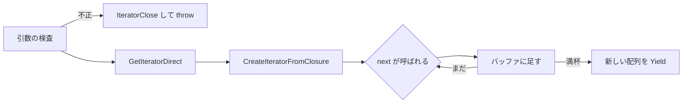

# 2026-10-23（金）

> 今日のひとこと：`Iterator.prototype.chunks` と `windows` がECMA-262の本文に入った。9月29日にStage 4になった提案が、10月22日にマージされて仕様になった。新規の脆弱性はありません。

## 今日のリリース

- 【TypeScript】vercel-labs/tsc-ts v0.0.7：import先の解決をチェッカーごとに1回にし、長いプロパティ一覧の比較を速くした。自己申告で、v0.0.6比のチェックが0.6〜6.2%速い（出典: https://github.com/vercel-labs/tsc-ts/commit/3b67267 ）
- 【TypeScript】vercel-labs/scriptc v0.4.2：tsc-ts 0.0.7 を使い、型情報をまとめて問い合わせるようにして大きなプログラムのビルドを速くした（出典: https://github.com/vercel-labs/scriptc/releases/tag/v0.4.2 ）

## トップニュース

### Iterator.prototype.chunks / windows が仕様本文に入る

【TC39】tc39/ecma262 に、イテレータを「n個ずつの配列」にまとめる `Iterator.prototype.chunks` と、1つずつずらしながら窓を作る `windows` が入った（2026-10-22、#3970）。提案がStage 4になったのは[9月30日の号](2026-09-30.md)で取り上げた9月29日のTC39会議で、今日はそれが仕様の本文になった日。

**何が変わる**

- `iterator.chunks(n)`：重ならない長さnの配列を順に返す。最後に余りがあれば、短い配列を1つ返す
- `iterator.windows(n, undersized)`：直近n個を持つ窓を1つずつずらして返す。`undersized` は `"only-full"`（既定）か `"allow-partial"`。入力がn個に満たないときだけ、`"allow-partial"` なら短い配列を1つ返す

**なぜ変えた**：このPR自体には動機の説明がなく、提案リポジトリ（tc39/proposal-iterator-chunking）へのリンクだけがある。動機の詳細は「不明」。

**何に効く・誰が困る**：配列に変換せずに、遅延評価のまま「2要素ずつ」「前後3個の移動窓」を書ける。仕様に入っただけなので、各エンジンの実装はこれから。

**ここまでの経緯**

- 2026-09-02：Stage 4用のPR（#3970）が開かれる
- 2026-09-29：TC39会議でStage 4に（[09-30の号](2026-09-30.md)）
- 2026-10-04：同じ系統の `Iterator.prototype.join` が本文に入る（[10-04の号](2026-10-04.md)）
- 2026-10-22：#3970 がマージされる

出典: https://github.com/tc39/ecma262/pull/3970

## 今日の深掘り

### `windows` は「バッファの先頭を捨てて末尾に足す」だけで窓になる

選んだ理由：仕様の手順が短く、イテレータ・ヘルパー共通の作り（Abstract Closure、`IteratorClose`）の読み方が分かる。コミット 4a0d3f8 の `spec.html` を読む。

**背景**

`Iterator.prototype.map` などのヘルパー（ES2025）は、`CreateIteratorFromClosure` で遅延するイテレータを作る。`chunks` と `windows` も同じ型で、新しいのはバッファを持つ点。

**変更点**

引数の検査が先に来る。`windowSize` が整数でなければ `TypeError`、1〜2^32−1の範囲外なら `RangeError`。どちらも `IteratorClose(_iterated_, _error_)` で元のイテレータを閉じてから投げる。

```
1. If _windowSize_ is not an integral Number, then
  1. Let _error_ be ThrowCompletion(a newly created *TypeError* object).
  1. Return ? IteratorClose(_iterated_, _error_).
```

引数を調べる時点では、`[[NextMethod]]` が `undefined` のIterator Recordを作って閉じている。`GetIteratorDirect` は検査の後。つまり不正な引数のときに `next` を読まない。

本体はクロージャの中のループ。

```
1. If the number of elements in _buffer_ is ℝ(_windowSize_), then
  1. Remove the first element from _buffer_.
1. Append _value_ to _buffer_.
1. If the number of elements in _buffer_ is ℝ(_windowSize_), then
  1. Let _completion_ be Completion(Yield(CreateArrayFromList(_buffer_))).
  1. IfAbruptCloseIterator(_completion_, _iterated_).
```

バッファがいっぱいなら先頭を捨てて、末尾に足し、満杯のときだけ配列にして `Yield` する。`CreateArrayFromList` は毎回新しい配列を作るので、受け取った側が配列を書き換えても次の窓には影響しない。

`chunks` との違いは、満杯のあとにバッファを空にするか（`chunks`）、先頭だけ捨てるか（`windows`）。終了時は、`chunks` は余りがあれば返す。`windows` は `"allow-partial"` かつ「バッファが空でなく、n個に満たない」ときだけ返す。

**周辺コード**



**この変更から分かる設計思想**

- 失敗するときも元のイテレータを閉じる。リソースを持つイテレータを守る、ES2025のヘルパーと同じ方針
- 窓の配列は毎回コピーする。速さより、受け取った側が壊せないことを選んでいる
- 推測：`undersized` が文字列のオプションなのは、将来の選択肢を足せるようにするためだと思われるが、根拠は読めていない

出典: https://github.com/tc39/ecma262/commit/4a0d3f8

## 仕様の変更

### whatwg/html

#### 子ナビゲーションのCORPチェックを、HTTP(S)の応答だけにする

【HTML】COEP（Cross-Origin-Embedder-Policy）の下で、子ナビゲーション（iframe）への応答に対するCORP（Cross-Origin-Resource-Policy）チェックを、URLのスキームがHTTPかHTTPSのときだけ実行するようにした。これまでは `about:blank`、`data:`、`blob:` の応答も対象で、CORPヘッダーがないために、不透明なオリジンなどで同一オリジン扱いにならずブロックされていた。
なぜ変えたか：Chromium、Gecko、WebKitは `about:blank` と `data:` を許し、ChromiumとGeckoは `blob:` も許していて、仕様が実装とずれていたため（whatwg/html#13086 を修正）。
出典: https://github.com/whatwg/html/commit/b342939

### tc39/ecma262

トップニュースで扱った #3970 のほか、エディトリアルの変更（`JoinIndexedProperties` の整理など、#3958 ほか）は除外。

### w3c/csswg-drafts

#### 注目

#### `display-mode` メディア特徴が、ブラウザ自身の表示モードに一致できる

【CSS】`[mediaqueries-5]` で、ブラウザのUIそのものが使われている表示モード（`browser`）に一致するよう整えられた（#14125）。本文の詳細は読めていないので、挙動の細部は不明。
なぜ変えたか：不明（PR本文は未確認）。
出典: https://github.com/w3c/csswg-drafts/commit/bfd43540

その他：

- css-fonts-4でカーニングが `palt` に依存することを規定として明記（[#6723](https://github.com/w3c/csswg-drafts/issues/6723)）
- css-font-loading-3のIDLの誤りを2コミットで修正（[dba3578b](https://github.com/w3c/csswg-drafts/commit/dba3578b)、[79059f56](https://github.com/w3c/csswg-drafts/commit/79059f56)）

動きなし：whatwg/dom, whatwg/fetch, whatwg/streams, whatwg/url, w3c/aria, w3c/ServiceWorker, w3c/wcag3

## OSSのPR

### Next.js

32件。依存や内部の整理が中心で、注目はなし。

その他：

- Turbopackで、PURE注釈つきのコンストラクタ呼び出しとコールバック引数を評価対象にする（[#100588](https://github.com/vercel/next.js/pull/100588)、[#100577](https://github.com/vercel/next.js/pull/100577)）
- ボットのUser-Agent照合を1KBで打ち切る（[#100604](https://github.com/vercel/next.js/pull/100604)）
- ストリーミング中にキューされたキャッシュ再検証の不具合を修正（[#100448](https://github.com/vercel/next.js/pull/100448)）
- サーバー側importの遅延化をルートハンドラーとPagesに拡張（[#99541](https://github.com/vercel/next.js/pull/99541)）
- ほか、CI・テスト・turbo-tasksの内部修正など

### Vite

その他：

- bundled-devで、Node組み込みモジュールからの名前付きimportを許可（[#23858](https://github.com/vitejs/vite/pull/23858)）
- `ssr.target=webworker` で、組み込みモジュールへの外部 `require` をimportに変換（[#23759](https://github.com/vitejs/vite/pull/23759)）
- 静的な `alias` の置換で `$&` などの特殊パターンをそのまま扱う（[#23703](https://github.com/vitejs/vite/pull/23703)）
- Rolldown関連の依存更新（[#23868](https://github.com/vitejs/vite/pull/23868)）、テスト2件

### oxc

38件。リンターのリファクタリング（Cam McHenry氏の連続コミット）が大半。

その他：

- フォーマッターが、プライベート `in` 式や、インスタンス化式のオペランドの括弧を保つ（[#28096](https://github.com/oxc-project/oxc/pull/28096)、[#28025](https://github.com/oxc-project/oxc/pull/28025)）
- フォーマッターの幅の判定を表示幅で測る（[#28098](https://github.com/oxc-project/oxc/pull/28098)、[#28026](https://github.com/oxc-project/oxc/pull/28026)）
- パーサーが、`let` の後置更新、エスケープされたクラスフィールド名、`import source type` を読める（[#28060](https://github.com/oxc-project/oxc/pull/28060)、[#28061](https://github.com/oxc-project/oxc/pull/28061)、[#28062](https://github.com/oxc-project/oxc/pull/28062)）
- ランタイム変換で、async iteratorの `throw` をBabelに合わせる（[#28059](https://github.com/oxc-project/oxc/pull/28059)）
- minifierの引数の書き換え、`no-useless-concat` などの修正

### TypeScript（Go版チェッカーの移植）

#### oxc-project/tsrs：安定版に向けて性能と堅牢性の修正が続く

【oxc】コミット約155件。チェッカーの性能（単純な型関係の高速パスのインライン化 #699、一時的なexport解決テーブルの解放 #710）、APIサーバーのリクエストあたりの処理削減、CIでの全コンフォーマンスのベースライン検査（#714）が中心。リリースは 0.15.0（10-14、`--watch` がLinux/macOSで動く）、0.16.0（10-16、パッケージのスコープが `@ts-rs` から `@tsrs` へ）、0.18.0（10-19）。速度の数字はリリースノートの自己申告。
なぜ変えたか：不明（コミットメッセージにはなく、docs の方針は #704）。
出典: https://github.com/oxc-project/tsrs/releases

その他：

- microsoft/TypeScript本体は2件のみ（watchの`Created`イベントでキャッシュ済みファイルを再読込 [#64909](https://github.com/microsoft/TypeScript/pull/64909)、Copilot向け指示 [#64926](https://github.com/microsoft/TypeScript/pull/64926)）
- vercel-labs/tsc-ts：v0.0.7までの最適化（自己申告）。宣言をインデックスで読む（[#297](https://github.com/vercel-labs/tsc-ts/pull/297)）、パース済みリストを正確な長さで保持（[#296](https://github.com/vercel-labs/tsc-ts/pull/296)）ほか全22コミット
- pingdotgg/ts-rust：64コミット。大半は進行状況を記録するdocsのコミット。wasm32向けのclippyとWASIのケース判定テストを追加。最新リリースは v0.8.0（10-21、`@tsc-rs/typescript` のdrop-in）。今日の変更は件数のみ
- vercel-labs/scriptc：約325コミット（重複を含む）。v0.4.2が出た。AST子ノードの取得をスロット指定にする、Map/Setをdynamicなイテラブルから作る対応ほか。件数のみ

### Biome

21件。lintの新規ルールが中心。

その他：

- 新ルール `noUnsafeReturn`（[#12422](https://github.com/biomejs/biome/pull/12422)）、`noSelfNestedLayer`（[#12343](https://github.com/biomejs/biome/pull/12343)）、`noBooleanSortComparator`（[#12432](https://github.com/biomejs/biome/pull/12432)）ほか計約10件のルール追加
- ESLintの `react/self-closing-comp` の移行に対応（[#12539](https://github.com/biomejs/biome/pull/12539)）
- インスタンス化式の括弧、CSSプロパティの並べ替え、Markdownの整形の修正

### Svelte

その他：

- 非同期derivedのラベルを改善（[#19068](https://github.com/sveltejs/svelte/pull/19068)）

### GHC

その他：

- アンボックス値用のdo記法 `GHC.Internal.Unboxed.Do` を追加し、Bignumで使用（[#27944](https://gitlab.haskell.org/ghc/ghc/-/issues/27944) のコミット 71808e29a1、33247780fc）
- JSバックエンドで、wasmオブジェクトの後のアーカイブのパディングを削除（[593f5f5bbe](https://github.com/ghc/ghc/commit/593f5f5bbe)）

### Wado

#### 代入の分割（destructuring assignment）と、値のコピーなしのswapのWEP

【Wado】`docs/wep-2026-10-21-destructuring-assignment.md` が追加された。`let t = xs[i]; xs[i] = xs[j]; xs[j] = t;` のように書くと、複合型の要素では要素ごとに値のコピーが起きる。所有権の解析はローカル変数ならmoveにできるが、要素は `IndexValue`（読み）と `IndexAssign`（書き）が別々で、同じ場所だと分からない。Rustのように`&mut` を使う方法も、プリミティブ要素が `&mut` を取れないために合わない。そこで、swapを代入ターゲットの1形式として、専用のトレイトに振り分ける案を検討している。
なぜ変えたか：複合型要素のソートが、値のコピーに時間を取られるため。
出典: https://github.com/wado-lang/wado/blob/main/docs/wep-2026-10-21-destructuring-assignment.md

その他：

- 全77コミット。`sort_by` を参照とmoveでmergeする、`&` ローカルが指す要素を不変に保つ最適化の修正、wasmtime 50.0.0でのベンチマークの再測定など。件数のみ

動きなし：facebook/react, vuejs/core（minor）, solidjs/solid


## 仕様を読む会の候補

- ECMA-262 `Iterator.prototype.chunks` / `windows`（#3970）：手順が短く、バッファ・引数検査・`IteratorClose` の扱いを1時間で読み切れる。`map` などのヘルパーとの比較も入れやすい
- Wado WEPの「コピーなしのswap」：言語設計のドキュメントで、Rustとの比較を軸に「なぜ `&mut` では駄目か」が読める
