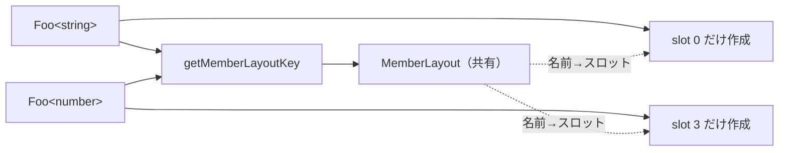

# 2026-10-24（土）

> 今日のひとこと：Go版TypeScriptのチェッカーに、クラスとインターフェースのメンバーを「使われるまで作らない」遅延解決が入った（vscodeでシンボル数が約46%減と、PRで報告されている）。新規の脆弱性はありません。

## 今日のリリース

- 【Vue】v3.6.0-rc.13：Vaporのtree-shaking改善（interopコードを使わないときに除く）と、条件付きスロットの再マウント修正など（出典: https://github.com/vuejs/core/releases/tag/v3.6.0-rc.13）
- 【Next.js】v16.4.3：16.4系へのバックポート。Google Fontsの拡張子なしURL、`proxy.ts` でのapp-pageランタイム読み込み、OpenTelemetryのトレースが分断される問題などを修正（出典: https://github.com/vercel/next.js/releases/tag/v16.4.3）
- 【TypeScript】tsc-ts v0.0.8、v0.0.9：宣言の診断を扱うチェッカーの修正や、Windowsでの名前付きパイプ経由のAPIなど。自己申告のプロジェクト（出典: https://github.com/vercel-labs/tsc-ts/tags）
- 【TypeScript】scriptc v0.4.3：型付き配列、Streams、Bufferまわりの対応を中心にした更新（出典: https://github.com/vercel-labs/scriptc/tags）

## トップニュース

### Go版TypeScriptのチェッカーが、メンバーを遅延解決するようになる

【TypeScript】`microsoft/TypeScript` の `main` に、Anders Hejlsbergによる「クラスとインターフェース型のメンバーの遅延解決」（#64915）が10月23日にマージされた。型のインスタンス化のたびにメンバーのシンボルをすべて作る処理をやめ、共有のレイアウトから必要なときにだけ作る。

**何が変わる**
これまでは、`Foo<string>` のような型参照を解決すると、宣言されたメンバーも継承したメンバーも一度に全部インスタンス化していた。新しい実装では、型ごとに「メンバーの並び（レイアウト）」を共有し、各インスタンスは要求されたスロットだけを埋める。

**なぜ変えた**
PRの説明によれば、狙いはネイティブ版チェッカーの過剰なメンバーのインスタンス化を減らすこと。PRに貼られた計測では、vscodeでシンボル数が約46%（1330万→720万）、メモリが約14%、チェック時間が約7%減った。他のベンチマークでもメモリは12〜34%減っている。一方、Compiler-Unionsではシンボルが約23%減ったのにチェック時間は約3%増えた。数字はPR内の計測（自己申告）で、こちらでは再現していない。

**何に効く・誰が困る**
大きなコードベースで型チェックのメモリが下がる。副作用として、数値名のメンバーとタプルの `length` が、`Array<T>` から継承したメンバーより前に並ぶようになり、診断が1件変わっている（`arityAndOrderCompatibility01.errors.txt`）。

**ここまでの経緯**
- 2026-10-21：#64915 が開かれる。着想元は #64765 とPRに書かれている。
- 2026-10-23：レビューとベンチマークを経てマージ。途中でarktypeのベンチマークがnilポインタで落ち、後続コミットで修正された。
- 同じ「Go版チェッカーの移植・高速化」の流れは、[10-20の号](2026-10-20.md)の `bun check`、[10-19の号](2026-10-19.md)の tsc-ts でも扱った。

出典: https://github.com/microsoft/TypeScript/pull/64915

## 今日の深掘り

### 型が「メンバーの表」を共有する：#64915のデータ構造を読む

**選んだ理由**：チェッカーの最大のコストの一つ、型のメンバー解決を、データ構造の置き換えで減らしている。型システムの実装がどこで時間とメモリを使うかを学べる。

**背景**
`Array<string>` と `Array<number>` は、宣言上は同じメンバー（`push`、`map` …）を持つ。違うのは型引数だけだが、インスタンス化のたびに全メンバーのシンボルを作り直していた。使うのは `.length` だけでも、全員分を作っていた。

**変更点**
`tsc/internal/checker/types.go` に、遅延状態とレイアウトの型が足された（コミット 8d9b6da99e）。

```go
type LazyState struct {
	layout             *MemberLayout
	mapper             *TypeMapper
	baseTypes          []*Type
	propertiesResolved bool
}

type MemberInfo struct {
	symbol    *ast.Symbol // Uninstantiated symbol
	baseIndex int32       // Index of base type with symbol, or -1 if locally declared
	slotIndex int32       // Index of resolved symbol in members array
}
```

`MemberLayout` は名前→`MemberInfo` の表を持つ。表は型引数が違っても共有できる。`MemberInfo` は「宣言元のシンボル」と「どの基底型から来たか」だけを覚える。

実際のシンボルは `getPropertyAt` が初めて呼ばれたときに作る。自分で宣言したメンバーは `instantiateSymbol` で、継承したメンバーは基底型側の `getPropertyOfType` で取る。

```go
member := t.properties[index]
if member == nil {
	memberInfo := lazy.layout.memberInfos[index]
	if memberInfo.baseIndex < 0 {
		member = t.checker.instantiateSymbol(memberInfo.symbol, lazy.mapper)
	} else {
		member = t.checker.getPropertyOfType(lazy.baseTypes[memberInfo.baseIndex], memberInfo.symbol.Name())
	}
	t.properties[index] = member
}
```

名前で引く `getMember` は、全メンバーを作らず、表で名前→スロットを引いて1つだけ作る。全メンバーが必要な `getProperties` だけが、従来どおり全スロットを埋める。

**周辺コード**
`resolveObjectTypeMembers` は、クラスと型参照で別々だった解決関数を1つにまとめた。レイアウトのキャッシュは、宣言元の型、宣言済みメンバー数、各基底型のレイアウトIDから作るキー（`getMemberLayoutKey`）で引く。



キーに「宣言済みメンバー数」を入れる理由は、コメントに「遅延束縛（late binding）で宣言メンバーが増えうる」とある。レイアウトを先に作る順序にも「継承したシグネチャが循環して依存しうる」というコメントが付いている。テストに `lateBoundMemberLayoutReentrancy.ts` が足されているのは、この再入の穴を塞ぐためだと読める（推測）。

**設計思想**
- 同じ形の型は、表（レイアウト）を共有し、値（シンボル）だけを個別に持つ。
- 全部を先に作る代わりに、使われた分だけ払う。ただし全部が必要な経路（`getProperties`）は残し、互換を保つ。
- 注意：PRにはCopilotが「レイアウトのキー設計が、継承メンバーの違う基底型のインスタンス化を同一視しうる」と指摘したスレッドがある。結論は読めた範囲では確認できず、不明。

出典: https://github.com/microsoft/TypeScript/pull/64915

## OSSのPR

### TypeScript（Go版チェッカーの移植）

#### oxc-project/tsrs：チェッカーの内部表現を小さくする最適化が続く

【oxc】tsrs では、インスタンス化されたシンボルを16バイトに圧縮（#732）、シグネチャのリンクを圧縮（#745）、増分ビルドで宣言の遅延生成を有効化（#727）といった、メモリと速度の変更が続いた。一方で、決定性ゲートをtsgoのスナップショット比較に置き換えた（#748）。
なぜ変えたか：TypeScript 7.1に向けて、tsgoとの一致を保ったまま速くするため。数字はREADMEやPRの自己申告。
出典: https://github.com/oxc-project/tsrs/pull/732

その他：

- 収集系ヘルパーを `indexmap` のネイティブメソッドに置き換え（[#757](https://github.com/oxc-project/tsrs/pull/757)）
- 未使用ヘルパーの削除（[#756](https://github.com/oxc-project/tsrs/pull/756)）
- 出力パスの共通ディレクトリ処理を共有化（[#752](https://github.com/oxc-project/tsrs/pull/752)）
- 失敗しうる収集ループの整理（[#753](https://github.com/oxc-project/tsrs/pull/753)）
- 言語サービスの子ノード訪問処理を共有化（[#754](https://github.com/oxc-project/tsrs/pull/754)）
- APIのビルドオーケストレーターの後始末を所有化（[#755](https://github.com/oxc-project/tsrs/pull/755)）
- clippyのlintを有効化（[#749](https://github.com/oxc-project/tsrs/pull/749)、[#747](https://github.com/oxc-project/tsrs/pull/747)）
- Rustの命名規約に合わせた改名（[#743](https://github.com/oxc-project/tsrs/pull/743)）
- ベンチマークの自動更新とPR作成を停止（[#744](https://github.com/oxc-project/tsrs/pull/744)、[#740](https://github.com/oxc-project/tsrs/pull/740)）
- パーサー、チェッカー、モジュール解決まわりの小さな最適化と修正（[#716](https://github.com/oxc-project/tsrs/pull/716)、[#719](https://github.com/oxc-project/tsrs/pull/719)、[#715](https://github.com/oxc-project/tsrs/pull/715)、[#713](https://github.com/oxc-project/tsrs/pull/713)）
- LSPのAPIセッション対応、Cloudflare Workersでのwasm修正、ベンチの修正（[#726](https://github.com/oxc-project/tsrs/pull/726)、[#728](https://github.com/oxc-project/tsrs/pull/728)、[#731](https://github.com/oxc-project/tsrs/pull/731)）
- CI、ドキュメント、ツールのJavaScript化（[#734](https://github.com/oxc-project/tsrs/pull/734)、[#733](https://github.com/oxc-project/tsrs/pull/733)、[#736](https://github.com/oxc-project/tsrs/pull/736)、[#729](https://github.com/oxc-project/tsrs/pull/729)、[#724](https://github.com/oxc-project/tsrs/pull/724)）

#### vercel-labs/tsc-ts：チェッカーのスレッドの診断の扱いを整理

【TypeScript】v0.0.8、v0.0.9 で、大きな宣言ファイルを「文の範囲」ごとに空いているチェッカーで検査する（コミット 23824e3）、一部のファイルだけを検査したときの診断に答える（927da30）、宣言出力のグローバル診断を検査結果から分ける（978ec87）といった変更があった。
なぜ変えたか：並列のチェッカーで結果を取りこぼさず、tsgoと診断を揃えるため（コミットメッセージからの読み取り）。
出典: https://github.com/vercel-labs/tsc-ts/commit/978ec87

その他：マージ済みシンボルの表を使わない最適化、Windowsの名前付きパイプでのAPI、APIパイプを実行ユーザー専用にする変更、scriptc 0.4.2でのビルド（コミットのみ。13件中の残り）。

#### vercel-labs/scriptc：v0.4.3、約197コミット

【TypeScript】v0.4.3に向けて、型付き配列、`TransformStream`、`Response`/`Request` のbodyのtee、TextEncoder/Decoder、プロパティアクセスのキャッシュなどが入った。件数が多いため個別には書かない。数字や対応範囲は自己申告。
出典: https://github.com/vercel-labs/scriptc/tags

#### pingdotgg/ts-rust：約143コミット

【TypeScript】多くは運用記録（`docs(state)` など）。性能では `isConstTypeVariable` のメモ化、`isWeakType` のキャッシュ、シンボルIDの切り詰めの修正（ts#64711、ts#64739）などが入った。上流のピンの更新は確認できていない。
出典: https://github.com/pingdotgg/ts-rust/commits/main

### Vue（`minor` ブランチ）

#### Vaporの条件付きスロットが、VDOM親から渡されたときに再マウントされる

【Vue】VDOMの親が `v-if`/`v-else` のスロットをVaporコンポーネントに渡すと、枝を切り替えても既存DOMが再利用され、入力値や状態が残っていた。`createSlots` が付ける枝ごとのキーを、interopの正規化（`normalizeInteropSlotValue`）が `.map()` で落としていたのが原因。キーを正規化後の配列にコピーして直した。
なぜ変えたか：VDOMの挙動と揃えるため。
出典: https://github.com/vuejs/core/pull/15992

#### Vapor interopのコードがtree-shakeされるようになる

【Vue】`vaporInteropPlugin` を使わないアプリから、runtime-core側のinteropコード（#15990）と、Transition、KeepAlive、Suspenseのinterop（#15994）を落とせるようにした。
なぜ変えたか：Vaporを使わないアプリのバンドルを増やさないため（PRの題名から。本文は未確認）。
出典: https://github.com/vuejs/core/pull/15990

その他：

- Vaporの条件付きスロットの枝キーを維持（[#15992](https://github.com/vuejs/core/pull/15992)）→上で扱った
- コンポーネントの描画計測を最外のレンダーエフェクトだけにする（[#15993](https://github.com/vuejs/core/pull/15993)）
- カスタム要素のコンポーネント生成をマウントと一緒にフラッシュ（[#15991](https://github.com/vuejs/core/pull/15991)）
- `cloneVNode` の追加プロパティをVaporスロットのルートに渡す（[#15989](https://github.com/vuejs/core/pull/15989)）
- 非ルートのTransition/KeepAliveの子を単一ルート扱いにする（[#15988](https://github.com/vuejs/core/pull/15988)）

### Next.js

その他：

- Turbopackのトレース形式をTRACEv1にし、タイムスタンプを差分符号化（[#99781](https://github.com/vercel/next.js/pull/99781)、[#99809](https://github.com/vercel/next.js/pull/99809)、[#100656](https://github.com/vercel/next.js/pull/100656)）
- global-not-foundからAppルートへのナビゲーションを修正（[#100592](https://github.com/vercel/next.js/pull/100592)）
- フォールバックパラメーターをアダプターのレンダーに直接渡す（[#100456](https://github.com/vercel/next.js/pull/100456)）
- `encryptActionBoundArgs` がRDCに当たったときにキャッシュシグナルの読みを終える（[#100622](https://github.com/vercel/next.js/pull/100622)）
- バンドル分析を出力ファイルごとにキャッシュ（[#100475](https://github.com/vercel/next.js/pull/100475)）
- webpackローダーのビルド依存の変更をrevert（[#100634](https://github.com/vercel/next.js/pull/100634)）
- `pnpm new-test` のunitタイプの不具合を修正（[#100641](https://github.com/vercel/next.js/pull/100641)）
- turbo-tasksの開発ガイダンス、CD文書、flakyテストの無視、テストの追加（[#100581](https://github.com/vercel/next.js/pull/100581)、[#100650](https://github.com/vercel/next.js/pull/100650)、[#100627](https://github.com/vercel/next.js/pull/100627)、[#100510](https://github.com/vercel/next.js/pull/100510)、[#100519](https://github.com/vercel/next.js/pull/100519)、[#100482](https://github.com/vercel/next.js/pull/100482)、[#100484](https://github.com/vercel/next.js/pull/100484)）

### Biome

#### Vueの `<Transition>` 内の切り替えを検査するlintが入る

【Biome】`useVueToggleInsideTransition` が追加された（ESLintの `vue/require-toggle-inside-transition` の移植）。`<Transition>` 直下のネイティブ要素に `v-if`、`v-show`、`key` のどれもないものを報告する。
なぜ変えたか：Transitionは挿入・削除（または表示切り替え）を検知してアニメーションするため、切り替わらない子ではアニメーションが走らない（PRの説明がなく、これは推測）。独自の表示ディレクティブでは偽陽性がありうるとレビューで指摘されている。
出典: https://github.com/biomejs/biome/pull/12337

その他：

- 型注釈を見て `useDomNodeTextContent` の偽陽性を減らす（[#12511](https://github.com/biomejs/biome/pull/12511)）
- `noDescendingSpecificity` の末尾セレクターの解決（[#12588](https://github.com/biomejs/biome/pull/12588)）
- `react/no-render-return-value` の移行に対応（[#12556](https://github.com/biomejs/biome/pull/12556)）
- `useLogicalProperties` の移行の修正（[#12538](https://github.com/biomejs/biome/pull/12538)）
- GraphQLのパースと整形の修正（[#12578](https://github.com/biomejs/biome/pull/12578)）
- CLIの概要と診断数の警告をstderrに出す（[#12593](https://github.com/biomejs/biome/pull/12593)）
- プロジェクトルートより上の除外判定を止める（[#12599](https://github.com/biomejs/biome/pull/12599)）
- `preorder()` を `preorder_of_kinds()` に置き換える最適化（[#12594](https://github.com/biomejs/biome/pull/12594)）
- フォーマッターのクレートと埋め込み処理の汎用化（[#12585](https://github.com/biomejs/biome/pull/12585)、[#12579](https://github.com/biomejs/biome/pull/12579)）
- ドキュメントとスポンサー表記（[#12584](https://github.com/biomejs/biome/pull/12584)、[#12577](https://github.com/biomejs/biome/pull/12577)）

### oxc

#### 型付きlintルール `no-unsafe-enum-assignment` が入る

【oxc】`typescript/no-unsafe-enum-assignment` が追加された。型情報が要るルールで、oxlint-tsgolint（7.0.2005に更新、最低バージョンにも指定）が裏で動く。`await-thenable` には `allowMixedPromiseArrays` オプションも加わった。
なぜ変えたか：typescript-eslint相当の型付きルールを揃えるため（PRの本文は未確認。ルールの厳密な判定条件は不明）。
出典: https://github.com/oxc-project/oxc/pull/28117

その他：

- `array-callback-return` が余分な引数つきのコールバックも検査（[#28133](https://github.com/oxc-project/oxc/pull/28133)）
- 型付きルールの重大度の引き当てを修正（[#28138](https://github.com/oxc-project/oxc/pull/28138)）
- `Oxlintrc` 型をエクスポート（[#28132](https://github.com/oxc-project/oxc/pull/28132)）
- LSPがpullモードでないときの診断応答を修正（[#27745](https://github.com/oxc-project/oxc/pull/27745)）
- minifierのif→式文の畳み込みでシーケンス式を扱う（[#27939](https://github.com/oxc-project/oxc/pull/27939)）
- 短い文字列のコピーでmemcpy呼び出しを避ける（[#27953](https://github.com/oxc-project/oxc/pull/27953)）
- カバレッジのビルドでクレート間LTOを外す（[#28007](https://github.com/oxc-project/oxc/pull/28007)）
- webpkiクレートの更新（[#28112](https://github.com/oxc-project/oxc/pull/28112)）

### React

#### React Compilerが、ResizeObserver／MutationObserverのコールバックでのref参照を許す

【React】コンパイラのref検証が、`ResizeObserver` と `MutationObserver` のコールバック内でのref参照をエラーにしなくなった（#37895）。別の変更（#37975）は、すでにfreezeされた値に宣言済みのFreeze効果を残し、ref検証に使う。
出典: https://github.com/facebook/react/pull/37895

### Vite

その他：

- `build.sourcemap` を環境ごとの設定から尊重（[#23879](https://github.com/vitejs/vite/pull/23879)）
- bundled devでHMRがエントリーを再実行できないときにリロード（[#23849](https://github.com/vitejs/vite/pull/23849)）
- `@rollup/plugin-alias` を6.0.1へ（[#23862](https://github.com/vitejs/vite/pull/23862)）
- テストの整理（[#23877](https://github.com/vitejs/vite/pull/23877)、[#23870](https://github.com/vitejs/vite/pull/23870)、[#23872](https://github.com/vitejs/vite/pull/23872)）、文字コード表記の統一（[#23863](https://github.com/vitejs/vite/pull/23863)）

動きなし：Svelte（前回の実行以降のコミットなし）、Solid（最新は10-07）

取得できず（今回の実行ではcloneしていない）：Bun（`bun check`/`bun fmt`）、GHC、Wado

## 仕様の変更

### ECMA-262

editorial のみ（ビット演算の参照の整形、BigIntBitwiseOpの整合。[#3987](https://github.com/tc39/ecma262/pull/3987)）で、載せない。

動きなし：whatwg/html（CORPチェックをHTTP(S)ナビゲーションの応答だけにする変更が前回の号の時刻より前）、whatwg/dom, fetch, streams, url, tc39/proposals, w3c/aria, w3c/ServiceWorker, w3c/wcag3。w3c/csswg-draftsは editorial のみ。

## 議論ウォッチ

取得できず（今回の実行では、WICG、standards-positions、各RFC、Discussionsの更新順ページを読まなかった）。次回以降に回す。

## 脆弱性

新規のアドバイザリなし。react、next、vite、svelte、vue、oxc、astro、nuxt、TanStack/routerのアドバイザリ一覧を確認し、前回の実行（10-23 07:11 JST）以降に公開されたものはなかった。
