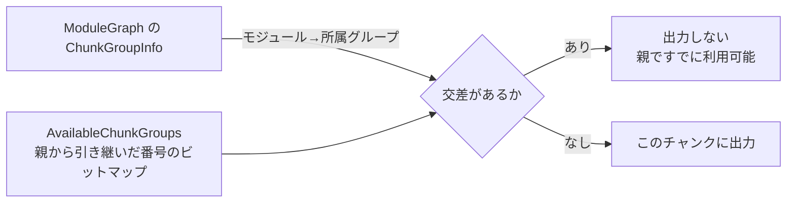

# 2026-10-25（日）

> 今日のひとこと：Turbopackが、チャンクグループの「すでに読み込み済みのモジュール」を集合ではなく、チャンクグループ番号のビットマップで覚えるようになった（動的importの多い合成ベンチで、ビルド時間が約30%減とPRで報告されている）。新規の脆弱性はありません。

## 今日のリリース

- 【Biome】@biomejs/biome 2.6.3：nursery（実験段階）のlintルールを33個追加し、Markdown・GraphQL・CSSまわりのフォーマッターとlintの修正が入った（出典: https://github.com/biomejs/biome/releases/tag/%40biomejs%2Fbiome%402.6.3）
- 【TypeScript】scriptc v0.4.4：変更なしのリビルドのキャッシュが復活し、23モジュールの再ビルドが1.26秒から93msになったとリリースノートにある（自己申告）（出典: https://github.com/vercel-labs/scriptc/releases/tag/v0.4.4）

## トップニュース

### Turbopackの「読み込み済みモジュール」管理が、集合からビットマップに変わる

【Next.js】Tobias Koppersによる #98685 が `canary` に入った。チャンクグループが親から引き継ぐ「すでに利用できるモジュール」を、モジュール集合そのものではなく、チャンクグループの番号を並べたroaring bitmapで持つようにした。

**何が変わる**
これまでの `AvailabilityInfo` は、祖先のチャンクグループが出力したモジュール、モジュールのバッチ、非同期ローダーを、すべて具体的な集合として持ち続けていた。新しい実装は `AvailableChunkGroups`（番号のビットマップ）だけを持つ。モジュールが使えるかは、「そのモジュールが属するチャンクグループの集合」と「使えるチャンクグループの集合」が交わるかで決める。

**なぜ変えた**
PR本文によれば、同じモジュール一覧が利用可能性の連鎖ごとに複製され、大きなグラフでメモリを食っていた。モジュールグラフはすでに「どのモジュールがどのチャンクグループに入るか」を記録しているので、それを再利用すれば集合を持たなくてよい。

**何に効く・誰が困る**
動的importや複数エントリーで「親から利用可能性を引き継ぐ」ビルドが速くなる。PRの計測（3回ずつ、自己申告）では、200ルート×動的import6個の合成ワークロードで、ビルド108.7秒→75.9秒（−30.1%）、ピークRSS 3462MB→3093MB（−10.7%）。動的importのない750ルートでもビルドは−7.0%だが、メモリは結果が割れて「判定不能」とされている。PR自身が「30%は典型的なアプリの数字ではない」と断っている。
副作用として、利用可能性に依存する出力ファイル名のハッシュが変わる（モジュールIDは同じ）。

**ここまでの経緯**
- 6本のPRのスタックの5本目。1本目は #98823（Pages Routerのdevでクライアントのグラフをつなぐ）。
- 2026-10-24：#98734（グラフから導いたマージ済みグループを使う）、#99750（チャンク化が `ChunkGroupKey` を受け取る）、そして本PRが `canary` に入った。
- 6本目の #99050（キー付きセルでチャンクグループ番号を引く）も同日に入っている。

出典: https://github.com/vercel/next.js/pull/98685

## 今日の深掘り

### 「利用できるか」を集合の交差で答える：#98685のAvailabilityInfoを読む

**選んだ理由**：バンドラが「親チャンクにすでにあるモジュールを子で重複して出さない」ためにどういう状態を持ち回るかが、データ構造の置き換えで見えるため。

**背景**
動的import（`import()`）で分割されたチャンクは、親チャンクがすでに読み込んでいるモジュールを再び出力したくない。そのため、チャンクグループごとに「ここまでに使えるもの」（availability）を持ち回る。これまでは「使えるモジュールの集合」そのものを持ち回していた。連鎖が深いと、同じ一覧が何度も複製される。

**変更点**
`turbopack/crates/turbopack-core/src/chunk/availability_info.rs`（コミット 9ffb2fce43）。フィールドが置き換わった。

```rust
// 前
available_modules: Option<ResolvedVc<AvailableModules>>,
// 後
available_chunk_groups: Option<ResolvedVc<AvailableChunkGroups>>,
```

チャンクグループを足すときは、グラフから番号を引いてビットマップに加える。

```rust
let chunk_group = *module_graph
    .chunk_group_info()
    .get_index_of(chunk_group)
    .await? as u32;
```

「使えるか」の判定は、モジュールが属するグループとの交差だ。

```rust
.is_some_and(|groups| {
    !groups.is_disjoint(available_chunk_groups.chunk_groups(module_graph))
})
```

バッチ（まとまりで出力されるモジュール群）は、中のモジュールが同じグループに属すので、先頭の1つで代表させる。

**周辺コード**



番号はひとつの `ModuleGraph` の中でしか意味を持たない。そのためビットマップはグラフと一緒に保持され、使うたびにアサートされる。別のグラフ（devではエンドポイントごとにグラフがある）に移すときは `translate` が、正規のキー `ChunkGroupKey` を介して番号を付け替える。移し先にないグループは捨てるが、PRの説明では「モジュールが重複することはあっても、欠けることはない」側に倒れる。ファイル名のハッシュも、番号ではなく `ChunkGroupKey::ident_str` で作った「グループの正体」から作る。番号を使うと、グラフごとに衝突するからだ。

**この変更から分かる設計思想**
- すでにグラフが持っている事実（モジュール→所属グループ）を使い回し、別の集合を持たない。
- ローカルな番号は、境界（グラフの外、ファイル名）に出すときに必ず正体へ戻す。
- 迷ったら重複する側に倒す。欠落はバグだが、重複は無駄で済む。

出典: https://github.com/vercel/next.js/pull/98685 / https://github.com/vercel/next.js/pull/99050

## OSSのPR

### Next.js

#### Turbopackのチャンク化が、グラフ由来のキーで動くようになる

【Next.js】トップニュースの #98685 を含む6本のスタックの一部。#98734 はマージ済みグループをグラフから導き、#99750 はチャンク化の入力を `ChunkGroupKey` にそろえ、#99050 はチャンクグループ番号の引き当てをキー付きセルにして再計算を減らす。
なぜ変えたか：利用可能性をグループ番号で持つために、チャンク化側もグループをキーで扱う必要がある。
出典: https://github.com/vercel/next.js/pull/98734 / https://github.com/vercel/next.js/pull/99750 / https://github.com/vercel/next.js/pull/99050

#### RSCのFlightの文字列を、Buffer化せずにHTMLのインラインスクリプトへ流す

【Next.js】NodeでReactのFlightが文字列で書く大きな行を、Bufferに変換してまた戻す処理をやめた。ストリームをオブジェクトモードにして、文字列を直接 `__next_f` のスクリプトにエスケープして書き出す。孤立サロゲートは `toWellFormed()` でU+FFFDにそろえ、SSR・インライン・RSCレスポンスで同じ結果になる。
なぜ変えたか：Suspense境界が少なくマークアップの多いページで、長い行の二重の変換コストが大きかった。作者の計測では、ストリーミングが重いルートの中央値レイテンシが下がり、非Latin-1の内容でとくに効く（自己申告）。出力のHTMLバイトは変わらない。
出典: https://github.com/vercel/next.js/pull/100142

その他：

- turbo-tasksのバックエンドで、スナップショットの操作数を分割して持つようにした（[#100280](https://github.com/vercel/next.js/pull/100280)）
- 大きなバッチ引きのデコードを並列化（[#100453](https://github.com/vercel/next.js/pull/100453)）
- turbo-persistenceで、最初の底のマージ前にシャード数を減らさないようにした（[#100424](https://github.com/vercel/next.js/pull/100424)）
- NFSなどロックファイルの実装が限られるファイルシステムで、distディレクトリのロックを直した（[#100684](https://github.com/vercel/next.js/pull/100684)）

### TypeScript（Go版）

#### mapped typeのシグネチャ探しで、メンバーを解決しなくなる

【TypeScript】Jake Baileyの #64873。mapped typeと逆方向のmapped typeには呼び出し・構築シグネチャが存在しないので、そう答えるときにプロパティを解決しない。型の関係チェックは最初にシグネチャを尋ねるため、これまではmapped typeが関係に出るたびに全プロパティが作られていた。
なぜ変えたか：MUIでは各HTML要素のpropsを `Partial<...>` で受けるため、数千の型で数百のプロパティを作っていた。CIのperf実行（n=12）で、MUIドキュメントのチェック時間が−10.0%、メモリが−4.6%。他の多くのシナリオは有意差なし。
出典: https://github.com/microsoft/TypeScript/pull/64873

[10-24の号](2026-10-24.md)の #64915（メンバーの遅延解決）と同じく、「使われるまで作らない」方向の変更だ。

### Biome

#### noNull：`null` を `undefined` に寄せるnursery lintルール

【Biome】ESLint Unicornの `no-null` の移植。`null` の使用を報告し、安全でないautofixで `undefined` に置き換える（`delete` の対象のときは出さない）。厳密比較など一部の例外がある。
なぜ変えたか：PRはUnicornの移植とだけ書き、動機は書いていない。ルールのオプションは空のままで、Unicornの `checkArguments` などは公開されていない。
出典: https://github.com/biomejs/biome/pull/12470

その他：

- `useWhileLoopCondition` を追加（[#12472](https://github.com/biomejs/biome/pull/12472)）
- `noVueWatchAfterAwait` を追加（[#12385](https://github.com/biomejs/biome/pull/12385)）
- `noArraySortForMinMax` を追加（[#12275](https://github.com/biomejs/biome/pull/12275)）
- `useVueComponentIs` を追加（[#12400](https://github.com/biomejs/biome/pull/12400)）
- `noSvelteInternal` を追加（[#12431](https://github.com/biomejs/biome/pull/12431)）
- `useBlockStatementOverIife` を追加（[#12300](https://github.com/biomejs/biome/pull/12300)）
- `useVueVOnExact` を追加（[#12423](https://github.com/biomejs/biome/pull/12423)）
- rowanの `grand_parent()` が親の赤ノードを確保しないようにした（[#12618](https://github.com/biomejs/biome/pull/12618)）
- アナライザーグループのルール数の上限を撤去（[#12637](https://github.com/biomejs/biome/pull/12637)）
- Markdownの整形で、引用とリストの間の改行を保つ（[#12662](https://github.com/biomejs/biome/pull/12662)）
- `biome migrate` で、overridesのPrettier `bracketSpacing` を引き継ぐ（[#12649](https://github.com/biomejs/biome/pull/12649)）
- `new` の callee に `import()` を含むときに括弧で包む（[#12598](https://github.com/biomejs/biome/pull/12598)）

### oxc

その他：

- パーサーで `@__PURE__` / `@__NO_SIDE_EFFECTS__` の注釈コメントの処理を `#[cold]` の関数に移した。まれな処理をホットパスから外す目的。CodSpeedでは性能変化なし（[#28139](https://github.com/oxc-project/oxc/pull/28139)）

### oxc-project/tsrs

TypeScript 7の型チェッカーのRust移植。10月24日にコミット8件。READMEなどの数字は自己申告。

その他：

- マップ型のメンバー名の文字列を再利用（[#759](https://github.com/oxc-project/tsrs/pull/759)）
- `compilerOptions.paths` を `Arc` で共有（[#767](https://github.com/oxc-project/tsrs/pull/767)）
- 診断の整形を並列化（[#763](https://github.com/oxc-project/tsrs/pull/763)）
- 診断用のソースファイルを、プログラム領域を解放する前に切り離す（[#768](https://github.com/oxc-project/tsrs/pull/768)）
- conformanceのゲートまわりのテスト整備（[#769](https://github.com/oxc-project/tsrs/pull/769)、[#730](https://github.com/oxc-project/tsrs/pull/730)）

### tsc-ts

#### 宣言ファイルの出力を、チェック中に別スレッドで進める

【TypeScript】Chris Tateのコミットで、プログラムのチェックと並行して `.d.ts` の出力を宣言用スレッドで行うようになった。チェッカーが8つまでの構成でも動く（#313、#314）。メインスレッドがチェック中にする仕事も短くした。tsgoとの一致率や速度の数字はREADMEの自己申告。
なぜ変えたか：未確認。コミットメッセージに理由は書かれていない。
出典: https://github.com/vercel-labs/tsc-ts/pull/313

その他：

- Unixソケットで、`--listen` サーバーを閉じる前に接続済みクライアントを処理するようにした（コミット 0859fec）

### scriptc

10月24日はコミット約100件（大半はNode.js互換の細かい修正）。件数のみ。v0.4.4 は上の「今日のリリース」を参照。

### ts-rust

コミット104件。大半はエージェント運用の記録（`docs(state)` など）。性能・正しさの修正としては `perf(goport): never inline get_symbol_at_location`（fe289e80）、`fix(goport): no early bind when a file has a syntactic diagnostic`（ec5fe861）などがある。

### GHC

その他：

- QuickLookを少し整理（コミット 7f73f51523）
- ExactPrintの `XClosedTypeFamily` に `AnnList` を使う（a4a3a964b0）
- WinIOでWin32エラーとNTSTATUSコードを取り違えないようにした（5e8ae81beb）
- Haddockビルドに推移的依存を含める（92848e6186）

### Wado

10月24日はコミット約145件（ほぼすべてエージェントによるもの）。WEP（`docs/wep-*.md`）は新規なし。`core:process@0.1.0` の追加（macOSでのsandbox化を含む）と、`!`（never型）まわりの型の修正が中心。

動きなし：facebook/react, vitejs/vite, sveltejs/svelte, vuejs/core（minor）, solidjs/solid, pingdotgg/ts-rust のピン更新, oven-sh/bun（取得できたコミットなし）, whatwg/html・dom・fetch・streams・url, tc39/ecma262, w3c/csswg-drafts・aria・ServiceWorker・wcag3

## 脆弱性

新規のアドバイザリはありませんでした（react, next, vite, svelte, vue, oxc, astro, nuxt, TanStack/router の各アドバイザリ一覧を確認。直近の公開は、Vite 10月21日、Next.js・React 10月14日）。ただし、Astro・Nuxt・Svelteは一覧の1ページ目だけの確認で、2ページ目以降は見ていない。
