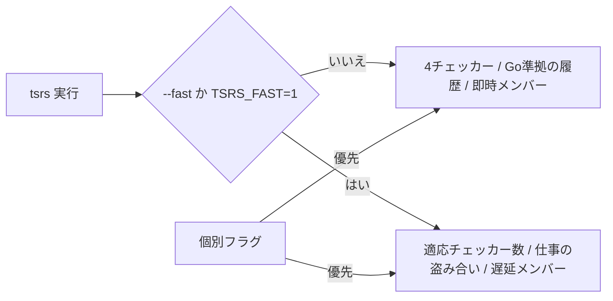

# 2026-10-26（月）

> 今日のひとこと：tsrsが「TypeScriptと同じ既定」と「`--fast` で最適化を足す」を分けた（#781）。週末で他は静かで、新規の脆弱性はなし。

## 今日のリリース

- 【TypeScript】scriptc v0.4.5：例外の巻き戻しをLinuxで直接行うようにし、関数本体の出力を最大8ワーカーで並列化（出典: https://github.com/vercel-labs/scriptc/releases/tag/v0.4.5）
- 【oxc】tsrs 0.19.0 beta：準備のコミット（#723）は入ったが、取得時点でリリースページとタグはまだ未公開（出典: https://github.com/oxc-project/tsrs/pull/723）

## トップニュース

### tsrsが既定をTypeScript準拠にし、高速化を `--fast` に分ける

【oxc】oxc-project/tsrsが、既定の動作をTypeScript（Go版）のチェッカーに揃え、速度とメモリの最適化を `--fast`（または `TSRS_FAST=1`）で選ぶ形に変えた。0.19.0 betaのリリースノートにも載る目玉の変更。

**何が変わる**

- 既定：チェッカー4本（ファイル数で上限）、Goと同じファイル割り当てとチェッカー履歴、メンバーは即時解決
- `--fast`：コア数に応じてチェッカー数を変える、近いファイルを同じチェッカーに寄せて仕事を盗み合う、履歴を正規化する、メンバーとd.tsを遅延解決する
- 個別の機能指定は、プリセットより優先される
- READMEは、この既定は「未リリース、ソースビルドで利用可」と断っている

**なぜ変えた**（コミットとドキュメントからの読み取り）

- チェック順に依存する診断は、TypeScript自体にもある。最適化はその順序を変えるので、既定で入れると「tsgoと違う診断」が出うる
- `--fast` では、既知の履歴依存・再帰型・インスタンス化上限のケースで、エラーの出方や終了コードが変わりうる、と明記された

**何に効く・誰が困る**

- tsgoとの出力一致を重視する人は、既定のままでよい。速度とメモリを取りたい人は `--fast` を選ぶ
- モードを切り替えると、増分ビルドのキャッシュが捨てられて次回が遅くなる
- 速度・メモリの数字はREADMEと `bench/` の自己申告で、ここでは検証していない

**ここまでの経緯**

- 2026-10-17：tsrsを対象に追加。ts-rust、tsc-tsと並ぶGo版チェッカーの移植として追い始めた
- 2026-10-24：Go版TypeScript側で、クラスとインターフェースのメンバーを遅延解決する変更（#64915）が入った（[10-24の号](2026-10-24.md)）
- 2026-10-25：tsrsに #781 が入り、同日に0.19.0 betaの準備（#723）が入った

出典: https://github.com/oxc-project/tsrs/pull/781

## 今日の深掘り

### 「正しさの既定」と「速さのプリセット」を分ける設計（tsrs #781）

選んだ理由：移植プロジェクトが「本家と同じ答え」と「本家より速い答え」をどう両立させるかが、差分から読めるため。

**背景**

tsrsの目標は100%の適合と、少ないメモリ、速い型チェック（README）。ところが型チェッカーは、チェックの順序で診断が変わることがある。並列化と遅延はまさにその順序を動かす。

**変更点**

ベンチとテストの呼び出しに `--fast` が足された。たとえば `crates/tsrs_bench/src/lib.rs` の引数列に `"--fast"` が入っている。

```rust
// crates/tsrs_bench/src/lib.rs（fb6aeb5）
"-p", config,
"--fast",
"--noEmit",
```

遅延メンバーの説明も、「既定で有効、`--noLazyMembers` で無効」から「`--fast` / `--lazyMembers`、`TSRS_LAZY_MEMBERS` でプリセットを上書き」に書き換わった（`crates/tsrs_checker/src/checker.rs`）。つまり、以前の「最適化が既定でオン」を反転させたのが本体。

**周辺コード**



**設計思想**

- 既定は「本家と同じ答え」。最適化は、副作用を読んだ人だけが選ぶ
- 副作用（診断・終了コード・統計値・キャッシュの互換）をドキュメントに列挙している
- 個別の指定がプリセットに勝つので、一部だけ試せる

推測：出力の一致を測るCIが、既定と `--fast` の両方で全ベースラインを比べるようになったのも、この分離があるから（0.19.0 betaの記述より）。

出典: https://github.com/oxc-project/tsrs/pull/781

## OSSのPR

### oxc-project/tsrs

#### 0.19.0 betaの準備と、TypeScript 7.1 betaへの追従

【oxc】#723でリリースノートが書かれた。TypeScriptの112コミットを取り込み、`v7.1-beta` まで進めた。リリースノート自身が、適合（エラーのベースライン13,700件が一致など）を自己申告として示している。
なぜ変えたか：TypeScript 7.1に向けた安定版を目指すため（READMEの方針）。
出典: https://github.com/oxc-project/tsrs/pull/723

その他：

- 診断の文言を、リークさせずアリーナ上で組み立てるように変更（[#779](https://github.com/oxc-project/tsrs/pull/779)）
- Windowsでフローのメモのキーが衝突する不具合を修正（[#786](https://github.com/oxc-project/tsrs/pull/786)）
- ThreadSanitizerを単独タスクとしてCIに追加（[#782](https://github.com/oxc-project/tsrs/pull/782)）
- Rustクレートの依存更新（[#784](https://github.com/oxc-project/tsrs/pull/784)、botのため参考）

### vercel-labs/tsc-ts

#### 並列度まわりの最適化が続く

【TypeScript】解析スレッドに渡すファイルのまとまりをテキスト量で区切る（#320）、コメントのない範囲ではコメント検索を飛ばす（#321）、増分ビルドと `-b` でemitをスレッドで行う（#317）など。数字はREADMEの自己申告で、ここでは検証していない。
なぜ変えたか：PR本文までは読んでおらず、コミットメッセージの範囲では不明。
出典: https://github.com/vercel-labs/tsc-ts/pull/320

### pingdotgg/ts-rust

コミットは約100件。大半は「checker-port」のRごとのマージで、エージェント運用の記録。内容のあるものは `perf(checker)` や `perf(ast)` の最適化（例：f14b06e3）。上流のピンは `dc37b5249ab6`（`UPSTREAM.json` の `current`）。

### vercel-labs/scriptc

v0.4.5の準備を含め、約280コミット。大半は細かい修正（Node互換、暗号、ビルド速度）なので件数だけ。リリースは上の節。

### biomejs/biome

#### nurseryにlintルールが一気に入る

【Biome】Carson McManus氏により `noUselessRecursion`（#12447）、`noReturnArrayPush`（#12483）、`noConsoleSpaces`（#12261）、`noMagicArrayFlatDepth`（#12469）、`noUnreadableIife`（#12477）、`noYamlBooleanKeys`（#12285）、`useSvelteEventDispatcherTypes`（#12338）が入った。いずれもnursery（試験）グループ。
なぜ変えたか：`unicorn/no-useless-recursion` など、ESLintのunicornプラグインのルールをBiomeに移すため。`eslint_any_rule_to_biome.rs` にESLintからの移行対応が足されている。
出典: https://github.com/biomejs/biome/pull/12447

その他：

- 設定ファイルが読めないとき、LSPで警告する（[#12678](https://github.com/biomejs/biome/pull/12678)）
- CSSの並び替えで、recessのプロパティ順に合わせ、カスケードを保つ（[#12640](https://github.com/biomejs/biome/pull/12640)）
- エディタ設定のディレクトリ解決を1回にし、確認を減らす（[#12656](https://github.com/biomejs/biome/pull/12656)）
- Markdownパーサーで、テーブルのパイプ前の空白をパイプに付ける（[#12607](https://github.com/biomejs/biome/pull/12607)）
- `pnpm-lock.yaml` を保護ファイルにする（[#12664](https://github.com/biomejs/biome/pull/12664)）
- migrateでPrettierの `bracketSpacing` をトップレベルに引き継ぐ（[#12670](https://github.com/biomejs/biome/pull/12670)）

### oxc-project/oxc

- minifierで `is_error_constructor` を再利用し、`new` のグローバル置換を簡略化（[#28149](https://github.com/oxc-project/oxc/pull/28149)）

動きなし：facebook/react, vitejs/vite, microsoft/TypeScript, sveltejs/svelte, solidjs/solid, vuejs/core, ghc/ghc, oven-sh/bun（`bun check` / `bun fmt` に関わるものは確認できず）, vercel/next.js（canaryタグのみ）、wado-lang/wado（約250コミットだが今回は精査せず、件数のみ）

## 仕様の変更

### whatwg/streams

- 例のコードの誤りを修正（アップロードの恒等変換ストリームの例）、重複語の削除（[commit 312b67e](https://github.com/whatwg/streams/commit/312b67e)、[c70182b](https://github.com/whatwg/streams/commit/c70182b)）。いずれもeditorialのため詳細は省略

動きなし：whatwg/html, whatwg/dom, whatwg/fetch, whatwg/url, tc39/ecma262, tc39/proposals, w3c/csswg-drafts, w3c/aria, w3c/ServiceWorker, w3c/wcag3

## 続報

- 10月24日の号で取り上げた、Go版TypeScriptのメンバーの遅延解決（#64915）は、tsrsの `--fast` で「遅延メンバー」として選べる機能に含まれている。上流の実装が、移植先の設定項目として現れた段階（[10-24の号](2026-10-24.md)）

## 脆弱性

取得時点で、新規のアドバイザリはなし（公開日が2026-10-24以降のものを確認）。確認先：next、react、vite、svelte、vue、astro、nuxt、TanStack/router、oxc。直近の公開は vite（10-21）、next と react（10-14）。
