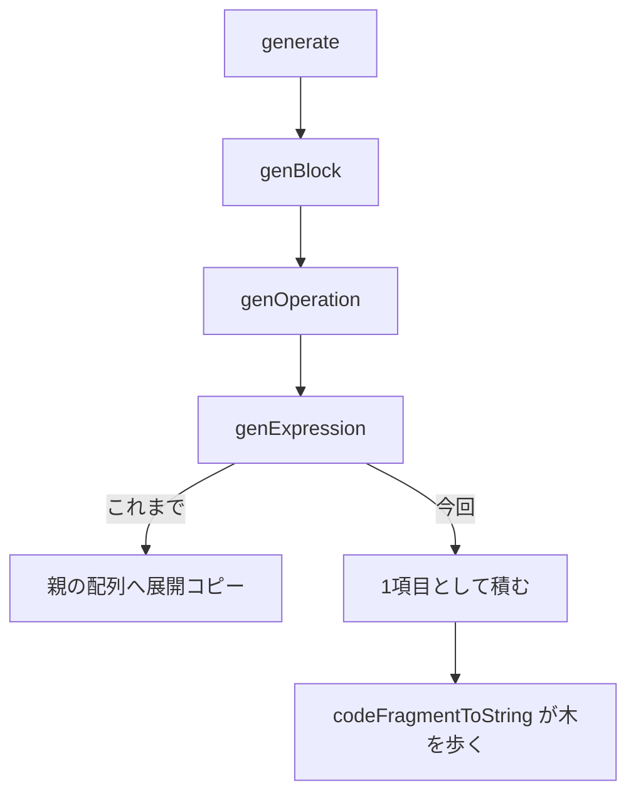

# 2026-10-27（火）

> 今日のひとこと：Solid 2.0（`next`）に `onFlush` が入った。「自分の書き込みを、他の更新の保留（hold）に巻き込ませない」ための小さな出口。新規の脆弱性はなし。

## 今日のリリース

- 【oxc】tsrs v0.20.0（`0.20.0-ts7.1.0-beta`）：既定をtsgo準拠に戻し、旧来の最適化を `--fast` に分けた。TypeScript 7.1 beta（`3e9236361fa9`）に追従し、LSPとNode APIも拡張（出典: https://github.com/oxc-project/tsrs/releases/tag/v0.20.0）
- 【TypeScript】tsc-ts v0.0.10：emitを別スレッドで行い、VS Codeのフルビルドが41.3秒→24.5秒（`--checkers 1`、リリースノートの自己申告）（出典: https://github.com/vercel-labs/tsc-ts/releases）
- 【Svelte】svelte 5.57.3：a11yの `role` 検査、ハイドレーション時の重複した属性書き込みの省略など、パッチ6件（出典: https://github.com/sveltejs/svelte/releases/tag/svelte%405.57.3）

## トップニュース

### Solid 2.0に、書き込みを「保留」から切り離す `onFlush` が入る

【Solid】solidjs/solid の `next` ブランチに、`onFlush(fn)` が入った（#4292）。`fn` を、いまのフラッシュの直後・描画の前に1回だけ走らせる。そこでの書き込みは、独立した更新として扱われる。

**何が変わる**

- 新しいエクスポート `onFlush`。イベントハンドラやエフェクトのコールバックで使う想定
- コンポーネント本体や計算の中で呼ぶと動くが、開発時に `ON_FLUSH_IN_OWNED_SCOPE` で警告される（`onSettled` を案内）
- 複数の `onFlush` は呼んだ順に走り、1回のフラッシュにまとまる
- サーバーでは何もしない。別エクスポートなので、使わなければツリーシェイクで0バイト（PR本文の記述）

**なぜ変えた**（PR本文より）

- 例：メニューが `setOpen(false); props.onSelect?.(id)` と書く。`onSelect` が非同期の遷移やfetchを始めると、`setOpen(false)` がその完了まで保留され、メニューが開いたままになる
- 既存の回避策はどれも癖がある。`queueMicrotask` は最初の書き込みより前だと同じフラッシュに乗る。`flush()` は保留中のエフェクトを早く走らせ、二重実行しうる。`setTimeout` は描画の後になり、他のイベントが先に走る
- 実装は `schedule(); queueMicrotask(fn)` で、スケジューラ本体は変えていない（PR本文）。同期的な書き込みを保つ別案（`independent(fn)` の試作）は、約+1.27 KB（brotli）と約20のフックが要る、と比較されている

**何に効く・誰が困る**

- ライブラリ作者：利用者のコールバックが非同期処理を始めても、自分の状態更新を即時に確定できる
- 注意：`onFlush` の書き込みも、それが非同期の保留の結果から派生していれば、ほかの書き込みと同じく保留に入る（PR本文）

**ここまでの経緯**

- Solid 2.0では、非同期の結果を待つ間に更新をまとめて保留する設計が中心にある
- 2026-10-21：Solid 2.0 rc.16 で `createDeferred` が入った（[10-21の号](2026-10-21.md)）
- 2026-10-26：同じ日に `next` へ、境界ごとの保留を独立させる修正（#4302）、`Loading` のフォールバックの修正（#4282, #4301）が連続して入った

出典: https://github.com/solidjs/solid/pull/4292

## 今日の深掘り

### Vue Vaporのコンパイラが、コード断片を「展開してコピー」から「ネストして持つ」へ（vuejs/core #16032）

選んだ理由：コンパイラの出力を作る単純な部品が、見えないところで深さの分だけコピーを重ねていた例で、直し方が小さいため。

**背景**

`compiler-vapor` のジェネレーターは、コードを `CodeFragment[]`（文字列やソースマップ付きの断片の配列）で返す。呼び出し側は、子の返した配列を `push(...frags)` のように展開して自分の配列に積んでいた。PR本文によると、深さ *d* で作られた断片は、上に届くまでに約 *d* 回コピーされる。さらに、平らな文字列化の段階で、文字列断片を1要素の配列に包んで分割代入していた。

**変更点**

約150か所の展開を、配列そのものを積む形にした。`generate.ts` の差分から。

```ts
// packages/compiler-vapor/src/generate.ts（e29122c）
-  push(...body)
+  push(body)
```

`generators/directive.ts` も同じ形で、`[NEWLINE, ...(cond ? genOnce(call) : call)]` が `[NEWLINE, cond ? genOnce(call) : call]` になった。断片は木になり、文字列化はその木を再帰で歩く。

**周辺コード**



**結果**（PR本文の自己申告）

- `minor` との比較ベンチで、通常のコーパスが約7〜8%、インラインのコーパスが約7〜9%の短縮。A/A対照は-1.6%/-0.4%で、雑音より大きいと書かれている
- プロファイルでは `genMulti` と `genCall` が全体の3.4%から0.1%に落ちた
- GCの割合は12〜13%のままなので、効いたのは確保の回数ではなくコピーの量
- 出力とソースマップは36件のベンチコーパスでバイト一致、既存のコンパイラテスト約1,800件は変更なしで通る

**この変更から分かる設計思想**

- 同じ日に、同作者が同じ形の最適化を連続で入れている（#16005〜#16031）。プロファイルで見つけた無駄を、出力を変えない小さな変更で削る方針
- 出力が変わらないことをバイト比較で担保し、速度は対照付きで測る

出典: https://github.com/vuejs/core/pull/16032

## 仕様の変更

### whatwg/html

#### close watcherの定義の誤りが3件まとめて直る

【HTML】Jin Dongxun氏が、close watcherまわりの仕様の記述を直した。いずれも実装の挙動を変えるものではなく、アルゴリズムの穴を埋める修正。
- キャンセル動作の戻り値：引数がfalseのときの戻り値は「常にfalse」ではなく「常にtrue」（58a162e）
- 「active」の判定：close watcher managerそのものではなく、その `groups`（リストのリスト）に対して「contains」を取る（d22524d）。理由は、managerが構造体で、containsの対象リストが抜けていたため
- クラシックワーカーのimportのfetchフック：`isTopLevel` ではなく `true` を渡す（78fc164）
なぜ変えたか：コミットメッセージでは、仕様の文面内の型や引数が合っていなかったため。

出典: https://github.com/whatwg/html/commit/d22524d

その他：

- `ImageData` 初期化の `rgba-float16` 参照を修正（[9396777](https://github.com/whatwg/html/commit/9396777)、editorialのため詳細は省略）

### w3c/csswg-drafts

#### css-color-5の `none` と、css-text-4の `text-spacing-trim` の値空間

【CSS】css-color-5で、数式の中でチャンネルキーワードが `none` のときの扱いを明確にした（#10280）。css-text-4では、`text-spacing-trim` の値の全体を戻し（#13789）、`text-spacing` の `insert | replace` を明確にした（#13774）。
なぜ変えたか：コミットメッセージから読み取れる範囲では、各Issueの議論の結論を本文に反映するため。Issueの議論までは読んでいない。
出典: https://github.com/w3c/csswg-drafts/commit/7d677b2

その他：

- css-colorのJzazbz変換の行列の掛ける順序を修正（[ba82c73](https://github.com/w3c/csswg-drafts/commit/ba82c73)）、逆PQの指数を定義（[d6ef4eb](https://github.com/w3c/csswg-drafts/commit/d6ef4eb)）
- 誤字・括弧・リンクの修正（editorial、省略）

### w3c/aria

- html-aamの画像マップの役割（ATK）の修正がマージ（[#2945](https://github.com/w3c/aria/pull/2945)）

動きなし：whatwg/dom, whatwg/fetch, whatwg/streams, whatwg/url, tc39/ecma262, tc39/proposals, w3c/ServiceWorker, w3c/wcag3

## OSSのPR

### solidjs/solid（`next`）

#### コンパイラのRustコアが、呼び出し側が組んだOxcのプログラムを受け取れる

【Solid】`compile_program` が入り、文字列ではなく、呼び出し側が作ったOxcのプログラム（AST）をそのままコンパイルできる（#4290）。同時に、スコープ付きCSSのエンジンをTSRXから独立してエクスポートした（#4289）。
なぜ変えたか：PR本文までは読んでおらず、READMEの追記から、他のツールのパイプラインに差し込むためと読める（推測）。
出典: https://github.com/solidjs/solid/pull/4290

その他：

- 境界ごとのマウントが、フラッシュをまたいで自分の保留を保つ（[#4302](https://github.com/solidjs/solid/pull/4302)）
- ストリームされた `Loading` が失敗したとき、サーバーで `Errored` のフォールバックを描く（[#4303](https://github.com/solidjs/solid/pull/4303)）
- クライアントのみの `Loading` が、再開後も配信済みのフォールバックを保つ（[#4301](https://github.com/solidjs/solid/pull/4301)）
- 再武装した `Loading` の画面外フォールバックが、中身の表示を保留しない（[#4282](https://github.com/solidjs/solid/pull/4282)）
- 再生したイベントごとにフラッシュする（[#4299](https://github.com/solidjs/solid/pull/4299)）
- `Repeat` の子を行ごとに1回だけ読む（[#4298](https://github.com/solidjs/solid/pull/4298)）
- `reconcileArrays` に最初のマウント用の近道を追加（[#4297](https://github.com/solidjs/solid/pull/4297)）
- 修正で増えたバイト数を削る（[#4295](https://github.com/solidjs/solid/pull/4295)）

### vuejs/core（`minor`）

#### Vaporのdevtoolsにコンポーネントのフックが入る

【Vue】`runtime-vapor` が、devtoolsのコンポーネントフックを呼ぶようになった（#16027）。
なぜ変えたか：PR本文までは読んでおらず、不明。
出典: https://github.com/vuejs/core/pull/16027

その他：

- コード断片のネスト化（深掘り参照、[#16032](https://github.com/vuejs/core/pull/16032)）
- テンプレートの重複排除を `TemplateRegistry` に持たせる（[#16031](https://github.com/vuejs/core/pull/16031)）
- 親の終了時にDOMアクセスを計画し、`genChildren` の再導出をやめる（[#16030](https://github.com/vuejs/core/pull/16030)）
- ブロックの終了時に副作用の順序を確定（[#16028](https://github.com/vuejs/core/pull/16028)）
- 末尾が複数桁の数字の束縛名を、生成変数用に予約（[#16025](https://github.com/vuejs/core/pull/16025)）
- 小さな確保の削減など、`compiler-vapor` / `compiler-core` の最適化（[#16024](https://github.com/vuejs/core/pull/16024)、[#16022](https://github.com/vuejs/core/pull/16022)、[#16021](https://github.com/vuejs/core/pull/16021)、[#16020](https://github.com/vuejs/core/pull/16020)、[#16008](https://github.com/vuejs/core/pull/16008)、[#16007](https://github.com/vuejs/core/pull/16007)、[#16005](https://github.com/vuejs/core/pull/16005)）

### vercel/next.js

#### MPAのServer Action後に、完全なHTMLを返す

【Next.js】Cache Componentsの部分プリレンダリング（PPF）のページで、JavaScriptなしのフォーム送信（MPA）がシェルなしの残りだけを返し、画面が空になる問題を直した（#100740）。MPAの送信では、プリレンダリングのデータを保ったまま、文書全体を描く。
なぜ変えたか：Issue #99756。Server Actionは走るのに、`useActionState` の値が表示されなかった（PR本文）。リダイレクトする場合だけ問題を避けられていた。
出典: https://github.com/vercel/next.js/pull/100740

#### Turbopackの本番用チャンク分割に、Node.jsサーバー用の閾値が足される

【Next.js】`experimental.turbopackChunking` に `minServerChunkSize` と `maxMergeServerChunkSize` が入った（#100712）。
なぜ変えたか：既存の `minChunkSize` などはクライアント用で、サーバーは固定値（最小4000、結合上限100000）だったため。既定は従来の固定値のままで、Edgeは対象外。
出典: https://github.com/vercel/next.js/pull/100712

その他：

- `'use cache'` のエラー後にHTMLの応答が止まる不具合を修正（[#100673](https://github.com/vercel/next.js/pull/100673)）
- Cache Componentsでdraft modeの描画を修正（[#100728](https://github.com/vercel/next.js/pull/100728)）
- Turbopackのwebpackローダーで `fs.stat` に対応（[#100272](https://github.com/vercel/next.js/pull/100272)）
- ビルドで、ページ数の2乗かかっていた元のアプリパスの走査をやめる（[#100615](https://github.com/vercel/next.js/pull/100615)）
- Turbopack：統合モジュールの調停で、冗長な処理を省き、チャンクグループのリストを並列に結合（[#100238](https://github.com/vercel/next.js/pull/100238)、[#100237](https://github.com/vercel/next.js/pull/100237)）
- exportで、静的生成のバッチごとに、自分の分のresume data cacheだけを送る（[#100048](https://github.com/vercel/next.js/pull/100048)）
- turbo-tasksで、出力の依存を足すときに読み手の距離を更新（[#99764](https://github.com/vercel/next.js/pull/99764)）
- ほか、テスト・ベンチ・docsの整理（除外対象が中心）

### facebook/react

- compiler：定数伝播とコード生成で、符号付きゼロ（-0）を保つ（[#37995](https://github.com/facebook/react/pull/37995)）
- compiler：`PerformanceObserver` / `ReportingObserver` のコールバックでrefアクセスを許す（[#37996](https://github.com/facebook/react/pull/37996)）
- compiler：react-nativeの `PanResponder.create` に型を付け、`react-hooks/refs` の誤検知を直す（[#37970](https://github.com/facebook/react/pull/37970)）

### vitejs/vite

- `new URL(..., import.meta.url)` で、クエリやハッシュ付きの参照先ファイルも監視する（[#23780](https://github.com/vitejs/vite/pull/23780)）
- 古い `minimumReleaseAgeExclude` の設定を削除（[#23885](https://github.com/vitejs/vite/pull/23885)）

### microsoft/TypeScript

- 属性なしのimportで、非モジュールのエラーを保つ（[#64884](https://github.com/microsoft/TypeScript/pull/64884)）

### oxc-project/oxc

- react-compilerの移植：手動メモ化を、依存を守れないときは書かれたまま保つ（[#28101](https://github.com/oxc-project/oxc/pull/28101)）、オプショナルチェーンのキャッシュ守りを保つ（[#28165](https://github.com/oxc-project/oxc/pull/28165)、[#28144](https://github.com/oxc-project/oxc/pull/28144)）
- formatter：コメントまわりの位置判定、`;` の保持、括弧の保持、JSX spread内のコメントなど、修正が約10件（例：[#28170](https://github.com/oxc-project/oxc/pull/28170)、[#28168](https://github.com/oxc-project/oxc/pull/28168)、[#28166](https://github.com/oxc-project/oxc/pull/28166)）
- transformer：参照が残るときは素の `inject` を保つ（[#26965](https://github.com/oxc-project/oxc/pull/26965)）
- 依存更新・minifierの整理など（[#28180](https://github.com/oxc-project/oxc/pull/28180)、[#28148](https://github.com/oxc-project/oxc/pull/28148)）

### oxc-project/tsrs

#### 0.20.0 beta：既定がtsgo準拠、LSPとNode APIが広がる

【oxc】リリースノートによると、TypeScript 7.1 betaに追従し、`custom/initializeAPISession`（Node APIのクライアントがLSPのプロジェクトと未保存ファイルを共有する）が入った。Intel macOSとWindows x64のパッケージも足された。`tsrs/unstable/*` は `tsrs/*` に移り、`openProject` などが削除され、watch系のフラグも消えた。
なぜ変えたか：TypeScript 7.1に向けた安定版を目指すため（READMEの方針）。既定の変更は[10-26の号](2026-10-26.md)で扱った。リリースノートには適合率の数字はなく、既知の問題として、`-b` のピークメモリが約20%増えること、Windowsでwatch未対応が書かれている。
出典: https://github.com/oxc-project/tsrs/releases/tag/v0.20.0

その他：

- checkerのフラグのインライン化とバッファの統合（[#800](https://github.com/oxc-project/tsrs/pull/800)）、小さな作業用バッファを `smallvec` に（[#794](https://github.com/oxc-project/tsrs/pull/794)）、疎なunionの部分集合の探索を前回の一致の後に限る（[#798](https://github.com/oxc-project/tsrs/pull/798)）
- ユニットテストを、クレートごとの統合テスト1本にまとめる（[#797](https://github.com/oxc-project/tsrs/pull/797)）
- リリースのGitHubを「latest」に印付け（[#801](https://github.com/oxc-project/tsrs/pull/801)）、CIのフィクスチャの置き場を修正（[#802](https://github.com/oxc-project/tsrs/pull/802)）
- ワークスペースの道具をVite+に移行（[#785](https://github.com/oxc-project/tsrs/pull/785)）。ほか、依存・ベンチ・CIの整理

### vercel-labs/tsc-ts

#### v0.0.10：emitを別スレッドにし、`--checkers` の数え方が変わる

【TypeScript】リリースノートによると、`--checkers 1` でemitと宣言の生成が別スレッドで走り、VS Codeのフルビルド（`-p`）が41.3秒→24.5秒、ピークメモリが4.18GB→3.28GBになった。`--checkers` が「チェックするスレッドだけ」を数える仕様に変わり、宣言用のスレッドが別に加わる。`--api --listen <path>` でUnixソケット経由のAPIも入った。数字はリリースノートの自己申告で、ここでは検証していない。
なぜ変えたか：リリースノートの範囲では、emit待ちでチェックスレッドが遊ぶのを減らすため（推測を含む）。
出典: https://github.com/vercel-labs/tsc-ts/releases

その他：

- `new Promise` の `resolve` を引数なしで呼ぶ場合のtsgoの引数エラーを再現（[#333](https://github.com/vercel-labs/tsc-ts/pull/333)）
- ジェネリックな値のimport型クエリを型引数でインスタンス化（[#331](https://github.com/vercel-labs/tsc-ts/pull/331)）
- ローダーの走査で、パスごとの検索を1回に（[#326](https://github.com/vercel-labs/tsc-ts/pull/326)）

### pingdotgg/ts-rust

コミットは約80件。大半はエージェント運用の記録なので件数のみ。上流のピンは `dc37b5249ab6` のまま（`UPSTREAM.json` の `current`）。

### vercel-labs/scriptc

約250コミット。大半は細かい修正（Node互換、ビルド速度）なので件数だけ。内容があるものとして、置換の被演算子を、戻るときに解放する修正（#2337）。新しいリリースはv0.4.5以降なし。

### biomejs/biome

#### lintの大量のルールが、線形時間や高速な実装に書き換わる

【Biome】`noDuplicateCase`・`noDuplicateElseIf`・`noFallthroughSwitchClause` が線形時間になり（#12457）、`useHookAtTopLevel`・`noUnusedImports`・`noUnusedPrivateClassMembers` も速くなった（#12458）。
なぜ変えたか：PRの変更ファイルから読めるのは、重複判定を比較の総当たりから走査に置き換えたこと。PR本文までは読んでおらず、動機は不明。
出典: https://github.com/biomejs/biome/pull/12457

その他：

- Markdownパーサーで、深いリスト項目の中の引用を継続（[#12575](https://github.com/biomejs/biome/pull/12575)）
- 埋め込みMarkdownのフロントマターを保つ（[#12682](https://github.com/biomejs/biome/pull/12682)）
- インポートした型と値が結合しているとき、注釈では型に解決（[#12652](https://github.com/biomejs/biome/pull/12652)）
- ルールのメタデータ更新（[#12699](https://github.com/biomejs/biome/pull/12699)）

### wado-lang/wado

約140コミット。`docs/wep-2026-10-25-refined-types.md` と `docs/wep-2026-10-25-profile-guided-optimization.md` が追加され、Jade（FastAPI風の消費者）のWEPが洗練型を軸に書き直された。ほか、テンプレート値の `Inspect`（`feat(template)`）。詳細は精査していない。

### sveltejs/svelte

- リリースは上の節。5.57.3の内容は6件のパッチ

動きなし：ghc/ghc（取得できたコミットは前回以前のもののみ）, oven-sh/bun（`bun check` / `bun fmt` に関わるものは確認していない）

## 議論ウォッチ

取得できず（今回は、WICG、standards-positions、interop、TC39、各RFCのリポジトリのページを読んでいない）。

## 続報

- 10-26の号で取り上げたtsrsの「既定をtsgo準拠、`--fast` で最適化」は、今日 v0.20.0 として出た。リリースノートでは破壊的変更の最初に挙がっている（[10-26の号](2026-10-26.md)）
- 10-21の号のSolid 2.0 rc.16（`createDeferred`）の流れで、`next` に保留まわりの修正と `onFlush` が続いた（[10-21の号](2026-10-21.md)）

## 脆弱性

新規のアドバイザリはなし。確認したのは、react、next.js、vite、svelte、vuejs/core、oxc、astro、nuxt、TanStack/routerのアドバイザリ一覧の1ページ目。最新の公開日は、reactとnext.jsが10-14、viteが10-21、astroが10-12、nuxtが10-16、TanStack/routerが9-30、vuejs/coreが8-31、svelteが5-14で、いずれも前回の実行より前。oxcは公開済みアドバイザリなし。
