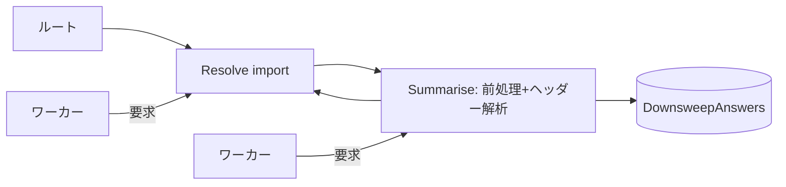

# 2026-10-28（水）

> 今日のひとこと：GHCのコンパイラが、モジュールの依存解析（downsweep）を「ルールを並列に解く」形に書き換えた。新規の脆弱性はなし。

前回の号（10-26）から今回までの間に10-27の号は出ていないため、今回は10-26 07:17 JST以降の約2日分を対象にしている。

## 今日のリリース

- 【oxc】oxlint v1.90.0：型を使う規則 `no-unsafe-enum-assignment` を追加し、`await-thenable` に `allowMixedPromiseArrays` を足した（出典: https://github.com/oxc-project/oxc/releases/tag/oxlint_v1.90.0）
- 【oxc】oxfmt v0.75.0：タグのみ確認。リリースノートは取得していない（出典: https://github.com/oxc-project/oxc/releases/tag/oxfmt_v0.75.0）
- 【oxc】tsrs v0.20.0（`0.20.0-ts7.1.0-beta`）：TypeScript 7.1 betaを対象にし、既定をTypeScript準拠、最適化を `--fast` に分けた。npmの `latest` もこのbetaになった（出典: https://github.com/oxc-project/tsrs/releases/tag/v0.20.0）。経緯は[10-26の号](2026-10-26.md)
- 【Vite】create-vite 9.3.2 / 9.3.3：TypeScript 7が使えるテンプレートでは7を使うようにした（9.3.2）。9.3.3でテンプレートがパッケージに入っていなかった問題を直した（出典: https://github.com/vitejs/vite/pull/23910 , https://github.com/vitejs/vite/pull/23915）
- 【Svelte】svelte 5.57.3：a11y検査で `role` の最初の有効なフォールバック値を使うよう修正（出典: https://github.com/sveltejs/svelte/pull/18947）

## トップニュース

### GHCのdownsweepが、並列に走る「ルール」の集まりになる

【GHC】`ghc --make` の最初の段階であるモジュール依存の解析（downsweep）が、並列ワーカーで実行できる形に書き換えられた。`-j<N>` と `-jsem` で並列度を決められる。

**何が変わる**

- downsweepを、1つの問い合わせ応答ルール（`DownsweepRule`）として書き直した
- CPPの前処理、ヘッダーの構文解析、インターフェースの読み込みといった重い処理を、並列に動かせる
- ルールは `GHC.Driver.Concurrency.runRules` が、必要になった順（demand-driven）に走らせる。各ワーカーは他のワーカーに仕事を要求できるが、他のワーカーの完了を待たない。1つの仕事は高々1回しか行われない
- コミットメッセージによれば、同時に多くの仕事をするため、メモリ使用量は増えうる（ベンチマーク `MultiComponentModulesRecomp` など3つで増加を許容と明記）

**なぜ変えた**

コミットメッセージにあるのはIssue #27514の修正ということだけ。動機の詳細（Issue本文）は読めていないので、並列化による起動時間の短縮が狙いだというのは推測。

**何に効く・誰が困る**

- 多数のモジュールを持つプロジェクトの、コンパイル開始までの時間（推測）
- 「決定的」をうたう点が重要で、並列にしても依存グラフの結果が変わらないことを狙っている（コミットの題名にdeterministicとある）

**ここまでの経緯**

- 2026-10-26：準備のリファクタが連続で入った。`GHC.Driver.MakeAction` の整理、downsweepの環境の整理（`MakeEnv` をまとめ、挙動は変えない）、finderキャッシュのHome/Externalの分離、`LogQueue` を本物のキューにする変更
- 同日：本体 `38a9900693` が入り、続けて `Acquire/release semaphore tokens more readily` で `-jsem` のトークンの取り方も調整された

出典: https://github.com/ghc/ghc/commit/38a9900693 （GHCのMRはgitlab.haskell.orgにあり、届かない。コミットメッセージを根拠にした）

## 今日の深掘り

### 依存解析を「問い合わせ」に分けて並列化する（GHC）

選んだ理由：コンパイラの依存解析という、直列に書かれがちな処理を、どう分解して並列にしたかが型定義から読めるため。

**背景**

downsweepは、ルートのモジュールから `import` をたどり、home unitのモジュールの一覧（ModuleGraph）を作る段階。各モジュールのヘッダーを前処理して読む必要があり、ここが直列だと大きなプロジェクトで待ち時間になる。

**変更点**

`compiler/GHC/Driver/Downsweep.hs` に、問い合わせの種類が型で並べられている（`38a9900693` 時点）。

```haskell
data DownsweepQuery answer where
  -- | Resolve an import.
  Resolve   :: !UnitId -> !(UnresolvedImport PkgQual) -> DownsweepQuery ImportResolution
  -- | Preprocess a home unit source file and parse its header.
  Summarise :: !UnitId -> !OsPath -> DownsweepQuery SummariseResult
  -- | Read the interface of a home module that is taken as given.
  Fixed     :: !ModNodeKeyWithUid -> DownsweepQuery (Maybe FixedModule)
  ...
type DownsweepAnswers = DMap DownsweepQuery Identity
```

答えの型が問い合わせごとに違うので、`DownsweepQuery answer` をGADTにし、答えの集まりを依存マップ（`DMap`）で持つ。コミットで `GHC.Data.Dependent` が足されたのは、このための準備と読める（コミットの題名から。中身は読んでいない）。

`ImportResolution` は、importが何に解決されたかを表す。home module、与えられたインターフェース、外部unit、Backpackの具体化、「どこにもつながらない」の5通り。

**周辺コード**



**設計思想**

- 「グラフを歩く手続き」ではなく「問い合わせとその答え」として書くと、同じ問いを二重に解かない保証（メモ化）と、並列実行を、ルールの外側に置ける
- 待たずに要求だけする設計は、ワーカー同士のデッドロックを避けるためと読める（推測）
- その代償としてメモリが増えることを、コミットで先に認めている

## 仕様の変更

### whatwg/html

#### close watcherの「有効」判定が、groupsを見るように直る

【HTML】`close watcher is active` の定義が、close watcher managerそのものではなく、その `groups`（close watcherのリストのリスト）を見るようになった。managerは構造体なので、元の文は `contains` に渡すリストが欠けていた。
なぜ変えたか：アルゴリズムの文面に型の誤りがあったため（コミットメッセージより）。
出典: https://github.com/whatwg/html/commit/d22524d

その他：

- close watcherのcancel actionの戻り値の記述を修正（[58a162e](https://github.com/whatwg/html/commit/58a162e)）
- classic workerのimport fetchフックに渡す引数を `true` に直した（[78fc164](https://github.com/whatwg/html/commit/78fc164)）

### w3c/csswg-drafts

#### `calc-size()` と `interpolate-size` がCSS Sizing 4に移る

【CSS】`calc-size()` と `interpolate-size` の定義が css-values-5 から css-sizing-4 に移された。内容の変更ではなく、置き場所の整理。
なぜ変えたか：サイズ指定に関わる機能なので、Sizingの仕様に置くのが自然という判断と読める（Issue #14502 の議論は読んでいない）。
出典: https://github.com/w3c/csswg-drafts/commit/ee30871a

#### counter-stylesで `-informal` などの接尾辞が落ち、旧名はエイリアスになる

【CSS】css-counter-styles-3で、`-informal` の接尾辞（と、korean-hangulの `-formal`）を落とした名前に統一し、旧名はエイリアスとして残した（#12312）。`nko-ordinal` も追加された（#8988）。
なぜ変えたか：不明（コミットメッセージに理由の記載なし）。
出典: https://github.com/w3c/csswg-drafts/commit/10ae2707

その他：

- css-conditional-5に `matchContainer()` と `ContainerQueryList` インターフェースを追加（[e405e564](https://github.com/w3c/csswg-drafts/commit/e405e564)）
- css-color-4で、powerlessな色相をmissingにするときの扱いを明確化し、サンプルのJavaScriptを追加（[81ee91c4](https://github.com/w3c/csswg-drafts/commit/81ee91c4)）
- css-color-5で、数式中の `none` の扱いを明確化（[7d677b2f](https://github.com/w3c/csswg-drafts/commit/7d677b2f)）
- css-text-4で `text-spacing-trim` の値の全体を戻し、`text-spacing: insert | replace` を明確化（[6dbb905c](https://github.com/w3c/csswg-drafts/commit/6dbb905c)）
- css-colorのJzazbz変換まわり（逆変換の行列の積の順序、PQ関数の指数の定義）の修正（[ba82c73b](https://github.com/w3c/csswg-drafts/commit/ba82c73b)）

### w3c/aria

- HTML-AAMのimage mapロールのATKマッピングを更新（[#2945](https://github.com/w3c/aria/pull/2945)）

動きなし：whatwg/dom, whatwg/fetch, whatwg/streams, whatwg/url, tc39/proposals, tc39/ecma262, w3c/ServiceWorker, w3c/wcag3（取得時点で、期間内のコミットなし）

## OSSのPR

### TypeScript（microsoft/TypeScript）

#### 記号表が「挿入順を保つ小さな配列＋しきい値超えでハッシュ」になる

【TypeScript】Go版の `SymbolTable` を、Strada（旧TypeScript実装）の `Map` と同じ「挿入順に走査できる」表として実装し直した。エントリは1本のスライスに挿入順で持ち、16個（`symbolTableLinearMax`）までは線形探索、それを超えたときだけハッシュ用の索引を持つ（`tsc/internal/ast/symbol.go`）。変更はbinder、checker、API層の広い範囲に及ぶ。
なぜ変えたか：コードのコメントによれば、走査順をbinderとchecker が追加した順で決定的に保つため。速度面の狙いはPR題名の「Optimized」から。数字は読んでいない。
出典: https://github.com/microsoft/TypeScript/pull/64979

その他：

- JSXの閉じタグ内のコメントに似た文字列でフォーマッターが落ちる問題を修正（[#64644](https://github.com/microsoft/TypeScript/pull/64644)）
- unsavedな export が、自動importの計算後に出てこない問題を修正（[#64960](https://github.com/microsoft/TypeScript/pull/64960)）
- 関数型の束縛パターンの暗黙のanyを、チェック時に報告するよう変更（[#64856](https://github.com/microsoft/TypeScript/pull/64856)）
- プリンターのバッファを事前確保するのはファイル全体を出力するときだけにした（[#64972](https://github.com/microsoft/TypeScript/pull/64972)）
- 属性なしのimportでmodule以外のエラーを保つよう修正（[#64884](https://github.com/microsoft/TypeScript/pull/64884)）

### oxc-project/tsrs

注目は上の「今日のリリース」（v0.20.0）。ほかにコミットは41件。主なもの：

- 出力の組み立てで一時的な確保を避ける（[#828](https://github.com/oxc-project/tsrs/pull/828)）
- チェッカーのスレッドを作業グループの間で使い回す（[#816](https://github.com/oxc-project/tsrs/pull/816)）
- 小さなincludeツリーはrayonプールではなくその場で読む（[#814](https://github.com/oxc-project/tsrs/pull/814)）
- Windows SDKの探索に対応、Windowsの実行ファイルをPATHEXTで解決（[#826](https://github.com/oxc-project/tsrs/pull/826) , [#822](https://github.com/oxc-project/tsrs/pull/822)）
- wasmで2GiB以上のホストポインタを符号なしで読む修正（[#812](https://github.com/oxc-project/tsrs/pull/812)）

速度・メモリの数字は自己申告で、ここでは検証していない。

### pingdotgg/ts-rust

108コミット。ほぼ全てがエージェント運用の記録（`docs(state): ...`）で、LSPの並行処理が「設計課題」として記録されている。上流のピンの更新やリリースは、この期間にはなし（最新は10-21のv0.8.0）。

### vercel-labs/tsc-ts, scriptc

- tsc-ts：13コミット。タグは10-25のv0.0.10まで（今期間に新しいリリースなし）。プロファイルを2段階で取る変更など（[#366](https://github.com/vercel-labs/tsc-ts/pull/366)）
- scriptc：252コミット（細かい修正が大半のため件数のみ）。新しいリリースは10-25のv0.4.5まで（[10-26の号](2026-10-26.md)で既出）

### Vite

#### `.wasm` が `server.fs` の外を読めないよう、変換の入口で拒否する

【Vite】変換ミドルウェアの `isServerAccessDeniedForTransform` に、`.wasm` で終わるIDを拒否する正規表現 `wasmRE = /(?<![?#].*)\.wasm$/` を足した。`?` や `#` より後ろにある `.wasm` は対象外にしている。
なぜ変えたか：10-06に公開された、`?vite-wasm-instance` で `server.fs` の外のファイルの先頭4バイトが見えるアドバイザリの系統の続き。今回の変更に新しいアドバイザリはまだ付いていない。
出典: https://github.com/vitejs/vite/pull/23914

その他：

- optimizerのキャッシュディレクトリを正確に検出（[#23912](https://github.com/vitejs/vite/pull/23912)）
- クエリ付きの動的importを、CSS依存の収集で解決（[#23909](https://github.com/vitejs/vite/pull/23909)）
- `new URL(..., import.meta.url)` で参照したクエリ・ハッシュ付きファイルも監視（[#23780](https://github.com/vitejs/vite/pull/23780)）
- `cssScopeTo` のためにレンダリング済みモジュールの索引を出力ごとに1回だけ作る（[#23889](https://github.com/vitejs/vite/pull/23889)）
- create-viteがTypeScript 7を使う（[#23910](https://github.com/vitejs/vite/pull/23910)）、テンプレートがパッケージに入る修正（[#23915](https://github.com/vitejs/vite/pull/23915)）

### Biome

#### Vue向けのlint規則が一気に増える

【Biome】10-26〜27の2日間に、Vue向けの規則を追加するPRが16本入った。`useVueValidVModel`、`useVueValidVSlot`、`useVueValidDefineProps`、`useVueTemplateRef`、`noVueSideEffectsInComputed`、`noVueMutatingProps` など。Vueのテンプレートの検査をBiomeに移していく動きと読める（推測）。
なぜ変えたか：PR本文までは読んでいない。
出典: https://github.com/biomejs/biome/pull/12513

その他：

- `noVueVIfWithVFor` が `v-else` と `v-else-if` も報告する（[#12519](https://github.com/biomejs/biome/pull/12519)）
- `noDuplicateCase` などを線形時間にする（[#12457](https://github.com/biomejs/biome/pull/12457)）、`useHookAtTopLevel` などを高速化（[#12458](https://github.com/biomejs/biome/pull/12458)）
- Markdownパーサーで、リスト項目を囲む内容の桁でネストする（[#12576](https://github.com/biomejs/biome/pull/12576)）、深いリストの中の引用を継続（[#12575](https://github.com/biomejs/biome/pull/12575)）
- 型注釈で、値とマージされたimport型を型に解決（[#12652](https://github.com/biomejs/biome/pull/12652)）
- 自動リリース前後の依存更新、メンバー移動（[#12713](https://github.com/biomejs/biome/pull/12713)）

### oxc-project/oxc

68コミットのうち、多くは jest/vitest 系のlint規則を「AST dispatch」に移す連続リファクタ（#28209〜#28235）。

#### フォーマッターで、括弧とメンバーアクセスの扱いが揃う

【oxc】oxfmtで、`this.b` と `super.b` を `foo.b` と同じに扱い、`(a + b)[c]` を `(a + b).c` と同じ折り方にする、`x.b` と `x.#b` を同じに出力するなど、メンバーアクセス周りの出力を揃える修正が続いた。private fieldの括弧は残す（#28188）。
なぜ変えたか：Prettierとの出力の差を埋めるためと読める（推測。PR本文は読んでいない）。
出典: https://github.com/oxc-project/oxc/pull/28199

その他：

- ジェネリック関数型を型アサーションの中で括弧を残す（[#28173](https://github.com/oxc-project/oxc/pull/28173)）
- ファイル読み込みにデバッグ用のspanを追加（[#28204](https://github.com/oxc-project/oxc/pull/28204)）
- snapshot補間の規則をテンプレートリテラルで走らせる（[#28208](https://github.com/oxc-project/oxc/pull/28208)）

### Next.js

46コミット。Turbopackまわりの変更が多い。

#### Turbopackが、pnpmのグローバル仮想ストア（GVS）を自動で検出する

【Next.js】pnpmのGlobal Virtual Storeを自動検出し、追加のルートとして設定する（#99758）。同じ週に、追加ルートにあるソースでwebpackローダーが動かない問題も直った（#100744）。
なぜ変えたか：GVSではパッケージがプロジェクトの外にあり、ルートの外として扱われて壊れるため（推測。PR本文は読んでいない）。
出典: https://github.com/vercel/next.js/pull/99758

その他：

- ID型に固定長のエンコードを使う（[#100764](https://github.com/vercel/next.js/pull/100764)）
- turbo-tasks-backendで子コンテキストを作るときにタスクの優先度を解決（[#100767](https://github.com/vercel/next.js/pull/100767)）
- Docker環境でもストレージキャッシュを保持（[#100790](https://github.com/vercel/next.js/pull/100790)）
- next-bundle-optimizerにserver-onlyのリーク検出パスを追加（[#100330](https://github.com/vercel/next.js/pull/100330)）
- Reactを `dc9aed36-20261027` に更新（[#100791](https://github.com/vercel/next.js/pull/100791)）
- 圧縮されたHTTPレスポンスをテスト用プロキシで扱う修正（[#100805](https://github.com/vercel/next.js/pull/100805)）、sharp 0.35.5への更新（[#99714](https://github.com/vercel/next.js/pull/99714)）ほか、残りは内部の整理とテスト

### React

#### `onTransitionRun` などがSyntheticTransitionEventを使う

【React】`onTransitionRun`、`onTransitionStart`、`onTransitionCancel` のイベントが、汎用のイベントではなく `SyntheticTransitionEvent` で渡されるようになる。
なぜ変えたか：PR本文は読んでいない。
出典: https://github.com/facebook/react/pull/37985

その他：

- Compiler：定数伝播とコード生成で符号つきゼロを保つ（[#37995](https://github.com/facebook/react/pull/37995)）
- Compiler：`PerformanceObserver` / `ReportingObserver` のコールバックでrefアクセスを許可（[#37996](https://github.com/facebook/react/pull/37996)）
- Compiler：`PanResponder.create` に型を付けて `react-hooks/refs` の誤検出を解消（[#37970](https://github.com/facebook/react/pull/37970)）
- React Native：イベントの対象がnullのときも `dispatchNativeEvent` を呼ぶ（[#38007](https://github.com/facebook/react/pull/38007)）

### Svelte

- 開発時の更新カウンターを、走査中に書かれたsourceでもリセットする修正（[120c0ed](https://github.com/sveltejs/svelte/commit/120c0ed04)）
- `autocorrect` を全ての要素で許可（[#19105](https://github.com/sveltejs/svelte/pull/19105)）

### ghc/ghc

トップニュースと深掘りで扱った並列downsweep以外にも、`EPA: Update AnnClsInstDecl to contain AnnList`（[c83c673](https://github.com/ghc/ghc/commit/c83c673315)）など、計13コミット。

### Vue（vuejs/core）

`minor` ブランチ（Vapor Mode）は、今回のcloneでは取得していない。取得できず（`main` のみclone、`minor` は未取得）。`main` は1コミット。

### Bun, wado

- Bun（`bun check` / `bun fmt`）：取得できず（今回は調べていない）
- wado-lang/wado：356コミット、新しいリリースなし（最新は10-18のv0.0.37）。`docs/wep-*.md` の変更は確認していない

動きなし：solidjs/solid（期間内のコミットなし）

## 続報

- 10-06に公開された `?vite-wasm-instance` のアドバイザリ（[10-07の号](2026-10-07.md)）と、10-21のバックポート漏れ（[10-22の号](2026-10-22.md)）の続きとして、10-27に `.wasm` 自体を変換の入口で拒否する修正（#23914）が入った。新しいアドバイザリは出ていない。
- tsrsの既定の変更（[10-26の号](2026-10-26.md)）は、v0.20.0としてリリースされた。npmの `latest` がbetaになった。

## 脆弱性

取得したのはViteとNext.jsのアドバイザリ一覧（1ページ目のみ）。他の対象（React, Svelte, Vue, oxc, Astro, Nuxt, TanStack）は今回は取得できず（確認していない）。

- Vite：最新は10-21公開のGHSA-8g5g-mxqh-grgj。10-26以降の新規はなし
- Next.js：最新は10-14公開。10-26以降の新規はなし（一覧は8ページあるうち1ページ目だけを読んだ）
