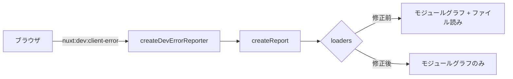

# 2026-10-29（木）

> 今日のひとこと：Nuxt 4.6.3 が開発サーバーのファイル読み出しなど5件のセキュリティ修正を公開し、Astroの公式インテグレーションにもXSSが3件出た。前回の号（10-26）から3日分をまとめている。

## 今日のリリース

- 【Nuxt】nuxt 4.6.3：開発サーバーの任意ファイル読み出し、ドットセグメントによるミドルウェア回避など5件のセキュリティ修正（出典: https://github.com/nuxt/nuxt/releases）
- 【oxc】tsrs v0.20.0（10-26）：TypeScript 7.1 betaを対象にし、既定をTypeScriptのチェッカーに揃え、最適化は `--fast` で選ぶ（出典: https://github.com/oxc-project/tsrs/releases）
- 【oxc】tsrs v0.20.1（10-28）：`NoInfer` の構成要素を見落とす共用体の近道を取り消し、Windowsと2 GiB以上のポインタ処理を修正（出典: https://github.com/oxc-project/tsrs/releases）
- 【oxc】oxlint v1.90.0：`no-unsafe-enum-assignment` を追加、複数のESLint互換ルールの不具合を修正（出典: https://github.com/oxc-project/oxc/releases）
- 【oxc】oxfmt v0.75.0：コメント位置と括弧のフォーマット修正が中心。幅の計算を表示幅に（出典: https://github.com/oxc-project/oxc/releases）
- 【Svelte】svelte 5.57.3（出典: https://github.com/sveltejs/svelte/releases/tag/svelte%405.57.3）。変更の中身までは確認していない
- 【Vite】create-vite 9.3.2 / 9.3.3：テンプレートでTypeScript 7を使う（#23910）。9.3.3はテンプレートファイルがパッケージに入っていなかった不具合の修正（#23915）（出典: https://github.com/vitejs/vite/pull/23910）

## トップニュース

### Nuxt 4.6.3 が、開発サーバーとルーティングの穴を5件まとめて塞ぐ

【脆弱性】Nuxtが4.6.3で、5件のアドバイザリ（Moderate 4件、Low 1件）を一度に修正した。開発サーバーが任意のファイルを読ませてしまう問題と、ドットセグメントでミドルウェアを回避できる問題が目立つ。

**何が変わる**

- クライアントから届くエラー報告に書かれたパスのファイルを、開発サーバーが読まなくなった
- `/%2e/admin` のようなドットセグメント入りのページ要求は404になり、ルートルールのキーと照合パスも正規化されてから比べられる
- 生成された `appSecret` を開発時のVite経由で配信しない
- リダイレクトのルートルールを、`.server.vue` のページアイランドにも適用する

**なぜ変えた**

- 4.6.0 でNuxtがページ描画の前にドットセグメントを解決するようになったが、Nitroのミドルウェアとルートルールは未解決のパスを見ていた。同じ要求を2か所で別のパスとして扱ったのが原因（アドバイザリ GHSA-9v7c-q64q-vv33 より）
- 開発サーバーのエラー報告は、Viteの `server.fs` 許可リストを通らない別の経路でファイルを読んでいた

**何に効く・誰が困る**

- 影響は4.6.0〜4.6.2。Nuxt 3系と4.0〜4.5系は影響なし（アドバイザリの記述）
- 開発サーバーの2件は `--host` や `--tunnel` などで外に公開したときだけ現実的
- ドットセグメントの件は、`server/middleware` が `event.path` で認可している場合に効く。通常のブラウザは送信前にパスを正規化するので、攻撃には非ブラウザのクライアントが要る

**ここまでの経緯**

- 2026-10-17：Nuxtが5件のアドバイザリを公開。ルートルールの生パス照合が中心（[10-17の号](2026-10-17.md)）
- 2026-10-26：Daniel Roe氏が修正コミットを `main` に入れる（35856eb、545004c など）
- 2026-10-27：4.6.3 リリース、5件のアドバイザリ公開

出典: https://github.com/nuxt/nuxt/security/advisories/GHSA-9v7c-q64q-vv33

## 今日の深掘り

### 「クライアントが書いた文字列を信じない」ために、エラー報告のファイル読みを切る（Nuxt 35856eb）

選んだ理由：開発専用の機能でも、WebSocketで外から届く文字列を信頼するとファイル読み出しになる。修正が小さく、考え方が読みやすいため。

**背景**

Nuxtの開発サーバーは、ブラウザで起きたエラーを `nuxt:dev:client-error` というHMRのイベントで受け取り、オーバーレイとターミナルに整形して出す。整形時、スタックに書かれたファイルを読んでソースの断片を付ける。ここで、メッセージの末尾に書かれた絶対パスまで読んでしまった（GHSA-x287-wcfc-q46c）。

同じパスは、Viteの `/_nuxt/@fs/` では `server.fs` の許可リストで止まる。エラー報告の経路だけが許可リストを通らなかった、というのが穴。

**変更点**

`packages/vite/src/dev-errors.ts` の差分はこれだけ（commit 35856eb）。

```ts
// before
// the stack is client-controlled, so no filesystem loader: only the module graph
loaders: [viteLoader(server)],
// after
// the message and stack are client-controlled: no compile detection, no filesystem reads, only the module graph
kind: 'error',
loaders: [viteLoader(server, { fs: false })],
```

- `fs: false`：ファイルシステムからの読み込みを止め、Viteのモジュールグラフに載っているものだけを材料にする
- `kind: 'error'`：メッセージから「コンパイルエラーらしさ」を推定しない。推定がファイル読みの入口になりうるため（アドバイザリの説明と、コミット内のコメントからの読み取り）

追加のテストは、クライアントが `boom\n<絶対パス>:1:1` というメッセージを送ってきても、報告の `frames` が空で、ファイルの中身が一切含まれないことを確かめる。

**周辺コード**



**設計思想**

- 入力が外から来る限り、「読んでよいもの」の許可は入口側で一本化する。ここでは許可リストを通さない別経路が穴になった
- 修正は許可リストを足すのでなく、そもそも読まない側に倒した。開発サーバーのエラー表示にとって、ディスクの再読み込みは必須でないため（推測）

出典: https://github.com/nuxt/nuxt/commit/35856eb148bf8d6f1ad753c5b8b337c52b4fd6b3

### CSSの `matchContainer()` が仕様に入る（csswg-drafts #13551）

選んだ理由：`matchMedia()` のコンテナ版を、仕様の文章でどう定義するかが読めるため。

**背景**

`@container` の条件をJavaScriptで評価する方法がなく、仕様には長く `Issue(6205)` として「`matchContainer` があるべき」とだけ書かれていた。今回、そのIssueの注記が実際の定義に置き換わった。

**変更点**（`css-conditional-5/Overview.bs`、commit e405e56）

文法に `<container-query-list>` が切り出され、`@container` はそれを受ける形になった。

```
@container <<container-query-list>> { ... }
<container-query-list> = <container-condition>#
```

`Element.matchContainer(query)` の手順は次のとおり。

1. `query` を `<container-query-list>` として構文解析する
2. 失敗なら `SyntaxError` の `DOMException` を投げる
3. `this` と解析結果を持つ `ContainerQueryList` を返す。`matches` はその時点の真偽を映す

複数の条件があれば、それぞれが自分の問い合わせ対象のコンテナを選び、どれか1つでも真なら全体が真になる（既存の文を `container query list` を主語に書き直した）。

**設計思想**

- 手順は `matchMedia()` と `MediaQueryList` をなぞっている。仕様内に「`resizeObserver` に似るが、コンテナクエリの構文と機能を持つ」と書かれていた
- 仕様自身が `Issue(14541)` で「名前が紛らわしいので変えるかもしれない」と留保している。確定ではない
- 実装側（ブラウザ）の状況は、egressの制約で今回は追っていない（取得できず）

出典: https://github.com/w3c/csswg-drafts/commit/e405e56

## 仕様の変更

### w3c/csswg-drafts

#### `calc-size()` と `interpolate-size` が Sizing 4 に移る

【CSS】css-values-5 にあった `calc-size()` と `interpolate-size` が css-sizing-4 に移動（#14502）。差分は約600行ずつの入れ替えで、内容の変更ではなく置き場所の整理。
なぜ変えたか：サイズ指定に関する機能をSizing側にまとめるため（コミットの題名と差分の形からの読み取り）。
出典: https://github.com/w3c/csswg-drafts/commit/ee30871

#### css-counter-styles-3：`-informal` などの接尾辞をやめ、`nko-ordinal` を追加

【CSS】`-informal` の接尾辞を落とし（`korean-hangul` の `-formal` も）、旧名は別名として残す（#12312）。N'Koの序数のカウンタースタイル `nko-ordinal` も追加（#8988）。
なぜ変えたか：Issue本文までは読んでおらず、不明。
出典: https://github.com/w3c/csswg-drafts/commit/10ae270

その他：

- css-color-4：「powerless」な色成分を missing にするときの扱いを明確化し、サンプルJavaScriptを追加（[#14531](https://github.com/w3c/csswg-drafts/issues/14531)、[#14674](https://github.com/w3c/csswg-drafts/pull/14674)）
- css-color-5：数式の中の `none` とチャンネルキーワードの扱いを明確化（[#10280](https://github.com/w3c/csswg-drafts/issues/10280)）
- css-text-4：`text-spacing-trim` の値の空間を元に戻し（[#13789](https://github.com/w3c/csswg-drafts/issues/13789)）、`text-spacing: insert | replace` を明確化（[#13774](https://github.com/w3c/csswg-drafts/issues/13774)）
- css-color 系の例・数式の誤り修正（Jzazbz の逆変換の行列の順序、PQ復号の式など。編集的なものを含む）

### whatwg/html

#### close watcherまわりの手順の誤りが2件直る

【HTML】close watcher の「アクティブか」を調べる手順で、`contains` の操作に足りなかったリスト（`groups`）を渡すようにした。もう1件は、キャンセル動作の返り値の記述を訂正。
なぜ変えたか：手順の記述が、実際に指すものとずれていたため（コミットメッセージより）。仕様上の挙動を変えるというより、書き間違いの訂正。
出典: https://github.com/whatwg/html/commit/d22524d

その他：

- クラシックワーカーのimportのfetchフックに、`isTopLevel` ではなく `true` を渡すと明記（[78fc164](https://github.com/whatwg/html/commit/78fc164)）

動きなし：whatwg/dom, whatwg/fetch, whatwg/streams, whatwg/url, tc39/ecma262, tc39/proposals, w3c/ServiceWorker, w3c/wcag3。w3c/aria は html-aam の ATK 画像マップロールのマージが1件（[#2945](https://github.com/w3c/aria/pull/2945)）。

## OSSのPR

### oxc-project/tsrs

#### tsrs v0.20：TypeScript準拠の既定と、`--fast` の整理

【oxc】[10-26の号](2026-10-26.md)で扱った既定の変更（#781）が、v0.20.0 として出た。破壊的変更として、他バージョンのTypeScriptが出した `.tsbuildinfo` を無視する、Node APIのimportを `tsrs/*` に移す、watch関連のフラグを一部削除、が並ぶ。0.20.1 では、`NoInfer` の構成要素を見落とす共用体の近道を取り消した（#808）。リリースノートの適合・速度の数字は自己申告で、ここでは検証していない。
なぜ変えたか：TypeScript 7.1 に向けた安定版を目指すため（READMEの方針）。
出典: https://github.com/oxc-project/tsrs/releases

その他：

- チェッカースレッドを作業グループ間で再利用（[#816](https://github.com/oxc-project/tsrs/pull/816)）
- 疎な共用体の部分集合検索を、直前の一致の後からだけ行う（[#798](https://github.com/oxc-project/tsrs/pull/798)）
- アリーナ上のシンボルテーブルで、名前が異なるキーを別名として持つ（[#829](https://github.com/oxc-project/tsrs/pull/829)）
- Windows SDK の探索に対応（[#826](https://github.com/oxc-project/tsrs/pull/826)）
- WASMで2 GiB以上のホストポインタを符号なしで読む（[#812](https://github.com/oxc-project/tsrs/pull/812)）
- 他にperf系（printer、JSDoc、VFS、割り当て削減）が約10件

### microsoft/TypeScript

#### 共用体の部分集合チェックが、ソート済みの構成要素の走査になる

【TypeScript】共用体の部分集合を調べるとき、ソート済みの構成要素を順に走査して速くする（#64964）。交差型のプロパティ名の数え上げも、素のmapとsliceに変更（#64876）。挙動は変えず、内部の最適化が続いている。
なぜ変えたか：PR本文までは読んでおらず、不明。
出典: https://github.com/microsoft/TypeScript/pull/64964

その他：

- 挿入順を保つシンボルテーブルを最適化（[#64979](https://github.com/microsoft/TypeScript/pull/64979)）
- コンパイラの既定のPGOプロファイルを追加（[#64986](https://github.com/microsoft/TypeScript/pull/64986)）
- 関数型のbinding patternの暗黙のanyエラーを、チェック中に報告（[#64856](https://github.com/microsoft/TypeScript/pull/64856)）
- 逆写像型の解決で、非公開メンバーを飛ばす（[#64594](https://github.com/microsoft/TypeScript/pull/64594)）
- import-equals の出力で、結合された名前空間の参照を修飾（[#64976](https://github.com/microsoft/TypeScript/pull/64976)）
- `getImmediateAliasedSymbol` の挙動を戻す（[#64867](https://github.com/microsoft/TypeScript/pull/64867)）
- 属性なしのimportで非モジュールのエラーを保つ（[#64884](https://github.com/microsoft/TypeScript/pull/64884)）
- フォーマッターのJSX閉じタグでのクラッシュ修正（[#64644](https://github.com/microsoft/TypeScript/pull/64644)）、自動importが未保存の export を出さない不具合の修正（[#64960](https://github.com/microsoft/TypeScript/pull/64960)）
- テストと生成コードのビルド整理（[#64969](https://github.com/microsoft/TypeScript/pull/64969)、[#64748](https://github.com/microsoft/TypeScript/pull/64748)、[#64400](https://github.com/microsoft/TypeScript/pull/64400)、[#64679](https://github.com/microsoft/TypeScript/pull/64679)、[#64972](https://github.com/microsoft/TypeScript/pull/64972)）

### vercel-labs/tsc-ts

#### 増分処理とプロファイルまわりの更新が続く

【TypeScript】contextual return type の推論の走査をメモ化、`--watch` の最初のビルドを解析スレッドで行う、tsgoの引数個数エラーに揃える、など約40コミット。数字はREADMEの自己申告で、ここでは検証していない。v0.0.10 は10-25に出ている。
なぜ変えたか：コミットメッセージの範囲では不明。
出典: https://github.com/vercel-labs/tsc-ts/commit/fade6ce

### pingdotgg/ts-rust / vercel-labs/scriptc

取得せず（今回は両リポジトリをcloneしておらず、件数も数えていない）。scriptc は v0.4.5 が10-25に出ており、前回の号に載せた。

### vercel/next.js

#### `experimental.hydrationChangeEvent` フラグが入る

【Next.js】ハイドレーションに関する変化のイベントを出す実験的な設定が追加された（#99610）。中身までは読んでいない。
なぜ変えたか：不明。
出典: https://github.com/vercel/next.js/pull/99610

#### 完全に静的なPPFのペイロードをファイルシステムキャッシュに永続化

【Next.js】Persist fully static PPR payloads in filesystem cache（#100759）。あわせて Cache Components 下のdraft modeの描画修正（#100728）、`'use cache'` のエラー後にHTMLが止まる不具合の修正（#100673）、MPAのServer Action後に完全なHTML文書を描く修正（#100740）が入った。
なぜ変えたか：PR本文までは読んでおらず、不明。
出典: https://github.com/vercel/next.js/pull/100759

#### Turbopackのビットセット化が続く

【Next.js】`turbo-bitset` に高速なビットセット `Bitset` が入り（#100566）、チャンクグループ情報や統合モジュールの計算に使われた（#100643、#100568、#100567、#100630）。[10-25の号](2026-10-25.md)のビットマップの続き。
なぜ変えたか：ビルド時間の短縮（コミットの題名より）。
出典: https://github.com/vercel/next.js/pull/100566

その他：

- Turbopack：サーバーチャンクのサイズ指定オプションを追加（[#100712](https://github.com/vercel/next.js/pull/100712)）、pnpm GVSを自動検出（[#99758](https://github.com/vercel/next.js/pull/99758)）、webpackローダーでの `fs.stat` に対応（[#100272](https://github.com/vercel/next.js/pull/100272)）、永続キャッシュの読み出しの並列化（[#100620](https://github.com/vercel/next.js/pull/100620)）
- ビルド：static check の `O(pages²)` を解消（[#100615](https://github.com/vercel/next.js/pull/100615)）
- `server-only` の漏れを調べる処理を next-bundle-optimizer に追加（[#100330](https://github.com/vercel/next.js/pull/100330)）
- `jsonwebtoken` を `fast-jwt` に置き換え（[#100818](https://github.com/vercel/next.js/pull/100818)）
- export：静的生成のバッチごとに必要なresume data cacheだけを送る（[#100048](https://github.com/vercel/next.js/pull/100048)）
- 残りは評価・ベンチ・CI・ドキュメントの整理。v16.5.0-canary.28 / .29 は先行版のため省略

### facebook/react

#### Reactコンパイラが符号付きゼロと `PerformanceObserver` のrefを正しく扱う

【React】定数伝播とコード生成で `-0` を保つ（#37995）。`PerformanceObserver` / `ReportingObserver` のコールバックでのref参照を許す（#37996）。
なぜ変えたか：前者は最適化で `-0` が `0` に変わる誤り、後者は `react-hooks/refs` の誤検知を直すため（題名より。PR本文は読んでいない）。
出典: https://github.com/facebook/react/pull/37995

その他：

- `onTransitionRun` / `onTransitionStart` / `onTransitionCancel` に SyntheticTransitionEvent を使う（[#37985](https://github.com/facebook/react/pull/37985)）
- RN：イベントの対象がnullのときも `dispatchNativeEvent` を呼ぶ（[#38007](https://github.com/facebook/react/pull/38007)）
- react-native の PanResponder の型付けで、`react-hooks/refs` の誤検知を直す（[#37970](https://github.com/facebook/react/pull/37970)）

### vitejs/vite

#### `server.fs` の外の `.wasm` を拒否する

【Vite】許可リストの外にある `.wasm` に要求が来たとき、中身が正しいWebAssemblyでなければ先頭4バイトが返ってしまった。これを拒否する（#23914）。PRにアドバイザリの紐づけはない。
なぜ変えたか：許可リストの抜けを塞ぐため（PR本文より）。
出典: https://github.com/vitejs/vite/pull/23914

その他：

- `new URL(..., import.meta.url)` で参照した、クエリやハッシュ付きファイルも監視する（[#23780](https://github.com/vitejs/vite/pull/23780)）
- CSS依存の収集で、クエリ付きの動的importを解決する（[#23909](https://github.com/vitejs/vite/pull/23909)）
- `cssScopeTo` のためにレンダリング済みモジュールを出力ごとに一度だけ索引化（[#23889](https://github.com/vitejs/vite/pull/23889)）
- オプティマイザのキャッシュディレクトリの検出を正確に（[#23912](https://github.com/vitejs/vite/pull/23912)）

### biomejs/biome

#### Vueのlintルールが一気に約25個入る

【Biome】`noVueMutatingProps`、`useVueDefineOptions`、`useVueValidVModel`、`useVueValidVSlot`、`noVueDeprecatedListeners`、`noVueSideEffectsInComputed`、`useVueTemplateRef` など、`eslint-plugin-vue` 系のルールが3日で次々に入った（#12512〜#12661 ほか）。いずれもルール追加で、仕組みは各ルールの規則を `rowan` の構文木に当てる形。
なぜ変えたか：eslint-plugin-vue からの移行を受け入れるため（推測。PR本文は読んでいない）。
出典: https://github.com/biomejs/biome/pull/12554

#### 構文木とlintの高速化

【Biome】`rowan` で、ノードのテキストと構文ノードのポインタをgreen tree経由で引く（#12722、#12723）、`SyntaxKindSet` を立っているビットだけ走査する（#12719）。lintでは `noDuplicateCase` などを線形にし（#12457）、`useHookAtTopLevel` などを高速化（#12458）。
なぜ変えたか：速度（題名より）。
出典: https://github.com/biomejs/biome/pull/12722

その他：

- 解析器：`v-for` の束縛の既定値を構文解析（[#12702](https://github.com/biomejs/biome/pull/12702)）
- Markdownパーサー：リスト項目を内側の列に合わせて入れ子にする（[#12576](https://github.com/biomejs/biome/pull/12576)）、深いリスト項目の中で引用を続ける（[#12575](https://github.com/biomejs/biome/pull/12575)）
- スキャナーのepoch管理とLRU追い出しの整理（[#12694](https://github.com/biomejs/biome/pull/12694)）
- x86_64 musl のCLIでjemallocを使う（[#12692](https://github.com/biomejs/biome/pull/12692)）
- 型注釈で、型と値が結合したimportを型に解決する（[#12652](https://github.com/biomejs/biome/pull/12652)）

### oxc-project/oxc

#### lexerの大規模な整理と、数値パーサーの置き換え

【oxc】lexerの `Lanes`、コメント分類、`disambiguate` を別モジュールに切り出す一連の整理（#28310〜#28332）。数値のパースは `dragonbox_ecma` から `zmij_ecma` に変更（#28282）。
なぜ変えたか：整理の動機はPR本文までは読んでおらず、不明。
出典: https://github.com/oxc-project/oxc/pull/28282

その他：

- パーサー：import属性のキー重複に分かりやすいエラー（[#28262](https://github.com/oxc-project/oxc/pull/28262)）
- linter：Jest/Vitest系のルール約40個を新しいAST dispatchに移行し、旧dispatchを削除（[#28229](https://github.com/oxc-project/oxc/pull/28229) 〜 [#28256](https://github.com/oxc-project/oxc/pull/28256)）
- linter：gitlab形式のフィンガープリントを診断ごとに一意に（[#28307](https://github.com/oxc-project/oxc/pull/28307)）
- TypeScriptのProgramのspanにコメントを含める（[#28326](https://github.com/oxc-project/oxc/pull/28326)）
- minsize.snapにバイト数を正確に出す（[#28274](https://github.com/oxc-project/oxc/pull/28274)）

### sveltejs/svelte

- 開発時、走査中に書き込まれたsourceの更新カウンターをリセット（[120c0ed](https://github.com/sveltejs/svelte/commit/120c0ed04)）
- `autocorrect` を全要素で許可（[#19105](https://github.com/sveltejs/svelte/pull/19105)）
- 使われていないコードを削除（[#19103](https://github.com/sveltejs/svelte/pull/19103)）

### ghc/ghc

#### 並列downsweepと、finderキャッシュの分離

【GHC】`Rule-based deterministic concurrent downsweep`、`Driver: structured concurrent worker abstraction`、`Separate Home/External finder caches`、`2-phase Cache/Search Finder monad` など、モジュール依存の探索（downsweep）を並列化する一連のコミットが `master` に入った。作者日付は8月〜10月で、まとめて入ったように見える。メッセージ以上の中身は読んでいない（MRの議論はgitlab.haskell.orgで取得できず）。
なぜ変えたか：不明（コミットメッセージに理由の記述なし）。
出典: https://github.com/ghc/ghc/commit/38a9900693

その他：

- `Serialized` が `[Word8]` でなく `ShortByteString` を持つ（[5308737](https://github.com/ghc/ghc/commit/5308737363)）
- X86 NCG：下位幅のpopcountに32ビット `POPCNT` を使う（[ac870ad](https://github.com/ghc/ghc/commit/ac870ad532)）
- `LogQueue` を適切なキューに作り直す（[953e4c7](https://github.com/ghc/ghc/commit/953e4c7fd3)）
- semaphore tokenの取得・解放をより早く行う（[9fa7b7b](https://github.com/ghc/ghc/commit/9fa7b7be13)）

### oven-sh/bun

`bun check` と `bun fmt` に関わる変更は、取得したコミットの題名からは確認できなかった。`bun lint` は release ビルドでコマンドとして使えるようになり、ヒントが短くなった（[#46439](https://github.com/oven-sh/bun/pull/46439)）。`bun fmt` と一緒に入った機能なので触れておく。ランタイム側の変更は対象外。

動きなし：vuejs/core（READMEのみ）, solidjs/solid, wado-lang/wado（今回は精査せず）

## 議論ウォッチ

### csswg-drafts：`matchContainer()` の名前

論点：`Element.matchContainer()` という名前が紛らわしいので変えるべきか（Issue #14541、仕様の注記より）。
賛否それぞれの主張：Issueのコメントまでは読めておらず、不明。
今回の進展：メソッドの定義自体が仕様に入った（上の「今日の深掘り」）。
次に決まりそうなこと：名前の見直し。

## 続報

- [10-17の号](2026-10-17.md)で取り上げたNuxtのルートルール問題の続きとして、4.6.3 で別系統のルーティング問題（ドットセグメント）と開発サーバー関連の修正が出た。「発案 → 議論 → 決定 → 仕様 → 実装」でいえば、修正の実装と配布まで進んだ。
- [10-26の号](2026-10-26.md)のtsrsの `--fast` 分離は、v0.20.0 として配布された。
- [10-25の号](2026-10-25.md)のTurbopackのビットマップは、`Bitset` クレートとして切り出され、他の計算にも広がった。

## 脆弱性

### Nuxt：5件（2026-10-27公開、4.6.3で修正）

【脆弱性】4.6.0〜4.6.2 が対象（Nuxt 3系と4.0〜4.5系は影響なし）。

| GHSA | 深刻度 | 内容 |
|---|---|---|
| GHSA-x287-wcfc-q46c | Moderate（CVSS 5.9） | 開発サーバーが、クライアントのエラー報告に書かれたパスのファイルを読む |
| GHSA-9v7c-q64q-vv33 | Moderate（CVSS 6.5） | ドットセグメントでミドルウェアとルートルールを回避 |
| GHSA-648h-gw55-m2g7 | Moderate | 開発サーバーがNitroの開発バンドル経由で非公開のランタイム設定を公開 |
| GHSA-3xf4-9g3c-4h4w | Moderate | 生成された `appSecret` がViteのファイル配信から見える |
| GHSA-2fxj-c3j7-rr69 | Low | サーバーアイランドが `.server.vue` のページに `redirect` ルートルールを適用しない |

- 攻撃原理：ファイル読み出しは、HMRのWebSocketで送った `nuxt:dev:client-error` のメッセージ末尾の絶対パスを、開発サーバーがそのまま読む。ドットセグメントは、Nuxtが解決したパスで描画し、Nitroのミドルウェアは未解決のパスで判定するずれを突く（`/%2e/admin` は `/admin` を描画しながら `/admin` 向けのチェックを通らない）
- 成立条件：ファイル読み出しは `--host`、`--tunnel`、プロキシなどで開発サーバーに届くこと。ドットセグメントは、`server/middleware` が `event.path` や `event.node.req.url` を見ていること、または、ページルートにルートルールがあること。`server/api` と `server/routes`、`appMiddleware`、`definePageMeta` のミドルウェアは影響なし
- 修正コミット：ファイル読み出しは 35856eb（上の深掘り）。`appSecret` は 545004c で配信を拒否（`packages/vite/src/vite.ts`）。リダイレクトは 5245190。ドットセグメントは、404にしてルートルールのキーと照合パスを正規化する（アドバイザリの記述。diffまでは読んでいない）
- 同種のパターン：検証を行う層と使う層でパスの正規化が一致しない（[10-17の号](2026-10-17.md)のNuxt、[10-22の号](2026-10-22.md)のViteの `server.fs.deny` も同系統）

出典: https://github.com/nuxt/nuxt/security/advisories

### Astro（公式インテグレーション）：3件（2026-10-28公開、すべてModerate）

| GHSA | パッケージ | 修正版 | 内容 |
|---|---|---|---|
| GHSA-f4j9-crrj-867q | `@astrojs/svelte` | 9.1.2（9.1.1以前の5.7.3以降が対象） | スロット名が `<astro-slot>` の `name` 属性にエスケープなしで入る |
| GHSA-jmv2-qgxf-f995 | `@astrojs/solid-js` | 7.1.2（7.1.1以前が対象） | 同上のSolid版 |
| GHSA-ff38-p3qj-4pmf | `@astrojs/prism`（4.1.2で修正）、`@astrojs/markdoc`（2.1.2で修正） | 同左 | Prismに文法がない言語名のとき、コードをエスケープせず返す |

- 攻撃原理（スロット名）：スロット名に二重引用符を含めると属性が閉じ、`onerror` 付きの `` などを注入できる。Astro本体の同種の問題は CVE-2026-50146（GHSA-8hv8-536x-4wqp）で、今回のはそれのインテグレーション版
- 成立条件（スロット名）：リクエスト由来の入力をスロット名に渡し、`client:*` でハイドレートされ、そのスロットを動的名で描画する（Svelte 5のスニペットなど）
- 攻撃原理（Prism）：`runHighlighterWithAstro()` が文法のない言語でコードをそのまま返し、呼び出し側が `set:html` で挿入する。CVSS 5.4。Markdocでは `prism()` 拡張と、`vue`、`svelte`、`console` などの言語ラベルのコードフェンスを書ける著者が条件で、`allowHTML: false` を回避できる
- 修正コミット：アドバイザリにコミットへのリンクがなく、不明（cloneで探すところまでは行っていない）
- 同種のパターン：エスケープを「対応言語のときだけ」の経路に置くと、非対応のときに生のまま出る

出典: https://github.com/withastro/astro/security/advisories

その他の確認：vitejs/vite、vercel/next.js、facebook/react、sveltejs/svelte、vuejs/core、oxc-project/oxc、TanStack/router に前回以降の新規アドバイザリはなし（ページ上の最新日付で確認。ページはキャッシュの可能性がある）。
