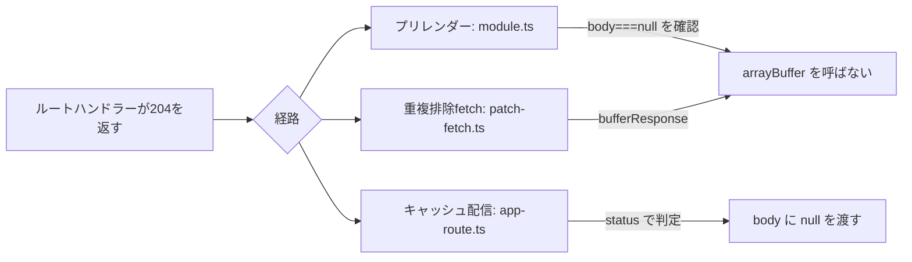

# 2026-10-30（金）

> 今日のひとこと：Next.js が、204 を返すルートハンドラーで `next build` が止まる不具合を直した。原因は「本文なしのレスポンスを、空のバッファから作り直そうとした」こと。新規の脆弱性はなし。前回の号（10-29 09:36 JST）以降の分をまとめている。

## 今日のリリース

- 【Solid】solid-js 2.0.0-rc.20（10-29）：非同期まわり（`isPending` / `<Errored>`）とハイドレーションの修正、`<For>` と store の高速化。rc なので載せる（出典: https://github.com/solidjs/solid/releases）
- 【TypeScript】scriptc v0.4.6（10-29）：実行中に Node.js を読み込んで scriptc が扱えない npm パッケージを動かす「Node islands」を追加。リリースノートの記述で、動作は未確認（出典: https://github.com/vercel-labs/scriptc/releases）

## トップニュース

### Next.js が、204 を返すルートハンドラーのハングと 500 を直す

【Next.js】`cacheComponents` 付きのルートハンドラーが 204 を返すと、プリレンダーの Promise が決着せず `next build` が止まっていた。Next.js はこれを3か所で直した（#100159、2026-10-29 に `canary` へ）。

**何が変わる**

- `new Response(body, { status: 204 })` は、`body` が `null` でなければ例外になる。空の `ArrayBuffer` でも同じ。Next.js には、レスポンスを `arrayBuffer()` で読んで作り直す箇所が3つあり、本文なしのレスポンスが「空バッファ付き」に化けていた
- 3か所は、`cacheComponents` 付きルートハンドラーのプリレンダー、キャッシュ済みのAppルート応答の配信、`pendingRevalidates` で重複排除された fetch
- 修正は、元のレスポンスの `body === null` を見て `arrayBuffer()` を呼ばない、という形

**なぜ変えた**

- PR本文によれば、nextjs.org で `OPTIONS /feed.xml` のたびに `unhandledRejection` が出て、その後60秒の実行タイムアウトになっていた。自動実装の `OPTIONS` も204を返すため、普通のルートでも踏む
- 例外が `.then` の中で起き、その拒否を誰も受けなかったので、Promise が解決も拒否もされないまま止まった

**何に効く・誰が困る**

- `cacheComponents` を有効にしていて、204 / 205 / 304 を返すルートハンドラーを持つアプリ
- キャッシュされた応答の保存形式は変えていない。独自のキャッシュハンドラーや既存のエントリーが `body: Buffer` に依存しているため（PR本文）

**ここまでの経緯**

- 2026-10-29：#100159 が `canary` にマージ。関連Issueは本文に書かれていない（不明）

出典: https://github.com/vercel/next.js/pull/100159

## 今日の深掘り

### 「本文なし」を空バッファで表すと、Fetch の Response が拒否する（Next.js 3478b30f58）

選んだ理由：Fetch 標準の細かい規則が、フレームワークの3か所で同時に踏まれた例。修正の分け方に、データ形式を変えない判断がよく出ている。

**背景**

Fetch標準には「null body status」がある。204、205、304 は本文を持てない。`Response` のコンストラクターは、これらのステータスに `null` 以外の本文を渡すと `TypeError` を投げる。空の `ArrayBuffer` や空の `Buffer` も「本文あり」として数えられる。

一方、レスポンスを共有・保存するには、一度 `arrayBuffer()` で読んでバッファにするのが手っ取り早い。本文が `null` のレスポンスを `arrayBuffer()` に通すと、長さ0のバッファが返る。ここで「本文なし」と「空の本文」の区別が消える。

**変更点**

重複排除された fetch 用に、バッファ化の関数が切り出された（`packages/next/src/server/lib/patch-fetch.ts`）。

```ts
async function bufferResponse(response: Response): Promise<BufferedResponse> {
  return {
    body: response.body === null ? null : await response.arrayBuffer(),
    headers: response.headers,
    status: response.status,
    statusText: response.statusText,
  }
}
```

`pendingRevalidates` に入れる2か所は、インラインの `.then(async (response) => ({ body: await response.arrayBuffer(), ... }))` をやめ、これに置き換えられた。型も `body: ArrayBuffer | null` になった。

キャッシュ済みルートの配信（`packages/next/src/build/templates/app-route.ts`）は事情が違う。保存形式の `body` は Buffer で、本文なしは「0バイト」として保存されている。区別できるのはステータスだけなので、判定を足した。

```ts
const status = cacheEntry.value.status || 200
const body = isNullBodyStatus(status) ? null : cacheEntry.value.body
await sendResponse(nodeNextReq, nodeNextRes, new Response(body, { headers, status }))
```

`isNullBodyStatus` は `packages/next/src/server/web/http.ts` に足されたヘルパー。ルートハンドラーのプリレンダー側（`app-route/module.ts`）は `body === null` を見るのに加え、`.then().catch(reject)` にして、将来また例外が出ても拒否として伝わるようにした。

**周辺コード**



**この変更から分かる設計思想**

- 形式を変えず、判定を足した。保存形式は外部（カスタムキャッシュハンドラー）が読むので、後方互換のほうを重く見ている
- メモリ内の経路は「そもそも読まない」、保存済みの経路は「ステータスで見分ける」と、情報が残っているかどうかで手を分けた
- プリレンダーの修正は、本題の `null` 判定と別に「拒否を握りつぶさない」を足した。止まる失敗は、落ちる失敗より気づきにくい

PR本文には、デプロイ環境のみのテスト（自動 `OPTIONS`）はローカルで実行していない、とある。

出典: https://github.com/vercel/next.js/pull/100159

## 仕様の変更

### w3c/ServiceWorker

- Service Worker の activation の説明で重複していた記述を削除（[#1851](https://github.com/w3c/ServiceWorker/pull/1851)）

### w3c/csswg-drafts

- css-color-4 のサンプルコードで、rgb→hsl の変換に epsilon を使うようにした（[#14531](https://github.com/w3c/csswg-drafts/issues/14531)、コミット 42d4d796）。サンプルコードの数値の扱いの修正で、仕様の挙動は変えない
- css-color-4 の旧い GMA の注釈の削除と、css-color の誤字修正（editorial、[#14682](https://github.com/w3c/csswg-drafts/pull/14682)）

動きなし：whatwg/html, whatwg/dom, whatwg/fetch, whatwg/streams, whatwg/url, tc39/ecma262（IPRの運用変更のみ。内容は editorial に当たるため載せない）, w3c/aria, w3c/wcag3, tc39/proposals

## OSSのPR

### vercel/next.js

#### create-next-app が常に App Router で作るようになる

【Next.js】`create-next-app` から「App Router を使うか」の質問が消え、新規プロジェクトは常に App Router になる。Pages Router が要るときは `--no-app` を渡す。保存済みの `app: false` も無視される。
なぜ変えたか：PR本文によれば、質問が誤選択のもとになり、前回の設定が Pages Router を黙って作り続けていたため。
出典: https://github.com/vercel/next.js/pull/100850

その他：

- Turbopack: 非同期ローダーの「利用可能なモジュール」の正規化の最適化（#100705）を取り消し（[#100898](https://github.com/vercel/next.js/pull/100898)）
- 開発オーバーレイのエラーを、インジケーターの状態が決まる前でも表示（[#100629](https://github.com/vercel/next.js/pull/100629)）
- Server reference 変換の出力を、将来のツリーシェイキングのために整理（[#100637](https://github.com/vercel/next.js/pull/100637)）
- アダプターで、メタデータのプリレンダーの再検証を維持（[#100861](https://github.com/vercel/next.js/pull/100861)）
- Turbopack: フラグメントファサードで解析済み参照を使う（[#100852](https://github.com/vercel/next.js/pull/100852)）、末尾スラッシュ付きパッケージルートの解決を修正（[#100726](https://github.com/vercel/next.js/pull/100726)）
- build/utils でページデータ補助を遅延 require（[#100822](https://github.com/vercel/next.js/pull/100822)）
- テストとCI：再検証後・書き込み失敗後のキャッシュ再利用のテスト追加（[#100652](https://github.com/vercel/next.js/pull/100652)）、デプロイテストをNode.js 22.xに固定（[#100879](https://github.com/vercel/next.js/pull/100879)）

### oxc-project/tsrs

#### tsrs に型情報つきリント用のバックエンド `tsrs-lint` が入る

【oxc】oxlint が `OXLINT_TSGOLINT_PATH` 経由で呼ぶ、Go製 tsgolint の代わりの Rust 製実行ファイル。`await-thenable`、`no-floating-promises`、`no-unsafe-enum-assignment` など型情報を使うルールを移植している。上流の tsgolint v7.0.2005 に固定。
なぜ変えたか：PR本文は空。コメントからは速度とメモリの削減が狙いと読めるが、動機そのものは推測。利用者の報告（公開リポジトリで約30.6秒→約19.6秒、ピークRSS約6.3→約5.1GiB）は自己申告で、条件も揃っていない。CodSpeedのベンチは変化なし。
既知の課題：tsconfig の `contentMappers`（TS 7.1）は未対応。複数プロジェクトのアリーナがリクエスト終了まで解放されない問題は #783 で追跡。
出典: https://github.com/oxc-project/tsrs/pull/624

その他：

- tsrs-lint の変更をベンチマークで比べるCIを追加（[#853](https://github.com/oxc-project/tsrs/pull/853)）
- LSP のセッションがサーバーを弱参照で持つようにした（[#837](https://github.com/oxc-project/tsrs/pull/837)）
- 夜間同期でトリアージ用モデルを使う（[#845](https://github.com/oxc-project/tsrs/pull/845)）

### microsoft/TypeScript

- LSP で、アイドル時の掃除により未使用の設定済みプロジェクトを解放（[#64603](https://github.com/microsoft/TypeScript/pull/64603)）
- 文の位置にあるクラス宣言でエラーを報告（[#65005](https://github.com/microsoft/TypeScript/pull/65005)）
- signature help が `findPrecedingMatchingToken` のループでハングする不具合を修正（[#65006](https://github.com/microsoft/TypeScript/pull/65006)）
- es2026 で `JSON.parse` の reviver を省略可能に保つ（[#65012](https://github.com/microsoft/TypeScript/pull/65012)）
- ASTの走査でトークン探索のvisitorを再利用（[#64928](https://github.com/microsoft/TypeScript/pull/64928)）、保護されたレコード種別フィールドへの書き込みを lint（[#64791](https://github.com/microsoft/TypeScript/pull/64791)）、content mapper の拡張子エラーの文言を明確化（[#64921](https://github.com/microsoft/TypeScript/pull/64921)）

### vercel-labs/scriptc

【TypeScript】コミットは約45件で、大半は Node.js との挙動の差を詰める細かい修正（stdio への書き込みコールバック、SIGPIPE の無視、UTF-8 の復号、未宣言名の `ReferenceError` など）。件数のみ。リリース v0.4.6 は上の「今日のリリース」を参照。

動きなし：pingdotgg/ts-rust, vercel-labs/tsc-ts

### oxc-project/oxc

#### パーサーとレキサーの高速化が続く

【oxc】Boshen 氏らによるパーサーの `perf` コミットが約30件（識別子のUnicode復号を一度だけにする #28414、括弧付きアロー関数の先読みの統合 #28412、SIMDバイト探索の命令数削減 #28423 など）。個々の数字は確認していない。regex 側では正規表現の捕獲グループ追跡、エスケープ値、テンプレートのcooked値の扱いの修正が入った（#28297, #28296, #28345）。
なぜ変えたか：各PRの本文は未確認（不明）。
出典: https://github.com/oxc-project/oxc/pull/28423

その他：

- リポジトリに、AIエージェント向けの再利用に関する告知文書を追加（[#28433](https://github.com/oxc-project/oxc/pull/28433)）。PR本文は一文のみで、背景は不明
- minifier: ブロック展開で追加パスを要求しない（[#28315](https://github.com/oxc-project/oxc/pull/28315)）
- lexer のリファクタリング多数（#28417〜#28428、#28387）

### biomejs/biome

- lint ルール `useVueConsistentDefineEmitsDeclaration` を追加（[#12675](https://github.com/biomejs/biome/pull/12675)）
- YAML のデシリアライズに対応（[#12064](https://github.com/biomejs/biome/pull/12064)）、analyzer に panic handler を追加（[#12746](https://github.com/biomejs/biome/pull/12746)）
- ルールのドキュメントを自前のパーサーで処理（[#12744](https://github.com/biomejs/biome/pull/12744)）、論理ショートハンドのテスト追加（[#12465](https://github.com/biomejs/biome/pull/12465)）、libz-sys を更新（[#12750](https://github.com/biomejs/biome/pull/12750)）

### solidjs/solid

- store の reconcile 後の配列長をサーバーで維持（[#4266](https://github.com/solidjs/solid/pull/4266)）
- 解決済みの `lazy()` コンポーネントを再マウント時に同期描画（[#4135](https://github.com/solidjs/solid/pull/4135)）
- `createRoot` の dispose が `fn` を保持し続けないようにした（[#4096](https://github.com/solidjs/solid/pull/4096)）、DOM Expressions を 0.40.13 に更新（[#4431](https://github.com/solidjs/solid/pull/4431)）

### vuejs/core

- compiler-dom: 静的な boolean 属性の束縛の意味を維持（[#16055](https://github.com/vuejs/core/pull/16055)）
- `dialog` の `closedby` 属性の型を追加（[#16064](https://github.com/vuejs/core/pull/16064)）

### facebook/react

- View Transitions のエラーメッセージ分類を Chrome 153 に合わせて更新（[#38034](https://github.com/facebook/react/pull/38034)）

### wado-lang/wado

【Wado】コミット約20件（件数のみ）。クロージャのキャプチャまわりのミスコンパイル修正と、分岐の合流点でアグリゲートを分解する最適化が中心。`wep-*.md` の追加・変更は確認できなかった。

動きなし：vitejs/vite, sveltejs/svelte（ドキュメントのリンク修正のみ）, ghc/ghc, oven-sh/bun（`bun check` / `bun fmt` 関連はWebFetchで確認しておらず、不明）

## 脆弱性

新規のアドバイザリはなし。前回以降（2026-10-29 以降の公開）のものを、各リポジトリの一覧の1ページ目で確認した。

- next.js：最新は10-14。react：最新は10-14。vite：最新は10-21。nuxt：最新は10-27。astro：最新は10-28（前号で扱い済み）。TanStack/router：最新は09-30。svelte：最新は05-14。vuejs/core：最新は08-31。oxc：公開済みのものなし
- どれも一覧の1ページ目の並び（新しい順に見える）で判断している。2ページ目以降は見ていない
