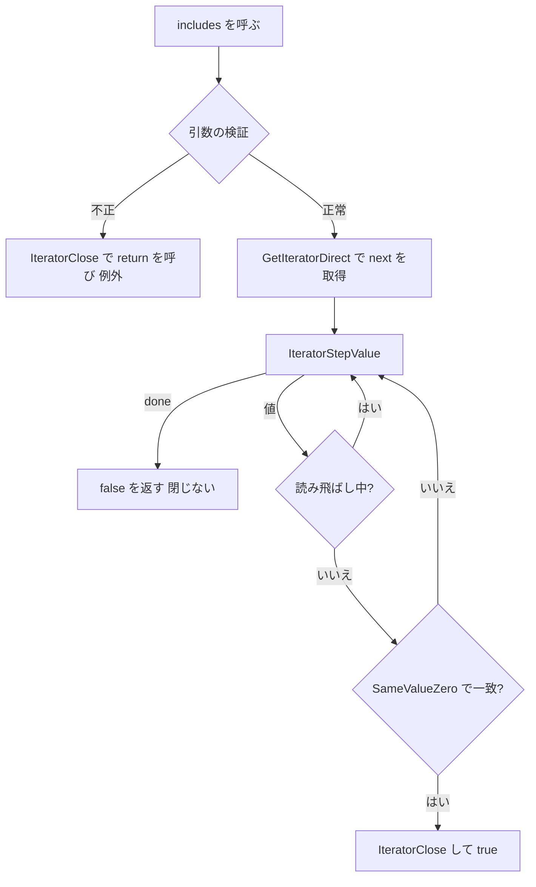

# 2026-10-31（土）

> 今日のひとこと：ECMAScript 本体に `Iterator.prototype.includes` が入った（ecma262 #3969）。配列の `includes` と同じ見た目で、「イテレーターを途中まで読んで、見つかったら閉じる」という挙動が仕様の手順として固まった。新規の脆弱性はなし。前回の号（10-30 07:18 JST）以降の分をまとめている。

## トップニュース

### ECMAScript に `Iterator.prototype.includes` が入る

【TC39】イテレーターに「この値を返すか」を尋ねる `includes(searchElement, skippedElements?)` が、ecma262 の本文に入った（#3969、2026-10-30 に `main` へ）。proposal-iterator-includes の Stage 4 を受けた PR。

**何が変わる**

- `gen().includes(3)` のように、イテレーターを直接検索できる。比較は `SameValueZero`（配列の `includes` と同じ。`NaN` は `NaN` と等しい）
- 2つ目の引数は「先頭から何個読み飛ばすか」。負の値は `RangeError`、整数でない値は `TypeError`
- 見つかった時点で `IteratorClose` を呼び、元のイテレーターを閉じる。見つからずに最後まで読んだ場合は閉じない（もう終わっているため）

**なぜ変えた**

- 提案リポジトリの説明によれば、これまでは `some` に比較関数を渡すしかなく、どの比較演算子を使うかという選択を毎回強いられていた。短い標準メソッドで意図を直接書けるようにする、というのが動機
- 2つ目の引数は、`drop` で足りるため技術的には不要。配列の `includes(x, fromIndex)` に慣れた人が混乱しないよう置いた、とある。ただし配列と違って負の値は受け付けない（提案リポジトリの説明）

**何に効く・誰が困る**

- 使う側：`Iterator.from(...)` や generator の結果に対して、配列に変換せずに存在確認ができる
- 実装する側：エンジンへの組み込みはこれから。提案リポジトリは「2つ以上の実装が出るまで Stage 4 に進めない」と書いていたので、実装は既にあるはず。ただし出荷状況は今回確認できていない（不明）

**ここまでの経緯**

- 2026-03：委員会での発表（提案リポジトリのリンクによる）
- 2026-09-02：Stage 4 用の PR #3969 が開かれる
- 2026-10-01：ラベルが「Stage 4 取得済み」に変わる
- 2026-10-29：「ready to merge」
- 2026-10-30：マージ（837168a）

出典: https://github.com/tc39/ecma262/pull/3969 、https://github.com/tc39/proposal-iterator-includes

## 今日の深掘り

### `Iterator.prototype.includes` の手順を読む：引数の検証でも「閉じる」のはなぜか（ecma262 837168a）

選んだ理由：数行の機能だが、手順の大半が「エラーのときにイテレーターをどう閉じるか」に使われていて、イテレーター系ヘルパーの設計の癖がよく出ているため。

**背景**

`Iterator.prototype` のヘルパー（`map`、`take`、`some` など）は、先に入った Iterator helpers の流れにある。共通の約束は「呼び出し側が途中でやめるなら、元のイテレーターに `return()` を呼んで後始末をさせる」こと。

**変更点（`spec.html` の追加手順、抜粋）**

```
3. Let iterated be the Iterator Record { [[Iterator]]: obj, [[NextMethod]]: undefined, [[Done]]: false }.
...
   1. If skippedElements is not one of +∞, -∞, or an integral Number, then
     1. Let error be ThrowCompletion(a newly created TypeError object).
     1. Return ? IteratorClose(iterated, error).
...
9. Set iterated to ? GetIteratorDirect(obj).
10. Repeat,
   1. Let value be ? IteratorStepValue(iterated).
   1. If value is done, return false.
   1. If skipped < toSkip, then ...
   1. Else if SameValueZero(value, searchElement) is true, then
     1. Return ? IteratorClose(iterated, NormalCompletion(true)).
```

読みどころは3つ。

- 手順3で、`next` メソッドを `undefined` にした「仮の Iterator Record」を先に作る。引数の検証に失敗したとき、`IteratorClose` に渡す入れ物が必要なため。`next` を読む前（手順9の `GetIteratorDirect`）に検証を済ませる順序にして、検証エラーのときは `next` に触らず `return()` だけ呼ぶ
- 検証で投げるエラーは、`throw` ではなく `ThrowCompletion` を作って `IteratorClose` に渡す。「失敗の理由は保ったまま、後始末だけはする」ための書き方
- 見つかったときは `IteratorClose(iterated, NormalCompletion(true))`。最後まで読んで `done` になったときは閉じない

**周辺コードの流れ**



**この変更から分かる設計思想**

- イテレーターは「一度きりの資源」なので、どの経路でも後始末の責任を仕様が明示する
- 引数エラーを先に検出して、`next` を呼ぶ副作用を避ける。配列のメソッドにはない配慮
- 既存の `Array.prototype.includes` の見た目を借りつつ、負の `fromIndex` を許さないなど、ストリームとしての制約は守る

エンジンの実装は今回確認していない（不明）。

出典: https://github.com/tc39/ecma262/commit/837168a438620a119970f2759756fd7b4e947719

### Go版 TypeScript のスキャナーが、キーワード判定を完全ハッシュ表にする（TypeScript #64992）

選んだ理由：パーサーの一番熱い場所（識別子を読むたびに呼ばれる）の高速化で、「Go の `map` をやめる理由」が差分から読めるため。

**変更点**

`GetIdentifierToken`（`tsc/internal/scanner/scanner.go`）は、識別子がキーワードかを `textToKeyword` という `map` で引いていた。これを256要素の配列に置き換えた。

```go
func keywordHash(s string, multiplier uint32) uint8 {
	x := uint32(len(s)) | uint32(s[0])<<8 | uint32(s[1])<<16 | uint32(s[len(s)-1])<<24
	return uint8((x * multiplier) >> 24)
}
```

- ハッシュは「長さ・先頭2文字・末尾1文字」だけから作る。キー全体を読まない
- 乗数 `0x9E6867BF` は、全キーワードで衝突しないものを探して決めた定数。起動時の初期化で衝突したら `panic` する。キーワードが増えたら「`0x9E3779B1` から奇数を上へ探す」とコメントに書いてある
- 引く側は、長さと先頭文字の範囲チェックのあと、ハッシュ1回＋文字列比較1回で終わる

**設計思想**

キーワードの集合は言語仕様で固定されるので、実行時の汎用ハッシュ表より、集合に合わせて作った完全ハッシュのほうが速い。代償は「キーワードを足すたびに乗数を探し直す」運用の手間で、それを `panic` とコメントで守っている。速度の数字は、今回読んだ範囲では確認できていない（不明）。

出典: https://github.com/microsoft/TypeScript/pull/64992

## 仕様の変更

### ecma262

注目は上のトップニュース（#3969）。

その他：

- `RegExp.prototype[%Symbol.split%]` の説明と整形を整理（[#2975](https://github.com/tc39/ecma262/pull/2975)。editorial だが、手順の説明が変わる）

editorial のみの変更（文法の節の整理 #3956、`!` の付け方 #4005 など）は載せない。

### w3c/aria

その他：

- Core-AAM に「計算されたアクセシビリティプロパティ」の節を追加（[#2800](https://github.com/w3c/aria/pull/2800)）

動きなし：whatwg/dom, whatwg/fetch, whatwg/streams, whatwg/url, tc39/proposals, w3c/csswg-drafts, w3c/ServiceWorker, w3c/wcag3。whatwg/html は editorial の1件のみ。

## OSSのPR

### Next.js

#### キャッシュ関数の例外をページが握ってもプリレンダーを失敗として扱う

【Next.js】`'use cache'` の中で投げられた例外は、ログ用の「ダイジェスト検索表」に記録される。プリレンダーはこの表を「描画に失敗したか」の判定にも使っていたため、ページ側で例外を握っていても、ビルドやオンデマンド生成が失敗扱いになるべき場面があった。#100956 は、ページの RSC レンダラーが報告した例外を別に集め、ログ用の共有表は元のまま残す。
なぜ変えたか：ログ復元（#86500）と失敗検出という、2つの用途が同じ表を使っていて衝突していたため（PR本文）。
出典: https://github.com/vercel/next.js/pull/100956

#### Turbopack が「利用可能なモジュール」の扱いを引き続き調整

【Next.js】チャンクグループの番号の持ち方（`chunk_groups` を Vec に）と、それに絡むパニックの修正が続いた（[#100935](https://github.com/vercel/next.js/pull/100935)、[#100928](https://github.com/vercel/next.js/pull/100928)、[#100923](https://github.com/vercel/next.js/pull/100923)）。非同期ローダーの可用性の正規化は一度戻して再投入（[#100947](https://github.com/vercel/next.js/pull/100947)）。10-25 の号で扱ったビットマップ化の続きとみられるが、関連はPR本文で確かめていない（推測）。
出典: https://github.com/vercel/next.js/pull/100947

その他：

- ツリーシェイクされたモジュールの AST を捨てる（[#100871](https://github.com/vercel/next.js/pull/100871)）
- Pages ルートがあるときだけ Pages のクライアントエントリーを追加（[#100896](https://github.com/vercel/next.js/pull/100896)）
- ソース位置の走査に memchr3 を使い、サロゲートペアの文字を UTF-16 で2列と数える（[#100919](https://github.com/vercel/next.js/pull/100919)）
- Pages の i18n と App Router のロケールパス照合の修正を再投入（[#98726](https://github.com/vercel/next.js/pull/98726)）
- レスポンスの clone 後始末でのキャンセルエラーを処理（[#100961](https://github.com/vercel/next.js/pull/100961)）
- ソースマップ無効時はエラー検査のパッチを当てない（[#93364](https://github.com/vercel/next.js/pull/93364)）
- クライアント更新エラーを回復可能に保つ（[#100924](https://github.com/vercel/next.js/pull/100924)）
- turbo-trace-server のよくあるエラーを改善（[#100862](https://github.com/vercel/next.js/pull/100862)）
- テスト・eval・docs・CI の整理（#100976、#100908、#100946、#100912、#100828、#100984、#99178-99180 ほか）

### React

#### 削除された非表示 Activity の中断データが解決したときのクラッシュを修正

【React】非表示の `Activity` が削除されたあと、その中で中断していたデータが解決するとクラッシュした（[#37965](https://github.com/facebook/react/pull/37965)）。
なぜ変えたか：削除済みの境界に対する再試行が走るため（PR本文までは読んでいない。推測を含む）。
出典: https://github.com/facebook/react/pull/37965

その他：

- 新しい描画が throttle 中の retry のタイムアウトを取り消すとき、retry を ping する（[#38061](https://github.com/facebook/react/pull/38061)）
- Fizz の再開時に外部ランタイム設定を保持（[#38059](https://github.com/facebook/react/pull/38059)）
- compiler: AST のソース位置と宣言子の範囲を保持（[#36921](https://github.com/facebook/react/pull/36921)）
- FB の Flight バンドラーで未対応の Server Reference デコードを無効化（[#36865](https://github.com/facebook/react/pull/36865)）

### Vite

その他：

- `build.ssr: true` のとき、トップレベルの `input` を SSR ビルドに使う（[#23898](https://github.com/vitejs/vite/pull/23898)）
- プリロード link のリスナーを settle 時に外す（[#23922](https://github.com/vitejs/vite/pull/23922)）
- plugin container の close が重なったときに await する（[#23935](https://github.com/vitejs/vite/pull/23935)）
- `server.forwardConsole` の ANSI エスケープをエスケープ（[#23933](https://github.com/vitejs/vite/pull/23933)）
- create-vite：ESLint 利用時に TypeScript 6 を維持（[#23931](https://github.com/vitejs/vite/pull/23931)）
- ビルド：import-meta-current-dirname プラグインでソースマップ生成（[#23904](https://github.com/vitejs/vite/pull/23904)）

### oxc

oxc 本体は約70件。大半は性能の細かい改善。

#### リンタールールのメモリ割り当てを減らす連続PR

【oxc】`feat(track_memory_allocs)` でリンタールールごとの割り当てを計測できるようにし（[#28470](https://github.com/oxc-project/oxc/pull/28470)）、その結果をもとに `no-dupe-keys`、`rules-of-hooks`、`no-var` など十数ルールの割り当てを減らした（#28471〜#28485）。
なぜ変えたか：計測の仕組みを先に入れて、数字を見ながら削る進め方（コミット列から読める範囲。PR本文は未確認）。
出典: https://github.com/oxc-project/oxc/pull/28470

その他：

- パーサー・セマンティック・正規表現パーサーの性能改善が Boshen によって多数（#28489〜#28514）
- 数値の `+` の定数畳み込みで、文字列になりうるオペランドを避ける（[#28544](https://github.com/oxc-project/oxc/pull/28544)）
- 2つのルールを suspicious カテゴリへ移動（[#28545](https://github.com/oxc-project/oxc/pull/28545)、[#28546](https://github.com/oxc-project/oxc/pull/28546)）
- JS では TypeScript の default export を拒否（[#28440](https://github.com/oxc-project/oxc/pull/28440)）
- oxfmt：Prettier 適合テストを一本化（[#28529](https://github.com/oxc-project/oxc/pull/28529)〜[#28533](https://github.com/oxc-project/oxc/pull/28533)）、動的タグ名を閉じる html-in-js テンプレートに対応（[#28389](https://github.com/oxc-project/oxc/pull/28389)）

### TypeScript

#### Go版チェッカー・スキャナーの高速化が続く

【TypeScript】上の深掘りのほか、Jake Bailey による性能改善が並んだ。結合済みシンボルをページ化したストアに保存（[#64869](https://github.com/microsoft/TypeScript/pull/64869)）、短命なチェッカーキャッシュの高速化（[#64871](https://github.com/microsoft/TypeScript/pull/64871)）、ユニオン／インターセクションのプロパティキャッシュの共有（[#64789](https://github.com/microsoft/TypeScript/pull/64789)）。
なぜ変えたか：PR本文は未確認。タイトルとコミットの差分の範囲から読んだ。
出典: https://github.com/microsoft/TypeScript/pull/64869

その他：

- フロー参照の照合で、シンボルより先に名前を比べる（[#64868](https://github.com/microsoft/TypeScript/pull/64868)）、アクセス参照の照合で対象外を早く弾く（[#65045](https://github.com/microsoft/TypeScript/pull/65045)）
- arena チャンクを前のチャンクの容量から決める（[#65031](https://github.com/microsoft/TypeScript/pull/65031)）
- wasip1 対応（CLI、API、ブラウザ、同期／非同期）を追加（[#64174](https://github.com/microsoft/TypeScript/pull/64174)。コミットはこの期間の最初にある）
- `new` 式の callee に必要なら括弧を付ける（[#65060](https://github.com/microsoft/TypeScript/pull/65060)）、protected な省略可能プロパティの補完（[#65055](https://github.com/microsoft/TypeScript/pull/65055)）、タプル末尾引数のインレイヒント（[#64410](https://github.com/microsoft/TypeScript/pull/64410)）
- unsafe 操作に SAFETY コメントを要求する lint（[#65024](https://github.com/microsoft/TypeScript/pull/65024)）、`ReadDirectoryChangesW` が0バイトを返したときのオーバーフロー報告（[#65027](https://github.com/microsoft/TypeScript/pull/65027)）、追加テスト（[#64907](https://github.com/microsoft/TypeScript/pull/64907)）

### TypeScript移植（Bun / tsrs / tsc-ts / scriptc / ts-rust）

比較の数字は、各プロジェクトの自己申告。

- vercel-labs/tsc-ts：チェッカースレッド間で結果を共有する `TSC_TS_SHARE` を追加（コミット 3d5200c、#381。検証用の `share-exactness.mjs` 付き）。TypeScript 7.1.0-beta を対象に、上流のレイアウト・オラクル・生成ファイルを更新（4bd046a、#325）。インストールされる実行ファイルの書き込みを1回にまとめる修正（#380）
- oxc-project/tsrs：リンターのルールをプログラムのチェッカープールで走らせる（[e18fb61](https://github.com/oxc-project/tsrs/commit/e18fb61)、#848）。従来は各ワーカースレッドが新しいチェッカーを作り、18コアなら18個がプログラムのほぼ全体の型を解決していた、とコミットメッセージにある。出力順は変えていない
- vercel-labs/scriptc：約250コミット。Test262 の移植、`node:http` / `fs` の挙動合わせが中心（#2609、#2678、#2686 ほか）。リリースは v0.4.6（昨日の号で扱い済み）
- pingdotgg/ts-rust：この期間のコミットなし
- oven-sh/bun：`bun check` / `bun fmt` に関わる変更なし

### Biome

その他：

- 新しいリントルール：`noMissingScssInterpolation`（[#12342](https://github.com/biomejs/biome/pull/12342)）、`noPseudoElementInFunctionalPseudoClass`（[#12388](https://github.com/biomejs/biome/pull/12388)）、`useVueValidNextTick`（[#12557](https://github.com/biomejs/biome/pull/12557)）
- Markdown フォーマッターの修正：空行・引用・リスト（[#12758](https://github.com/biomejs/biome/pull/12758)、[#12762](https://github.com/biomejs/biome/pull/12762)、[#12769](https://github.com/biomejs/biome/pull/12769)）
- JS フォーマッター：オプショナルチェーンの末尾の括弧を保つ（[#12745](https://github.com/biomejs/biome/pull/12745)）
- LSP の動的 capability 登録（[#12747](https://github.com/biomejs/biome/pull/12747)）、editorconfig の入れ子ブレース（[#12708](https://github.com/biomejs/biome/pull/12708)）、`useMathMinMax` の修正（[#12737](https://github.com/biomejs/biome/pull/12737)）

### Wado

約67件。`docs/wep-*` の追加・変更は見当たらず、直近は loam（TPU / WebGPU 向けの設計）のドキュメントの整理が中心（d7bce45c7e、1f1c3adb1a、c4d2f84a07。コミットメッセージによる）。

動きなし：Solid、Svelte、Vue、GHC は、この期間のコミットなし（clone で確認）。

## 脆弱性

新規のアドバイザリはなし。GitHub の各リポジトリのアドバイザリ一覧（先頭ページ）で、2026-10-29 以降の公開を確認した：react、next.js、vite、svelte、vuejs/core、oxc、astro（最新は10-28）、nuxt（最新は10-27）、TanStack/router（最新は9-30）。いずれも該当なし。2ページ目以降は読んでいない。
