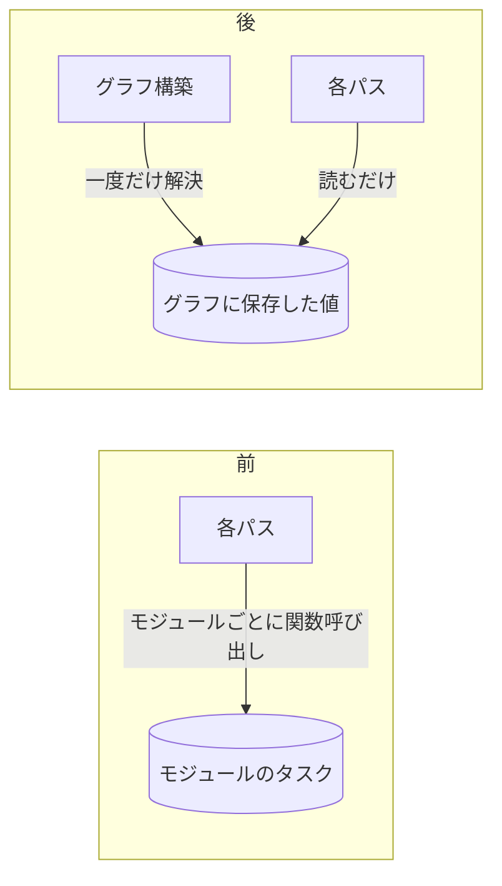

# 2026-11-01（日）

> 今日のひとこと：TypeScript 7.1 beta に追従するRust/TS製の型チェッカー移植 tsc-ts が v0.1.0 を出し、土台のコンパイラ scriptc も v0.4.7 に。新規の脆弱性はなし。日曜で仕様・主要フレームワークの動きは少なめ。前回の号（10-31 07:21 JST）以降の分をまとめている。

## 今日のリリース

- 【TypeScript】vercel-labs/tsc-ts v0.1.0：追従先をTypeScript 7.0.2から7.1.0-betaに変更し、`--checkers` 並列時の型の共有（実験的、`TSC_TS_SHARE=1`）などを追加（出典: https://github.com/vercel-labs/tsc-ts/releases/tag/v0.1.0）
- 【TypeScript】vercel-labs/scriptc v0.4.7：Node.js互換の拡充、Node islandsの自動利用、ビルドとメモリの削減（出典: https://github.com/vercel-labs/scriptc/releases/tag/v0.4.7）

## トップニュース

### tsc-ts が TypeScript 7.1 beta に追従して v0.1.0 に

【TypeScript】TypeScript 7（Go版）のチェッカーをTypeScriptで書き直し、scriptcでネイティブにコンパイルして配布する tsc-ts が v0.1.0 を出した。追従先が7.0.2から7.1.0-betaに上がり、並列チェックの共有など速度面の新機能が入った。

**何が変わる**

- `tsc-ts --version` が7.1.0-betaを返す。チェッカー、パーサー、binder、emit、`--api` サーバー（7.1のAPIプロトコルとバイナリAST形式）まで追従範囲に含まれると、CHANGELOGは書いている。
- 実験的な「shared checking」：`TSC_TS_SHARE=1` かつ `--checkers` が2以上のとき、チェッカースレッド同士が、宣言済み変数・プロパティの型と宣言済み関数の戻り値型を共有する。他のスレッドが計算済みの型は、計算し直さず変換して使う。既定はオフ。
- Linuxでは、初回起動時に実行ファイルを1回の書き込みで書き直し、ファイルシステムが大きなfolioに対応していれば（XFS、Linux 6.16以降のext4）コードが2 MiBページでマップされる。パッケージマネージャーの分割書き込みではこれが効かない、という理由。

**なぜ変えたか（CHANGELOGの記述から）**

7.1側の最適化（和集合のナローイングの近道、エイリアス・参照の型引数推論を一度だけ行う方式）を移植し、さらにscriptc 0.4.7とプロファイル最適化でビルドし直したため。数字はすべてプロジェクト側の自己申告：VS Codeのcheck-onlyで`--checkers 1`が33.2秒→28.6秒、`--checkers 16`が4.30秒→3.60秒。共有チェックはT3 serverで3.77秒→2.77秒（27%）とされ、他のプロジェクトでは数%以内。

**何に効く・誰が困る**

実験段階なので本番のCIに置き換える話ではない。ただし「Go版チェッカーを別言語に移植して並べる」流れ（ts-rust、tsrs、`bun check`）の中で、移植を自動でどこまで速くできるかの観測点になる。

**ここまでの経緯**

- 2026-10-17：tsc-ts と scriptc を対象に追加（[10-17の号](2026-10-17.md)）
- 2026-10-31 00:43（米東部時間）：v0.1.0 のタグ（`5fa2699` "Prepare v0.1.0 release"）
- 今日：v0.1.0 の後、識別子の文字列を共有の名前として保持する変更（#384、`d264e06`）がmainに入った

出典: https://github.com/vercel-labs/tsc-ts/releases/tag/v0.1.0 、https://github.com/vercel-labs/tsc-ts/pull/384

## 今日の深掘り

### Turbopack：モジュールごとの値をグラフ構築時に一度だけ解決する（#94842）

**選んだ理由**：増分計算の仕組み（turbo-tasks）で「関数を呼ぶ」ことが依存辺を増やし、それが高くつく、という設計上の落とし穴を直した例だから。

**背景**

モジュールグラフに対するパス（asyncモジュール情報、副作用解析、モジュールのマージ、モジュールID、Server Actions、NFT、ビルド機能のテレメトリ）は、どれもモジュールごとの値を必要とする。以前は各パスがモジュールごとにturbo-tasksの関数（`ident()`、`is_self_async()`、`side_effects()`、`is_mergeable()` など）を呼んで取っていた。

**変更点**

PR本文によると、turbo-tasksの関数呼び出しは、呼び出し元のタスクから呼ばれたタスクへの子辺を一つ足す。パスの終わりに、数万個の子を接続することになり、この接続が高価だった。`canary` では `project_feature_usage` だけで92,000個の子を接続し、14.6秒のCPU時間を使って、全エントリポイントの書き出し直後の約1.3秒間、14本のワーカースレッドを占有していたという（PR本文の数字）。

修正は、グラフを作る間に値を一度解決して、グラフごとに保存し、各パスはグラフから読む形にした。

**周辺コード**：変更は `turbopack` 側のモジュールグラフ構築にあり、差分は `git -C /tmp/oss/next.js show a64724dc6a` で読める。この号では全ファイルを読み切れておらず、上の内容はPR本文と要約に基づく。

**設計思想**

増分計算のフレームワークでは「呼べば依存が張られる」ので、便利な関数呼び出しが、コストの見えない辺になる。ホットパスでは、依存の粒度をグラフ単位にまとめる、という判断。

出典: https://github.com/vercel/next.js/pull/94842

## OSSのPR

### React

#### Fizzの外部ランタイムスクリプトに `crossOrigin` が渡るようになる

【React】サーバーレンダリング（Fizz）の `externalRuntime` の設定は、ブートストラップスクリプトと同じ型を受け取り、そこで `crossOrigin` も指定できる。しかし外部ランタイム用の `<script>` には転送されていなかった。`createRenderState` で `externalRuntimeConfig.crossOrigin` を渡すよう修正（`ReactFizzConfigDOM.js`、テスト25行付き）。
なぜ変えたか：PR本文は「単なる見落とし」としている。
出典: https://github.com/facebook/react/pull/38071

その他：

- DevToolsのファサードで、リソースでないhoistable instanceを検出（[#38067](https://github.com/facebook/react/pull/38067)）
- DevToolsのファサード検査結果でBigIntを正規化（[#38068](https://github.com/facebook/react/pull/38068)）
- DevToolsで、対応しない書式指定子を文字のまま残す（[#38069](https://github.com/facebook/react/pull/38069)）

### Next.js

トップの深掘りで扱った #94842（Turbopackのモジュールグラフ）。

その他：

- ブロッキングなルート応答のステータスについてドキュメントを明確化（[#100191](https://github.com/vercel/next.js/pull/100191)）

### Biome

#### Vue用リントルールが大量に追加される

【Biome】Vue向けのルールが連続して入った：`noVueRestrictedCallAfterAwait`（#12517）、`noVueDeprecatedPropsDefaultThis`（#12604）、`noVueUndeclaredEmits`（#12601）、`noVueMixin`（#12533）、`useVueSlotNameCasing`（#12646）、`useVueValidDefineOptions`（#12613）、`useVueRenderReturn`（#12566）、`noVueDeprecatedSlotScope`（#12634）、`noVueLoneTemplate`（#12666）、`noVueVForTemplateKeyOnChild`（#12522）。あわせて、ルール検査（`rules_check`）がVueのセマンティックモデルを作って使うようになった（#12535）。eslint-plugin-vueのルールの移植とみられる（推測）。
なぜ変えたか：PR本文は未確認。
出典: https://github.com/biomejs/biome/pull/12535

その他：

- `useTailwindVariablesShorthand` を追加（[#12290](https://github.com/biomejs/biome/pull/12290)）
- `useNamingConvention` で `typeMember` が型パラメーターに当たる不具合を修正（[#11623](https://github.com/biomejs/biome/pull/11623)）
- oxlintのルールソースを追加（[#12784](https://github.com/biomejs/biome/pull/12784)）

### oxc

その他（件数が多いので要約）：

- Cam McHenry氏による、linter・minifier・transformer・react-compilerにまたがるヘルパーの共通化リファクタリングが約13件（#28555〜#28568）
- `no-control-regex` が生の制御文字を検出（[#28548](https://github.com/oxc-project/oxc/pull/28548)）
- `prefer-global-this` で `typeof` とworker APIの扱いを揃える（[#28549](https://github.com/oxc-project/oxc/pull/28549)）
- `no-invalid-fetch-options` で未知のメソッドをGET扱いしない（[#28547](https://github.com/oxc-project/oxc/pull/28547)）
- プロパティ名の短縮化（mangler）で `HashMap::entry` を使う（[#28551](https://github.com/oxc-project/oxc/pull/28551)）

### TypeScript系の移植

#### scriptc：v0.4.7以降もNode互換とJSオブジェクトモデルの作業が続く

【TypeScript】v0.4.7のハイライトは、`Intl.Segmenter`、node:http・querystring・string_decoderのNode 24互換、`structuredClone` のMap/Set対応、Node islandsの自動利用（sloppy modeやビルトインを書き換えるモジュール）、ビルド時間とメモリの削減（ネイティブコンパイラのコードが73.9 MBから63.0 MBに、ランタイムパックがLinux x64で24 MB小さく）。TypeScript 7.1の `import source` は未対応として報告する扱いになった。数字はプロジェクトの自己申告。リリース後は、JavaScriptのオブジェクトモデルのランタイムビルド（#2753）などがmainに入っている。
なぜ変えたか：Node互換の範囲を広げ、tsc-tsのような大きなTypeScriptプロジェクトをネイティブでビルドするため（推測）。
出典: https://github.com/vercel-labs/scriptc/releases/tag/v0.4.7

その他：コミットは多数。件数が多いため割愛（Test262対応、BigInt、タイマー、バッファ周りなど）。

動きなし（前回以降のコミットなし）：TypeScript、oxc-project/tsrs、vitejs/vite
ts-rust（pingdotgg）：cloneに失敗し、取得できず

### GHC

その他（コミットメッセージを根拠にしている。マージリクエストはGitLabで確認できない）：

- 閉じた型族を使うfundepsの深刻なバグを修正（#27994）。`getRelevantBranches` が `TyVar` と `TcTyVar` を混ぜていた。閉じた型族では `trimQtvs` を呼ばないよう簡素化（`3b60ae7e10`）
- base：例外を再throwするとき、例外コンテキストを保持する（`modifyIOError`、`mapException`、`hClose` など複数、Zubin Duggal氏）
- RTS：進化（evacuation）の競合に負けたWeak#のコピーにtombstoneを付ける（#23160、`13d38047f6`）
- `-XStrict` が生む bang について `-Wredundant-bang-patterns` を出さない（`cc533b6653`）

### Wado

動きは多いが、設計に関わるものは確認できず、件数だけ：mainに約25コミット（多くはエージェントによる `chore`・`fix(hooks)`・`refactor(elaborate)`）。`Reify` をコンパイラのホストから独立させる変更と、リソースを宣言するゲストエフェクトを拒否する変更（`865222b86b`）が入っている。

Vue（`minor`）：リリース候補 v3.6.0-rc.14 は前回の号以前に公開済みで、今回の新規コミットは確認できなかった。Solid（`main`・`next` の一部）、Svelte、Bunはcloneまたは確認に失敗し、取得できず（今回は未調査）

## 脆弱性

対象パッケージ（react、next、vite、svelte、vue、oxc、astro、nuxt、TanStack Start）のアドバイザリ一覧を確認した。前回以降に公開されたものはなし。直近は Nuxt（10-27）、Astro（10-28）、Next.js・React（10-14）。vuejs/core と oxc-project/oxc の一覧は取得せず（時間切れ）。
