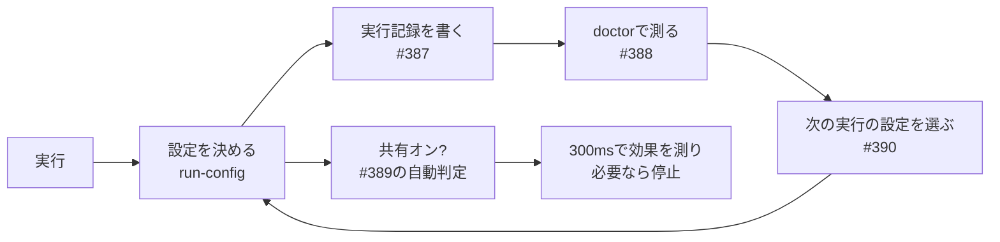

# 2026-11-02（月）

> 今日のひとこと：tsc-ts（TypeScript 7.1 beta のチェッカーの移植）が、チェッカースレッド間の結果共有を条件次第で自動でオンにし、効かなければ300ms後に止める仕組みを入れた。日曜明けで仕様・主要フレームワークの動きはほぼなく、新規リリースと新規の脆弱性もなし。前回の号（11-01 07:18 JST）以降の分をまとめている。

## トップニュース

### tsc-ts が「結果の共有」を自動で入れ、効かなければ途中で止める

【TypeScript】tsc-ts（TypeScript 7.1 betaのチェッカーをTypeScriptで移植し、scriptcでネイティブ化したもの）は、並列チェッカー間で型の計算結果を共有する機能を、これまでの環境変数による手動指定から自動判定に変えた（#389）。さらに、共有を入れた実行は300ms時点で効果を測り、割に合わなければ共有を止める。

**何が変わる**

- 共有は次の条件をすべて満たすと自動でオンになる：チェッカー数が12以上、プログラム内のファイルの40%以上が宣言ファイルかnode_modules由来、各チェッカーの解決範囲が同じ大きなライブラリに集中している、共有で増えるピークメモリを含めてもメモリに収まる。
- 開始300ms時点でカウンタを読み、共有による節約がコストの1.5倍未満、または共有された結果がほとんど使われていなければ止める。止めたあとは各チェッカーが自分で計算するので、診断結果は変わらない。
- `TSC_TS_SHARE` で固定でき、`TSC_TS_AUTO=0` で従来の判断に戻せる。出力には `Sharing: on (measured: stopped after 300 ms: ...)` のように測定結果が出る。

**なぜ変えたか**

PR本文によると、共有は重複作業が多い場面では速くなるが、場面によっては共有のコストが節約を上回る。「効く場面でだけ使い、効かなくなったら止める」のが目的。

**何に効く・誰が困る**

数字はすべてプロジェクト側の自己申告。PR本文では、`--checkers` 1・4・16の9プロジェクト・27セルの幾何平均が0.966（同一バイナリの基準値は0.991）、全セルで出力は同一、T3 serverのc16で2.52秒→1.80秒とされる。実験段階のプロジェクトなので、本番CIの話ではない。ただ、固定の設定ではなく「実行中に測って方針を変える」設計が、移植版チェッカーで試されている点が面白い。

**ここまでの経緯**

- 2026-10-17：tsc-ts と scriptc を追跡対象に追加（[10-17の号](2026-10-17.md)）
- 2026-11-01：v0.1.0 で、`TSC_TS_SHARE=1` による実験的な共有チェックを導入（[11-01の号](2026-11-01.md)）
- 今日（11-01 JST 夕〜）：#385〜#390 が連続でmainに入る。各実行に「設定（configuration）」を持たせて `--extendedDiagnostics` に出す（#386）、実行記録を書き出す（#387）、`tsc-ts doctor` でプロジェクトごとの設定を測る（#388、実験的）、共有の自動オン/オフ（#389）、過去の実行の測定値から次の実行の設定を選ぶ（#390）

出典: https://github.com/vercel-labs/tsc-ts/pull/389 、https://github.com/vercel-labs/tsc-ts/pull/390

## 今日の深掘り

### tsc-ts：設定を「測って選ぶ」ための部品が一晩で揃った（#386〜#390）

**選んだ理由**：型チェッカーの並列化で「いつ共有が得か」を、固定のしきい値ではなく実測の記録で決める設計が見えるから。

**背景**：11-01のv0.1.0の共有チェックは実験的で、既定オフだった。T3 serverでは27%速くなる一方、他のプロジェクトでは数%以内という自己申告で、全員にオンにはできなかった。

**変更点（PRタイトルと#389本文に基づく。この号ではソースのdiffまでは読めていない）**

#389の差分は `parallel-check.ts`（+234行規模）、`run-config.ts`、`shared-results.ts` が中心で、`tests/run-config.test.mjs` に208行のテストが足されている（`git show --stat 782609e`）。

**設計思想**：結果を共有するかどうかは、プロジェクトの形（宣言ファイルの割合、ライブラリの偏り）とメモリで決まる。そこで、静的な条件で入口を絞り、実行時の測定で出口を作る。出力は変えないことを `config-exactness.test.mjs`（#385）で保証し、設定を変えても診断が同じになることを土台にしている。

出典: https://github.com/vercel-labs/tsc-ts/pull/389 、https://github.com/vercel-labs/tsc-ts/pull/388 、https://github.com/vercel-labs/tsc-ts/pull/390

## OSSのPR

### Biome

#### TypeScript向けに `noUselessTypeAssertion` が入る

【Biome】typescript-eslintの `no-unnecessary-type-assertion` に相当するルール（nursery）。不要な非nullアサーション（`!`）、`as`、山括弧形式、アサーションの連鎖を検出し、削除する修正を（unsafeで）提供する。型推論の補助ヘルパー（`biome_js_type_info`）を足して判定している。レビューボットは、同一型の検査が一部の型と式に限られるため、移植元と同等ではなく「inspired」と書くべきだと指摘していた（反映されたかは未確認）。
なぜ変えたか：PR本文には目的の記載がなく、移植元と同じく冗長で誤解を招くアサーションを減らすためと読める（推測）。
出典: https://github.com/biomejs/biome/pull/12488

その他：

- Vue向けルールの追加が続く（約14件）：`useVueDefaultProp`（[#12655](https://github.com/biomejs/biome/pull/12655)）、`noVueUndeclaredSlots`（[#12657](https://github.com/biomejs/biome/pull/12657)）、`noVueThisInBeforeRouteEnter`（[#12665](https://github.com/biomejs/biome/pull/12665)）、`noVueMultipleObjectsInClass`（[#12658](https://github.com/biomejs/biome/pull/12658)）、`useVuePropTypeConstructor`（[#12571](https://github.com/biomejs/biome/pull/12571)）ほか
- `noDynamicDelete`（[#12547](https://github.com/biomejs/biome/pull/12547)）、`useAccessorPairs`（[#12516](https://github.com/biomejs/biome/pull/12516)）を追加
- TanStack Query向けに `useTanstackQueryInfiniteQueryPropertyOrder`（[#12806](https://github.com/biomejs/biome/pull/12806)）、`useTanstackQueryStableQueryClient`（[#12518](https://github.com/biomejs/biome/pull/12518)）、`noTanstackQueryVoidQueryFn`（[#12515](https://github.com/biomejs/biome/pull/12515)）を追加
- JSプラグインの `.kind` プロパティが返す文字列を静的にした（[#12813](https://github.com/biomejs/biome/pull/12813)）
- `usePlaywrightValidDescribeCallback` が無名の `describe` を許容（[#12821](https://github.com/biomejs/biome/pull/12821)）

### oxc

#### レキサーが実行時のCPU機能検出に向けて、関数ごとにCPU機能別にコンパイルされる

【oxc】overlookmotel氏による #28610〜#28628 の連続PR。`cpu_versions!` マクロで、`carve`、コメントのレキシング、JSX曖昧性解消、数値のパースなどを、CPUの機能セットごとに別々にコンパイルする。コミットメッセージには「実行時のCPU機能検出に移る取り組みの一部」とある。#28610は、マクロ内でジェネリックなコードが過剰にインライン化されるのを防ぐ修正。
なぜ変えたか：コミットメッセージにはCPU機能検出への移行とだけあり、動機の詳細は不明。
出典: https://github.com/oxc-project/oxc/pull/28613

その他：

- レキサーの内部状態を型付きフィールドやenumに置き換え（[#28662](https://github.com/oxc-project/oxc/pull/28662)、[#28661](https://github.com/oxc-project/oxc/pull/28661)、[#28660](https://github.com/oxc-project/oxc/pull/28660)）
- 上記のCPU機能別コンパイル関連が約20件（#28610〜#28628）
- Rustクレートの依存更新（[#28608](https://github.com/oxc-project/oxc/pull/28608)）

### Solid

#### `next` ブランチのsignalsで、楽観的更新・保留（pending）まわりの修正が連続する

【Solid】前回以降に24コミット（うち18件が `fix`）。`latest()` / `isPending()` がハイドレーション中にサーバーのスナップショットを読むようにする（[#4581](https://github.com/solidjs/solid/pull/4581)）、保留中のフィルター変更が楽観的更新をまたいで全体として確定する（[#4585](https://github.com/solidjs/solid/pull/4585)）、投機的な更新（guess）が進行中の問い（question）の上でフレームを保つ（[#4572](https://github.com/solidjs/solid/pull/4572)、[#4558](https://github.com/solidjs/solid/pull/4558)）、遅延実行のエフェクトが1回の書き込みで1度だけ走る（[#4567](https://github.com/solidjs/solid/pull/4567)）など。サイズ予算の再記録（`chore(size)`）が間に入る。コミットメッセージのみを根拠にしており、各PRの本文は読めていない。
なぜ変えたか：各コミットは対応するIssue番号（#4536〜#4577）を指すが、本文は未確認。
出典: https://github.com/solidjs/solid/pull/4581

### TypeScript系の移植

#### scriptc：Node互換とJSの動的な値の扱いの作業が続く

【TypeScript】前回以降に163コミット。`process.stdin` の読み取り面と、クラスインスタンスへの `Object.assign`（[#2848](https://github.com/vercel-labs/scriptc/pull/2848)）、インデックスシグネチャや要素の読み取りで `undefined` を保つ（[#2822](https://github.com/vercel-labs/scriptc/pull/2822)）、動的な書き込みで部分レコードビューが得たキーを保持（[#2843](https://github.com/vercel-labs/scriptc/pull/2843)）、`groupBy` などを動的ティアで実行（[#2826](https://github.com/vercel-labs/scriptc/pull/2826)）。大半はコミット単位の細かい修正のため、詳細は割愛。
なぜ変えたか：大きなTypeScriptプロジェクトをネイティブでビルドする範囲を広げるため（推測）。
出典: https://github.com/vercel-labs/scriptc/commits/main

その他：tsc-ts の同日の変更はトップニュースで扱った。oxc-project/tsrs は依存更新のみ2件（[#866](https://github.com/oxc-project/tsrs/pull/866)、[#867](https://github.com/oxc-project/tsrs/pull/867)）。

### GHC

その他（コミットメッセージを根拠にしている。マージリクエストはGitLabで確認できない）：

- 前回の号で扱った fundeps のバグ修正（`3b60ae7e10`）と同じ日付のコミット群。`mightBeFunTy` の #27979 向けホットフィックス（`bc6c0db64a`）、`haddock --incremental` が `-this-unit-id` でモジュールを探す修正（`e4610f2d80`）

### Wado

172コミット弱（`fix` 40、`chore` 29、`refactor` 19、`docs` 17、`test` 15、`feat` 9、`perf` 6）。大半はエージェントによる整理で、`docs/wep-*.md` の変更は確認できなかった。設計に関わるものは拾えていないので、件数のみ。

動きなし：facebook/react、vercel/next.js（canaryのバージョンコミットのみ）、vitejs/vite、microsoft/TypeScript、pingdotgg/ts-rust、sveltejs/svelte、vuejs/core（`minor`）

## 仕様の変更

動きなし（前回以降のコミットなし）：whatwg/html, whatwg/dom, whatwg/fetch, whatwg/streams, whatwg/url, tc39/ecma262, tc39/proposals, w3c/csswg-drafts, w3c/ServiceWorker, w3c/wcag3。w3c/aria はdependabotの更新のみ。

## 脆弱性

対象パッケージ（react、next、vite、svelte、vuejs/core、oxc、astro、nuxt、TanStack Start）のアドバイザリ一覧を確認した。前回以降に公開されたものはなし。直近は Astro（10-28）、Nuxt（10-27）、Vite（10-21）、Next.js・React（10-14）。oxc は公開済みアドバイザリが0件。
