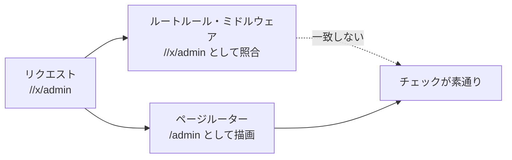

# 2026-11-03（火）

> 今日のひとこと：Nuxt 4.6.4 がセキュリティリリースとして出て、Nuxt本体の8件のアドバイザリが公開された。うち2件は「ルーター（URLを読む側）とルートルール（URLを照合する側）で、同じパスを違う文字列として読む」ことによる認可バイパスで、過去の修正の不完全さを突いたもの。前回の号（11-02 07:21 JST）以降の分をまとめている。

## 今日のリリース

- 【Next.js】v16.4.4：Turbopackの不具合修正などのバックポート7件（`jsonwebtoken` から `fast-jwt` への置き換えを含む）。リリースノートは「11月のセキュリティリリースを翌日に公開する」と予告している（出典: https://github.com/vercel/next.js/releases/tag/v16.4.4）
- 【oxc】crates v0.157.0：パーサーと正規表現まわりのバグ修正が約20件、性能改善が約40件。破壊的変更の記載なし（出典: https://github.com/oxc-project/oxc/releases）。なお oxlint v1.91.0 / oxfmt v0.76.0 のリリースPR（[#28718](https://github.com/oxc-project/oxc/pull/28718)）はmainに入ったが、リリースページでの公開は確認できなかった。

## トップニュース

### Nuxt 4.6.4 がセキュリティリリースとして出る：8件のアドバイザリ

【脆弱性】【Vue】Nuxt 4.6.4 は、Nuxt本体の8件のアドバイザリ（重大度は Moderate 4件、Low 4件）をまとめて直すセキュリティリリース。リリースノートによると、Nitro（nitropack 2.13.6）側でも3件が直る。詳細は下の「脆弱性」節。

**何が変わる**

- 8件の内訳：認可バイパス2件（エンコードされたスラッシュ、先頭の `//`）、開発サーバーの境界3件（親ディレクトリのファイル配信、webpack/rspackのDNSリバインディング、Hostヘッダー）、情報漏えい1件（サーバーレンダリング中の未処理エラーの内容が出る）、リダイレクト1件（`redirect` ルートルールのワイルドカードが別オリジンへ）、アイランドの `__nuxt_island` パスの衝突1件。
- 利用者に見える挙動の変更が入る。本番でのエラー詳細の非公開、キャッシュされるルートルールのGET/HEADへの限定、開発サーバーの `devServer.allowedHosts` オプションの追加。
- Nuxt 3 はEOLのため修正されない。

**なぜ変えた**

アドバイザリの記述から読めるのは、同じリクエストパスを、ルートルールの照合とページルーターで別々に解釈していたこと。過去の修正（GHSA-6gq8-jgmh-3ffp、GHSA-9v7c-q64q-vv33、CVE-2026-46342）を一部だけ塞いでいて、2件が「不完全な修正」として再び報告された。

**何に効く・誰が困る**

- ルートルールやサーバーミドルウェアのパス一致で認可やヘッダー付与をしているNuxt 4系のアプリ。
- 認証不要で、リンクを踏ませるだけで成立する（CVSS 6.5）。
- Nuxt 3 のまま使っている場合は修正が来ないので、アップグレードか、先頭 `//` を弾く対策が要る。

**ここまでの経緯**

- 2026-10-27：Nuxtのアドバイザリ2件（クライアントエラーレポート経由の任意ファイル読み取り、Nitro開発バンドル経由の非公開ランタイム設定の露出）が公開（[11-02の号](2026-11-02.md)の脆弱性節で最近の例として触れた）
- 2026-11-02：4.6.4 とアドバイザリ8件が公開

出典: https://github.com/nuxt/nuxt/releases/tag/v4.6.4 、https://github.com/nuxt/nuxt/security/advisories

## 今日の深掘り

### 「同じパスを二度読む」認可バイパス：Nuxtの2つの修正を読む

**選んだ理由**：Webフレームワークの認可は「パスの文字列で一致させる」ことが多い。その一致のしかたと、ページを描くための読み方がずれると、チェックだけが素通りになる。2件の修正は小さく、その構造が読み取りやすい。

**背景**：Nuxtは、受け取ったリクエストのパスを少なくとも2か所で解釈する。

- ルートルール（`routeRules`）の照合：Nitroが `appMiddleware`、`headers`、`redirect` などを、パスのパターン（`/docs/internal/**`）に当てる。
- ページルーター：パスからどのページを描くかを決める。ここでは `%2F` が `/` に戻され、キャッチオールのパラメータになる。

GHSA-f3x9-2chm-73c8 は、`/docs/internal%2Fguide` が、ルートルールには `%2F` のまま渡るので `/docs/internal/**` に当たらず、ルーターには `/` として読まれてページが描かれる、という食い違い（アドバイザリの記述）。
GHSA-r99w-jh2x-3mg9 は、4.6.0 以降でページ描画前にパスを「ホストつきURL」として解析する処理が入り、`//x/admin` が `/admin` のページとして描かれる一方、Nitroのルーティング、ルートルール、`server/middleware` には `//x/admin` のまま見える、という食い違い。

**変更点（コミットはGitHubのページから読んだ。diffの引用は要点のみ）**

1. `084396b10`（`fix(nitro,nuxt): match route rules for paths with encoded slashes`、14ファイル +112/−22）
   `packages/nuxt/src/core/utils/index.ts` に `matchAllRouteRules` を足した。パスに `%2F` があれば、`%2F` を区切りとして扱ったパスでも照合し、新しく当たったルールを結果に足す。`resolveRouteRules`、生成されるルートルールのテンプレート、vite-server側の照合のすべてがこの関数を通る。二重エンコードの `%252F` は当たらないことをテストで確かめている。
2. `75c12c6fb`（`fix(nitro): keep leading double slash in renderer request path`、2ファイル +15/−1）
   `packages/nitro-server/src/runtime/utils/event.ts` に `resolveEventURL(event)` を足した。`new URL(パス, 基準)` にパスを渡すと、先頭の `//` はホスト名として読まれる。そこで、プロトコルとホストから先にURLを作り、パスは `url.pathname` に代入する。代入なら `//` はホストにならない。テストは `//admin`、`//x/admin`、`///x/admin?y=1` で、レンダラーが読むパスとh3が読むパスが同じになることを確かめる。

**周辺コード**：リリースノートには、同じ種類の修正として、ワイルドカード尾部の解決（`1e7dfa6a7`）、大文字小文字を区別しないルールでの尾部の保持（`bf31e4cd8`）、末尾スラッシュ除去を線形時間にする修正（`97424dd21`）も並ぶ。パスの正規化を1か所に集める方向の修正に見えるが、これは筆者の推測。

**この変更から分かる設計思想**：修正は「照合の側を広げる」（1）と「描画の側を狭める」（2）の両方向に分かれた。どちらか一方に正規形をそろえる設計ではなく、読み方を個別に直した形。認可に使うパスは、描画に使うパスと同じ関数で作るべきだ、というのが教訓。

出典: https://github.com/nuxt/nuxt/commit/084396b10 、https://github.com/nuxt/nuxt/commit/75c12c6fb 、https://github.com/nuxt/nuxt/security/advisories/GHSA-f3x9-2chm-73c8 、https://github.com/nuxt/nuxt/security/advisories/GHSA-r99w-jh2x-3mg9

## 仕様の変更

### w3c/csswg-drafts

#### CSSに `@supports` で調べられる `gamut-mapping` が入る

【CSS】色域マッピング（gamut mapping）をブラウザが実装しているかを `@supports named-feature(gamut-mapping)` で判定できるようにする。10-30に決議し、11-02に css-conditional-5 へ反映した（名前も `gamut-mapping` に決定）。同じ日に css-color-4 には「補間で色域外の色ができる」説明と図が足され、css-images-4 では色域外のグラデーション色を色域マッピングすることがMUSTになった（`12ab907`）。
なぜ変えたか：作者が色域マッピングの有無を安全に判別できず、MDNやBaselineも非視覚的に検証できなかったため（Issue #14545）。実装がまだ不完全という懸念（限られた記法、rec2020への写像のみ、グラデーションやトランジションの未対応）は、注記として仕様に残した。
出典: https://github.com/w3c/csswg-drafts/issues/14545 、https://github.com/w3c/csswg-drafts/commit/12ab907

#### その他

- css-fonts-4 で font feature value の直列化を定義（`bfd05e0`）
- `<meta name=color-scheme>` の例のタイポ修正（`fc3afa7`）。このほかeditorialのコミットは除外

動きなし：whatwg/html（最新は10-30のeditorialのみ）, tc39/proposals（最新は10-14）。whatwg/dom, whatwg/fetch, whatwg/streams, whatwg/url, tc39/ecma262, w3c/ServiceWorker, w3c/wcag3, w3c/aria は今回個別に確認していない（取得せず）。

## OSSのPR

### Next.js

#### `router.experimental_prepare()`：pointerdownで先に遷移を準備し、clickで確定する

【Next.js】`useRouter()` に実験的なメソッドが入る（`experimental.prepareNavigation` で有効化）。通常の遷移と同じ手順（動的リクエストを含む）を、ルーターを更新せずに実行し、結果をbfcache用のローカルキャッシュに入れる。返るハンドルの `push()` / `replace()` で確定すると、stale timeに関係なくキャッシュを読み、飛行中のリクエストを使い回す。
なぜ変えたか：pointerdownで始めてclickで確定すれば、動的リクエストを早く始められるため。将来 `Link` に組み込む可能性があり、まず低レベルAPIで試せるようにした。ハンドルは1回だけ確定でき、refreshやServer Actionを挟むと無効になる。
出典: https://github.com/vercel/next.js/pull/101050

#### FlightデータをインラインスクリプトでなくDOMの `<template>` で運び、CSPの `unsafe-inline` を外せるようにする

【Next.js】`experimental.externalBrowserRuntime` を有効にすると、RSCのFlightペイロードを `self.__next_f` へ積む `<script>` ではなく、`data-next-flight` 属性つきの `<template>` に入れる。クライアントのバンドル内のコレクターが、既存分を走査し、あとは `MutationObserver` で拾う。ペイロードの形式は同じなので、下流のデコーダーは変わらない。
なぜ変えたか：インラインのFlightスクリプトは、App Routerの文書が `unsafe-inline` を必要とする理由の2つ目だったため（PR本文）。コレクターを非同期のランタイムアセットに置かなかったのは、`DOMContentLoaded` でストリームを閉じるので取りこぼしの競合が出るため。
出典: https://github.com/vercel/next.js/pull/97573 、関連 https://github.com/vercel/next.js/pull/97570

その他：

- Turbopackに実験的な「チャンク化の前にminify」を追加（[#98760](https://github.com/vercel/next.js/pull/98760)）
- turbo-tasksにKeyedReadRefによるバッチ読み取りを追加（[#100884](https://github.com/vercel/next.js/pull/100884)）、`get_chunk_groups_for_module` をキー単位の無効化に（[#101034](https://github.com/vercel/next.js/pull/101034)）
- `next start` で完全静的なISRページがナビゲーションで再レンダリングされる不具合を修正（[#100854](https://github.com/vercel/next.js/pull/100854)）
- staleTimeが短いキャッシュの再検証を修正（[#101037](https://github.com/vercel/next.js/pull/101037)）
- 遅延コンパイルの状態をセッションをまたいで無効化（[#98867](https://github.com/vercel/next.js/pull/98867)）
- 古いRDC/PPRの機能ガードを削除（[#100827](https://github.com/vercel/next.js/pull/100827)）
- 新しい実験フラグの機能を公開APIに数えない（[#101051](https://github.com/vercel/next.js/pull/101051)）
- レジストリがJSONを返さないときのバージョン確認（[#95062](https://github.com/vercel/next.js/pull/95062)）、`headersToExcludeInCacheKey` の統一（[#101035](https://github.com/vercel/next.js/pull/101035)）、Rustのパニックでe2eを失敗させる（[#100922](https://github.com/vercel/next.js/pull/100922)）、Turbopackのファイルパス追跡の変更を取り消し（[#101053](https://github.com/vercel/next.js/pull/101053)）、エージェント向けdocsなど

### TypeScript

#### 型の解決中に、宣言済みメンバーを名前で引けるようにする

【TypeScript】メンバーの遅延解決（#64915）の導入後に、Zod 4.5〜4.6の公開型でTS5115が出る退行（#64605）があった。型のメンバー配置を解決している最中でも、継承分を含む名前つきの宣言メンバーを引けるようにして直した。チェッカーは解決中のオブジェクト型を追跡し、先に解決したプロパティを完成後の配置へ引き継ぐ。
なぜ変えたか：遅延解決のもとでの循環エラーの誤検出を防ぐため。Jake Baileyの別の作業（#65064）も同じ問題に当たる、とPRの議論にある。
出典: https://github.com/microsoft/TypeScript/pull/65059

その他：

- インクリメンタルビルドでのコンパイラーオプションの無効化を修正（[#64712](https://github.com/microsoft/TypeScript/pull/64712)）
- 合成importを持つファイルの編集でプログラムを再利用（[#65104](https://github.com/microsoft/TypeScript/pull/65104)）
- `hasBaseType` の指数時間の探索を回避（[#64737](https://github.com/microsoft/TypeScript/pull/64737)）
- TS18000の循環メッセージに設定の循環を入れる（[#65091](https://github.com/microsoft/TypeScript/pull/65091)）
- 正規表現のクラスでU+FFFDを実際の文字として扱う（[#65080](https://github.com/microsoft/TypeScript/pull/65080)）
- 診断フォーマットの引数不足をlint（[#65103](https://github.com/microsoft/TypeScript/pull/65103)）

### Svelte

#### 副作用の順序が、複数回の走査をまたいでもツリー順になるよう直す

【Svelte】5.57.1 でSvelte Flowのノードが表示されないままになる退行（#19131）があった。原因は、#18508 で祖先のマークを走査まで遅らせた結果、複数回の走査で集めたエフェクトを連結していたため、each内の子が後の兄弟より後ろに回ること。もう一度走査が要るときに、集めたエフェクトを戻して新しい分と一緒に集め直すようにした。
なぜ変えたか：バッチ間の隔離（#18508）は保ちつつ、ツリー順を守るため。
出典: https://github.com/sveltejs/svelte/pull/19132

その他：

- 本番で、ネストしたawaitを越えてリアクティブコンテキストが漏れる不具合を修正（[#19134](https://github.com/sveltejs/svelte/pull/19134)）
- docsのクロスリンク修正（[#19135](https://github.com/sveltejs/svelte/pull/19135)）

### Biome

その他：

- Vue向けlintルールの追加が続く（`useVueBooleanPropTypeFirst` [#12715](https://github.com/biomejs/biome/pull/12715)、`useVueSingleEventPayload` [#12677](https://github.com/biomejs/biome/pull/12677) ほか約20件）
- `useSetSize` を追加（[#12778](https://github.com/biomejs/biome/pull/12778)）
- `noTailwindRawColors` に `allowBlackAndWhite` オプション（[#12786](https://github.com/biomejs/biome/pull/12786)）
- JSプラグインに `tokenKinds` / `nodeKinds` のAPI（[#12812](https://github.com/biomejs/biome/pull/12812)）、プラグインの失敗をエラーとして報告（[#12858](https://github.com/biomejs/biome/pull/12858)）
- Markdownフォーマッターの強調と周囲の文章の折り返し（[#12754](https://github.com/biomejs/biome/pull/12754)）、Grit整形のリストの改行（[#12787](https://github.com/biomejs/biome/pull/12787)）、astro/svelteの `<pre>` 内コメントの保持（[#12674](https://github.com/biomejs/biome/pull/12674)）ほか修正数件

### oxc

その他（約45コミット。注目に当たるものは拾えていない）：

- レキサーにSIMDベクタ型を導入（[#28679](https://github.com/oxc-project/oxc/pull/28679)）、`cpu_version` マクロをprocマクロに変換（[#28681](https://github.com/oxc-project/oxc/pull/28681)）ほか、overlookmotel氏によるレキサーの整理が約10件（昨日の「CPU機能別コンパイル」の続き）
- フォーマッター各言語（CSS、YAML、GraphQL、htmlish、Markdown）の性能改善が約10件（例：[#28699](https://github.com/oxc-project/oxc/pull/28699)、[#28706](https://github.com/oxc-project/oxc/pull/28706)）、XHTMLの扱い（[#28703](https://github.com/oxc-project/oxc/pull/28703)）
- アロー関数の条件式の本体の括弧を修正（[#28710](https://github.com/oxc-project/oxc/pull/28710)）、オプショナルチェーンのドットの後の型引数のレキシング（[#28714](https://github.com/oxc-project/oxc/pull/28714)）、`prefer-const` の性能（[#28732](https://github.com/oxc-project/oxc/pull/28732)）、ランタイムヘルパーをBabel 8.0.8に同期（[#28172](https://github.com/oxc-project/oxc/pull/28172)）

### TypeScript系の移植

#### tsc-ts：共有結果の読み取り位置を変え、実行設定を「対にした実行」から選ぶ

【TypeScript】tsc-ts（自己申告ベースの実験的プロジェクト）は、共有されたチェッカー結果を「書いたチェッカー側」で読む変更（[#395](https://github.com/vercel-labs/tsc-ts/pull/395)、`shared-results.ts` の変更が中心で6ファイル +1881/−1177）と、実行設定を対にした実行から選び、採用を任意のサンプルから日付つけする変更（[#393](https://github.com/vercel-labs/tsc-ts/pull/393)）を入れた。共有のコストを実行ごとに記録する `TSC_TS_SHARE_PRICE`（[#392](https://github.com/vercel-labs/tsc-ts/pull/392)）と、cgroupのCPUクォータから使えるCPU数を読む変更（[#391](https://github.com/vercel-labs/tsc-ts/pull/391)）も続く。11-02のトップニュースの続き。
なぜ変えたか：PR本文は未確認。コミットの題から、共有の費用対効果を実測で選ぶ流れの続きと読める（推測）。
出典: https://github.com/vercel-labs/tsc-ts/pull/393

その他：

- oxc-project/tsrs：キープロパティ探索で単位型になり得ないプロパティの型を解決しない性能改善（[#859](https://github.com/oxc-project/tsrs/pull/859)）、`TSRS_LIB_PATH` の尊重と終了コードの返却（[#862](https://github.com/oxc-project/tsrs/pull/862)）
- vercel-labs/scriptc：前回以降に約50コミット。Test262の早期エラー追加と`RegExp`コンストラクタの型変換（[#2895](https://github.com/vercel-labs/scriptc/pull/2895)）、カウントループを2回ずつ回す（[#2890](https://github.com/vercel-labs/scriptc/pull/2890)）、`node:path`/`node:url`/`node:os` をNode 24に合わせる（[#2831](https://github.com/vercel-labs/scriptc/pull/2831)）、型メモの共有（[#2894](https://github.com/vercel-labs/scriptc/pull/2894)）ほか。数字はプロジェクトの自己申告

### Wado

約60コミット（大半がエージェントによる `docs` / `test` / `refactor` / `fix` / `chore`）。設計に関わるものとして、PGO（プロファイルに基づく最適化）の仕様章を新設し（`8105ba403a` ほか）、テスト用の世界にもプロファイルを適用する（`f21328cea5`）。LLVM、GCC、Goと比べる検討項目の一覧も追加された（`545016e86e`）。`docs/wep-*.md` の変更は確認していない。

### GHC

取得できず（今回はghc/ghcのcloneを行わなかった。11-02の号の続きの確認を省いた）。

動きなし：facebook/react、vitejs/vite（renovateの依存更新のみ）、pingdotgg/ts-rust（前回以降のコミットなし）

※ Solid（`main` / `next`）、Vue（`minor`）は今回調べていない。

## 議論ウォッチ

### CSSWG：`@supports` の `gamut-mapping`（#14545）

- 論点：色域マッピングの有無を、作者や文書化プロジェクトが判定できるようにするか。
- 賛成：Lea Verouは「作者が知りたいのは有無で、どのアルゴリズムかではない」。Chris Lilleyは可用性の検出が主な価値で、細かい粒度は任意。
- 慎重：Romain MenkeとAlan Stearnsは、記法が限られ、rec2020への写像のみで、グラデーションやトランジションが未完という実装の不完全さを理由に、作者の反応を見たい。Emilio Cobosは、named feature は壊れを避けるために使われるもので、使う作者がいるか疑問だが、反対はしない。
- 今回の進展：10-30に「`gamut-mapping` を足し、懸念をまとめた注記を付ける」と決議。11-02に仕様へ反映。
- 次：ブラウザの実装が進んだところで、注記の懸念がどう扱われるか。

出典: https://github.com/w3c/csswg-drafts/issues/14545

※ ほかの議論の場（WICG、standards-positions、TC39ノート、各フレームワークのRFC、Discussions）は今回確認していない。

## 続報

- 11-02の号で取り上げた tsc-ts の「結果共有の自動オン/オフ」（#389）の後続として、#391〜#395 が入った（上の「TypeScript系の移植」）。実装段階の実験で、続きの変更が続いている。

## 脆弱性

### Nuxt：8件のアドバイザリ（2026-11-02公開、修正は 4.6.4）

【脆弱性】公開者はdanielroe。いずれもCVE番号は記載なし。影響パッケージは `nuxt`、`@nuxt/nitro-server`、`@nuxt/vite-server` など。

| ID | 重大度 | 内容 |
|---|---|---|
| GHSA-f3x9-2chm-73c8 | Moderate (6.5) | キャッチオールページで、エンコードされたスラッシュがルートルールを回避（GHSA-6gq8-jgmh-3ffp の不完全な修正） |
| GHSA-r99w-jh2x-3mg9 | Moderate (6.5) | 先頭の `//` が `server/middleware` とルートルールを回避（GHSA-9v7c-q64q-vv33 の不完全な修正） |
| GHSA-mjrq-cffv-q4qc | Moderate | 開発サーバーが、ロックファイルやワークスペースファイルがあると親ディレクトリのファイルを配信 |
| GHSA-96x6-fvhx-49hg | Moderate | サーバーレンダリング中の未処理エラーのメッセージとデータが露出 |
| GHSA-x2wv-5868-p7v2 | Low | webpack/rspackの開発サーバーが、DNSリバインディングのページにビルド済みソースを配信 |
| GHSA-r9jc-w898-3fv6 | Low | ペイロードURLの生成が、繰り返しスラッシュで二次的なコストになる |
| GHSA-p4h3-4h99-9665 | Low | Viteサーバービルダーの、ワイルドカード `redirect` ルートルールが別オリジンへ飛べる |
| GHSA-hf59-9xwc-2g4p | Low | 衝突するislandのpropsが同じ `/__nuxt_island` パスを共有（CVE-2026-46342 の不完全な修正） |

**攻撃原理と成立条件**（上位2件。アドバイザリの記述）

- `%2F` 版：影響は `nuxt` が 3.0.0 以上 4.6.4 未満（3.x は修正なし）、`@nuxt/nitro-server` が 4.2.0 以上 4.6.4 未満、`@nuxt/vite-server` が 4.6.0 以上 4.6.4 未満。`/docs/internal%2Fguide` のようなリクエストで、ルートルールが当たらないままキャッチオールページが描かれる。認証不要。
- `//` 版：`@nuxt/nitro-server` が 4.6.0 以上 4.6.4 未満。`//x/admin` で `/admin` のページが描かれ、パスに紐づくミドルウェアやルートルールが外れる。回避策は、`//` で始まるパスをミドルウェアで拒否するか、リバースプロキシやCDNで連続スラッシュをまとめること。

**修正コミットのdiff解説**：上の「今日の深掘り」を参照（`084396b10`、`75c12c6fb`）。ほかの6件は、リリースノートにコミットの題が並ぶが、アドバイザリとの対応づけは明記されておらず、diffは読んでいない（不明）。

**同種の脆弱性パターン**：「パスの解釈の食い違い」（CWE-436）。認可の判断に使う文字列と、実際に処理する文字列が違う。同じ型の修正が連続して「不完全な修正」として再報告されている点も、このパターンの特徴。

出典: https://github.com/nuxt/nuxt/security/advisories 、https://github.com/nuxt/nuxt/releases/tag/v4.6.4

そのほかの対象（react、next、vite、svelte、vuejs/core、oxc、astro、TanStack Start）は、一覧ページを確認したが前回以降に公開されたものはなし。直近は Astro（10-28）、Vite（10-21）、React / Next.js（10-14）。ただし Next.js v16.4.4 のリリースノートは、11月のセキュリティリリースが翌日（11-03）に出ると予告しているので、次の号で確認する。
