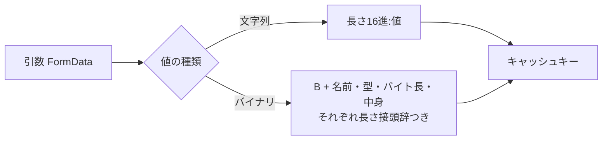

# 2026-11-04（水）

> 今日のひとこと：Next.js 16.4.5 と 15.5.29 がセキュリティリリースとして出て、7件のアドバイザリ（すべてModerate）が公開された。うち4件は `'use cache'` やフォールバックシェルといった「キャッシュのキーが、結果を分けるべき入力を覆っていない」ことによる他ユーザーへの漏えい・汚染。前回の号（11-03 07:19 JST）以降の分をまとめている。

## 今日のリリース

- 【Next.js】v16.4.5：7件のセキュリティアドバイザリの修正のみ（出典: https://github.com/vercel/next.js/releases/tag/v16.4.5）
- 【Next.js】v15.5.29：3件のセキュリティアドバイザリの修正のみ（Edgeルートのcookie露出、fetch応答の転送、SVG拒否の回避）（出典: https://github.com/vercel/next.js/releases/tag/v15.5.29）

## トップニュース

### Next.js が7件のセキュリティアドバイザリを一度に公開する

【脆弱性】【Next.js】Next.js 16.4.5 は、`'use cache'`・Cache Components・画像最適化・Edgeランタイムにまたがる7件（Moderate）を修正するセキュリティリリース。15系は 15.5.29 で、3件だけが該当する。11-03の号で取り上げた v16.4.4 のリリースノートが予告していた「11月のセキュリティリリース」にあたる。

**何が変わる**

- 16.4.5 の7件：`unstable_cache()` 越しの `'use cache'` でroot paramsをまたぐ漏えい（GHSA-mfr8-8qww-v76h）、入れ子の `'use cache'` でroot paramの値をまたぐキャッシュ漏えい（GHSA-vc7v-qv4w-wrv8）、リクエスト由来のプレースホルダーパラメータによる共有フォールバックシェルの汚染（GHSA-vvgp-ww4w-46vf）、バイナリ引数の `'use cache'` でのキー衝突（GHSA-rhh4-g77r-r9qj）、fetch応答を転送するセルフホストでの他クライアントへの応答混入（GHSA-pc58-hwjq-p385）、画像最適化のSVG拒否の回避（GHSA-7qx7-33qx-rqx2）、Edgeルートでの HttpOnly cookie 露出（GHSA-f3mh-rxg3-f5g2）。
- 15.5.29 は、このうち後ろの3件だけ。`'use cache'` は16系の機能なので15系には関係しない。
- 修正はmainにも同じ日に入っている（`5fcb2617f0`、`14e82e4741` など、いずれもSebastian Silbermann。コミットメッセージは短く、本文は非公開のミラーPRへのリンクのみ）。

**なぜ変えた**

アドバイザリの記述と差分から読めるのは、4件が「キャッシュキーの作り方」の問題で、残りが「内部用のヘッダーを外へ出していた」問題だということ。同じキーに別ユーザー向けの結果が入る、または内部のヘッダーが公開応答に残る。

**何に効く・誰が困る**

- `'use cache'` を使うApp Router（16.0.0〜16.4.2が対象と記載）。バイナリ引数（`Uint8Array`、`Blob`）を渡している場合は特に。
- Edgeルートで `NextResponse` からcookieを設定しているアプリ（15.0.0〜15.5.28、16.0.0〜16.4.2）。
- 取得したfetch応答をそのまま返すセルフホスト。
- アドバイザリのページには「Patched versions」が空欄で表示されている（ページの記載。リリースノートでは上記バージョンで修正と読める）。

**ここまでの経緯**

- 2026-11-03（[11-03の号](2026-11-03.md)）：v16.4.4 のリリースノートが、11月のセキュリティリリースを翌日に出すと予告
- 2026-11-03：mainに修正コミットが並び、16.4.5 / 15.5.29 と7件のアドバイザリが公開

出典: https://github.com/vercel/next.js/releases/tag/v16.4.5 、https://github.com/vercel/next.js/security/advisories

## 今日の深掘り

### キャッシュキーは「区切りが自己完結」していないと衝突する：`'use cache'` のバイナリ引数

**選んだ理由**：キャッシュの漏えいは、キーの作り方の小さな曖昧さから起きる。差分が1関数に収まり、衝突の仕組みが読み取りやすい。

**背景**：`'use cache'` 関数の引数は、キャッシュキーを作るためにシリアライズされる。`FormData` はその一部で、`packages/next/src/server/use-cache/use-cache-wrapper.ts` の `encodeFormData` が文字列にする。区切り文字を値のエスケープに頼らず、「長さを16進で書いて `:` を置き、値を続ける」形式（長さ接頭辞）を使っている。

**変更点（`5fcb2617f0`、5ファイル +131/−3。本文は要点のみ）**

- 修正前は、文字列の値もバイナリの値（`File` / `Blob`）も、最後にまとめて `長さ + ':' + 値` と書いていた。バイナリは2バイトを1コード単位に詰めた文字列にするので、nバイトが `ceil(n/2)` コード単位を占める。
- 追加されたコメントによると、そのせいで、文字列の値が後続のフィールドの枠組みを飲み込めてしまう。別々の引数が同じキーになりうる。
- 修正後、バイナリのフィールドは `'B'` で始め、ファイル名、MIMEタイプ、バイト長、中身を、それぞれ長さ接頭辞つきで書く。コメントは「`'B'` は文字列側の小文字16進の長さ接頭辞には現れないので、バイナリの目印になる」と説明している。`lastModified` は構築時刻が入り、マルチパート送信で残らないので、キーから外す。

**周辺コード**：同じ日のコミットは、root paramsをまたぐ再利用（`94d924ecef`、`0f72ad2195`）や、リクエスト由来のプレースホルダーによる共有シェルの汚染（`789d1230b7`）も直している。いずれも「キーに入れるべき入力が足りない」類だが、差分は読んでいないので、そうだと断言はしない。

**この変更から分かる設計思想**：キャッシュキーの規則は、①入力のうち出力を変えるものをすべて含める、②フィールドの境界が曖昧にならない形で連結する、の2点。長さ接頭辞は後者のための手段で、型の目印（`B`）を足すのは、種類の違う値が同じ連結に混ざるときの定石。

出典: https://github.com/vercel/next.js/commit/5fcb2617f0 、https://github.com/vercel/next.js/security/advisories/GHSA-rhh4-g77r-r9qj

## 仕様の変更

### whatwg/html

#### 「フォーカスを持つか」の手順で、navigableがnullの場合を扱う

【HTML】"has focus steps" が、ノードのnavigableがnullの場合を扱うようになった（11-03）。コミットのタイトルだけを確認した。PR番号と本文は取得できず。
出典: https://github.com/whatwg/html/commits/main

その他：

- パーサーが挿入するコントロールで、挿入ステップ（insertion steps）が走り続けるように修正（コミットタイトルのみ確認。PR番号は取得できず）

### w3c/csswg-drafts

#### CSSの `param()` で、名前と値の区切りが `:` になる

【CSS】css-link-params で、`param()` の名前と値の区切りにコロンを使う（WGの決議による。#14275、`636a76a`）。同じ日に、`color` / `accent-color` を `env()` として渡し、ルートにUAルールを置く変更も入った（#14447、`f6a994b`）。css-env-1 では、`env()` のタイミングは十分定まったとして古いIssue注記を削除している。なぜ変えたかは、議論を読んでいないので不明。
出典: https://github.com/w3c/csswg-drafts/commit/636a76a 、https://github.com/w3c/csswg-drafts/commit/f6a994b

その他：

- css-counter-styles-3 の誤字 `-format` を `-formal` に修正（`1d11d8e`）
- editorialの変更（css-env-1、css-link-params-1、css-images-5、css-color-4）は除外

動きなし：whatwg/dom, whatwg/fetch, whatwg/streams, whatwg/url, tc39/proposals（最新コミットは10-14）

## OSSのPR

### vercel/next.js

セキュリティ修正（上記トップニュース）以外：

#### Turbopackが `.go` のルートハンドラーを試験的にコンパイルする

【Next.js】App Routerの `route.go` ハンドラーを対応させる実験（[#100130](https://github.com/vercel/next.js/pull/100130)）と、turbopack-cliで `.go` をコンパイルする実験（[#99980](https://github.com/vercel/next.js/pull/99980)）が入った。どちらも `[experiment]` と題されている。なぜ変えたかはPR本文を読めておらず不明。
出典: https://github.com/vercel/next.js/pull/100130

その他：

- アダプターが渡す計装コードを差し込む `instrumentationInject` を追加（[#100658](https://github.com/vercel/next.js/pull/100658)）
- `fetch` と `unstable_cache` のブロッキング再検証を修正（[#101077](https://github.com/vercel/next.js/pull/101077)）
- 非同期のserver importをまたいでレイアウトのクライアントチャンクが漏れる不具合を修正（[#101040](https://github.com/vercel/next.js/pull/101040)）
- ビルドトレース収集で nft のreadlinkキャッシュを使う（[#99678](https://github.com/vercel/next.js/pull/99678)）
- turbo-tasks：idle時の起床が失われる不具合を修正（[#100290](https://github.com/vercel/next.js/pull/100290)）、キャンセル可能なセル読み取りを追加（[#101008](https://github.com/vercel/next.js/pull/101008)）
- Turbopack：ソース位置の列数計算に `simd-utf16-len` を使う（[#100973](https://github.com/vercel/next.js/pull/100973)）、暗号鍵が変わっても per-module analysis を無効化しない（[#100950](https://github.com/vercel/next.js/pull/100950)）、CSS Modulesの取り扱い修正（[#101065](https://github.com/vercel/next.js/pull/101065)）
- `next/image` のAVIF/HEIC誤検出を修正（[#101105](https://github.com/vercel/next.js/pull/101105)）
- create-next-appでwebpackの未使用オプションを削除（[#101081](https://github.com/vercel/next.js/pull/101081)）、Tailwindを4.3.3に固定（[#101061](https://github.com/vercel/next.js/pull/101061)）
- canary v16.5.0-canary.37〜39、テスト・eval・docsの整理は省略

### oxc-project/oxc

#### レキサーのSIMD実装が全プラットフォームでコンパイルされる

【oxc】`crates/oxc_parser` のlexerにあるSIMD層で、CPU種別ごとの型と `DynCpu` のバリアントを全プラットフォームで定義し、全コードを常にコンパイルするようにした（[#28772](https://github.com/oxc-project/oxc/pull/28772) ほか一連）。整列された `VecData` 型（[#28766](https://github.com/oxc-project/oxc/pull/28766)）も入っている。なぜ変えたかは、PR本文を読めていないので不明。
出典: https://github.com/oxc-project/oxc/pull/28772

その他：

- パーサー：エスケープされた文脈依存キーワードを修飾子ではなく名前として扱う（[#28748](https://github.com/oxc-project/oxc/pull/28748)）
- リンター：import graphのバッチを重ねて処理（[#28323](https://github.com/oxc-project/oxc/pull/28323)）、`no-fallthrough`、`prefer-spread`、`no-zero-fractions`、`no-misleading-character-class`、`prefer-single-call` の修正
- `oxlint --init` が既存の設定を上書きしないように修正（[#28754](https://github.com/oxc-project/oxc/pull/28754)）
- トランスフォーマー・ミニファイア・セマンティック・codegenの修正（[#28716](https://github.com/oxc-project/oxc/pull/28716)、[#28261](https://github.com/oxc-project/oxc/pull/28261)、[#28601](https://github.com/oxc-project/oxc/pull/28601)、[#26051](https://github.com/oxc-project/oxc/pull/26051)）
- react-compilerで非ASCIIの名前によるpanicを修正（[#28758](https://github.com/oxc-project/oxc/pull/28758)）
- lexerのリファクタリング約10件（#28767〜#28777）

### microsoft/TypeScript

その他：

- インデックスシグネチャの型注釈なし宣言を、文法エラーでなく暗黙のanyにする（[#65283](https://github.com/microsoft/TypeScript/pull/65283)）
- クラス名 `eval` / `arguments` でstrictモードのエラーを報告（[#64682](https://github.com/microsoft/TypeScript/pull/64682)）
- 増分ビルドで依存ファイルのシグネチャを並列計算（[#64659](https://github.com/microsoft/TypeScript/pull/64659)）
- メンバーレイアウトにMapでなくSymbolTableを使う（[#65093](https://github.com/microsoft/TypeScript/pull/65093)）
- CommonJSModuleIndicatorをパーサーで計算（[#65073](https://github.com/microsoft/TypeScript/pull/65073)）
- 保持されたconst enumの初期化子で型を消去（[#65279](https://github.com/microsoft/TypeScript/pull/65279)）、decoratorつきabstractプロパティの消去（[#64982](https://github.com/microsoft/TypeScript/pull/64982)）
- API文字列テーブルの不正なオフセットを拒否（[#65285](https://github.com/microsoft/TypeScript/pull/65285)）
- そのほか、auto-importの順序、call hierarchy、JSDocリンク、`closeProjects` など8件ほど

### biomejs/biome

その他：Svelte・Vue・Playwright・Promise系を中心に、リントルールの追加が約40件（例：`noSvelteBindValueOnCheckableInputs` [#12241](https://github.com/biomejs/biome/pull/12241)、`useVueOneComponentPerFile` [#12773](https://github.com/biomejs/biome/pull/12773)、`noArrayForEach` [#12755](https://github.com/biomejs/biome/pull/12755)）。JSプラグインの最適化されたトラバーサルAPI（[#12868](https://github.com/biomejs/biome/pull/12868)）、`ci: release` PR（[#12732](https://github.com/biomejs/biome/pull/12732)）もmainに入ったが、リリースページでは新しい版を確認できなかった（最新は2.6.4、10-28）。

### vuejs/core（`minor` ブランチ）

その他：Suspenseと非同期setupのエラー処理の修正が約10件（例：[#16111](https://github.com/vuejs/core/pull/16111)、[#16109](https://github.com/vuejs/core/pull/16109)、[#15939](https://github.com/vuejs/core/pull/15939)）。`compiler-ssr` で静的なstyle属性をコンパイル時に描画（[#16010](https://github.com/vuejs/core/pull/16010)）。

### sveltejs/svelte

その他：snippetの型パラメーターにアロー関数型がある場合のパースを修正（[#19141](https://github.com/sveltejs/svelte/pull/19141)）。

### oven-sh/bun

`bun check` / `bun fmt` に関わるPRは、コミット一覧のタイトルからは見つからなかった（ランタイムのPRは対象外）。

動きなし：facebook/react、vitejs/vite（取得できたコミットはいずれも11-02以前）

取得できず：solidjs/solid（クローンに失敗）。ghc/ghc、wado-lang/wado、pingdotgg/ts-rust、oxc-project/tsrs、vercel-labs/tsc-ts、vercel-labs/scriptc は今回調べられていない

## 続報

- 11-03の号で取り上げたNext.js v16.4.4 の「11月のセキュリティリリースを翌日に公開する」という予告が実現し、16.4.5 / 15.5.29 として出た。（[11-03の号](2026-11-03.md)）
- 11-03の号のNuxt 4.6.4 の8件のアドバイザリは、今回の確認でも追加はなかった。パスの解釈の食い違いに続き、Next.jsでも「キーや内部ヘッダーが入力を覆わない」類の修正が並んだ。

## 脆弱性

### Next.js：7件（Moderate）

【脆弱性】【Next.js】すべて2026-11-03公開。アドバイザリのページの要約と、mainの修正コミットを根拠にしている。

| GHSA | 内容 | 影響バージョン（記載があるもの） |
|---|---|---|
| GHSA-mfr8-8qww-v76h | `unstable_cache()` 経由の `'use cache'` でroot paramsをまたいだ情報漏えい | 不明（未確認） |
| GHSA-vc7v-qv4w-wrv8 | 入れ子の `'use cache'` で、遅れて届く内側のストリームメタデータによるroot param値をまたぐキャッシュ漏えい | 不明（未確認） |
| GHSA-vvgp-ww4w-46vf | リクエスト由来のプレースホルダーパラメータによる、Cache Componentsの共有フォールバックシェルの汚染 | 不明（未確認） |
| GHSA-rhh4-g77r-r9qj（CVE-2026-119349） | バイナリ引数の `'use cache'` でのキー衝突。CVSS 4.0 で6.3 | 16.0.0〜16.4.2 |
| GHSA-pc58-hwjq-p385 | fetch応答を転送するセルフホストでの他クライアントへの応答混入 | 不明（未確認） |
| GHSA-7qx7-33qx-rqx2 | 画像最適化でSVGの拒否を回避できる | 不明（未確認） |
| GHSA-f3mh-rxg3-f5g2（CVE-2026-119346） | Edgeルートで、内部ヘッダー `x-middleware-set-cookie` に HttpOnly cookie の値が出る。CVSS 4.0 で6.0 | 15.0.0〜15.5.28、16.0.0〜16.4.2 |

**攻撃原理（読めたもの）**

- バイナリ引数：上の深掘りのとおり、別々の引数が同じキーになり、他ユーザーのキャッシュ結果を返す、または汚染する。
- Edgeルート：`NextResponse` で設定したcookieが、内部ヘッダー `x-middleware-set-cookie` にも載って公開応答に出る。同一オリジンのJavaScriptが読めるので、HttpOnlyの意味がなくなる。成立には同一オリジンのJSが走る前提があり、CVSSも攻撃の複雑さを高とする。
- 修正は `14e82e4741`（`next-server.ts` と `web/adapter.ts` で内部のcookieヘッダーを落とす。+99/−3）。差分の細部は読んでいない。

**同種のパターン**：①キャッシュキーが出力を変える入力を覆っていない（4件）、②内部用の値が公開応答に残る（Edgeルート、圧縮フレーミングの `2b95209125`）。11-03のNuxtも「同じ入力を2か所で別に解釈する」類で、フレームワークの境界で起きる点が共通する。

その他の対象（react、react-dom、vite、svelte、vue、oxc、astro、nuxt、TanStack Start）：新規アドバイザリなし（Nuxtは11-02公開分のみ。astro、TanStackは一覧を今回確認していない）。
