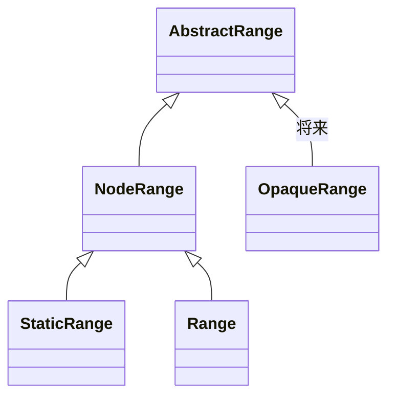

# 2026-11-05（木）

> 今日のひとこと：DOM Standard が、まだ存在しない `OpaqueRange` のために、Range の継承の途中に `NodeRange` を挟んで「Range は必ずノードを指す」という前提を型の上で外し始めた。新規の脆弱性はなし。前回の号（11-04 07:22 JST）以降の分をまとめている。

## 今日のリリース

- 【Biome】2.6.5：nursery ルールを一度に十数個追加（`noArrayForEach`、`noAwaitInPromiseMethods`、`noChainedComparison`、`noMissingThrow` など）（出典: https://github.com/biomejs/biome/releases/tag/%40biomejs%2Fbiome%402.6.5）
- 【TypeScript】tsc-ts v0.1.1：scriptc 0.4.8 とそのプロファイルでビルドし直したパッチ版（出典: https://github.com/vercel-labs/tsc-ts/releases/tag/v0.1.1）

## トップニュース

### DOM Standard が OpaqueRange に備えて NodeRange を挟む

【DOM】whatwg/dom に、`AbstractRange` と `StaticRange` / `Range` の間へ新しいインターフェース `NodeRange` を入れる変更が入った（Anne van Kesteren、2026-11-04）。コミットのタイトルは「Prepare for OpaqueRange」で、`OpaqueRange` 自体はまだ仕様に入っていない。

**何が変わる**

- `startContainer` / `endContainer` が `AbstractRange` から `NodeRange` に移る。`StaticRange` と `Range` は `NodeRange` を継承するので、利用者から見える挙動は変わらない。
- `startOffset` / `endOffset` / `collapsed` は、`AbstractRange` に「get start offset steps」などの内部アルゴリズムを持たせ、サブクラスが定義する形になった。`NodeRange` は従来どおり range の start offset などを返す。
- start node / end node などの内部の値は `AbstractRange` に残す。コミットメッセージによると、`OpaqueRange` もライブ range と同じように操作される（DOM の変更で位置が追従する）ので、これらは共通である必要がある。

**なぜ変えた**

コミットメッセージが理由を書いている。将来の `OpaqueRange` は、内部的にはノードを指す range だが、それを外に見せない。そのため `*Container` を公開する型と、`*Offset` / `collapsed` の返す値を差し替えられる型を分けた。`OpaqueRange` の用途は、このコミットからは分からない（不明。ここから先は推測だが、`<textarea>` や `<input>` の内部のように、中のノードを隠したい場所の範囲を扱うためだと思われる）。

**何に効く・誰が困る**

- いまのところ利用者に見える変化はない。型階層だけが変わる。
- ブラウザ実装は、`AbstractRange` を `NodeRange` と分けて持つかどうかを選べる。

**ここまでの経緯**

- 2026-11-04：`Prepare for OpaqueRange`（`11fac8e`）と、live ranges の記述を整える `6cc2415`。
- OpaqueRange の提案そのものは、今回の調査では確認できていない（不明）。

出典: https://github.com/whatwg/dom/commit/11fac8ec2725fdf64c13c640f450ca9ea2b1f1f0

## 今日の深掘り

### 「サブクラスが定義するステップ」で公開面を差し替える

選んだ理由：仕様の中で、継承階層を使って「同じ内部状態を、型ごとに違う見せ方で公開する」書き方を見られる小さな例だから。

**背景**

従来は、`AbstractRange` が `startContainer` / `endContainer` / `startOffset` / `endOffset` / `collapsed` をまとめて持っていた。これは「range の両端はノードとオフセットの組」という前提による。

**変更点**

`dom.bs`（`11fac8e`）の `AbstractRange` は、offset 系の3つを「サブクラスが定義するステップ」にした。

```html
<p>Each <a>range</a> has associated
<dfn for=AbstractRange export>get start offset</dfn> steps,
<dfn for=AbstractRange export>get end offset</dfn> steps, and
<dfn for=AbstractRange export>get collapsed</dfn> steps, which are to be defined by a
subclass.
```

`NodeRange` は IDL でコンテナ2つを持ち、offset 系は内部の値をそのまま返す。

```
interface NodeRange : AbstractRange {
  readonly attribute Node startContainer;
  readonly attribute Node endContainer;
};
```

> The get start offset steps of a NodeRange object range are to return range's start offset.

`collapsed` は「start node と end node が同じで、offset も同じ」という既存の定義を返す。

**周辺コード**



`OpaqueRange` は図の点線の位置に入る見込み。なお、このコミットには `OpaqueRange` の定義は含まれていない。

**この変更から分かる設計思想**

- 仕様は、機能を足す前に、足しやすい形へ構造を直す（コミットを分けて小さく入れる）。
- 内部の状態（start node など）と公開する値（offset など）を、アルゴリズム1つ分だけ離しておく。公開面を差し替えるための継ぎ目になる。

## 仕様の変更

### whatwg/dom

#### NodeRange の導入

トップニュースを参照。

その他：

- live ranges の記述を OpaqueRange 向けに整理（[6cc2415](https://github.com/whatwg/dom/commit/6cc2415)。editorial）

### whatwg/html

その他：

- `<embed>` に廃止済みの `hspace` / `vspace` IDL 属性を追加（[a7f6aed](https://github.com/whatwg/html/commit/a7f6aed)）

動きなし（editorialのみ・コミットなし）：whatwg/fetch, whatwg/streams, whatwg/url, tc39/ecma262, w3c/ServiceWorker, w3c/aria（accname の change log の更新のみ）

## OSSのPR

### TypeScript（tsc-ts / tsrs / microsoft/TypeScript）

#### tsc-ts がノードの kind・flags・pos の詰め込みをやめる

【TypeScript】tsc-ts は、ノードの kind・flags・pos を2語に詰める変更（#404）を入れたが、ネイティブビルドの公開 API が「ノードのフィールドをレコードにコピーする」ときにこの3つが抜け、最初の文字列リテラルで止まった。#405 で3つを通常のフィールドに戻し、`scripts/check-int32-fields.mjs` が kind・flags・pos・end・parent を持つことをビルド時に検査する。
なぜ変えたか：コミットメッセージによると、アクセサの裏に隠すとコピーから漏れるため。数字は自己申告で、検証は筆者の環境。
出典: https://github.com/vercel-labs/tsc-ts/pull/405

その他：

- 交差型の重複判定をリスト走査にした（[#408](https://github.com/vercel-labs/tsc-ts/pull/408)）
- チェッカー用の3つのコレクションを要素が入るときだけ作る（[#409](https://github.com/vercel-labs/tsc-ts/pull/409)）
- `--extendedDiagnostics` がすべてのチェッカーを数える（[#406](https://github.com/vercel-labs/tsc-ts/pull/406)）
- macOS ビルドに2段階のプロファイル最適化（[#407](https://github.com/vercel-labs/tsc-ts/pull/407)）
- ファイルの文法チェックをパースのスレッドで実行（[#400](https://github.com/vercel-labs/tsc-ts/pull/400)）

#### tsrs が content mapper を言語サーバーと Node API で動かす

【oxc】【TypeScript】oxc-project/tsrs に、content mapper（TS 以外の拡張子の中身を変換して型検査にかける仕組み）を言語サーバーと Node API で動かす変更が入った。Go 版のプロジェクト管理側に必要なコードを、コメントで Go 側の `ast.go` や `fileloader.go` の行番号を指して移植している。
なぜ変えたか：コミットメッセージによると、先行する不要コード削除（#813）で、project system が使うコードまで消えていたため戻した。
出典: https://github.com/oxc-project/tsrs/commit/48cf809

その他：

- fast モードでの条件型の遅延評価とタプルのリテラル添字の近道（[942470d](https://github.com/oxc-project/tsrs/commit/942470d)）
- lint の1回の実行で別の型検査を置き換える opt-in（`TSRS_LINT_CHECK_PROGRAM=1`。速度は同梱の測定メモの数字で自己申告）（[5def511](https://github.com/oxc-project/tsrs/commit/5def511)）

#### microsoft/TypeScript

その他：

- 相対パスの content mapper パッケージを、宣言した config から解決（[#65105](https://github.com/microsoft/TypeScript/pull/65105)）
- 複合代入の対象を1回だけ評価する挙動を維持（[#65297](https://github.com/microsoft/TypeScript/pull/65297)）
- パラメータ初期化子のスコープを本体内の関数宣言に対して尊重（[#65299](https://github.com/microsoft/TypeScript/pull/65299)）
- `ParsedCommandLine` の errors を書き換えない修正（[#64193](https://github.com/microsoft/TypeScript/pull/64193)）
- ASCII 識別子バイトの判定をルックアップテーブルに（[#64989](https://github.com/microsoft/TypeScript/pull/64989)）
- 行末を CRLF から LF に統一（[#64046](https://github.com/microsoft/TypeScript/pull/64046)）、blame 無視に追加（[#65320](https://github.com/microsoft/TypeScript/pull/65320)）、ローカライズのブランチの無駄なリベースを回避（[#64910](https://github.com/microsoft/TypeScript/pull/64910)）

#### vercel-labs/scriptc

その他：コミットは約50件（日本時間の昼間に集中）。主に node:test の `t.runOnly` / `t.waitFor`、`Buffer#toJSON`、`process.abort()`、Test262 の整備、GC・huge page まわりの最適化。数字は自己申告。例：[#2982](https://github.com/vercel-labs/scriptc/pull/2982)、[#2977](https://github.com/vercel-labs/scriptc/pull/2977)、[#2974](https://github.com/vercel-labs/scriptc/pull/2974)

### Next.js

その他：

- 開発時の Request Insights にフィルタと一時停止（[#96924](https://github.com/vercel/next.js/pull/96924)）
- `experimental.lockDistDir` のオプトアウトを削除（[#100747](https://github.com/vercel/next.js/pull/100747)）
- Turbopack: `require.context` を合成モジュールとして生成（[#100526](https://github.com/vercel/next.js/pull/100526)）
- Turbopack: ソースマップ後のファイルを issue の見出しに表示（[#101161](https://github.com/vercel/next.js/pull/101161)）
- Turbopack: turbopack-node の IPC フレームを線形時間で解析（[#99968](https://github.com/vercel/next.js/pull/99968)）
- 読み込んだ config を深くフリーズ（テスト時）（[#99943](https://github.com/vercel/next.js/pull/99943)）、既定値と共有しない（[#99942](https://github.com/vercel/next.js/pull/99942)）
- server actions のエントリが `type: commonjs` で失敗する問題を修正（[#101164](https://github.com/vercel/next.js/pull/101164)）
- 中断したステージの onStage リスナーを実行しない修正（[#95684](https://github.com/vercel/next.js/pull/95684)）
- 画像最適化まわりの整理（[#101126](https://github.com/vercel/next.js/pull/101126)）
- ほかは docs・skills・eval・フォントデータ更新

### Vite

その他：

- optimizer がサブパスインポート（`#`）を Vite の resolver で解決（[#23959](https://github.com/vitejs/vite/pull/23959)）
- チャンクの import map のハッシュ署名に安定したモジュール ID を使う（[#23976](https://github.com/vitejs/vite/pull/23976)）
- pnpm の `.modules.yaml` を Vite Task の入力から除外（[#23634](https://github.com/vitejs/vite/pull/23634)）

### oxc

その他：

- フォーマッター: Tailwind クラスを空白を畳んだ後の文字列でレイアウト判定（[#28745](https://github.com/oxc-project/oxc/pull/28745)、[#28791](https://github.com/oxc-project/oxc/pull/28791)、[#28744](https://github.com/oxc-project/oxc/pull/28744)）
- oxfmt: Prettier のワーカーを必要時に起動（[#28789](https://github.com/oxc-project/oxc/pull/28789)）、tinypool に worker_threads を再び使用（[#28787](https://github.com/oxc-project/oxc/pull/28787)）
- lexer: キーワードをバイトパターンで判定（[#28494](https://github.com/oxc-project/oxc/pull/28494)）、トークンごとの reset をまとめる（[#28492](https://github.com/oxc-project/oxc/pull/28492)）
- linter: `no-redeclare` に `ignoreDeclarationMerge`（[#28816](https://github.com/oxc-project/oxc/pull/28816)）、`prefer-type-error` が波括弧なしの if を報告（[#28819](https://github.com/oxc-project/oxc/pull/28819)）
- transformer: class-properties の private アクセサ・メソッドの代入まわりの修正（[#28790](https://github.com/oxc-project/oxc/pull/28790)、[#28788](https://github.com/oxc-project/oxc/pull/28788)、[#28606](https://github.com/oxc-project/oxc/pull/28606)）
- 無限大の数値リテラルを `1e400` で出力（[#28812](https://github.com/oxc-project/oxc/pull/28812)）、minifier の空文字検索 replaceAll の UTF-16 境界（[#28807](https://github.com/oxc-project/oxc/pull/28807)）
- 他に react-compiler・formatter のデコレータ・lexer のリファクタ

### Biome

その他：

- rowan: 子のないノードを飛ばし、種類で絞る走査でのコピーを避ける（[#12931](https://github.com/biomejs/biome/pull/12931)）
- 型推論: Array 型の lowering の上書きを削除（[#12930](https://github.com/biomejs/biome/pull/12930)）

### Svelte

その他：

- 失敗した boundary を含む別の分岐へ hydrate するとき、サーバー描画の内容をすべて消す（[#19166](https://github.com/sveltejs/svelte/pull/19166)）

### Vue（minor ブランチ）

その他：

- `effect()` に渡した options オブジェクトを書き換えない（[#16105](https://github.com/vuejs/core/pull/16105)）

### Wado

その他：コミットは100件ほど。ほとんどは inliner と最適化の整理（PGO の fuel の測定のやり直しなど）。WEP は optimizer remarks の記述が2件更新された（docs）。

### Bun

`bun check` / `bun fmt` に関わるPRは今回確認できず。ランタイムのPRは対象外。

動きなし：facebook/react, solidjs/solid, ghc/ghc, pingdotgg/ts-rust

## 脆弱性

新規のアドバイザリは見つからなかった。確認したのは next.js、astro、vite、TanStack/router、nuxt、svelte で、最新は Next.js の11-03公開分（11-04の号で扱い済み）。facebook/react、vuejs/core、oxc は今回確認できていない（時間切れ）。
