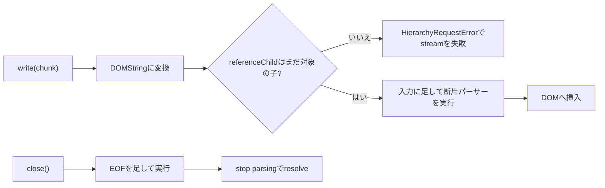

# 2026-11-06（金）

> 今日のひとこと：WHATWG HTML に、`WritableStream` を返す `streamHTML()` 系のメソッド（要素にHTMLを流し込みながらパースする）が入り、2016年12月のIssue #2142 が閉じた。新規の脆弱性はなし。前回の号（11-05 07:18 JST）以降の分をまとめている。

## 今日のリリース

- 【Vite】v8.3.6：開発サーバーの HTML 属性のエスケープ、worker チャンクの衝突の修正など（出典: https://github.com/vitejs/vite/releases/tag/v8.3.6）
- 【Vite】plugin-legacy 8.2.4、create-vite 9.3.4：v8.3.6 と同日のリリース。中身は未確認（出典: https://github.com/vitejs/vite/releases/tag/plugin-legacy%408.2.4 、https://github.com/vitejs/vite/releases/tag/create-vite%409.3.4）
- 【Vue】v3.5.45：Suspense、KeepAlive、Transition まわりの不具合修正が中心（出典: https://github.com/vuejs/core/releases/tag/v3.5.45）
- 【oxc】tsrs v0.22.0：リント実行が型チェックを兼ねられる `--type-check` と、増分ビルドの性能改善（出典: https://github.com/oxc-project/tsrs/releases/tag/v0.22.0）
- 【TypeScript】tsc-ts v0.1.2：チェック処理の高速化（READMEと同じく自己申告で約1%）と `@scriptc/threads` の任意依存化。リリース準備コミットは確認したが、タグとリリースページは未確認（出典: https://github.com/vercel-labs/tsc-ts/commit/3239e2e ）

## トップニュース

### HTML に「流し込みながらパースする」streamHTML() 系が入る

【HTML】whatwg/html に、要素へ HTML を少しずつ流し込める新しいメソッド群が入った（Noam Rosenthal、2026-11-05、`289f918`）。`streamHTML()` は `WritableStream` を返し、書き込まれたチャンクがそのままパースされてDOMに入る。

**何が変わる**

- `Element` と `ShadowRoot` に `streamHTML()`、`streamAppendHTML()`、`streamPrependHTML()` と、それぞれの `...Unsafe()` 版が増える。
- ノードの前後・置換には `streamBeforeHTML()`、`streamAfterHTML()`、`streamReplaceWithHTML()`（と `Unsafe` 版）が増える。
- `Unsafe` が付かない方はサニタイザー（Sanitizer API）を通す。付く方は通さない。Trusted Types の検査も、ストリームを返す前に同期的に行う。
- `fetch()` の本文を `pipeTo()` でつなげば、受け取った分から画面に出せる。

**なぜ変えた**

Issue #2142（2016-12-07、Jake Archibald）が出発点。記事のHTMLを取得中から表示し、遷移アニメーションを早く始めたいが、`innerHTML` では全部届くまで待つことになる。この動機は Issue のページから読んだ要旨。

**何に効く・誰が困る**

- ストリーミングSSRで届いたHTMLを、クライアント側でも同じ速さで差し込める。
- スクリプトを含むHTMLを流すと、通常のパーサーと同じ順序で実行が止まる。`Unsafe` 版を使う側は、XSSの責任を自分で負う。
- 他のブラウザの実装状況は、今回の調査では確認できていない（不明）。

**ここまでの経緯**

- 2016-12-07：Issue #2142 が立つ。
- 2025-11-27：Stage 2 に進む合意が取られたと、Issue上のコメントにある。
- 2025-09-25の号：Interop の提案で「HTML Streaming Setters」にFirefoxが positive と書かれていた。→ [09-25（木）](2026-09-25.md)
- 2026-10-13の号：位置別のHTML挿入（`appendHTML` など）を扱った。今回の `stream*` はその系統の続き。→ [10-13（火）](2026-10-13.md)
- 2026-11-05：仕様に入り、Issue #2142 が閉じる（コミットメッセージに `Closes #2142`）。

出典: https://github.com/whatwg/html/commit/289f918 、https://github.com/whatwg/html/issues/2142

## 今日の深掘り

### streamHTML()：WritableStream の3つのフックにパーサーをつなぐ

**選んだ理由**：「ストリームの書き込み・閉じる・中断」という3つのフックに、HTMLパーサーの状態機械をどうつなぐかが、仕様の本文にそのまま書かれているため。

**背景**：`innerHTML` は文字列を丸ごとパースして、できた断片を一度に差し込む。途中の状態をページに見せる場所がない。一方、`document.write()` は流し込めるが、文書全体のパーサーに触る。要素の中だけに限った「断片パーサー」を、外から少しずつ動かせる形にしたのが今回の変更。

**変更点**：仕様は `stream HTML` というアルゴリズムの中で、`WritableStream` の3つのアルゴリズムを定義している（`source` の `289f918` より、要旨）。

- `writeAlgorithm`（チャンクが来たとき）：チャンクを `DOMString` に変換し、パーサーの入力ストリームの末尾に足して、断片パーサーを走らせる。変換に失敗したらパーサーを中断して、その例外で reject する。
- `closeAlgorithm`（閉じるとき）：明示的な `"EOF"` を入力に足してパーサーを走らせ、`close promise` を返す。パーサーを止める処理（stop parsing）が終わると resolve する。
- `abortAlgorithm`（中断されたとき）：パーサーを中断する。

書き込みの Promise は、パーサーをブロックするスクリプトの完了を待たない。待つのは `close` の方だけ。これで、書き込み側がスクリプトの実行待ちで詰まらない。

**周辺コード**：挿入の基準になる `referenceChild`（ここより前に入れる、という目印のノード）が、書き込みの合間に動かされることがある。仕様は、`referenceChild` の親が対象でなくなったら「invalid reference child steps」を呼ぶ。ストリームを `HierarchyRequestError` で失敗させ、パーサーを中断する。この仕様では、挿入先がすでに壊れたものは、黙って続けるより止める、と決めている。

**この変更から分かる設計思想**

- 非同期のスクリプトと同期のパーサーを、Promise の返し方（書き込みは待たない、閉じるは待つ）で分けている。
- サニタイズ前の要素は、DOMに入れずに「テンプレート内容の所有文書」で作って捨てる。コミットメッセージによると、これは `setHTML()` など既存のサニタイザー付きメソッドにも適用され、以前は断片全体をパースしてカスタム要素をアップグレードしてから除去していたものが変わる。

出典: https://github.com/whatwg/html/commit/289f918

## 仕様の変更

### whatwg/html

#### 画像の選択が「実装依存」から手順になる

【HTML】`srcset` の画像選択（select an image source from a source set）が、実装に任されていた選び方から決まった手順になった（`5955a33`）。同じ画素密度の候補は先のものを残し、昇順に並べ、文書のデバイスピクセル比以上で最初のものを選ぶ。どれも満たさなければ最後のものを選ぶ。すでに取得済みの高密度の画像を優先してよい、という「may」は残る。
なぜ変えたか：Issue #13077。各ブラウザの実装がすでに揃っていたので、それを仕様に書いた。ネットワーク速度による選択の記述は削られた。
出典: https://github.com/whatwg/html/commit/5955a33

### w3c/csswg-drafts

#### css-mixins の関数の引数：空の引数と末尾のカンマの扱いが決まる

【CSS】`@function` の定義で最後のパラメーターの後ろのカンマを許す文法（`<function-parameter>#? ,?`）に変わり、空の引数は許されて前後の空白を除く、と決まった。末尾のカンマは JavaScript と同じ扱い、とコミットに書かれている。
なぜ変えたか：Issue #14370 への対応。詳細は未確認（不明）。
出典: https://github.com/w3c/csswg-drafts/commit/909869d6

その他：

- cssom-view-1 の「determine the device pixel ratio」に Document 引数を追加。HTMLの画像選択が文書を渡せるようにするための変更とみられる（推測）（[#14724](https://github.com/w3c/csswg-drafts/pull/14724)）
- css-mixins-1 に、`initial` / `inherit` の動きを説明する非規範の節を追加（[bd31cb0f](https://github.com/w3c/csswg-drafts/commit/bd31cb0f)、editorial）

### w3c/aria

その他：editorialな修正と整形のみ（[#2968](https://github.com/w3c/aria/pull/2968)、[#2967](https://github.com/w3c/aria/pull/2967)、[#2957](https://github.com/w3c/aria/pull/2957)）

動きなし：whatwg/dom, whatwg/fetch, whatwg/streams, whatwg/url, tc39/proposals, tc39/ecma262, w3c/ServiceWorker, w3c/wcag3

## OSSのPR

### Next.js

#### route handler の応答はNext側で圧縮しなくなる（セルフホストの圧縮を直す）

【Next.js】セルフホストで route handler の応答が圧縮されなかった不具合を直した。`NodeNextResponse.appendHeader` がヘッダー値を常に配列で保存していたため、圧縮ミドルウェアの Content-Type 判定（`compressible`）が文字列でないと判断して素通りしていた。1つの値は文字列のまま保存するようにした。
なぜ変えたか：Issue #101120。なお、`fetch()` の応答を丸ごと返すルートでは、GHSA-pc58-hwjq-p385 の対策として Content-Encoding と Content-Length を落とす必要があり、そのままだと圧縮が外れるため、圧縮は外側のサーバーに任せる方針がPR本文にある。
続報：11-04の号のアドバイザリ7件の1件に関係する。→ [11-04（水）](2026-11-04.md)
出典: https://github.com/vercel/next.js/pull/101220

#### Image Optimization API がローカル画像のリダイレクトを辿る

【Next.js】`fetchLocalImage()` がリダイレクトに応答するルートを辿れず500になっていたのを、外部画像と同じく `images.maximumRedirects` の回数まで辿るようにした。
なぜ変えたか：Issue #98237。
出典: https://github.com/vercel/next.js/pull/98271

その他（27件中の主なもの）：

- Turbopack：GC と退避の競合を、タスクの復活をやめて直す（[#100370](https://github.com/vercel/next.js/pull/100370)）
- Turbopack：コンポーネントチャンクの読み込み失敗を再試行（[#101179](https://github.com/vercel/next.js/pull/101179)）
- Turbopack：`import.meta.glob` を合成モジュールとして生成（[#100535](https://github.com/vercel/next.js/pull/100535)）
- Request Insights：セッション履歴の永続化、ルートモジュールの読み込み表示ほか3件（[#97795](https://github.com/vercel/next.js/pull/97795)、[#97362](https://github.com/vercel/next.js/pull/97362)、[#96925](https://github.com/vercel/next.js/pull/96925)）
- `next/image-optimizer-transform` の公開APIから `optimizeImage` を削除（[#101133](https://github.com/vercel/next.js/pull/101133)）
- swc を v83、v84 に更新（[#101079](https://github.com/vercel/next.js/pull/101079)、[#101194](https://github.com/vercel/next.js/pull/101194)）
- ほかはテスト、CI、docsの整理

### Vite

#### 開発サーバーが出力するHTMLの属性をエスケープする

【Vite】base URL の案内ページと、`index.html` のインラインスクリプトを置き換えるプロキシURLで、属性の値を HTML エスケープするようにした。インラインスクリプトのURLの `&` は `&amp;` になる。アドバイザリの有無は未確認で、今回の一覧には出ていない。
出典: https://github.com/vitejs/vite/pull/23995

その他：

- 最初の行にある隣り合う module タグの除去を修正（[#23823](https://github.com/vitejs/vite/pull/23823)）
- 未使用の worker と競合するチャンクが、使われている worker からも落ちる不具合を修正（[#23956](https://github.com/vitejs/vite/pull/23956)）
- 副パスのインポート（`#`）を Vite の resolver で解決（[#23959](https://github.com/vitejs/vite/pull/23959)）
- チャンクのインポートマップのハッシュに安定したモジュールIDを使う（[#23976](https://github.com/vitejs/vite/pull/23976)）

### oxc

#### oxlint が tsrs を見つけて型を意識したリントに使う

【oxc】`oxlint` が tsrs を探して、型情報を使うリント（type-aware linting）に使えるようになった。
なぜ変えたか：PR本文は読めていない（不明）。tsrs 側の `--type-check` との組み合わせと思われる（推測）。
出典: https://github.com/oxc-project/oxc/pull/28751

その他（33件中）：

- パーサー：async アロー関数の先読みをまとめる性能改善（[#28431](https://github.com/oxc-project/oxc/pull/28431)）
- レキサー：一般的な記号を直接ディスパッチする性能改善ほか多数（[#28792](https://github.com/oxc-project/oxc/pull/28792)）
- codegen：ソースマップの行走査を高速化、位置ごとのマッピングを1つに（[#28400](https://github.com/oxc-project/oxc/pull/28400)、[#28844](https://github.com/oxc-project/oxc/pull/28844)）
- フォーマッター：Tailwind の並べ替えまわりの修正3件（[#28800](https://github.com/oxc-project/oxc/pull/28800)、[#28798](https://github.com/oxc-project/oxc/pull/28798)、[#28794](https://github.com/oxc-project/oxc/pull/28794)）
- リンター：各ルールの修正が約8件
- そのほか依存更新、submodule更新

### oxc-project/tsrs

その他：

- v0.22.0 の内容：リント1回で型チェックを代替できる `--type-check`（オプトイン）、増分ビルドにインターフェースファイルを記録（[#897](https://github.com/oxc-project/tsrs/pull/897)、[#900](https://github.com/oxc-project/tsrs/pull/900)）
- リリース後：Windows ARM64 向けのnpmパッケージ（[#903](https://github.com/oxc-project/tsrs/pull/903)）、フルプログラム再ビルドでリージョンを毎回作る修正（[#895](https://github.com/oxc-project/tsrs/pull/895)）、リントルールの修正が約6件

速度・互換性の数字はREADMEと `bench/RESULTS.md` の自己申告。

### vercel-labs/tsc-ts と scriptc

その他：

- tsc-ts：v0.1.2 の準備。`@scriptc/threads` を任意のpeer依存に（[#410](https://github.com/vercel-labs/tsc-ts/pull/410)）。macOS と Windows でも Linux と同じ2段階のプロファイルを使う。READMEの数字は自己申告
- scriptc：約100件のコミット。Node の `readline`、`dns`、`url.Url` の対応拡張、`scriptc mcp` の追加（[#2918](https://github.com/vercel-labs/scriptc/pull/2918)）、動的な値から型付きの値へ渡る境界の検査を1か所にまとめる変更（[#3015](https://github.com/vercel-labs/scriptc/pull/3015)）が主

### Vue

その他：minor ブランチで Vapor Mode の runtime-vapor の修正（Transition、hydration の状態の解放）が続く。Teleport を devtools 向けに追跡する機能追加（[71948235](https://github.com/vuejs/core/commit/71948235)）、tsconfig の include の列挙を省く性能改善（[#16136](https://github.com/vuejs/core/pull/16136)）

### TypeScript

その他：

- TS1450（無効な動的インポート）の診断の重大度を修正（[#65317](https://github.com/microsoft/TypeScript/pull/65317)）
- 非連続の abstract メソッド宣言で TS2516 を報告（[#65099](https://github.com/microsoft/TypeScript/pull/65099)）
- 型アサーションで隠れた単項の指数演算子のオペランドを拒否（[#65323](https://github.com/microsoft/TypeScript/pull/65323)）
- `process.execve` で tsc の環境を保持（[#65336](https://github.com/microsoft/TypeScript/pull/65336)）
- ワークスペースの TypeScript バージョン検出の修正（[#65344](https://github.com/microsoft/TypeScript/pull/65344)）、`parseConfigFileTextToJson` の追加（[#65328](https://github.com/microsoft/TypeScript/pull/65328)）、チェッカーAPIに足りないメソッドの追加（[#65037](https://github.com/microsoft/TypeScript/pull/65037)）

### Biome

その他：Markdown パーサーが MDX の ESM ブロック・式・JSX タグをパース（[#12831](https://github.com/biomejs/biome/pull/12831)、[#12832](https://github.com/biomejs/biome/pull/12832)）、JS の extent 検出を `biome_js_extent` に切り出し（[#12830](https://github.com/biomejs/biome/pull/12830)）

### React

その他：CI のみ（Node 24 化など、[#38104](https://github.com/facebook/react/pull/38104)、[#38122](https://github.com/facebook/react/pull/38122)）

### Wado

wado-lang/wado は約130コミットで、ほとんどがエージェント（Claude）の運用の記録と整理。`docs/wep-*.md` は、`wep-2026-10-25-profile-guided-optimization.md` ほか2件が変わっていた。内容は読めていない（不明）。

### Bun

`bun check` と `bun fmt` に関わるPRはなし。

動きなし：facebook/react（CIを除く）、sveltejs/svelte、solidjs/solid、ghc/ghc、pingdotgg/ts-rust

## 議論ウォッチ

取得できていない：今回は、WICG、standards-positions、TC39のノート、各RFCリポジトリ、Discussions（github.comのページ）を読んでいない。時間の都合で、節を省略せずここに書く。

## 続報

- 11-04の号で取り上げたNext.jsのアドバイザリ GHSA-pc58-hwjq-p385（fetch応答の転送）の対策に伴う、route handler の圧縮の扱いが `#101220` で調整された。→ [11-04（水）](2026-11-04.md)
- 09-25の号の Interop「HTML Streaming Setters」は、今日、仕様まで進んだ。実装は、Firefox は Issue のコメントによると実装が進んでいる（未確認）。→ [09-25（木）](2026-09-25.md)

## 脆弱性

新規のアドバイザリなし。次のリポジトリの一覧を確認し、2026-11-05以降の公開分がないことを確かめた：vercel/next.js（最新は11-03）、vitejs/vite（最新は10-21）、facebook/react（10-14）、sveltejs/svelte（05-14）、vuejs/core（08-31）、nuxt/nuxt（11-02）、withastro/astro（10-28）、TanStack/router（09-30）、oxc-project/oxc（なし）。
