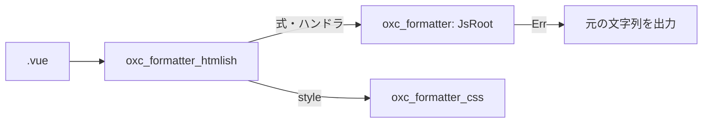

# 2026-11-07（土）

> 今日のひとこと：oxfmt が `.vue` ファイルの整形を Prettier から切り離し、自前の HTML 系フォーマッターで処理するようになった（破壊的変更、oxfmt v0.77.0 に収録）。新規の脆弱性は確認できなかった。前回の号（11-06 07:18 JST）以降の分をまとめている。

## 今日のリリース

- 【oxc】oxfmt v0.77.0：`.vue` の整形を Prettier 経由から `oxc_formatter_htmlish` に切り替え（出典: https://github.com/oxc-project/oxc/releases/tag/oxfmt_v0.77.0）
- 【oxc】oxlint v1.92.0：型を使うリントで tsrs を見つけて使えるようになった、`no-redeclare` に `ignoreDeclarationMerge` を追加など（出典: https://github.com/oxc-project/oxc/releases/tag/oxlint_v1.92.0 。内容はリリースコミット `29daf901a` のチェンジログから）
- 【Biome】2.6.6：リリースノートは未確認。同日に `usePackageJsonEngines` など多数の lint ルールのコミットが main に入っている（出典: https://github.com/biomejs/biome/releases/tag/%40biomejs%2Fbiome%402.6.6 ）
- 【TypeScript】scriptc v0.4.9：リリース準備コミット `9b6af92f4` を確認。中身は未確認（出典: https://github.com/vercel-labs/scriptc/releases/tag/v0.4.9 ）

## トップニュース

### oxfmt が Vue を Prettier なしで整形するようになる

【oxc】oxc-project/oxc に、`.vue` ファイルを oxfmt 自身で整形する変更が入った（#28848、leaysgur、2026-11-06 03:51 UTC、`00d1a6736`）。これまで Prettier に渡していた `parser:vue` の経路が消える。

**何が変わる**

- `.vue` と Markdown 内の `vue` コードブロックは、Prettier を通らない。
- マークアップは `oxc_formatter_htmlish`、テンプレート内の JS は `oxc_formatter`、`<style>` は `oxc_formatter_css` が受け持つ。
- `prettier-plugin-oxfmt` が整形するのは Svelte と Astro のスクリプトだけになる。
- コミットメッセージには「Prettier の出力と異なる箇所がある」（破壊的変更）とあり、差分は `apps/oxfmt/DIVERGENCES.md` に書かれている。

**なぜ変えた**

Issue #28264 を閉じる変更。動機の詳しい議論までは読んでいない（不明）。コミットメッセージから読み取れる方針は、整形後のコードが `@vue/compiler-sfc` で、整形前と同じように読めること（`crates/oxc_formatter_htmlish/AGENTS.md` の「What Vue reads」）。

**何に効く・誰が困る**

- Vue プロジェクトで oxfmt を使う人は、整形結果の差分が出る。CI の差分チェックを使っているなら、アップデート時に一度まとめて整形し直すことになる。
- 整形できなかった値と `v-pre` の中身は、元のまま出力される。

**ここまでの経緯**

- 2026-11-06：テンプレート用の `JsRoot`（#28846）、`oxc_formatter_htmlish` の Vue 対応（#28847）、経路の切り替え（#28848）が同時刻にマージされる。
- 同日：oxfmt v0.77.0 として公開。

出典: https://github.com/oxc-project/oxc/pull/28848

## 今日の深掘り

### Vue テンプレートの「式」を JS フォーマッターに渡す設計（oxc）

Prettier のように「Vue の整形ごと別の仕組みに任せる」のではなく、HTML 側と JS 側を分けて、境界だけを小さな部品で結んでいる。#28846 と #28847 のコミットメッセージから、その切り分けが読めるので選んだ。コードの diff そのものは読んでおらず、以下はコミットメッセージに基づく。

**背景**

`{{ a }}` や `:a="b"`、`@click="x; y"` のように、Vue のテンプレートには JS が断片で現れる。断片は「文」でも「プログラム」でもない。セミコロンの扱い（ASI）も普通のコードとは違う。

**変更点**

- `JsRoot::Expression`：`{{ }}` などの区切りの中にある式を、そのまま、グループ化して、または区切りに寄せて出力する。`Program` の下で出力されるので、文用の規則（`;` や ASI ガード）は掛からない。
- `ProgramSemicolons::MarksStatements`：`@click` のように `;` があれば文として読むホスト向け。`semi: false` でも、複数の文をつなぐ `;` は ASI の保護として残る。
- #28848 で `JsRoot::FunctionParams` と `JsRoot::TypeParameters` が加わり、`v-for`、`v-slot`、`<script generic>` を扱う。

**周辺コード**

**設計思想**

「出力はホストの読み方が入力と同じになる」ことを守る。守れない場所は `format_to_ir` が `Err` を返し、フォーマッターは諦めて元のまま出す。整形の美しさより、壊さないことを優先している。

出典: https://github.com/oxc-project/oxc/pull/28846 、https://github.com/oxc-project/oxc/pull/28847

## 仕様の変更

### whatwg/html

#### `<picture>` の `<source>` 追加で img の寸法がすぐ決まるようにする

【HTML】`<picture>` 内で `<source>` の後ろにある `` について、ブラウザは寸法を同期的に解決しているが、仕様はタスクを積んでからだったため食い違っていた。仕様側を、ソースセットの更新だけを同期的に行うよう直した（Tim van der Lippe、`5fcc231`）。
なぜ変えたか：`<source>` を足した直後にスタイルを計算すると、`<source>` の寸法が使われるのが実際の挙動のため。`error` イベントが早く発火しないよう、残りの処理はタスクの中に残している。
出典: https://github.com/whatwg/html/commit/5fcc2318395821db61e353705e6368ad9a000af5

### w3c/csswg-drafts

#### CSS Gaps に gap segments の定義が入る

【CSS】css-gaps-1 に「Gap segments」の節が加わり、ギャップの区切り（segment）を求める手順と、それを連結した gap decoration segment が定義された。キャップとジャンクションの端点も「描画される gap segment」を基準に決まる（#14637、`70431978`）。
なぜ変えたか：コミットメッセージには手順の追加としか書かれておらず、動機は不明。
出典: https://github.com/w3c/csswg-drafts/pull/14637

その他：

- css-values-5 の Changes リストを更新（`2da1cb17`、editorial）

動きなし：whatwg/dom, whatwg/fetch, whatwg/streams, whatwg/url, tc39/proposals, tc39/ecma262（editorial のみ）, w3c/aria, w3c/ServiceWorker, w3c/wcag3（クローン時点で期間内のコミットなし、または editorial のみ）

## OSSのPR

### oxc-project/oxc

注目は上のトップニュースと深掘りで扱った Vue 整形。ほかの流れ：

- formatter まわりのコミットが約20件（JSDoc の改行処理、TOML・GraphQL の空文書、Tailwind、`oxfmt` の fixture 型テストの導入など）。多くは leaysgur によるもので、Vue 対応と並行して整形の周辺が整えられている。
- リンターの修正が複数：`exhaustive-deps` が依存の削除を提案（[#28925](https://github.com/oxc-project/oxc/pull/28925)）、`--fix` で未使用の `oxlint-disable` を消す（[#27698](https://github.com/oxc-project/oxc/pull/27698)）、tsgolint を通常のリントより先に起動する性能改善（[#28824](https://github.com/oxc-project/oxc/pull/28824)）、`promise/prefer-catch` に提案を実装（[#28919](https://github.com/oxc-project/oxc/pull/28919)）
- codegen のソースマップ末尾の走査を減らす性能改善（[#28869](https://github.com/oxc-project/oxc/pull/28869)）

### oxc-project/tsrs

#### 参照検索と自動インポートが速くなる

【oxc】LSP の「複数プロジェクトをまたぐ参照検索」を、tsgo（Go版）が並行に探すのに対し tsrs は順番に探していた。これを並行にした。コミットメッセージには、大規模リポジトリで tsgo 1.6秒に対し tsrs 22秒だった例が書かれている（自己申告）（#936、`f913a8d`）。
なぜ変えたか：Go 版と同じ並行度に合わせるため。
出典: https://github.com/oxc-project/tsrs/commit/f913a8d

その他：

- `--type-check` が `--fast` の有無にかかわらずプログラム全体を検査（`b8b2127`、#930）
- 設定ファイルの探索が、推移的な project reference をたどる（`28e42fc`、#934）
- `no-unnecessary-type-assertion` が推論されたジェネリック引数を報告、`prefer-optional-chain` の JSX テスト基準を上流に同期（#925、#926）

### microsoft/TypeScript

#### LSP の性能改善と `declare abstract` の順序

【TypeScript】Andrew Branch による LSP の性能最適化（[#64877](https://github.com/microsoft/TypeScript/pull/64877)）。クラス宣言で `abstract` の前に `declare` を要求する変更（[#65360](https://github.com/microsoft/TypeScript/pull/65360)）。詳細は読んでいない。
なぜ変えたか：不明（本文未確認）。
出典: https://github.com/microsoft/TypeScript/pull/64877

その他：

- アクセサデコレータのメタデータで getter の注釈を保持（[#65343](https://github.com/microsoft/TypeScript/pull/65343)）
- Program と Project のメソッドを追加（[#64988](https://github.com/microsoft/TypeScript/pull/64988)）
- ヒーププロファイルのサンプリングをプロファイル時だけに（[#65338](https://github.com/microsoft/TypeScript/pull/65338)）
- 並行性テストを実時間に依存しないものに（[#65353](https://github.com/microsoft/TypeScript/pull/65353)）、推論の再帰ハングの回帰テスト追加（[#65362](https://github.com/microsoft/TypeScript/pull/65362)）、CI のプロキシ対応（[#65349](https://github.com/microsoft/TypeScript/pull/65349)）

### vercel/next.js

#### `next/image-optimizer-transform` が `next/experimental` 配下に移る

【Next.js】画像最適化の変換 API を `next/experimental` 名前空間に移した（[#101252](https://github.com/vercel/next.js/pull/101252)）。PRページの要旨：まだ安定版に入っていない API が意図せず公開されていたため、安定 API として扱わない立場を示す。今後 `@next/safe-image-optimization` 対応で破壊的変更がありえる。
なぜ変えたか：利用者は Vercel の画像最適化や、自前で実装するホスティング事業者など少数と見込まれるため。
出典: https://github.com/vercel/next.js/pull/101252

その他：

- `NextConfigComplete` を imageOptimizerTransform の公開 API から外す（[#101184](https://github.com/vercel/next.js/pull/101184)）
- Turbopack：順序が観測されない値にハッシュコレクションを使う（[#100939](https://github.com/vercel/next.js/pull/100939)）、ページエントリをファサードに分けない（[#101152](https://github.com/vercel/next.js/pull/101152)）、Next.js のエントリ種別を不透明なタグに置換（[#101291](https://github.com/vercel/next.js/pull/101291)）
- `use cache` の条件付き読み取りを永続化（[#101283](https://github.com/vercel/next.js/pull/101283)）
- 再検証のたびにプリレンダー済み Link ヘッダが蓄積する不具合を修正（[#100960](https://github.com/vercel/next.js/pull/100960)）
- ビルドと分析を1パスに（[#99962](https://github.com/vercel/next.js/pull/99962)）、NodeNextResponse のヘッダ割り当てを削減（[#101225](https://github.com/vercel/next.js/pull/101225)）、eslint-config-next の TypeScript peer を typescript-eslint に合わせる（[#101247](https://github.com/vercel/next.js/pull/101247)）
- Request Insights の操作改善（[#97796](https://github.com/vercel/next.js/pull/97796)）。ほかテストの整理など数件

### facebook/react

#### Flight：ストリームされる Server Component の hooks を修正

【React】ストリーミング中の Server Component で hooks が壊れる不具合の修正（[#38128](https://github.com/facebook/react/pull/38128)）。また、`useDeferredValue` と中断したハイドレーションの組み合わせで無限ループになる不具合も修正（[#38132](https://github.com/facebook/react/pull/38132)）。
なぜ変えたか：どちらも本文は未確認（不明）。
出典: https://github.com/facebook/react/pull/38128

### biomejs/biome

#### 他ツールの定番ルールが大量に加わる

【Biome】約15件の新しい lint ルールが main に入った（`noConstantComparisons`、`noErasingOperation`、`noSharedBranchCode`、`usePackageJsonEngines`、`usePackageJsonCpu` など。Carson McManus）。個別の中身は読んでいない。
出典: https://github.com/biomejs/biome/pull/12310

その他：

- 埋め込み CSS で `styled.a.attrs()` を解析（[#12968](https://github.com/biomejs/biome/pull/12968)）、ルート宣言の解決（[#12967](https://github.com/biomejs/biome/pull/12967)）
- `useUnicodeRegex` が u フラグで無効になるパターンに足さない（[#12050](https://github.com/biomejs/biome/pull/12050)）、プラグイン欠落時にエラー（[#12955](https://github.com/biomejs/biome/pull/12955)）、グラフの上向き探索をメモ化（[#12951](https://github.com/biomejs/biome/pull/12951)）
- SCSS の負の補間リスト、`@font-palette-values`、セレクタ範囲の借用による性能改善など CSS まわり数件

### vercel-labs/scriptc, vercel-labs/tsc-ts

- scriptc：自己申告の細かい修正が約60コミット（Windows 環境変数、timers、`module.exports`、ArrayBufferView など）。v0.4.9 の準備コミットあり。Node 互換の状況表の追加（`0b8eba490`）。
- tsc-ts：実行記録（run record）が全チェック範囲が空でも読めるように（[#413](https://github.com/vercel-labs/tsc-ts/pull/413)）

### ghc/ghc

- 14コミット：`solveImplicationsUsingUnsatGiven` のパニック回避（`20334e1d1f`）、`-dynamic` が `-fsplit-sections` を無効にしない（`d735b507f9`）、スレッド単位の例外ブレーク（`fd00a88cb0`）、bignum 除算のアロケーション削減（`9f57c265ec`）。ほかは CI とテストスイート。GitLab のマージリクエストは読めないため、コミットメッセージのみが根拠。

### wado-lang/wado

- 53コミット。目立つのは PGO（プロファイル誘導最適化）の整理で、関数をハッシュだけで引く形式への変更（`0dfc4bb05e`）と、プロファイル形式のバージョン化（`602ce7e496`）。ほか loam（WebGPU 系）、dae（未使用引数の除去）の修正。`docs/wep-*.md` の変更は確認していない。

動きなし：facebook/react 以外の vitejs/vite（テスト1件のみ）, pingdotgg/ts-rust, oven-sh/bun, solidjs/solid, sveltejs/svelte, vuejs/core（クローン時点で期間内のコミットなし、または確認できず）

## 脆弱性

GitHub Advisory Database（npm）の新着一覧を WebFetch で確認した。11-05 以降に公開されたのは `filecoin-pin` のみで、対象パッケージ（react、next、vite、svelte、vue、oxc、astro、nuxt、TanStack Start）に当たるものはなかった。ただし、リポジトリごとのアドバイザリ一覧ページは今回確認していない。
