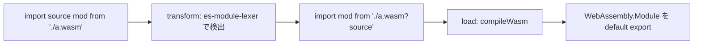

# 2026-11-12（木）

> 今日のひとこと：Vite の main に、WebAssembly の source phase import（`import source mod from './a.wasm'`）をはじめ、1日で十数件の機能変更が入った。Vite 8.3.8、Biome 2.6.7、tsrs 0.25.0 などが公開。新規の脆弱性は確認できず。

## 今日のリリース

- 【Vite】8.3.8：`transform` フックのメタに `magicString` と `ast` を残す修正（#24012）、インラインworkerが参照するアセットのbundled-dev対応など、バグ修正中心（出典: https://github.com/vitejs/vite/blob/v8.3.8/packages/vite/CHANGELOG.md ）
- 【Biome】2.6.7：nursery ルール `noAsyncPromiseFinally`、`noDuplicateTypeConstituents` などを追加（CHANGELOGを根拠。出典: https://github.com/biomejs/biome/blob/main/packages/@biomejs/biome/CHANGELOG.md ）
- 【TypeScript】tsrs 0.25.0：Windows ARM64 パッケージを追加し、lint まわりを変更（リリース準備コミット #962 を根拠。出典: https://github.com/oxc-project/tsrs/pull/962 ）
- 【TypeScript】scriptc v0.4.12：`unknown` を返す Promise の反応を fiber（512KB のスタック）なしで走らせる最適化が目玉（数字はCHANGELOGの自己申告。出典: https://github.com/vercel-labs/scriptc/commit/70525db3c7cffc5ffbfa08bab416adb481158b9e ）
- 【TypeScript】tsc-ts v0.1.5：TypeScript 5.9 の JavaScript API を `typescript-5.9` エイリアスで読み込む（出典: https://github.com/vercel-labs/tsc-ts/commit/e2d9f60 ）

## トップニュース

### Vite の main に、WebAssembly の source phase import など機能変更が1日で集中して入る

【Vite】日本時間11日の午後、`vitejs/vite` の main に feat 系のコミットが十数件まとまって入った。WebAssembly の `import source`、`--configLoader` の安定化、CSS preload のリトライなどが含まれる。

**何が変わる**

- `.wasm` の source phase import（#22675）：`import source mod from './a.wasm'` で、インスタンス化していない `WebAssembly.Module` が得られる。
- `--configLoader` の安定化と、`--configLoader=runner` の非推奨化（#23714）。
- ビルド時の CSS preload が失敗したとき、リトライできる（#23710）。
- CSS の `url()` でサブパスimport（`#` 始まりのimports）が使える（#23869）。
- `css.devSourcemap` から `dev.sourcemap.css` へ移行（#23765）、`optimizeDeps.rollupOptions` を削除（#23760）、worker のチャンクを manifest に含める（#23699）、preview で wasm を圧縮配信（#24051）。

**なぜ変えた**

- 各PRの本文までは読めていない（WebFetchを使っていない）。コミットメッセージと差分から見える範囲では、source phase import は TC39 と WebAssembly の ESM Integration 提案に Vite を合わせるため。ドキュメントには、TypeScript 7.1 が安定したら `?init` の代替として推奨する、と書かれている。

**何に効く・誰が困る**

- wasm を手でインスタンス化している人（import を自分で満たしたい、複数回インスタンス化したい人）。
- `css.devSourcemap` や `optimizeDeps.rollupOptions` を使っている人は、設定名の変更・削除の影響を受ける可能性がある（どのバージョンに入るかは未確認）。
- これらが同じ日に入った理由は不明。大きな版に向けたブランチの取り込みかもしれないが、推測。

**ここまでの経緯**

- 2026-10-06：`?vite-wasm-instance` 経由で `server.fs` 外のファイルの先頭4バイトが見える件のアドバイザリ（GHSA-vfpm-58rq-9qcg）。wasm 周りの話の前提。
- 2026-11-10〜11：source phase import（#22675）が main にマージ。
- 2026-11-11：8.3.8 が公開（これらの機能は含まれない。CHANGELOGに無い）。

出典: https://github.com/vitejs/vite/commit/97bb00f8f55e18caa5621c1a23dd057f1ca836e8

## 今日の深掘り

### Vite は `import source` を、パーサーとクエリで「ポリフィル」している

選んだ理由：まだブラウザが対応していない構文を、バンドラが既存のモジュールパイプラインの上でどう実現するかが、差分で読めるため。

**背景**

- source phase imports（TC39 の提案）は、モジュールを評価せず「ソース」だけ受け取る構文。wasm では `WebAssembly.Module` になる。
- Vite の `.wasm` は、これまで「直接 import（インスタンス化済み、top-level await が必要）」と「`?init`（初期化関数を返す）」の2通りだった。

**変更点**（`packages/vite/src/node/plugins/wasm.ts`、コミット 97bb00f8f）

1. まずヘルパーを「コンパイル」と「インスタンス化」に分けた。以前の `instantiateFromUrl` は `compileFromUrl`（`WebAssembly.compileStreaming` / `compile`）になり、`initWasm` が `WebAssembly.instantiate(await compileWasm(url), opts)` で包む。
2. 次に `transform` フックを足した。コードに `import source x from` か `import.source` があるときだけ（正規表現 `wasmSourcePhaseRE` で先に絞る）、`es-module-lexer` で解析する。
3. 静的形は specifier に `?source` を付けた普通の import に書き換える。動的形 `import.source(spec)` は、名前空間ではなくモジュールそのものが欲しいので `import(spec?source).then((m) => m.default)` に書き換える（コメントより）。

```ts
const sourced = injectQuery(specifier, 'source')
// 動的: import(spec?source).then((m) => m.default)
```

**周辺コード**



`?source` の側のロード処理は差分の続きにあるが、ここでは読んでいない。

**この変更から分かる設計思想**

- 新構文は、まず「既存の仕組み（クエリ付きimport）への書き換え」として実現する。ネイティブ対応後に捨てやすい。
- 重い解析は、安い正規表現で絞ってから走らせる。

出典: https://github.com/vitejs/vite/commit/97bb00f8f55e18caa5621c1a23dd057f1ca836e8

## 仕様の変更

### whatwg/html

#### 別ドキュメントから `window.close()` するときの sandbox 判定が直る

【HTML】`window.close()` で、呼び出し元（incumbent）ドキュメントの sandbox フラグを確認するようにした。以前の変更（0a97a81da）で退行していたとのこと。WPT のテストあり（wpt#62903）。
なぜ変えたか：退行の修正（コミットメッセージより）。
出典: https://github.com/whatwg/html/commit/91052e8

#### `selectedcontent` の更新タイミングが整理される

【HTML】`<selectedcontent>` が更新される場面を整理。`selectedIndex = -1` のあとで option を挿入した場合などに更新されるようにし、挿入・移動で二重に更新されないよう、select ごとに更新をまとめる（microtask の統合）。
なぜ変えたか：#12263 の続きで、更新が足りない・多すぎる場合が残っていたため（コミットメッセージより）。
出典: https://github.com/whatwg/html/commit/be85290

その他：

- cross-document view transition の setup parameters を一致させる（[5b21e4b](https://github.com/whatwg/html/commit/5b21e4b)）
- canvas に tone mapping を追加（[dce539f](https://github.com/whatwg/html/commit/dce539f)）

### whatwg/dom

#### カスタム要素のライフサイクルコールバックが、挿入・削除・移動の手順より先にキューされる

【DOM】`connectedCallback`（またはアップグレード）、`disconnectedCallback`、`connectedMoveCallback` を、insertion / removing / moving steps の前にenqueueする。これで、そのステップが同じ要素に積む `formAssociatedCallback` や `attributeChangedCallback` が、必ずライフサイクルコールバックの後で走る。
なぜ変えたか：反応（reaction）の順序を決定的にするため（コミットメッセージより。背景のIssueは読めていない）。
出典: https://github.com/whatwg/dom/commit/0a3d3eb

### w3c/csswg-drafts

その他：

- web-animations-1 で、finished状態の例の seek 先を effect end にそろえる（[cb8227b6](https://github.com/w3c/csswg-drafts/commit/cb8227b6)）

動きなし：whatwg/fetch, whatwg/streams, whatwg/url（取得できた範囲）

取得できず（clone に失敗）：tc39/ecma262, w3c/aria, w3c/ServiceWorker, w3c/wcag3, tc39/proposals

## OSSのPR

### vitejs/vite

トップニュース・深掘りで扱ったもの：#22675, #23714, #23710, #23869, #23765, #23760, #23699, #24051

その他：

- bundled-dev で lazy chunk を `base` の下から読む（[#23798](https://github.com/vitejs/vite/pull/23798)）
- bundled-dev の dev runtime を1ファイルで配信（[#23587](https://github.com/vitejs/vite/pull/23587)）
- Trusted Types 強制下で、サーバー起動待ちをメインスレッドで行う（[#21483](https://github.com/vitejs/vite/pull/21483)）
- CLI のプロファイル出力の先頭ファイル名から `-0` を除く（[#23490](https://github.com/vitejs/vite/pull/23490)）
- dts の識別子置換を import 名で引く（[#24068](https://github.com/vitejs/vite/pull/24068)）
- `magicString` と `ast` の transform メタ保持を revert（[#24065](https://github.com/vitejs/vite/pull/24065)）

### vercel/next.js

その他（Turbopack の内部とテストが中心）：

- 即時（immediates）を await する route handler をプリレンダー（[#101593](https://github.com/vercel/next.js/pull/101593)）
- 切り離したテレメトリ送信プロセスが残る問題を修正（[#101588](https://github.com/vercel/next.js/pull/101588)）
- `--debug-build-paths` でのメタデータルート選択を修正（[#101585](https://github.com/vercel/next.js/pull/101585)）
- no-op の webpack hot update で dev overlay のエラーを保持（[#101532](https://github.com/vercel/next.js/pull/101532)）
- Turbopack: SwcComments を軽量な MutableComments に置換（[#101543](https://github.com/vercel/next.js/pull/101543)）、ディスク書き込みの並列度を調整（[#101519](https://github.com/vercel/next.js/pull/101519)）、ビルドキャッシュの可搬性e2e（[#100780](https://github.com/vercel/next.js/pull/100780)）
- turbo-tasks の ordered map 系の整備や集約エッジの処理順の修正（#101497、#100964、#100940、#100892、#100873、#100435 など）、mimalloc 公式バインディングへ（[#101518](https://github.com/vercel/next.js/pull/101518)）
- 他は docs・eval・テストの修正（除外判定の対象を除き、件数のみ）

### facebook/react

その他：

- Flight：同期 abort のあとストリームが固まる問題を修正（[#38186](https://github.com/facebook/react/pull/38186)）
- DevTools：スタンドアロンのエディタ起動で Node の `process` を使う（[#38228](https://github.com/facebook/react/pull/38228)）

### oxc-project/oxc

その他：

- minifier：メンバー読み取りを call 引数・`new`・callee（間接呼び出し）にインライン化（[#29303](https://github.com/oxc-project/oxc/pull/29303)、[#29304](https://github.com/oxc-project/oxc/pull/29304)、[#29305](https://github.com/oxc-project/oxc/pull/29305)）、同一本体の隣接 switch case を統合（[#29316](https://github.com/oxc-project/oxc/pull/29316)）
- lexer と SIMD の crate を公開（[#29264](https://github.com/oxc-project/oxc/pull/29264)）
- linter：括弧付き optional chain や Unicode 空白で panic する規則の修正が十数件（例：[#29293](https://github.com/oxc-project/oxc/pull/29293)、[#29292](https://github.com/oxc-project/oxc/pull/29292)）、`vue/no-shared-component-data` の fixer（[#29291](https://github.com/oxc-project/oxc/pull/29291)）
- formatter：union の hug と conditional の整列など（[#29261](https://github.com/oxc-project/oxc/pull/29261)、[#29256](https://github.com/oxc-project/oxc/pull/29256)）、formatter_htmlish の Angular まわり数件
- playground で runtime helper のモジュール名を指定可能に（[#29254](https://github.com/oxc-project/oxc/pull/29254)）

### biomejs/biome

その他：

- `noDisabledButton` ルールを追加（[#13067](https://github.com/biomejs/biome/pull/13067)）、`noDisabledAttribute` がすべてのフォーム部品を対象に（[#13096](https://github.com/biomejs/biome/pull/13096)）
- JS プラグイン API から `semantic()` クエリ関数を削除（[#13066](https://github.com/biomejs/biome/pull/13066)）
- `useNullishCoalescing` が部分的な nullish チェックを報告しない（[#12549](https://github.com/biomejs/biome/pull/12549)）
- Astro の式内 HTML コメントの解析（[#13085](https://github.com/biomejs/biome/pull/13085)）、CSS・noUndeclaredDependencies の修正（[#12805](https://github.com/biomejs/biome/pull/12805)、[#13056](https://github.com/biomejs/biome/pull/13056)）

### sveltejs/svelte

その他：

- パースし直すとき、毎式でテンプレート全体を比較しないようにする perf（[#19215](https://github.com/sveltejs/svelte/pull/19215)）、コンパイルごとに新しい `ignore_map` を使う perf（[#19241](https://github.com/sveltejs/svelte/pull/19241)）
- `print` で directive 名と値が同じ場合に値を残す（[#19229](https://github.com/sveltejs/svelte/pull/19229)）、テンプレート型注釈の位置修正（[#19217](https://github.com/sveltejs/svelte/pull/19217)）

### microsoft/TypeScript

その他：

- checker の順序 fuzz で見つかった LS のクラッシュを修正（[#65390](https://github.com/microsoft/TypeScript/pull/65390)）

### oxc-project/tsrs

その他：

- lint で tsconfig のプログラムを並行に型チェック（[#957](https://github.com/oxc-project/tsrs/pull/957)。速度の数字は未確認）
- 不正な UTF-8 の argv で panic しない（[#965](https://github.com/oxc-project/tsrs/pull/965)）、未対応コマンドは stderr に出す（[#967](https://github.com/oxc-project/tsrs/pull/967)）

### vercel-labs/scriptc

その他：

- 大半が Chris Tate による小さな修正（定数除数の整数除算、zlib・http の対応範囲拡大、Immutable の fail-open の修正など30件超）。v0.4.12 に含まれる。

動きなし：vuejs/core（minor）, solidjs/solid, oven-sh/bun, ghc/ghc, wado-lang/wado, pingdotgg/ts-rust（取得できた範囲。上記以外は clone を試していないため未確認）

## 脆弱性

新規のアドバイザリは確認できなかった（2026-11-11 以降の公開なし）。確認した一覧の先頭ページの最新公開日は、Vite 11-10（GHSA-p4f5-76q4-ffq7、前日の号で扱い済み）、Next.js 11-03、Astro 11-09、Nuxt 11-02、React 10-14、TanStack 09-30、Svelte 05-14、Vue 08-31、oxc は公開なし。2ページ目以降は見ていない。
