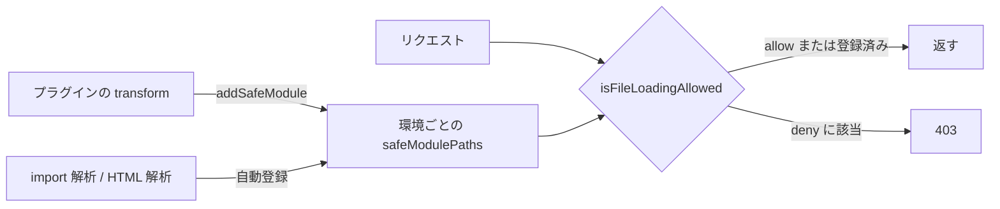

# 2026-11-13（金）

> 今日のひとこと：Vite の main に、dev サーバーの `server.fs.strict: 'extended'` と、プラグインが「安全なモジュール」を登録する `environment.addSafeModule` が入った。GHC 10.0.1-alpha2 と 9.14.2-rc3 が公開。新規の脆弱性は確認できず。

## 今日のリリース

- 【GHC】9.14.2-rc3：9.14 系のリリース候補3つ目（タグ `ghc-9.14.2-rc3` を確認。変更内容は読めていない。出典: https://github.com/ghc/ghc/releases ）
- 【GHC】10.0.1-alpha2：10.0 系のアルファ2つ目（タグ `ghc-10.0.1-alpha2` を確認。変更内容は読めていない。出典: https://github.com/ghc/ghc/releases ）

## トップニュース

### Vite の dev サーバーが、プラグインの `load` するモジュールにもアクセス制限をかけられるようになる

【Vite】`server.fs.strict` に `'extended'` が加わった。従来は `server.fs.allow` の外にあるファイルへの制限が中心だったが、これを有効にすると、プラグインが `load` するモジュールにも同じ検査をかける（ID が `\0` で始まる仮想モジュールは除く）。あわせて、プラグインが自分で足した参照を「安全」と登録する `environment.addSafeModule(id)` も入った。

**何が変わる**

- `server.fs.strict` の型が `boolean | 'extended'` になった（`packages/vite/src/node/server/index.ts`）。
- `isServerAccessDeniedForTransform` に `config.server.fs.strict === 'extended' ||` が足された。これまで `?raw`、`?url`、`?inline` などの特別なクエリに限っていた検査が、`'extended'` では全リクエストに及ぶ（`middlewares/transform.ts`）。
- 「安全なモジュールの一覧」`safeModulePaths` が、設定全体ではなく環境（`DevEnvironment`）ごとの持ち物になった（#23973）。
- プラグインは transform フック内で `this.environment.addSafeModule(id)` を呼ぶと、`server.fs.allow` の外でも、その ID を後から読めるようにできる。`server.fs.deny` は引き続き効く（ドキュメントより）。
- HTML から参照されるファイルや、import 解析で見つかる参照も、安全なモジュールとして登録する（#23168、#23169）。

**なぜ変えた**

- PR #23972 の本文は一行（「より多くのリクエストに検査を適用する」）だけで、動機は書かれていない。関連 Issue やアドバイザリのリンクもない。
- 推測：プラグインが `load` で返すモジュールは、これまで検査の外にあった。そこを塞ぐ流れの一環と思われる。10日の号の RCE アドバイザリ（仮想モジュール `__vite-browser-external`）とは別の変更で、結びつけた根拠は見つけていない。

**何に効く・誰が困る**

- `'extended'` を選ぶ人：プラグインが生成・参照するモジュールが、`allow` の外だと 403 になりうる。プラグインの作者は `addSafeModule` で登録する必要がある。
- 既定値は変わっていない（`true`）。既存のプロジェクトへの影響は、`'extended'` を選ばない限りない。

**ここまでの経緯**

- 2026-10-06：`server.fs` の外のファイルが露出するアドバイザリが複数公開。
- 2026-10-21：`server.fs.deny` がクエリで迂回されるアドバイザリ（GHSA-8g5g-mxqh-grgj）。
- 2026-11-02：#23972 が PR として開かれる（スタック #23170 の一部）。
- 2026-11-10：RCE アドバイザリ（GHSA-p4f5-76q4-ffq7）。[11-11の号](2026-11-11.md)
- 2026-11-12：#23168、#23169、#23972〜#23974 が main に入る。

出典: https://github.com/vitejs/vite/commit/e4babd7262256a3c5c383109eb7f7d489760faf5

## 今日の深掘り

### Vite の「安全なモジュール」は、環境ごとの許可リストになった

選んだ理由：dev サーバーのアクセス制御が、パスの規則だけでなく「誰が参照を足したか」という履歴を使う設計に寄っていく様子が、小さな差分で読めるため。

**背景**

- Vite の dev サーバーは、`/@fs/` 経由でディスクのファイルを返せる。そのため `server.fs.allow` / `deny` で範囲を絞っている。
- ただし、許可したファイルが import するファイルや、HTML が参照する画像は、`allow` の外にあっても返したい。そこで「import されたものは安全」と覚える仕組み（`SafeModulePaths`）がある。
- 問題は、プラグインが transform で足した参照だ。import 解析では見つからないので、覚えてもらえない。

**変更点**（コミット e0fe98a05、7480c5479）

1. `SafeModulePaths` は `addId` で ID を登録する。クエリ付きなら、クエリ付きの文字列とクエリを除いたパスの両方を入れる。テストでは `/foo/bar?raw` から `['/foo/bar?raw', '/foo/bar']` ができる。
2. 以前は `server.config.safeModulePaths` に1つだけあった。これを `DevEnvironment` のフィールドに移した。`client` と `ssr`（RSC なら `react-server` 環境も）で、許可の範囲が混ざらない。
3. プラグイン向けの入口として `addSafeModule(id)` を公開した。ドキュメントは「transform フックで参照を足すときに、同じフックで登録する」と求めている。

```ts
// ドキュメントの例（docs/guide/api-environment-plugins.md）
if (this.environment.mode === 'dev') {
  this.environment.addSafeModule(runtimeId)
}
return code.replaceAll('__RUNTIME_URL__', JSON.stringify(runtimeUrl))
```

**周辺コード**



`isFileLoadingAllowed` の本体は今回の差分に含まれないので、上の図の分岐はドキュメントの記述に基づく。

**この変更から分かる設計思想**

- 許可は「パスの一覧」だけでなく、「正当な参照の経路から来たか」で決める。
- 経路を知っているのはプラグインなので、登録をプラグインの責任にした。見つけられない参照は、黙って許すのではなく、登録を求める。
- 環境ごとに分けたのは、Vite 6 以降の「複数の環境を同時に持つ」設計に合わせたもの。

出典: https://github.com/vitejs/vite/commit/7480c547947d0b1dc519815d8f6f670964b15026

## 仕様の変更

### whatwg/html

#### パーサーが要素の子を読み終える時点が、仕様の用語として定義される

【HTML】要素が「開いている要素のスタック」から外れる場面（pop、`a` 開始タグ、`form` 終了タグ、adoption agency algorithm など）を、「finish parsing the children」としてまとめた。`style`、`audio`/`video`、`option`、`textarea` の記述を、各所に散らばっていた「popped off the stack のとき」から新しいフックに移した。新機能がこのフックに頼らないよう、警告も添えている。
なぜ変えたか：同じ種類の記述が散らばっていたのをまとめるため。#11781 を閉じる（コミットメッセージより）。
出典: https://github.com/whatwg/html/commit/c18a7c5

その他：

- `NavigateEvent` を abort するとき、navigation API の method tracker を bind する（[a386538](https://github.com/whatwg/html/commit/a386538)）
- `SharedWorker` の文字列オーバーロードで `SharedWorkerOptions` を使う（[a92b7eb](https://github.com/whatwg/html/commit/a92b7eb)）

動きなし：whatwg/fetch, whatwg/streams, whatwg/url, w3c/aria, w3c/ServiceWorker, tc39/proposals（editorial のみ：whatwg/dom、tc39/ecma262）

## OSSのPR

### Biome

#### 型推論が「フロー依存の絞り込み」を覚え始める

【Biome】型推論に、条件分岐による型の絞り込み（narrowing）の土台が入った（#12145）。続けて、ローカルに書いた型述語の呼び出し（#12146）と、単独のアサーション呼び出しのあと（#12147）でも絞り込むようになった。条件付き型と `infer` の束縛にも対応した（#12059）。
なぜ変えたか：PR本文までは読めていない。型を使う lint ルールの精度を上げる流れと思われる（推測）。
出典: https://github.com/biomejs/biome/commit/596a2b17fb

その他：

- nursery 以降の lint ルールを多数追加：`noMisusedSpread`、`noDynamicRequire`、`noTripleSlashReference`、`noTailwindRestrictedClasses`、`noLateCurrentTargetAccess`、`noConfusingArraySplice`、`usePackageJsonValidLicense`、Vue 向け3件（[#12904](https://github.com/biomejs/biome/pull/12904)、[#12924](https://github.com/biomejs/biome/pull/12924)、[#12893](https://github.com/biomejs/biome/pull/12893)、[#12838](https://github.com/biomejs/biome/pull/12838)、[#12907](https://github.com/biomejs/biome/pull/12907)、[#12966](https://github.com/biomejs/biome/pull/12966)、[#13020](https://github.com/biomejs/biome/pull/13020)、[#12545](https://github.com/biomejs/biome/pull/12545)、[#12964](https://github.com/biomejs/biome/pull/12964)、[#12965](https://github.com/biomejs/biome/pull/12965)）
- ローカル推論でオーバーロードを扱う修正（[#13123](https://github.com/biomejs/biome/pull/13123)）
- `useNullishCoalescing`、`useThisInClassMethods` の修正（[#12551](https://github.com/biomejs/biome/pull/12551)、[#13098](https://github.com/biomejs/biome/pull/13098)）

### Vite

#### dev サーバーの安全なモジュールまわりの機能がまとまって入る

【Vite】トップニュースと深掘りを参照。

その他：

- `environment.addSafeModule`、環境ごとの `safeModulePaths`、HTML・import 参照の登録（[#23974](https://github.com/vitejs/vite/pull/23974)、[#23973](https://github.com/vitejs/vite/pull/23973)、[#23169](https://github.com/vitejs/vite/pull/23169)、[#23168](https://github.com/vitejs/vite/pull/23168)）
- import 指定子と、CJS import の名前をエスケープ（[#24074](https://github.com/vitejs/vite/pull/24074)、[#24080](https://github.com/vitejs/vite/pull/24080)）
- 空の CSS ファイルを出力しない（[#24059](https://github.com/vitejs/vite/pull/24059)）
- 同じプロジェクトで動いているプロセスを表示（[#23624](https://github.com/vitejs/vite/pull/23624)）
- module runner のスタックトレースを V8 に合わせる（[#23690](https://github.com/vitejs/vite/pull/23690)）
- `execa` を `tinyexec` に置き換え（[#24079](https://github.com/vitejs/vite/pull/24079)）

### oxc

#### 型を使う lint ルール `no-misused-promises` に `flagUnions` が入る

【oxc】`no-misused-promises` に `flagUnions` オプションが加わった（#29380）。同じ変更が oxc-project/tsrs にも入っている（#988）。
なぜ変えたか：PR本文は読めていない。
出典: https://github.com/oxc-project/oxc/pull/29380

その他：

- パーサーの識別子ディスパッチのオーバーヘッドを削減（[#29347](https://github.com/oxc-project/oxc/pull/29347)）
- lexer に `Bitmap` 型を追加（[#29355](https://github.com/oxc-project/oxc/pull/29355)）
- NAPI を PGO（プロファイルに基づく最適化）付きでビルド（[#28411](https://github.com/oxc-project/oxc/pull/28411)）
- React Compiler：統合されたメモスコープで computed の依存を解決（[#29376](https://github.com/oxc-project/oxc/pull/29376)）
- パーサーのリスト・コンテキストのメソッドをモジュールに分離（[#29375](https://github.com/oxc-project/oxc/pull/29375)、[#29374](https://github.com/oxc-project/oxc/pull/29374)）
- linter のテスト解決を共通化するリファクタリング（#29324〜#29330）

### oxc-project/tsrs

#### リリースのバージョンを TypeScript に合わせる方針が入る

【TypeScript】リリースを TypeScript のバージョンに合わせる方式を採用した（#973）。自動の crate 公開も有効にした（#963）。リリース準備のワークフローも追加（#972）。
なぜ変えたか：README にある「TypeScript 7.1 に向けた安定版」を目指す流れと思われる（推測。コミット本文は方式の列挙のみ）。
出典: https://github.com/oxc-project/tsrs/commit/49d67fe4

その他：

- `no-misused-promises` に `flagUnions` を追加（[#988](https://github.com/oxc-project/tsrs/pull/988)）
- `--fast` のチェックでも PGO と BOLT を学習する（[#976](https://github.com/oxc-project/tsrs/pull/976)）
- wasm のウォッチモード拒否のテストを修正（[#971](https://github.com/oxc-project/tsrs/pull/971)）

### Next.js

#### Turbopack の永続キャッシュと集約まわりの変更が続く

【Next.js】Tobias Koppers による turbo-tasks / turbo-persistence への変更が目立つ。`turbo-persistence` の `batch_get` をコールバック型に変更（#100678）、親のない一時タスクを集約ルートにしない（#101614）、冗長な集約ルートとそのカスケード最適化を避ける（#101604）、コレクティブルの読み取りと依存の更新を原子的に行う（#101548）、など。
なぜ変えたか：PR本文は読めていない。大きなアプリでのスケールを見るベンチ（#101502）が同時に入っており、それに合わせた改善と思われる（推測）。
出典: https://github.com/vercel/next.js/pull/100678

その他：

- 全体の client スタイルグループを本番ビルドで早く始める（[#101612](https://github.com/vercel/next.js/pull/101612)）
- 一致しない兄弟を飛ばして app の loader tree を作る（[#101535](https://github.com/vercel/next.js/pull/101535)）
- プロジェクト終了直後に解放済みメモリを返す（[#101529](https://github.com/vercel/next.js/pull/101529)）
- NFT のベースパスのマッピングを最適化（[#101151](https://github.com/vercel/next.js/pull/101151)）
- `ImageResponse` の `--debug-prerender` での prerender を修正（[#101678](https://github.com/vercel/next.js/pull/101678)）
- `create-next-app` が、インストール失敗時に終了コード 1 を返す（[#101624](https://github.com/vercel/next.js/pull/101624)）
- ESLint のリンクルールを、定数・マップ由来の href に対応（[#101641](https://github.com/vercel/next.js/pull/101641)）
- React を `df6aa4ec-20261112` に更新（[#101673](https://github.com/vercel/next.js/pull/101673)）

### React

#### Flight が、ストリームの終端後に来る owner・スタック情報を無視する

【React】Server Components の Flight クライアントで、EOF のあとに owner やスタックの情報が欠けていても無視するようにした（#38233）。
なぜ変えたか：PR本文は読めていない。
出典: https://github.com/facebook/react/commit/df6aa4ec7

その他：

- DevTools の依存更新・整理（Ruslan Lesiutin による #38202〜#38224 の約20件）

### microsoft/TypeScript

その他：

- 遅延評価されるインデックスアクセス型を、永続的なアクセスフラグでキー付けする（[#65450](https://github.com/microsoft/TypeScript/pull/65450)）
- content mapper の登録に `include` の glob を許す（[#65047](https://github.com/microsoft/TypeScript/pull/65047)）

### ghc/ghc

その他：

- `TimerManager` が、評価済みのタイムアウトキューだけを公開する（[adc294d060](https://github.com/ghc/ghc/commit/adc294d060)。GitLab は読めず、コミットメッセージを根拠にした）
- GHC 8.2 以前で非推奨だったコマンドラインフラグを削除（[419f2a12d2](https://github.com/ghc/ghc/commit/419f2a12d2)）
- テストスイートの整理（IO Manager ごとのテスト修飾子など。件数のみ）

### scriptc

その他：コミットは約50件。`perf_hooks` の各クラス、`crypto.createMac`、`WeakRef`、`events.once`/`on`、`node:test` などの Node.js API 対応が中心（件数のみ。数字は自己申告）。

動きなし：tsc-ts、Svelte（docs のみで除外）

取得できず（今回は未確認）：solidjs/solid、vuejs/core、oven-sh/bun、wado-lang/wado、pingdotgg/ts-rust、w3c/csswg-drafts、w3c/wcag3、議論ウォッチの各対象。

## 脆弱性

新規のアドバイザリは確認できなかった。react、next、vite、svelte、vue、oxc、astro、nuxt、TanStack/router のアドバイザリ一覧を確認し、前回の実行（2026-11-12 07:19 JST）以降に公開されたものはなかった（直近は Vite の GHSA-p4f5-76q4-ffq7、11月10日）。
