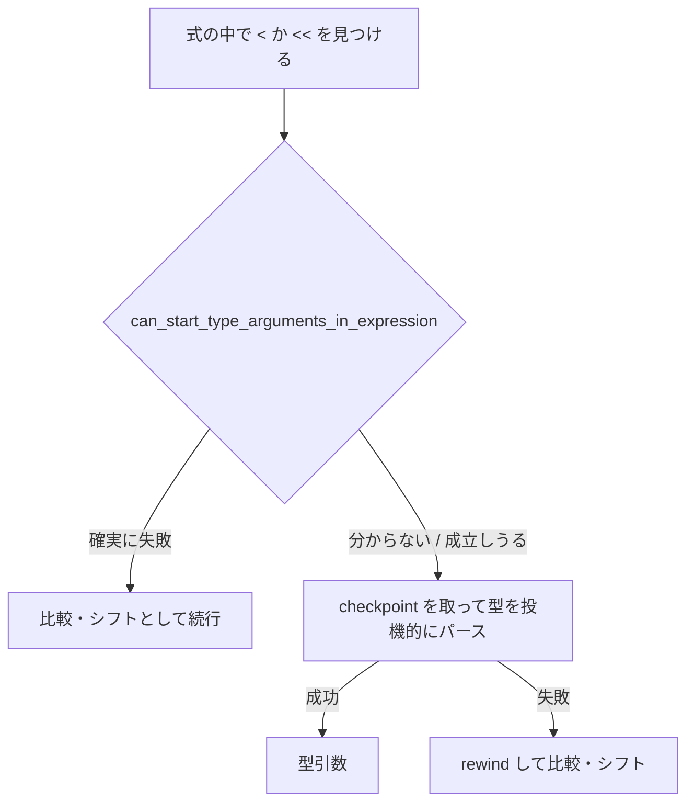

# 2026-11-15（日）

> 今日のひとこと：oxc のパーサーで、投機的パース（先読みして外れたら巻き戻す処理）を減らす perf の連続変更が入りました。新規の脆弱性は確認できませんでした。

## 今日のリリース

前回の実行（2026-11-14 07:20 JST）以降に公開された正式版・beta・rc のタグは確認できませんでした（cloneした各リポジトリのタグを日付で絞った結果。whatwg/streams、tc39/proposals、w3c/aria、w3c/ServiceWorker、w3c/wcag3、facebook/react、pingdotgg/ts-rust、vercel-labs/tsc-ts は `--shallow-since` のcloneに失敗し、深さ30で取り直した履歴で確認）。

## トップニュース

### oxc のパーサーが、先読みと投機的パースを減らす perf を重ねている

【oxc】`let`、`?.`、`<` まわりで「次のトークンを見てから判断する」処理を、トークンの再読み込みや巻き戻しを避ける形に書き直す一連のPRが main に入った（#29556〜#29560）。PR 本文は、これらを「パーサーの先読みと投機的パースを減らす5本のスタック」と位置づけている。

**何が変わる**

- 先読みで受理されたトークンを捨てずに保持し、却下されたときだけ巻き戻す（`eat_if_next`、#29558）。
- `let`、`?.` は、次のトークンを peek してから消費していた。今は1回の字句解析で済む（#29559）。
- TypeScript の `a < b` が比較演算子か型引数かを、文法から確実に失敗と分かる形ならチェックポイントを取る前に判定する（#29556）。
- 式の先頭の `(` や配列・オブジェクトリテラルで、アロー関数の投機を省く（#29557、#29560）。

**なぜ変えた**

- パース速度のため。PR 本文によれば、`checker.ts` で失敗した投機的パースは 312 回から 8 回に減った。

**何に効く・誰が困る**

- oxlint、oxfmt、transformer などパーサーに乗るツール全般。AST・診断・コメント・トークンは変わらない（PR 本文の検証による）。
- 速度の数字は PR 本文の自己申告で、macOS arm64 での命令数。改善は 0.01〜0.5% 程度と小さい。

**ここまでの経緯**

- 2026-11-08：1日に十数本の parser/lexer perf が入る（[11-08の号](2026-11-08.md)）。
- 2026-11-09：lexer の SIMD 層が `oxc_simd` として独立（[11-09の号](2026-11-09.md)）。
- 2026-11-14：今回のスタック。lexer 側では Shanon Jackson による unsafe を減らすリファクタリング（#29565〜#29581）も並行して進んでいる。

出典: https://github.com/oxc-project/oxc/pull/29556 、https://github.com/oxc-project/oxc/pull/29559

## 今日の深掘り

### 型引数か比較演算子か：`a < b` を文法から先に判定する

選んだ理由：TypeScript の「`<` は型引数かもしれない」という曖昧さを、パーサーがどう扱うかが分かる題材のため。

**背景**

- TypeScript では `f<T>(x)` の `<` は型引数の開始、`i < items.length` の `<` は比較演算子で、見た目が同じ。
- そのため `parse_type_arguments_in_expression` は、チェックポイントを取って型として読んでみて、失敗したら巻き戻す、という投機的パースをしていた。比較演算子のたびに、型の構築と診断の生成が無駄になる。

**変更点**（コミット 85c0269f7、#29556）

- 投機の前に `can_start_type_arguments_in_expression` を挟む。字句解析だけを進めて判断し、字句の状態は戻す。

```rust
let checkpoint = self.lexer.checkpoint();
let first = self.lexer.next_token().kind();
let can_start = if self.at(Kind::ShiftLeft) {
    self.can_start_type_parameters_after(first)
} else {
    self.can_start_type_argument_after(first)
};
self.lexer.rewind(checkpoint);
```
（`crates/oxc_parser/src/ts/types.rs`、コミット 85c0269f7）

- 型引数が名前・リテラル・`this` で始まるなら、その後ろは `.` で続く名前、または `,` `>` `[` `&` `|` `extends` `is` などでなければ型としては成立しない。`a < b;` や `a < b.c)`、`a < 0 &&` はここで確実に失敗と分かる。
- 分からない形は、これまでどおり投機的パースに任せる。判定は「確実に失敗するときだけ false」という片側の近道。

**周辺コード**



- 同じ考え方で #29559 は `let` と `?.` の「ほぼ必ず成立する」側を速くした。`eat_if_next` は、条件が成立したらそのトークンを保持し、不成立のときだけ巻き戻す。

```rust
let is_declaration = self.eat_if_next(|next| { /* `let` の後に束縛が続くか */ });
```
（`crates/oxc_parser/src/js/declaration.rs`、コミット 7a6b0a44a）

**この変更から分かる設計思想**

- 「ほぼ必ずこちら」という偏りのある分岐では、多数派を最短経路にして、少数派のときだけ巻き戻す。
- 近道は文法の規則から導かれたものだけに限り、迷う形は元の経路に残す。そのため出力は変わらない。PR 本文は、コードの検証として 873,558 件のファイル×設定の結果が `main` と一致したと書く（自己申告）。
- 代償もコードに書かれている。判定は `parse_non_array_type` などと「歩調を合わせ続けなければならない」とコメントされており、型の文法を変えるとここも直す必要がある。

出典: https://github.com/oxc-project/oxc/pull/29556 、https://github.com/oxc-project/oxc/pull/29559

## 仕様の変更

### w3c/csswg-drafts

#### css-gaps-1 に、grid-lanes の整列後の rule visibility が定義される

【CSS】grid-lanes で要素を揃えた後に、gap の rule をどこに描く／描かないかの定義が加わった（#14780、Fixes #14489）。詳細は未読。
出典: https://github.com/w3c/csswg-drafts/commit/c94587b0

その他：

- css-color-5：相対色の `none` 参照のスコープ整理、グレースケール結果の訂正（コミット [7844b413](https://github.com/w3c/csswg-drafts/commit/7844b413)、[7e94ebd4](https://github.com/w3c/csswg-drafts/commit/7e94ebd4)。内容は未読で editorial かどうかは未確認）

除外（editorial）：whatwg/html の3件（`<base>` の href getter、イベントストリームの例、tel-national の説明）、whatwg/dom の2件、whatwg/url の2件、whatwg/fetch の1件（いずれもコミットメッセージが `Editorial:`）。
動きなし：tc39/ecma262。whatwg/streams, tc39/proposals, w3c/aria, w3c/ServiceWorker, w3c/wcag3 は取り直した浅い履歴にコミットがなく、動きなしと推定（確認は不十分）。

## OSSのPR

### oxc

注目は上のトップニュースと深掘りで扱った parser perf。

その他：

- lexer のリファクタリング（unsafe を減らし、checked な型に置き換える）が約30本（例 [#29565](https://github.com/oxc-project/oxc/pull/29565)、[#29581](https://github.com/oxc-project/oxc/pull/29581)）
- linter：`--print-config` が CLI オプション（`--type-aware` など）と JS プラグイン設定を反映するようになる一連の変更（[#29531](https://github.com/oxc-project/oxc/pull/29531)〜[#29538](https://github.com/oxc-project/oxc/pull/29538)）
- linter：`exhaustive-deps` が custom ref の `ref.current` メソッド呼び出しを見逃す問題を修正（[#29571](https://github.com/oxc-project/oxc/pull/29571)）
- napi/parser：ネイティブのパース結果を早めに解放（[#29569](https://github.com/oxc-project/oxc/pull/29569)）
- semantic：catch と var の束縛の同一性を保持（[#28739](https://github.com/oxc-project/oxc/pull/28739)）
- 一覧は先頭45件までを確認。それ以降は未確認

### Biome

#### lint ルールが一度に十数個追加される

【Biome】Vue（`noVueAsyncComputed`、`noVueExportInScriptSetup`、`noVueDeprecatedFilter`、`useVueConsistentVOnHandlerStyle`）、YAML（`noYamlEmptyMapKeys`、`noYamlEmptyMapValues`、`noYamlEmptySequenceEntries`）、テスト系（`useSpyOn`、`useCalledWith`、`useExpectToHaveBeenCalled`、`useExpectToHaveBeenCalledTimes`）、Node 系（`noBufferConstructor`、`useTopLevelRequire`）、`useValidNamespaceImports` が入った。多くは他ツールのルールの移植に見えるが、元のルール名は未確認。
なぜ変えたか：不明（PR 本文は未読）。
出典: https://github.com/biomejs/biome/pull/12561 ほか（#12580、#13054、#13058〜#13063、#13075〜#13082）

その他：

- 抑制コメントのトークン走査を、抑制コメントのないファイルで省略（[#12932](https://github.com/biomejs/biome/pull/12932)）
- `noRedeclare` が束縛ノードをクエリ位置の近くから探す（[#12935](https://github.com/biomejs/biome/pull/12935)）
- HTML/Svelte フォーマット：抑制された最初の子の前のコメントの二重出力、ブロック区切り後のコメントを修正（[#13189](https://github.com/biomejs/biome/pull/13189)、[#13181](https://github.com/biomejs/biome/pull/13181)）
- class field 初期化子での `this` エイリアスを保持（[#13162](https://github.com/biomejs/biome/pull/13162)）
- Tailwind のクラスを引用符なしのオブジェクトキーで正しく検出（[#12845](https://github.com/biomejs/biome/pull/12845)）
- プラグインの診断にも抑制アクションを出す（[#12602](https://github.com/biomejs/biome/pull/12602)）

### Next.js

#### Turbopack が最小化後のコードでチャンクを分割する設定が canary で既定オンになる

【Next.js】`turbopackMinifyBeforeChunking` が canary で既定有効になった（#101113）。チャンクの大きさを最小化後のコードで見積もる #101010 の続き。詳細（見積もりの精度など）は PR 本文を未読。
なぜ変えたか：不明（PR 本文は未読）。
出典: https://github.com/vercel/next.js/pull/101113

その他：

- Turbopack：クライアント参照マニフェストを小さく速く書く（[#101312](https://github.com/vercel/next.js/pull/101312)）
- turbo-persistence：読み取り専用で開くときにディレクトリを変更しない（[#101779](https://github.com/vercel/next.js/pull/101779)）
- turbo-tasks-backend：keyed refinement で reader 側の前に owner task を解放（[#101732](https://github.com/vercel/next.js/pull/101732)）、`inline_atom` の最適化（[#101778](https://github.com/vercel/next.js/pull/101778)）
- `next dev` で管理されたエージェント向け指示を生成し、オプトアウトを尊重（[#101746](https://github.com/vercel/next.js/pull/101746)）
- `next/image`：LCP 要素の読み込み状態を確認（[#101737](https://github.com/vercel/next.js/pull/101737)）
- レンダーのエラー報告を work-unit スコープの外で実行（[#101597](https://github.com/vercel/next.js/pull/101597)）
- 一覧は主要な件のみ確認

### Vite

動きなし（最新コミットは 2026-11-13 の #24075 など、前回の号で扱い済み）。

### TypeScript

その他：Jake Bailey による修正7件。例：mapper リクエストをホスト終了待ちの前にキャンセル（[#65492](https://github.com/microsoft/TypeScript/pull/65492)）、型付き emit のパスを file ごとのトレーススレッドへ（[#65468](https://github.com/microsoft/TypeScript/pull/65468)）、基底型のインスタンス化中に宣言メンバーを読む（[#65479](https://github.com/microsoft/TypeScript/pull/65479)）、分散（variance）診断のコンテキストを復元（[#65466](https://github.com/microsoft/TypeScript/pull/65466)）。

### Bun

`bun check` と `bun fmt` に関わるPRは、一覧から確認できなかった（コミット一覧はランタイムの内部実装ばかりで、対象外）。

### vercel-labs/scriptc

#### v0.4.13 の準備が入る（リリースタグは未確認）

【TypeScript】`Prepare v0.4.13`（コミット c266a1fd4）が main に入った。クラスの変換・静的メンバー・prototype 反映、import 循環の束縛、child_process、DNS クエリ id のランダム化などの互換性修正が中心。数字は自己申告で確認していない。タグは cloneで見えず、リリースページは未確認。
出典: https://github.com/vercel-labs/scriptc/commit/c266a1fd4

その他：テストレーンを30分割（[#3629](https://github.com/vercel-labs/scriptc/pull/3629)）ほか、細かい修正が多数（件数のみ）。

### ghc/ghc

その他：`ghc -M` に `-dep-json` と複数 home unit の対応を追加し `doMkDependHS` を非推奨に（fendor。コミット [7ece99a741](https://github.com/ghc/ghc/commit/7ece99a741)、[0f6e0146b8](https://github.com/ghc/ghc/commit/0f6e0146b8)、[5598e6a0f7](https://github.com/ghc/ghc/commit/5598e6a0f7)）。クロスコンパイル向けに Stage3 の bindist を追加（#26924、[9ad25cb2b5](https://github.com/ghc/ghc/commit/9ad25cb2b5)）。rts の `getRtsSymbols()` の公開とテストまわりの整理（[39f2943eda](https://github.com/ghc/ghc/commit/39f2943eda)）。

### wado-lang/wado

注目は選別せず件数のみ：コンパイラの trait の `Self` の解決（参照 impl の static の選択、default の `Self`）の修正が多数。`core:icu` の simple case mapping と、正規表現の `i` 修飾子対応（`feat(re)`、`feat(core:icu)`）が入った。コミットの大半は `Claude` 名義の自動作業。`docs/wep-*.md` の動きは未確認。

### Svelte

その他：ドキュメントのコードブロックの構文修正のみ（[#19263](https://github.com/sveltejs/svelte/pull/19263)）。

動きなし：facebook/react（取り直した履歴で確認）、solidjs/solid（docs のみ）、vuejs/core `minor`（`--shallow-since` で fetch、コミットなし）、oxc-project/tsrs（最新は 11-13 の #989 で前回の号で扱い済み）、vercel-labs/tsc-ts（最新は v0.1.5、11-11）、pingdotgg/ts-rust（最新は 10-28）。

## 議論ウォッチ

取得できず（今回の号では、WICG、standards-positions、TC39 のノート、各 RFC・Discussions を確認していない。実行時間の都合で未実施）

## 脆弱性

新規は確認できなかった。アドバイザリ一覧の1ページ目を確認し、公開日が 2026-11-14 以降のものはなかった。

- vite：最新は GHSA-p4f5-76q4-ffq7（2026-11-10、前々日の号で扱い済み）
- next.js：最新は 2026-11-03（8ページ中の1ページ目のみ確認）
- astro：最新は 2026-11-09（6ページ中の1ページ目のみ確認）
- nuxt：最新は 2026-11-02（5ページ中の1ページ目のみ確認）
- TanStack/router：最新は 2026-09-30（全3件）
- react、svelte、vuejs/core、oxc：取得せず（今回は確認していない）
