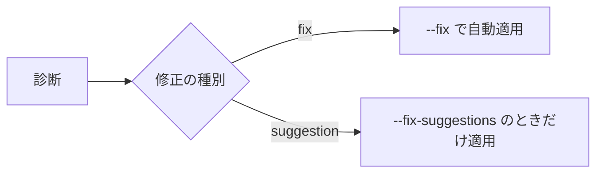

# 2026-11-16（月）

> 今日のひとこと：oxlint が「安全な自動修正（`--fix`）」を見直し、実行時の観測可能な出力が変わる書き換えを提案（suggestion）へ降格する修正を一斉に入れました。Solid 2.0 は rc.22、Biome は 2.6.8 が公開されました。新規の脆弱性は確認できませんでした（確認範囲は脆弱性の節）。

## 今日のリリース

前回の実行（2026-11-15 07:17 JST）以降に公開された正式版・beta・rc。

- 【Biome】2.6.8：Vue・YAML・テスト系の nursery ルール追加、条件型（`infer`、union の分配）の型推論の改善、lint の高速化（自己申告で大規模プロジェクト 3〜5%）（出典: https://github.com/biomejs/biome/releases/tag/%40biomejs%2Fbiome%402.6.8）
- 【Solid】2.0.0-rc.22（`solid-js`、`@solidjs/web` ほか。`next` ブランチ）：Context Provider が専用の owner を作らなくなった、`FlushEvent.changes` で描画の変更要因を追える、リスト更新で `moveBefore()` を使う（出典: https://github.com/solidjs/solid/releases）
- 【TypeScript】scriptc v0.4.14（2026-11-14 CST 公開。タグ日付は前回の実行より前のため参考）。v0.4.15 は「Prepare」コミット（3431b30a2）のみ確認でき、タグは未確認

## トップニュース

### oxlint が「安全な修正」の基準を締め直し、出力が変わる修正を suggestion に降格する

【oxc】oxlint の `--fix` が行う書き換えのうち、実行時に観測できる挙動（`RegExp.prototype.source` の文字列など）を変えうるものを、`--fix-suggestions` でだけ適用される suggestion に降格するPRが、11-15 に連続して main に入った（#29493〜#29512 ほか）。

**何が変わる**

- 例：`eslint/no-div-regex` は `/=x/` を `/[=]x/` に書き換えていた。マッチ結果は同じだが `re.source` と `toString()` の出力が変わるため、suggestion へ（#29493）。
- 同様の降格は `no-regex-spaces`、`no-new-wrappers`、`jest/prefer-to-be`、`typescript/ban-ts-comment` 系の `@ts-ignore` 書き換え、`jsx-a11y/no-aria-hidden-on-focusable` など十数ルールに及ぶ。
- 逆方向の修正もある。`no-var` は `let`/`const` に変えると挙動が変わる場合に修正を出さない（#29590）。

**なぜ変えた**

- 通常の `--fix` は「プログラムの観測可能な出力を変えない」ことが前提のため。#29493 のPR本文は、`--fix` の後に `node` で実行した出力が変わらないことを再現手順つきで示している。
- 個々のPRは自動化されたトリアージ用ボット（`oxc-captain[bot]`）が生成し、別のAIがレビュー・検証したとPR本文に明記されている。

**何に効く・誰が困る**

- CI で `oxlint --fix` を回している人。今まで自動で直っていた箇所が、診断として残り終了コード 1 になる場合がある。
- 明示的に直したい人は `--fix-suggestions` を使う。

**ここまでの経緯**

- 2026-11-15：パーサーの投機的パースを減らす perf スタックが入る（[11-15の号](2026-11-15.md)）。
- 2026-11-15（UTC）：今回の降格PR群が main に入る。#29493 の追加PR #29522（挙動を変える書き換えを suggestion にし、元の構文を保つ）は draft のまま。

出典: https://github.com/oxc-project/oxc/pull/29493 、https://github.com/oxc-project/oxc/pull/29501

## 今日の深掘り

### 「安全な修正」とは何か：oxlint の fix と suggestion の境界

選んだ理由：リンタの自動修正が「何を保証するか」を、コードの1行の差（`fix` → `suggestion`）から読めるため。

**背景**

- リンタの修正には段階がある。`--fix` は安全なものだけ、`--fix-suggestions` は利用者が確認する前提のもの、とoxlintは分けている（#29493のPR本文による）。
- 「安全」の定義が曖昧だと、`/=x/` → `/[=]x/` のように「マッチは同じだが `source` が変わる」書き換えが紛れ込む。Issue #29462 がこれを指摘した。

**変更点**（コミット 994ddc331、#29493）

ルールの宣言と、診断の出し方が1語ずつ変わるだけ。

```diff
 declare_oxc_lint!(
     NoDivRegex,
     eslint,
     restriction,
-    fix,
+    suggestion,
 ...
-    ctx.diagnostic_with_fix(no_div_regex_diagnostic(lit.span), |fixer| {
+    ctx.diagnostic_with_suggestion(no_div_regex_diagnostic(lit.span), |fixer| {
```

出典: `crates/oxc_linter/src/rules/eslint/no_div_regex.rs`（コミット 994ddc331）

**周辺コード**

- `declare_oxc_lint!` の第4引数が、そのルールの修正の種別（`fix` / `suggestion` など）をドキュメントと挙動の両方に載せる。ここまでは diff から読めた範囲で、マクロの内部は読んでいない（未確認）。



**この変更から分かる設計思想**

- 「同じ意味」では足りず、「観測可能な出力が同じ」を基準にしている。`source` のような反射（reflection）まで含める厳しい定義。
- 基準を人手で点検するのでなく、再現手順つきのPRを大量に作って締め直している。PR本文の `Co-authored-by` やAI支援の注記から、この運用が自動化されていることが分かる。

## 仕様の変更

### whatwg/dom

#### `getElementsByClassName()` の記述が、一致の向きを正しく言い直される

【DOM】アルゴリズムの文言が「要素のクラスが引数のクラスの部分集合」と読める書き方だったのを、「要素のクラスが引数のすべてを含む」に直した。実際の挙動は変わらず、仕様の記述を意図に合わせる修正。
なぜ変えたか：コミットメッセージによれば、既存の文言が逆向きの部分集合関係を述べていたため。
出典: https://github.com/whatwg/dom/commit/e4f4f4f

### w3c/csswg-drafts

- `css-overflow-4` のサブタイプの構文を修正（コミット 51852294、https://github.com/w3c/csswg-drafts/commit/51852294）

動きなし：whatwg/html, whatwg/fetch, whatwg/streams, whatwg/url, tc39/proposals, tc39/ecma262, w3c/aria, w3c/ServiceWorker, w3c/wcag3

## OSSのPR

### oxc

トップニュースと深掘りで扱った降格PR群のほか、前回以降に約45件。

#### minifier が未使用のラベルを削除する

【oxc】`feat(minifier): remove unused labels`（#29607）。参照されないラベル（`foo: { ... }` の `foo`）を落とす。
なぜ変えたか：不明（PR本文は未確認）。
出典: https://github.com/oxc-project/oxc/pull/29607

その他：

- `jsx-a11y/lang` が lang 属性なしを報告しないよう修正（[#29441](https://github.com/oxc-project/oxc/pull/29441)）
- `no-useless-escape` の修正を suggestion に降格（[#29508](https://github.com/oxc-project/oxc/pull/29508)）
- `react/rules-of-hooks` が名前空間付きの追加 effect フックに一致するよう修正（[#29517](https://github.com/oxc-project/oxc/pull/29517)）
- `no-accumulating-spread` が index や array を取る reduce コールバックも検査（[#29573](https://github.com/oxc-project/oxc/pull/29573)）
- `print config` の出力から冗長な extends を除去（[#29585](https://github.com/oxc-project/oxc/pull/29585)）
- 残りは linter の修正の安全性まわりの修正（`no-var`、`prefer-at`、`curly`、`import/no-duplicates` など）と依存更新

### Biome

#### テスト系 lint ルールが一括で追加される

【Biome】`noTestGlobals`、`noTestHooks`、`noJasmineGlobals`、`noReturnInTest`、`useTopLevelDescribe`、`useExpectToHaveLength`、`useExpectToStrictEqual` など（#13091〜#13122）に加え、`noUselessNestedTernary`、`noUselessSetConstruction`。
なぜ変えたか：不明（PR本文は未確認）。
出典: https://github.com/biomejs/biome/pull/13122

その他：

- 分割代入のデフォルト値を束縛の型に反映（[#12548](https://github.com/biomejs/biome/pull/12548)）
- import phase 修飾子が呼び出しなしのときにパニックしないよう修正（[#13180](https://github.com/biomejs/biome/pull/13180)）

### Next.js

- Turbopack: collectibles の依存先を EdgeSet に保存（[#101766](https://github.com/vercel/next.js/pull/101766)）
- turbo-persistence: 中間マージで使用中のキーを保持（[#101796](https://github.com/vercel/next.js/pull/101796)）
- turbo-persistence: ブロック長をCRCに含める（[#100322](https://github.com/vercel/next.js/pull/100322)）
- `next typegen`/`next build` で古い `.next/dev/types` を削除（[#100612](https://github.com/vercel/next.js/pull/100612)）
- deployment id を条件付きで足すコード生成を簡素化（[#101785](https://github.com/vercel/next.js/pull/101785)）

### Solid（`next` ブランチ）

#### HTML のパーサーが書き換えた不正なネストを、ハイドレーションで名指しする

【Solid】`<tr>` が暗黙の `<tbody>` に移される、などブラウザのパーサーが構造を直した場合に、ハイドレーション時に `INVALID_HTML_NESTING` を出す（#4898）。dev ではテーブル行の移動への警告も追加（#4895）。
なぜ変えたか：サーバー出力とブラウザの DOM がずれる原因を、利用者が特定できるようにするため（推測。PR本文は未確認）。
出典: https://github.com/solidjs/solid/pull/4898

その他：signals まわりの修正が約10件（#4876〜#4905）。例：レーンの葉の初期化扱い（[#4876](https://github.com/solidjs/solid/pull/4876)）、reorder の推測の再基準化（[#4900](https://github.com/solidjs/solid/pull/4900)）、`resetErrorHalt` で effect 例外後にスケジューリングを再開（[#4884](https://github.com/solidjs/solid/pull/4884)）。web 側は選択済み `<option>` の描画時マーク（[#4901](https://github.com/solidjs/solid/pull/4901)）、SSR のプール済み owner がコンテキストを持ち越さない修正（[#4899](https://github.com/solidjs/solid/pull/4899)）。

### TypeScript 周辺

- 【TypeScript】vercel-labs/scriptc：v0.4.14 を公開、JSDoc 型の外に書かれた値の保持（[#3651](https://github.com/vercel-labs/scriptc/pull/3651)）、promise executor の `resolve()` を引数なしで受理（[#3652](https://github.com/vercel-labs/scriptc/pull/3652)））。ほか docs とCIの変更。数字・対応範囲は自己申告
- 【oxc】oxc-project/tsrs：依存更新のみ（[#997](https://github.com/oxc-project/tsrs/pull/997)）

### Bun（`bun check`）

- `bun check`：名前付きファイルのグローバルの扱いを修正、`--no-follow-imports` を追加（[#48790](https://github.com/oven-sh/bun/pull/48790)）

### Svelte

- エージェント向けに「より良いテストを書く」ガイドを更新（[#19269](https://github.com/sveltejs/svelte/pull/19269)）

### Wado

前回以降に約83件。`docs/wep-*.md` の変更は、「Re」WEP の DFA の上限とキャッシュの説明（762edad6d9）、静的呼び出しのレシーバを identity として扱う（d5779a944c）。それ以外は件数のみ。

動きなし：facebook/react, vitejs/vite, microsoft/TypeScript, pingdotgg/ts-rust, vercel-labs/tsc-ts, vuejs/core（minor）, solidjs/solid（main）, ghc/ghc

## 脆弱性

新規のアドバイザリは確認できなかった。確認したリポジトリの最新の公開日：

- vercel/next.js：2026-11-03（それ以降なし）
- vitejs/vite：2026-11-10（それ以降なし）
- withastro/astro：2026-11-09（それ以降なし）
- nuxt/nuxt：2026-11-02（それ以降なし）
- TanStack/router：2026-09-30（それ以降なし）
- facebook/react、sveltejs/svelte、vuejs/core、oxc-project/oxc：取得できず（今回の実行では確認しなかった）
