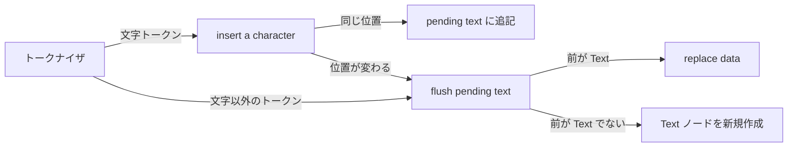

# 2026-11-17（火）

> 今日のひとこと：HTML Standard に `<input type="checkbox" switch>` が入り、2018年の Issue #4180 から約8年でスイッチ部品が仕様になりました。oxlint 1.94.0 が出て、Solid 2.0 は rc.23 に進み、安定版（2.0.0）へ向けて「RCの文言を外す」準備が main に入りました。新規の脆弱性は確認できませんでした（確認範囲は脆弱性の節）。

## 今日のリリース

前回の実行（2026-11-16 07:17 JST）以降に公開された正式版・beta・rc。

- 【oxc】oxlint v1.94.0：`--rules` の JSON に recommended フラグを出力、`no-misused-promises` に `flagUnions` オプション、`vue/no-shared-component-data` の fixer など。11-16 の号で扱った「出力が変わる修正を suggestion に降格」も同梱（出典: https://github.com/oxc-project/oxc/releases/tag/oxlint_v1.94.0）
- 【oxc】oxfmt v0.79.0：Prettier 3.10.1 に追従、GraphQL の空の selection set に対応、括弧つき `TSInstantiationExpression` の修正（出典: https://github.com/oxc-project/oxc/releases/tag/oxfmt_v0.79.0）
- 【Vite】v8.4.0-beta.1：リリースコミットのみ確認。本文は未確認（出典: https://github.com/vitejs/vite/releases/tag/v8.4.0-beta.1）
- 【Solid】2.0.0-rc.23（`solid-js`、`@solidjs/signals`、`@solidjs/web` ほか。`next` ブランチ）：リアクティブな spread が falsy のとき空の spread として扱われる、楽観的リストのリベース時に借用中の行を保つ、など signals・compiler の修正が中心。リリース本文は未確認で、同日の `next` のコミットから推測（出典: https://github.com/solidjs/solid/releases ）
- 【TypeScript】tsrs 7.1.0-beta.tsrs2（oxc-project/tsrs）：リリース準備コミットを確認。変更点の詳細は未確認（出典: https://github.com/oxc-project/tsrs/releases/tag/v7.1.0-beta.tsrs2）

## トップニュース

### HTML に「スイッチ」部品が入る：`<input type="checkbox" switch>`

【HTML】whatwg/html の main に、`type=checkbox` の `input` に `switch` 属性を付けると「2状態のスイッチ部品」になる変更が入った（11-16）。2018年11月に立った Issue #4180 が、同日クローズされた。

**何が変わる**

- `switch` は真偽属性。IDL では `HTMLInputElement.switch`（`Reflect`）が増える。
- スイッチでは `indeterminate`（どちらでもない状態）が効かなくなり、見た目も「on/off の2状態」になる。仕様の文面は、トラックに沿ってつまみ（thumb）をドラッグできることも述べている（コミット 9f0e398 の差分）。
- アクセシビリティ上は、ARIA の `switch` ロールに対応する扱い。対応表（html-aria / html-aam）に「switch 属性ありのチェックボックス」の行が足された。
- `type` の表の「期待される見た目」が "A checkbox" から "A checkbox or switch" になった。

**なぜ変えた**

- Issue #4180 の議論から読めること：モバイルでチェックボックスは当たり判定が小さく、CSS で作るスイッチはアクセシビリティの実装がばらつく。2018-11-19 の発案時は `type=switch` だったが、同日 annevk が「見た目だけの違いなら `appearance`」と返し、翌日には ARIA の `switch` ロールがあることから「意味が違うので属性（マークアップ）で表す」方向に寄った。
- 新しい `type` を足さず `checkbox` の拡張にしたのは、`switch` を知らないブラウザでも普通のチェックボックスとして動く（プログレッシブエンハンスメント）ため、と読める（議論からの推測を含む）。

**何に効く・誰が困る**

- デザインシステムの Toggle/Switch 部品を `role="switch"` ＋ JS で作っていたチーム。ネイティブに寄せる選択肢が仕様上できる。
- 仕様が入っただけで、各ブラウザの出荷状況はこのページからは分からない。実装状況は不明。

**ここまでの経緯**

- 2018-11-19：Issue #4180 が立つ（当初は `<input type=switch>`）。
- 2018-11-20：ARIA `switch` ロールとの対応を議論。`type=checkbox switch` の形が出る。
- 2024-11：CSSWG 側の未解決 Issue（csswg-drafts #10039 など）が前進のボトルネックとして挙げられる。
- 2026-07-23：stage 1（Incubation）に。2026-08-20：PR #9546 が「マージ可能」と annevk が言及。
- 2026-11-16：コミット 9f0e398 で main に入り、#4180 クローズ。WPT のテストは wpt#42449、#43048、#65016 が紐づく。

出典: https://github.com/whatwg/html/issues/4180 、https://github.com/whatwg/html/commit/9f0e398187ffda304a6bfc70c473ed05da723335

## 今日の深掘り

### HTML パーサーが文字を「溜めてから」DOM に流すようになる：pending text

選んだ理由：HTML パーサーの「1文字ずつ Text ノードに足す」という素朴な記述を、実装の実態に合わせて直した変更で、仕様がブラウザの最適化をどう取り込むかが読めるため。

**背景**

- Issue #12744（domenic、2026-08-01）：仕様の "insert a character" は、直前が Text ノードならその data に文字を直接足していた。文字どおり実装すると DOM の「children changed steps」が走らず、パーサーが途中で止まったときに `textarea` の raw value が追従しない問題が出る。
- DOM の "replace data" を使えば直るが、MutationObserver が発火してしまう。実際のブラウザは連続する文字をまとめて1回で入れるので、`characterData` のレコードは1文字ごとにはならない。
- そこで「溜める → まとめて replace data」を仕様に書く方針が、noamr と annevk の間で固まった（Issue の議論による）。

**変更点**（コミット 61a2f78、`source`）

パーサーに `pending text`（挿入位置と文字列のタプル、初期値は null）が増える。

```html
<li><p>If the parser's <span>pending text</span> is null, then set the parser's
<span>pending text</span> to (<var>insertionLocation</var>, <var>data</var>).</p></li>
<li><p>Otherwise, append <var>data</var> to the parser's <span>pending text</span>'s data.</p></li>
```

- 文字を挿入するアルゴリズムは、挿入位置が前回と違うなら先に flush し、そうでなければ文字列に追記するだけになる。
- 新しい "flush pending text" が、直前の兄弟が Text なら `replace data`（末尾に長さ0で挿入）、そうでなければ Text ノードを新規作成する。
- flush のタイミング：文字トークン以外のトークンが来る前（tree construction dispatcher）、要素を作る前、Text insertion mode を抜けるとき、ネットワークの各タスクの終わり、`document.write()` の処理後、パーサーを止めるとき、フラグメント解析の終わり。

**周辺コード**



- `replace data` は DOM 側のアルゴリズムで、ここで children changed steps と MutationObserver のレコードが1回分だけ生まれる。

**この変更から分かる設計思想**

- 仕様は「観測できる挙動」を決めるもので、内部の最適化は自由、というのが従来の立場。ただし「中間状態が観測できる」箇所（MutationObserver、`textarea` の値）では、実装の事実を仕様に書き戻す必要がある。
- 今回は「文字を溜める」という実装側の工夫を、そのまま仕様の状態（pending text）として持ち込んだ。flush 点の一覧が、観測できる境界の一覧にもなっている。

出典: https://github.com/whatwg/html/commit/61a2f78025e7ac78849c172d276f132d9f2fe8a3 、https://github.com/whatwg/html/issues/12744

### oxc のパーサーが `(…)` を一度だけ読む：cover grammar への切り替え

選んだ理由：アロー関数の判定という JS パーサー最大の曖昧さを、「先読みして読み直す」から仕様どおりの cover grammar に変えた例だから。

**背景**

- `(a, b)` は式の括弧かもしれず、`=> ` が続けばアロー関数の引数。`=>` を見るまで決められない。
- これまでは先読みの走査で判定してから、もう一度パースしていた（PR本文の説明）。

**変更点**（#29603、a1ed5af94）

- `CoverParenthesizedExpressionAndArrowParameterList` と `CoverCallExpressionAndAsyncArrowHead` に沿って、`( … )` を一度だけ読む。未確定の要素は arena 上の cover stack に積む。
- `=>` が来たら ArrowFormalParameters に「精製」し、来なければ ParenthesizedExpression か呼び出しの引数にする。
- TypeScript の注釈（`:`、`?:`、修飾子）が出たら、その時点で引数だと確定する。`async(…)` は `await` が出たときだけ読み直す。

**周辺コード**

- 同じ日に Boshen が lexer のトークン処理を作り直す7本のスタック（#29617〜#29623）を入れている。#29617 の本文によれば、63,739 の実ファイルのパースで命令数が10.8%、CPU サイクルが5.6%減る（PR本文の自己申告）。
- 方法は、`next_token` が空白1つを飛ばして1バイトのトークンをその場で完成させ、残りは256エントリの第2のテーブル（token handler）に渡す、というもの。

**この変更から分かる設計思想**

- 仕様にある曖昧さの名前（cover grammar）をそのままコードの構造にすると、「やり直し」を消せる。
- 速度は、よくある経路（直前のトークンのすぐ後ろ）だけを短くする、という発想で稼いでいる。

出典: https://github.com/oxc-project/oxc/pull/29603 、https://github.com/oxc-project/oxc/pull/29617

## 仕様の変更

### whatwg/html

#### `<input type=checkbox switch>` と pending text

トップニュースと今日の深掘りで扱った。

その他：

- 履歴ナビゲーションの終了時に、関連する Document を確認する editorial 修正（efcc0bc）
- `BroadcastChannel` の送信元自身を受信先から除外する、`postMessage()` の `this` の参照を直す editorial 修正（67a5940、23dc9cf）
- フラグメントナビゲーションで history length を history index より先に渡す修正（f3de25a）

### w3c/aria

その他：editorial の修正のみ（#2974、#2977、#2978、#2979。除外対象）

動きなし：whatwg/dom, whatwg/fetch, whatwg/streams, whatwg/url, tc39/proposals, tc39/ecma262, w3c/ServiceWorker

（csswg-drafts、wcag3 は今回確認していない：クローンを省略した。）

## OSSのPR

### Next.js

#### 実験的なネイティブ Go プロキシ（`proxy.go`）が入る

【Next.js】`experimental.goRoutes: true` で、`proxy.go`（または `src/proxy.go`）に書いた `Proxy(http.ResponseWriter, *http.Request)` を Turbopack がネイティブの HTTP ワーカーとしてコンパイルし、`next dev` と `next start` で動かす。最初の版は全パスにマッチし、書き換え・リダイレクト・リクエストヘッダの上書き・Cookie・ボディの再生・ストリーミングに対応。アダプター出力には `runtime: 'go'` の MIDDLEWARE が増える。
なぜ変えたか：PR本文は動機を述べていないが、JS のプロキシとの差分表と「218組の本番ケースの差分検証」を載せており、JS 版との挙動一致を重視していることが読める。空のヘッダ置換が JS では no-op、Go では全ヘッダ削除になる差を、内部の上書き名で吸収している。Vercel 上での扱いは未検証と本文にある。
出典: https://github.com/vercel/next.js/pull/101464

#### インラインの Turbopack ブートストラップを `<template>` のデータに置き換える（`no-unsafe-inline`）

【Next.js】`experimental.externalBrowserRuntime` が有効なとき、チャンクグループのブートストラップを実行可能なインラインスクリプトでなく、`<template data-next-turbopack="…">` の属性にエスケープした JSON として運ぶ。共有のローダーが、ストリーミング途中で挿入された template も含めて読む。
なぜ変えたか：React のストリーミング命令と Flight ペイロードをデータ化した結果、残っていたフレームワーク生成のインラインスクリプトがこれだけになり、`unsafe-inline` なしの CSP に近づけるため。
出典: https://github.com/vercel/next.js/pull/97574

その他：

- Turbopack の Server Component HMR 更新をより確実にまとめる（[#101877](https://github.com/vercel/next.js/pull/101877)）
- `turbo-persistence` が SST ファイルをバックグラウンドで先に開く（[#101768](https://github.com/vercel/next.js/pull/101768)）
- `cacheComponents` 有効時に、プリレンダー HTML で `useServerInsertedHTML` の出力が重複する不具合を修正（[#101147](https://github.com/vercel/next.js/pull/101147)）
- Node.js プロキシアダプターの出力から `required-server-files` を除く（[#101865](https://github.com/vercel/next.js/pull/101865)）
- `next/font/google` の `adjustFontFallback: false` を Turbopack でも尊重（[#101397](https://github.com/vercel/next.js/pull/101397)）
- 出力トレースから除外されたファイルを Turbopack が読まないようにした（[#101829](https://github.com/vercel/next.js/pull/101829)）
- ぶら下がりシンボリックリンクの扱いを修正（[#101827](https://github.com/vercel/next.js/pull/101827)、[#101828](https://github.com/vercel/next.js/pull/101828)）
- turbo-tasks の内部整理（[#101806](https://github.com/vercel/next.js/pull/101806)、[#101734](https://github.com/vercel/next.js/pull/101734)、[#101849](https://github.com/vercel/next.js/pull/101849)）
- 新規の `as any` を lint で禁止し、無効化には理由を必須に（[#101255](https://github.com/vercel/next.js/pull/101255)）
- bundler 競合エラーが環境変数を案内するように（[#101826](https://github.com/vercel/next.js/pull/101826)）
- Rust ビルドの回帰修正、テストの安定化、docs、React 内部への結合をReactメンテナにエスカレーションする運用文書（[#101888](https://github.com/vercel/next.js/pull/101888)、[#101879](https://github.com/vercel/next.js/pull/101879)、[#101878](https://github.com/vercel/next.js/pull/101878)）

### React

#### `useDeferredValue` の ping 取りこぼしと `initialValue` の再描画を修正

【React】`initialValue` を返した後に遅延レンダーも suspend すると、`markRootSuspended` が絡み合った lane をまとめて suspended にし、その間に届いた ping を消していた。今後は遅延レンダーが自分の lane だけを suspended にする（#38265）。また `initialValue` は `useState` と違いリアクティブで、最終値の commit 前に変わったら更新する修正の再投稿（#38266）。
なぜ変えたか：#38265 の本文によれば、Suspense 境界がないと更新が無期限にブロックされうるため。
出典: https://github.com/facebook/react/pull/38265 、https://github.com/facebook/react/pull/38266

その他：

- Flight の Server Component のパフォーマンス計測に React のメタデータを付与（[#38135](https://github.com/facebook/react/pull/38135)）

### Vite

その他：

- `transform` フックの meta に `magicString` と `ast` を残す修正（[#24067](https://github.com/vitejs/vite/pull/24067)）
- 純 CSS チャンクの import を相対パスで照合（[#24105](https://github.com/vitejs/vite/pull/24105)）
- HMR テスト2件の不安定さの修正（[#24092](https://github.com/vitejs/vite/pull/24092)）

### oxc

#### パーサーの cover grammar と lexer のトークンハンドラ

今日の深掘りで扱った（#29603、#29617〜#29623）。

その他：

- 大量のリンタールール修正：shadowed global（`Promise`、`RegExp`、`NaN` など）を無視する（[#29706](https://github.com/oxc-project/oxc/pull/29706)、[#29715](https://github.com/oxc-project/oxc/pull/29715)、[#29707](https://github.com/oxc-project/oxc/pull/29707) ほか）、書き換えを suggestion に回す（[#29694](https://github.com/oxc-project/oxc/pull/29694)、[#29698](https://github.com/oxc-project/oxc/pull/29698)）、不正な fix を避ける（[#29703](https://github.com/oxc-project/oxc/pull/29703)）
- `oxlint --init` のエラーを stderr に出す（[#29654](https://github.com/oxc-project/oxc/pull/29654)）
- napi パーサー：lazy visitor でスキップされた ESTree フィールドを辿る（[#29381](https://github.com/oxc-project/oxc/pull/29381)）
- transformer：class-properties、exponentiation-operator の修正（[#29684](https://github.com/oxc-project/oxc/pull/29684)、[#29685](https://github.com/oxc-project/oxc/pull/29685)）
- lexer のリファクタリング3件、mangler・semantic の整理（[#29721](https://github.com/oxc-project/oxc/pull/29721)、[#29640](https://github.com/oxc-project/oxc/pull/29640)、[#29637](https://github.com/oxc-project/oxc/pull/29637)）
- AI 開示にモデルの詳細を必須にする運用文書の更新（[#29673](https://github.com/oxc-project/oxc/pull/29673)）

### TypeScript

その他：

- 宣言出力のアクセシビリティ診断のクロージャを遅延生成にする（[#65026](https://github.com/microsoft/TypeScript/pull/65026)）
- node-builder のスコープで分割代入のパラメータをすべて束縛する（[#65467](https://github.com/microsoft/TypeScript/pull/65467)）
- 分散（variance）計測中にキャッシュされた関係の信頼性フラグを保つ（[#65030](https://github.com/microsoft/TypeScript/pull/65030)）
- printer からコンパイラオプションへの依存を外す（[#65523](https://github.com/microsoft/TypeScript/pull/65523)）
- `lib` から古い `Atomics.pause` のパラメータを削除（[#65352](https://github.com/microsoft/TypeScript/pull/65352)）

### oxc-project/tsrs

#### 7.1.0-beta.tsrs2 の準備

【oxc】`v7.1.0-beta.tsrs2` のリリース準備（#1001）と、Zstandard の大きなウィンドウを BOLT 向けに許可するリリース修正（#1003）。lint では、型エラーを lint 対象のファイルについてだけ報告する修正（#998）、project references での panic の修正（#999）。速度・一致率の数字は確認していない。
出典: https://github.com/oxc-project/tsrs/commit/3a5af259 、https://github.com/oxc-project/tsrs/commit/b12862d0

その他：

- 依存の Rust を 1.100.0 に更新（[#990](https://github.com/oxc-project/tsrs/pull/990)）、SDK のスモークテストが TypeScript に揃えたバージョンを受け付ける（[#1000](https://github.com/oxc-project/tsrs/pull/1000)）

### vercel-labs/scriptc

【TypeScript】前回以降に数十件のコミット。Node.js API の対応範囲の拡張（`node:sqlite` のユーザー関数・集約、WebCrypto の AES-OCB / ChaCha20-Poly1305、`stream` の `Writable.fromWeb`、`fsPromises.watch`、`worker_threads` の検証など）と、動的キーテーブルの継承まわりの修正が中心。数字は自己申告で、本日は確認していない。
出典: https://github.com/vercel-labs/scriptc/commits/main

### Biome

#### rowan（構文木）の性能改善がまとめて入る

【Biome】赤ノード（red node）をスレッドごとのプールから確保する（#12962）、緑のトークンとノードをアイテムごとのコピーなしで作る（#13193）、`BatchMutation` の兄弟の変更を1パスで確定する（#12464）、ASCII の識別子をその場で照合してパーサーのイベント処理を減らす（#13210）。
なぜ変えたか：PR本文に理由の記載なし（確認できた範囲）。定量の数字は今日は未確認。
出典: https://github.com/biomejs/biome/pull/12962

#### 型推論の絞り込み（narrowing）が前進

【Biome】`type_inference` に、`eval` や `arguments` があっても narrowing を行う（#13156）、分割代入・クラス式・論理代入の根でも narrowing（#13157）、未対応の文を「不透明な領域」として扱う（#13158）。アサーション関数には明示的な注釈を要求、falsy 分岐で広いプリミティブ型を残す修正（#13154、#13153）。
なぜ変えたか：narrowing の docs（#13155）が同時に入っており、保守的に扱う範囲を明文化する狙いと読めるが、推測。
出典: https://github.com/biomejs/biome/pull/13158

その他：

- JS プラグインに trivia API を追加（[#13195](https://github.com/biomejs/biome/pull/13195)）
- `useBaseline` のメタデータを週次で自動更新する CI（[#13093](https://github.com/biomejs/biome/pull/13093)）
- 内部 publisher ツール、syn v2 への更新、lint 内部の整理（[#13199](https://github.com/biomejs/biome/pull/13199)、[#13190](https://github.com/biomejs/biome/pull/13190)、[#13139](https://github.com/biomejs/biome/pull/13139)）

### Solid（`next`）

#### 2.0 の安定版に向けた準備

【Solid】rc.23 の後、「stable は `latest` に出す、changesets の pre mode を抜ける、README の RC 文言を外す」コミット（831792d9、#4954）が入った。docs のリンクを docs.solidjs.com に移すコミットも同時。2.0.0 のタグは確認した時点では未確認。signals の修正は、lane パス、楽観的リストのリベース、古い reader の再実行など（#4927、#4931、#4932 ほか）。
出典: https://github.com/solidjs/solid/commit/831792d9

### Vue（`minor`）

その他：Vapor Mode の `runtime-vapor` で、Transition まわり（fallthrough 属性、`v-show` の leave 待ち、hydration 時の appear フック）と vdom 連携の修正が続く（[#16280](https://github.com/vuejs/core/pull/16280)、[#16279](https://github.com/vuejs/core/pull/16279)、[#16274](https://github.com/vuejs/core/pull/16274) ほか）

### Bun（`bun check` / `bun fmt`）

その他：`bun check` に関わるのは #49067（ファイルのツリー解放が `Module` を借用しない修正）のみ。この日は Bun のコミットが多数あり、Rust への書き直しに見えるもの（libwebp、libjpeg-turbo、picohttpparser の置き換えなど）が並ぶが、ランタイムは対象外のため件数も書かない（[#49067](https://github.com/oven-sh/bun/pull/49067)）。`bun fmt` の変更は確認できなかった。

### GHC

その他：Core の最適化まわりの修正3件（`mkSymCo` の可視性、CoreMap のバインダーの多重度の無視、非再帰 let の鍵順序）。GitLab のマージリクエストは読めず、コミットメッセージを根拠にした（fa6b8c9e44、fa5bc4c0da、38d421fb77）。
出典: https://github.com/ghc/ghc/commits/master

動きなし：sveltejs/svelte

wado-lang/wado：100件超のコミット。`docs/wep-*.md` の変更は今回確認しておらず、コンパイラ（closure の捕捉規則、sroa）と loam（WebGPU の量子化カーネル）の修正が中心。

## 議論ウォッチ

今回は、動きのあった議論を拾えなかった（Discussions と各 RFC リポジトリの確認を省略した）。取得できず（時間の都合で未確認。ホストの制限ではない）。

## 続報

- 【Solid】11-16 の号で取り上げた rc.22 の続きとして、rc.23 が出て、安定版へ向けた準備コミットが入った。「発案 → 議論 → 実装」のうち、リリース候補の最終段階（出典: [2026-11-16](2026-11-16.md)）。
- 【oxc】11-16 の号の「fix と suggestion の境界」の変更が、oxlint v1.94.0 に入って公開された（出典: [2026-11-16](2026-11-16.md)）。

## 脆弱性

新規のアドバイザリは確認できなかった。次の一覧を確認し、前回の実行（2026-11-16 07:17 JST）以降に公開されたものはなかった。

- oxc：公開済みなし
- next.js：最新は 2026-11-03
- react：最新は 2026-10-14
- vite：最新は 2026-11-10（GHSA-p4f5-76q4-ffq7、Critical。前回の実行より前）
- svelte：最新は 2026-05-14
- vuejs/core：最新は 2026-08-31
- astro：最新は 2026-11-09
- nuxt：最新は 2026-11-02
- TanStack/router：最新は 2026-09-30
