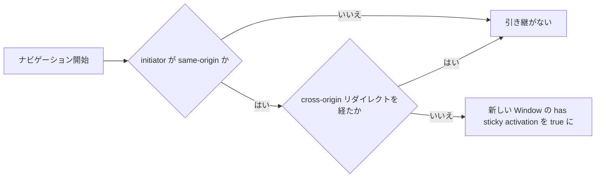

# 2026-11-18（水）

> 今日のひとこと：Solid 2.0.0 が安定版になりました（RC 23本、14週間）。HTML 仕様には、同一オリジンのナビゲーションで sticky activation を引き継ぐ変更が入りました。新規の脆弱性は確認できず。

## 今日のリリース

- 【Solid】solid-js 2.0.0（`@solidjs/signals`、`@solidjs/web`、`@solidjs/compiler` なども 2.0.0）：非同期をグラフに組み込んだ 2.0 が安定版に。`createResource`、`batch`、`startTransition` などを削除（出典: https://github.com/solidjs/solid/releases）

## トップニュース

### Solid 2.0.0 が安定版になる

【Solid】solid-js 2.0.0 が公開されました。2.0 系の RC は 23 本、14 週間で、リリースページによれば 971 本の PR をマージし 753 件の Issue を閉じたそうです。

**何が変わる**

- 計算（computation）が Promise や非同期イテレータを返せる。下流の読み手は、そのまま非同期をグラフの一部として扱う
- `createResource`、`batch`、`startTransition`、`on`、`produce`、`createComputed`、`createMutable` を削除（リリースページの記載）
- 開発ビルドは、リアクティブの誤用を安定したコード・ソース位置・修正案つきで報告する。`@solidjs/diagnostics` が新しいパッケージとして入った
- コンパイラ側も整理された。`dom-expressions` を本リポジトリに取り込み、`@solidjs/babel-plugin` と `@solidjs/compiler` に分けた（`packages/babel-plugin/CHANGELOG.md` の 2.0.0 の項）

**なぜ変えたか**

リリースページは「非同期をグラフに入れる」ことを軸に挙げています。競合状態の処理と、楽観的な状態のロールバックを、ライブラリ側で面倒を見る設計です。削除された API は、その考え方では不要になるものです（この点の因果はリリースページの記述からの読みで、設計文書は未確認）。

**何に効く・誰が困る**

- 1.x のコードは、削除された API を使っていると移行が必要
- 同じページに 1.x と 2.x が同居する場合、委譲イベント（delegated events）が二重に走る問題を避けるため、要素のキーが `$$click` から `_$$click` に変わった。`el.$$click` を直接読むコードは書き換えが必要（changeset `6d2bdeb` の説明）

**ここまでの経緯**

- 2026-11-16 21:09（太平洋時間）：`Version packages (#4953)`（`a8186e67`）で 2.0.0 の各パッケージを一斉にタグ付け
- 直前の RC は 2.0.0-rc.23（[11-17 の号](2026-11-17.md)）、rc.22 は [11-16 の号](2026-11-16.md)
- 公開後も 2.0 向けの修正（#4975、#4976、#4977 ほか）が main に入り続けている

出典: https://github.com/solidjs/solid/releases ／ https://github.com/solidjs/solid/commit/a8186e67

## 今日の深掘り

### HTML：sticky activation を同一オリジンのナビゲーションで引き継ぐ

**選んだ理由**：ユーザー操作の記録（user activation）という小さなデータが、ナビゲーションをまたいでどう扱われるかを、攻撃面を考えながら絞り込んでいる変更だからです。

**背景**

user activation は、クリックなどの操作があったことをウィンドウが覚える仕組みです。`navigator.userActivation.hasBeenActive`（sticky）と `isActive`（transient）に対応します。ページ遷移で新しい `Window` ができると、この情報はリセットされていました。

コミットメッセージによれば、きっかけは WICG/view-transitions#239 と whatwg/html#11328 の議論です（本文は未読。メッセージの参照のみ）。

**変更点**

コミット `823898c`（Domenic Denicola）の説明を、要点だけまとめます。

- 引き継ぐのは sticky のみ。transient は引き継がない（「racy なコードを助長しない」ため）
- 引き継ぎは、遷移先のフレーム自身が、直前の `Window` から受け取る。親や iframe には広げない
- push／replace、reload、bfcache 有無の traversal が対象
- 遷移先エントリの initiator origin が same-origin であり、cross-origin のリダイレクトを経ていないことが条件
- bfcache から外れた後でも判定できるよう、document state に「cross-origin redirect を経て作られたか」のビットを追加

仕様本文（`source`）では、`apply the history step` の中でこの判定をし、`stickyActivationToCarryOver` を true にします。注記にはこうあります。

> This allows sticky activation to survive same-origin navigations, reloads, and traversals, including to a bfcached document that did not previously have it.

別の箇所では、document state に追加した値を使う旨が書かれています。

> This is checked in apply the history step to decide whether sticky activation is carried over.

（`html/source`、コミット `823898c`。仕様の本文サイトは egress でブロックされているので、clone したソースから引用）

もう一つの変更は、history-action 用の user activation を、タイムスタンプの比較から単純な boolean に変えたことです。transient activation を消費すると history-action が再び付与される不具合があり、それを直しています。

**周辺の流れ**

**設計思想**

「便利さ」より先に「他オリジンが操作の記録を偽装できないこと」を条件に並べています。引き継ぎは遷移元の信頼できる情報（initiator origin とリダイレクトの履歴）だけを根拠にしており、bfcache 退避後にも同じ答えが出るよう、状態をドキュメントの記録側に持たせています。

ブラウザ側の実装状況は、今回は未確認（不明）です。

出典: https://github.com/whatwg/html/commit/823898c0c763fb4026c1518208e1b60d7c18315e

## 仕様の変更

### whatwg/html

その他：

- sticky activation の引き継ぎ（上の深掘り、[823898c](https://github.com/whatwg/html/commit/823898c0c763fb4026c1518208e1b60d7c18315e)）

### w3c/ServiceWorker

#### 静的ルーティングで、キャッシュに無ければ次のキャッシュへ進む

【ServiceWorker】Static routing のキャッシュ参照で、指定したキャッシュに該当リクエストが無いとき、次のキャッシュを試すように仕様が直りました。
なぜ変えたか：PR 説明は未読。タイトルからは、複数キャッシュを順に探す意図と読めます（推測）。
出典: https://github.com/w3c/ServiceWorker/pull/1859

その他：

- `WindowClient` の visibility state の enum を更新（[#1860](https://github.com/w3c/ServiceWorker/pull/1860)）
- `getRegistration()` でパース済み URL の origin を使う（[#1863](https://github.com/w3c/ServiceWorker/pull/1863)）

### w3c/csswg-drafts

その他：

- css-color-5 で相対カスタムカラースペースを規定（[9673f4e2](https://github.com/w3c/csswg-drafts/commit/9673f4e2)）
- 色変換行列を row-major と明記（[280da5c5](https://github.com/w3c/csswg-drafts/commit/280da5c5)）
- css-color-hdr-1 の範囲表記・例の修正（[5888adbb](https://github.com/w3c/csswg-drafts/commit/5888adbb)、[358f7b0d](https://github.com/w3c/csswg-drafts/commit/358f7b0d)）

動きなし：whatwg/dom, whatwg/fetch, whatwg/streams, whatwg/url, tc39/proposals, tc39/ecma262, w3c/aria（editorial のみ）, w3c/wcag3（editorial のみ）

## OSSのPR

### Solid

#### 2.0 安定版の直後も、signals の修正が続く

【Solid】`@solidjs/signals` で、`isPending()` の背後の最初の読みを mount として保持しない（[#4976](https://github.com/solidjs/solid/pull/4976)）、pending ソースの循環を `reasks()` が一度だけ辿る（[#4978](https://github.com/solidjs/solid/pull/4978)）など、非同期のグラフの端の挙動を直す修正が続いています。
なぜ変えたか：各 PR は個別の Issue（#4965、#4966、#4969 など）に対応する修正です。
出典: https://github.com/solidjs/solid/pull/4976

その他：

- `{...fn()}` をコンポーネントに渡すとき thunk にコンパイル（[#4977](https://github.com/solidjs/solid/pull/4977)）
- ネストした Portal を親の後にマウント（[#4975](https://github.com/solidjs/solid/pull/4975)）
- `hydrate(document)` が head にレジストリタグだけのとき固まる問題を修正（[#4962](https://github.com/solidjs/solid/pull/4962)）

### oxc

#### パーサーが、ソースのスライスとトークンを使い回して命令数を減らす

【oxc】文字列リテラルの値、JSX の識別子名・テキストを、字句解析器を呼び直さずに「すでに読んだトークンやソース」から取るようにしました。`x = ["alpha", "beta", "gamma"]` の1行あたりの命令数は 1,681.7 から 1,624.7（−3.4%）、ただし escape を含む文字列では +0.2%。数字は PR 本文の自己申告（macOS、Apple silicon）です。
なぜ変えたか：同じ文字列を二度読んでいたため。
出典: https://github.com/oxc-project/oxc/pull/29745

#### oxfmt の htmlish フォーマッターが Angular に対応

【oxc】Angular テンプレートのプリンター、テンプレート内 JS 式の整形、Tailwind のクラス並べ替えが入りました。
出典: https://github.com/oxc-project/oxc/pull/29737

その他：

- JSX を式の先頭で投機なしにパース（[#29740](https://github.com/oxc-project/oxc/pull/29740)）、`(
)` を直接パース（[#29741](https://github.com/oxc-project/oxc/pull/29741)）、`import` 後のトークン保持（[#29742](https://github.com/oxc-project/oxc/pull/29742)）、型引数の `<` 判定（[#29743](https://github.com/oxc-project/oxc/pull/29743)）、JSX テキスト値（[#29744](https://github.com/oxc-project/oxc/pull/29744)）、JSX 識別子名（[#29746](https://github.com/oxc-project/oxc/pull/29746)）のパース perf
- 型引数の投機が失敗したときをキャッシュ（[#29518](https://github.com/oxc-project/oxc/pull/29518)）
- パーサーの `UniquePromise` を branded lifetime に置き換え（[#29759](https://github.com/oxc-project/oxc/pull/29759)）
- 関連の整理：[#29756](https://github.com/oxc-project/oxc/pull/29756)、[#29757](https://github.com/oxc-project/oxc/pull/29757)、[#29758](https://github.com/oxc-project/oxc/pull/29758)、[#29760](https://github.com/oxc-project/oxc/pull/29760)、[#29761](https://github.com/oxc-project/oxc/pull/29761)
- 関連語の後ろの contextual keyword のパースを修正（[#25097](https://github.com/oxc-project/oxc/pull/25097)）
- catch パラメータを catch 節のスコープに保つ（[#29635](https://github.com/oxc-project/oxc/pull/29635)）、private name を宣言するクラスへ解決（[#29714](https://github.com/oxc-project/oxc/pull/29714)）
- legacy decorator の修正（[#27744](https://github.com/oxc-project/oxc/pull/27744)、[#29724](https://github.com/oxc-project/oxc/pull/29724)）
- minifier の修正・perf（[#27966](https://github.com/oxc-project/oxc/pull/27966)、[#29725](https://github.com/oxc-project/oxc/pull/29725)、[#29767](https://github.com/oxc-project/oxc/pull/29767)）
- React Compiler の修正（[#29754](https://github.com/oxc-project/oxc/pull/29754)、[#29655](https://github.com/oxc-project/oxc/pull/29655)）
- linter の修正（[#26992](https://github.com/oxc-project/oxc/pull/26992)、[#29442](https://github.com/oxc-project/oxc/pull/29442)、[#29496](https://github.com/oxc-project/oxc/pull/29496)、[#28727](https://github.com/oxc-project/oxc/pull/28727)）
- oxfmt／formatter の修正（[#29728](https://github.com/oxc-project/oxc/pull/29728)、[#29735](https://github.com/oxc-project/oxc/pull/29735)）、playground の整理（[#29732](https://github.com/oxc-project/oxc/pull/29732)、[#29736](https://github.com/oxc-project/oxc/pull/29736)）

### Biome

#### 型推論が、エイリアス経由の条件やプロパティパスでも絞り込む

【Biome】`type_inference` の narrowing が、プロパティパス（[#13170](https://github.com/biomejs/biome/pull/13170)）、リテラルキーの要素アクセス（[#13171](https://github.com/biomejs/biome/pull/13171)）、`this` のプロパティ（[#13172](https://github.com/biomejs/biome/pull/13172)）、optional chain の受け手（[#13173](https://github.com/biomejs/biome/pull/13173)）、エイリアスされた条件（[#13174](https://github.com/biomejs/biome/pull/13174)）に広がりました。先頭で narrowing の対象を ID で識別する整理（[#13169](https://github.com/biomejs/biome/pull/13169)）が入っています。
なぜ変えたか：PR 本文は未読。

その他：

- HTML パーサーで2つ目の CDATA 開始マーカーで panic しない（[#13262](https://github.com/biomejs/biome/pull/13262)）
- 依存のアドバイザリ対応、公開ツールの調整（[#13266](https://github.com/biomejs/biome/pull/13266)、[#13275](https://github.com/biomejs/biome/pull/13275)）

### Next.js

その他：

- 静的フォールバックの bootstrap スクリプトで CSP nonce を維持（[#101953](https://github.com/vercel/next.js/pull/101953)）
- 実験的 testing API の opt-in を Cache Components なしだと拒否（[#101952](https://github.com/vercel/next.js/pull/101952)）
- rewrite 後は正確な pathname を優先（[#101934](https://github.com/vercel/next.js/pull/101934)）
- PPF の有効判定を `cacheComponents` 設定から導く（[#101929](https://github.com/vercel/next.js/pull/101929)、[#101936](https://github.com/vercel/next.js/pull/101936)）
- Turbopack：ファイル tracing と NFT manifest の出力を分離（[#101941](https://github.com/vercel/next.js/pull/101941)）、アトミックなファイル書き込みを opt-in（[#101786](https://github.com/vercel/next.js/pull/101786)）、JS manifest を `compileFunction` で評価（[#101787](https://github.com/vercel/next.js/pull/101787)）、再ビルドでの chunk group 読み取りを絞る（[#101782](https://github.com/vercel/next.js/pull/101782)）、コンパクトな re-export の順序（[#101920](https://github.com/vercel/next.js/pull/101920)）、`next/font/google` の fallback face（[#100305](https://github.com/vercel/next.js/pull/100305)）
- turbo-tasks：stale 後は keyed dependency を確認しない（[#101736](https://github.com/vercel/next.js/pull/101736)）、collectible の伝播を遅延（[#101748](https://github.com/vercel/next.js/pull/101748)）
- アダプターの app page entry を lookup map で解決（[#101880](https://github.com/vercel/next.js/pull/101880)）、swc 84.1.1 に更新（[#101860](https://github.com/vercel/next.js/pull/101860)）

### Vite

その他：

- ビルドの preload 書き換えで source map を再トレースせずにずらす perf（[#24049](https://github.com/vitejs/vite/pull/24049)）
- 条件の整理、flaky テストの修正（[#24125](https://github.com/vitejs/vite/pull/24125)、[#24123](https://github.com/vitejs/vite/pull/24123)）

### React

その他：

- DevTools が Suspense の suspended 状態を検査結果に出す（[#38227](https://github.com/facebook/react/pull/38227)）
- React Compiler：`'use no memo'` の関数を outline せず、中へも潜らない（[#38278](https://github.com/facebook/react/pull/38278)）
- `useDeferredValue` の回帰を修正（[#38270](https://github.com/facebook/react/pull/38270)）

### Svelte

#### dev の `__svelte_meta` に、コンポーネントインスタンスと snippet 名が入る

【Svelte】dev ビルドの `__svelte_meta` に、コンポーネントのインスタンス（[#19286](https://github.com/sveltejs/svelte/pull/19286)）と、`render` エントリの `snippetName`（[#19283](https://github.com/sveltejs/svelte/pull/19283)）が入りました。
なぜ変えたか：PR 本文は未読。デバッグ用のメタ情報を足す変更です（用途は推測）。

その他：

- コンポーネントの後に `__svelte_meta` を付ける修正（[#19287](https://github.com/sveltejs/svelte/pull/19287)）、dev の要素 location をテンプレート作成時に付与（[#19291](https://github.com/sveltejs/svelte/pull/19291)）、esrap の更新（[#19290](https://github.com/sveltejs/svelte/pull/19290)）

### Vue

その他：

- `compiler-sfc` で tsconfig の include/exclude と `configDir` を参照先 config からの相対で解決（`minor` ブランチ、[f897fa34](https://github.com/vuejs/core/commit/f897fa34)、[2e2f7c6b](https://github.com/vuejs/core/commit/2e2f7c6b)）

### microsoft/TypeScript

その他：

- 大きな tuple 型の declaration emit での panic を修正（[#64385](https://github.com/microsoft/TypeScript/pull/64385)）
- JSDoc の `@augments`、`@implements` を TypeReference としてパース（[#65537](https://github.com/microsoft/TypeScript/pull/65537)）
- union／intersection の `getPropertiesOfUnionOrIntersectionType` を最適化（[#65529](https://github.com/microsoft/TypeScript/pull/65529)）
- conflict marker 判定、watch、kqueue、フォーマット断片などの整理・修正（[#65464](https://github.com/microsoft/TypeScript/pull/65464)、[#65475](https://github.com/microsoft/TypeScript/pull/65475)、[#65495](https://github.com/microsoft/TypeScript/pull/65495)、[#65491](https://github.com/microsoft/TypeScript/pull/65491)）
- 制約つき型パラメータを extends するインターフェースのエラー文言（[#65506](https://github.com/microsoft/TypeScript/pull/65506)）、AI 活動に関するドキュメント更新（[#65528](https://github.com/microsoft/TypeScript/pull/65528)）

### oxc-project/tsrs

その他：

- type error と tsconfig error のメッセージチェーンを保つ（[#1006](https://github.com/oxc-project/tsrs/pull/1006)）、lint の perf（[#1011](https://github.com/oxc-project/tsrs/pull/1011)、[#1012](https://github.com/oxc-project/tsrs/pull/1012)）、npm パッケージを `latest` に publish（[#1014](https://github.com/oxc-project/tsrs/pull/1014)）

### vercel-labs/scriptc

前回の実行以降、約70件のコミットがありました（Node.js API の対応拡張が中心：`node:http`、`node:test`、`stream` の `toWeb`、`worker_threads`、`dgram` など。CommonJS の `require()` のコンパイルも）。件数が多いので個別には扱いません。対応範囲の数字は自己申告です。目立ったもの：`stream: implement Readable.toWeb / Writable.toWeb`（[#3730](https://github.com/vercel-labs/scriptc/pull/3730)、[#3738](https://github.com/vercel-labs/scriptc/pull/3738)）。

動きなし：pingdotgg/ts-rust, vercel-labs/tsc-ts（clone した履歴に該当コミットなし）

取得せず：ghc/ghc, wado-lang/wado, oven-sh/bun（今回は調べていない。「動きなし」ではなく未調査）

## 脆弱性

新規のアドバイザリは確認できませんでした。確認したのは react、next、vite、svelte、vue、oxc、astro、nuxt、TanStack Router の各アドバイザリ一覧で、最新の公開日はいずれも前回の実行より前です（Vite の Critical RCE は 11-10、Next.js は 11-03、Astro は 11-09、Nuxt は 11-02）。

参考：Solid 2.0.0 の changeset には、SSR で flow-control のメモが返した文字列がエスケープされない XSS の修正（`7d985b6`）が含まれます。Solid は脆弱性の対象パッケージに入っておらず、solidjs/solid のアドバイザリ一覧には2025-02-21の1件のみで、この件の公開アドバイザリは確認できませんでした。

出典: https://github.com/solidjs/solid/security/advisories
