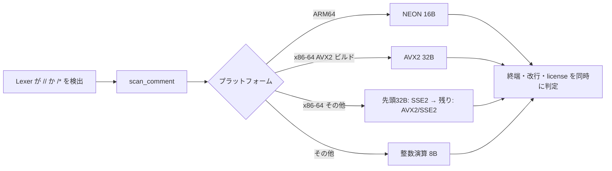

# 2026-11-19（木）

> 今日のひとこと：oxc のパーサーが、コメントを「1回だけ・SIMD で一括して」読むようになりました。Solid 2.0.1、Svelte 5.58.0、tsrs の TypeScript 版数ベータが公開。新規の脆弱性は、対象パッケージでは確認できず。

## 今日のリリース

- 【Solid】solid-js 2.0.1（`@solidjs/signals` なども 2.0.1）：凍結された（frozen）プレーンオブジェクト・配列をストアが包んで追跡するようになった。非同期・楽観的更新まわりの修正が多数（出典: https://github.com/solidjs/solid/releases/tag/solid-js%402.0.1）
- 【Svelte】svelte 5.58.0：dev の `__svelte_meta` に `snippetName` と、要素が属するコンポーネントインスタンスを記録（devtools 向け）。サーバーレンダリングの高速化など（出典: https://github.com/sveltejs/svelte/releases/tag/svelte%405.58.0）
- 【oxc】tsrs 7.1.0-beta.tsrs3：TypeScript 側の版に揃えた最初のリリースが npm の `latest` に。自己申告ベース（出典: https://github.com/oxc-project/tsrs/releases/tag/v7.1.0-beta.tsrs3）
- 【Biome】crates v0.7.3（出典: https://github.com/biomejs/biome/pull/13276）※リリース PR。利用者に見えるパッケージかは未確認

## トップニュース

### oxc のパーサーがコメントを1回の走査で読む

【oxc】`oxc_parser` のレキサーが、コメントの終端・改行の有無・`@license`/`@preserve` の有無を、1回の SIMD 走査でまとめて調べるようになりました。従来は同じバイト列を複数回探索していました。

**何が変わる**

- 行コメントは、改行を `memchr3` で探したあと、同じ範囲をもう一度 `@license`/`@preserve` 用に探していた
- ブロックコメントは `memchr2` と `memmem`（`*/` 探し）に加え、タグと改行の探索が重なっていた
- 今回は行・ブロック共通のループ `CommentScan::scan` で、チャンク（NEON なら16バイト、AVX2 なら32バイトなど）ごとに1回だけ読む。出力されるコメントの種類・位置・紐付けは変えていない（PR 本文）

**なぜ変えた**

短いブロックコメント（`/*#__PURE__*/` など）は長さがまちまちで、バイト単位のループの抜け分岐が外れやすい、というのが PR 本文の説明です。

**何に効く・誰が困る**

- PR 本文の数字（Apple Silicon のみ、自己申告）：`antd.js` のパース全体で命令数 -4.3%。コメントだけのファイルでは -20.9%。256バイトのブロックコメントは -48.9% サイクル
- 空の `//` はむしろ遅くなる（+4.8% サイクル）。ベンチ用ファイルで遅くなったものはない
- x86-64 と WebAssembly の経路は実機では未計測（PR 本文）。`oxc_parser` に `unsafe` の SIMD が入った

**ここまでの経緯**

- 2026-11-15：[先読みと投機的パースを減らす perf が連続で入った](2026-11-15.md)
- 2026-11-18：`perf(parser): read each comment once`（#29794）がマージ。同日 `Scoping` アリーナの事前サイズ指定（#29809）も入った

出典: https://github.com/oxc-project/oxc/pull/29794

## 今日の深掘り

### コメントを「一度だけ」読む設計（oxc `lexer/comment.rs`）

読むのは、設計の考え方がコードにそのまま出ている変更だからです。コミットは `a2eed1b99`（`crates/oxc_parser/src/lexer/comment.rs`）。

**背景**

JS のコメントは、バンドラーやミニファイアにとって意味を持ちます。`@license` や `@preserve` を含むコメントは出力に残す慣習があり、パーサーは「Legal コメントか」を知る必要があります。さらに、改行の有無で `MultiLineBlock` か `SingleLineBlock` かが決まります（ASI など構文上の扱いに関わる）。そのため、1つのコメントから「終端」「改行」「タグ」の3つを取り出します。

**変更点**

「探す対象」を trait に押し出し、走査ループは1つにしています。

```rust
// crates/oxc_parser/src/lexer/comment.rs (a2eed1b99)
fn scan<const LEN: usize>(&mut self, bytes: &[u8], range: Range<usize>,
    matcher: impl ChunkMatcher<LEN>) -> Option<usize> {
    let (chunks, tail) = bytes[range.clone()].as_chunks::<LEN>();
    for chunk in chunks {
        for index_in_chunk in self.find(chunk, matcher) {
            if self.is_end(bytes, index, chunk[index_in_chunk]) { return Some(index); }
        }
        ...
    }
    // 端数はゼロ埋めして、同じチャンクとして照合する
}
```

- 行コメントとブロックコメントは、`find`（どのバイトに反応するか）と `is_end`（見つけたバイトで何をするか）だけを実装する
- 末尾の端数はゼロで埋めて同じ経路で処理する。ゼロは探索対象にならないので、バイト単位のループが要らない
- x86-64 で AVX2 を使えるかが分からないビルドでは、最初の32バイトは SSE2 でインラインに読み、それより長いコメントだけ AVX2 に回す。CPU 判定と関数呼び出しのコストが、短いコメントでは得を上回るため（コード中のコメントによる）

**周辺コード**



**設計思想**

- 「速い探索ライブラリを組み合わせる」より、「1回の走査で必要な情報を全部取る」ほうが、短い入力では効く（推測：PR 本文の数字からの読み）
- 正しさは境界値で担保する。0〜70バイトの全オフセットで終わるコメントを並べた fixture `comment-chunk-boundaries.js` を足している
- 既知の差も残している。LS/PS（U+2028/2029）まわりでは、`oxc_lexer` とパーサーの挙動が前後で食い違うことを PR 本文が明記している
- 補足：この PR の AI 開示欄には、Claude Code で書いたと記載されている

出典: https://github.com/oxc-project/oxc/pull/29794

## OSSのPR

### oxc

#### Scoping アリーナを、シンボル・参照・スコープ数から見積もって確保する

【oxc】`perf(semantic)`（#29809）。`Scoping` のアリーナを、シンボル・参照・スコープの数から大きさを決めて確保する。
なぜ変えたか：PR 本文は未確認。タイトルからは、再確保を減らす狙いと読めるが推測。
出典: https://github.com/oxc-project/oxc/pull/29809

#### 診断のレンダリングで、ソース文字列のコピーを避ける

【oxc】`oxc_diagnostics` が `&T` に `SourceCode` を実装し、`NamedSource` が `&str` の名前を受けられるようになった（#29849、#29850、#29851、#29852。破壊的変更の印 `!` 付き）。
なぜ変えたか：ソース全文のコピーを避けるため（コミットメッセージのタイトルより。本文は未確認）。
出典: https://github.com/oxc-project/oxc/pull/29852

その他：

- `array-type` が `Readonly<T[]>` を検出・修正（[#29841](https://github.com/oxc-project/oxc/pull/29841)）
- `explicit-function-return-type` が返却オブジェクト内のブロック本体アロー関数を検査（[#29843](https://github.com/oxc-project/oxc/pull/29843)）
- `prefer-as-const` が山括弧のリテラルアサーションを検出（[#29839](https://github.com/oxc-project/oxc/pull/29839)）
- async-to-generator の推論関数名から先頭の数字を除去（[#29816](https://github.com/oxc-project/oxc/pull/29816)）
- ほか、`docs` / `chore` / `ci` が6件

### oxc-project/tsrs

【oxc】タグは 7.1.0-beta.tsrs3 のみ詳述（上の「今日のリリース」）。

その他：

- 型チェックの対象から suggestion を外す（[#959](https://github.com/oxc-project/tsrs/pull/959)）
- 動的な type root 検索でディレクトリ表現を使う（[#1009](https://github.com/oxc-project/tsrs/pull/1009)）
- TS5011 のレイアウト検査で設定ファイルのディレクトリを使う（[#1022](https://github.com/oxc-project/tsrs/pull/1022)）
- `/index` を外す前に対象ファイルのディレクトリを確認（[#1024](https://github.com/oxc-project/tsrs/pull/1024)）
- `files` の文字列を絶対パスで管理（[#1021](https://github.com/oxc-project/tsrs/pull/1021)）
- ルートなしのビルドで空のルート一覧を書く（[#1025](https://github.com/oxc-project/tsrs/pull/1025)）
- 拡張子のない自己参照で TS1006 を報告（[#1023](https://github.com/oxc-project/tsrs/pull/1023)）
- Intel macOS ビルドのタイムアウトを解消（[#1030](https://github.com/oxc-project/tsrs/pull/1030)）

### Solid

#### 凍結されたオブジェクトも、ストアが包んで追跡する

【Solid】`fix(signals): frozen plain objects and arrays wrap in stores`（#5014、`e57fc3fa`）。凍結済みのプレーンなオブジェクト・配列も通常のストアと同じく包む。2.0.1 に入った。包みたくない場合は `createStore(value, { shallow: true })`。
なぜ変えたか：凍結された値の下を読む側が、変更のたびに再実行されていた（リリースノートより）。
出典: https://github.com/solidjs/solid/pull/5014

その他：

- 2.0.0 直後の `signals` の修正が約15件（楽観的更新、`Loading`、アクションの保留中の整合など。#4987〜#5010）
- 再ディスパッチされた委譲イベントの処理を修正（[#5017](https://github.com/solidjs/solid/pull/5017)）
- hello world の最小構成から、機能依存のコードを外す（[#5018](https://github.com/solidjs/solid/pull/5018)）
- 2.0 の RFC と A-rules を凍結、アーカイブ整理、`AGENTS.md` 追加（[#5016](https://github.com/solidjs/solid/pull/5016)）

### Svelte

その他：

- 5.58.0 の変更は「今日のリリース」を参照
- `batch` で reaction のビューをまとめる（[#19030](https://github.com/sveltejs/svelte/pull/19030)）
- `on()` で追加した後続のリスナーが、先のリスナーの `stopPropagation()` で飛ばされないように（[#19317](https://github.com/sveltejs/svelte/pull/19317)）
- フォームのリセットで `bind:files` を更新（[#19298](https://github.com/sveltejs/svelte/pull/19298)）
- 再代入されない `$state.raw` の宣言タグを直接読む（[#19294](https://github.com/sveltejs/svelte/pull/19294)）
- `print` が入力テキストをそのまま出し、空白規則を守る（[#19292](https://github.com/sveltejs/svelte/pull/19292)）
- サーバーモジュールから孤立したコメントを除去（[#19289](https://github.com/sveltejs/svelte/pull/19289)）

### Next.js

その他：

- Turbopack：本番チャンク分割に `max_chunk_size` を追加（[#100478](https://github.com/vercel/next.js/pull/100478)）
- Turbopack：トップレベルの `this` を CommonJS exports として検出（[#101727](https://github.com/vercel/next.js/pull/101727)）
- Turbopack：チャンク設定を拡張できる `EmitOption` trait（[#101001](https://github.com/vercel/next.js/pull/101001)）
- `durableUseCacheEntries` の設定を整理（[#101930](https://github.com/vercel/next.js/pull/101930)）
- ts-plugin が引用符つきの prefetch セグメント設定値を受理（[#101895](https://github.com/vercel/next.js/pull/101895)）
- Navigation Inspector のダークモードのコントラスト修正（[#102008](https://github.com/vercel/next.js/pull/102008)）
- ほか、minimalMode 判定の前倒し、未使用メタ削除、Turbopack の内部整理などが約10件。React を a8342585 に更新（[#101942](https://github.com/vercel/next.js/pull/101942)）

### React

その他：

- Flight に Ledgers の骨組みをフラグ付きで追加（[#37588](https://github.com/facebook/react/pull/37588)）
- Ledgers の dedupe map に行 ID を追加（[#37589](https://github.com/facebook/react/pull/37589)）

### Vite

その他：

- フックのエラーにプラグイン名を付ける（[#24107](https://github.com/vitejs/vite/pull/24107)）
- optimizer が、依存のスキャン・バンドル時にトップレベルの tsconfig オプションを尊重（[#24119](https://github.com/vitejs/vite/pull/24119)）
- optimizer のロックファイルハッシュが、パッチファイルのその場の編集を検出（[#24126](https://github.com/vitejs/vite/pull/24126)）
- create-vite の Solid テンプレートが Solid 2 に（[#24130](https://github.com/vitejs/vite/pull/24130)）
- ライセンスプラグインを無効時に `applyToEnvironment` で外す（[#24134](https://github.com/vitejs/vite/pull/24134)）

### TypeScript

その他：

- LSP の content mapper の失敗後の位置変換パニックを防ぐ（[#65554](https://github.com/microsoft/TypeScript/pull/65554)）、不足していたフォールバックを追加（[#65557](https://github.com/microsoft/TypeScript/pull/65557)）
- 宣言出力での循環・切り詰め報告を revert（[#65567](https://github.com/microsoft/TypeScript/pull/65567)）、オブジェクト束縛の既定値の変更も revert（[#65556](https://github.com/microsoft/TypeScript/pull/65556)）
- `Temporal.ZonedDateTime.prototype.toLocaleString` で `timeZone` を禁止（[#65434](https://github.com/microsoft/TypeScript/pull/65434)）
- JSX のタグ・属性名が `#` で始まるとき TS1003（[#65431](https://github.com/microsoft/TypeScript/pull/65431)）
- 可変長タプル要素と交差型のクラッシュ修正（[#64239](https://github.com/microsoft/TypeScript/pull/64239)）
- ほか、パス補完のクラッシュ、ダウンレベルの private 論理代入、コア補助関数のアロケーション削減など6件

### Biome

その他：

- lint ルール追加：`noUselessBind`（[#12544](https://github.com/biomejs/biome/pull/12544)）、`useConsistentIndexedObjectStyle`（[#13191](https://github.com/biomejs/biome/pull/13191)）、`noVueDuplicateVElseIf`（[#13164](https://github.com/biomejs/biome/pull/13164)）、`noTailwindConflictingClasses`（[#13161](https://github.com/biomejs/biome/pull/13161)）、convex のルールソースとドメイン（[#13284](https://github.com/biomejs/biome/pull/13284)）
- Prettier からの移行で Markdown の frontmatter を有効化（[#13273](https://github.com/biomejs/biome/pull/13273)）
- Markdown パーサーが blockquote 内で段落をまたいで強調を対にしない（[#13269](https://github.com/biomejs/biome/pull/13269)）

### Vue

その他（`minor` ブランチ）：

- teleport の hydration で、無効な teleport のターゲットアンカーを先に確保（[#16333](https://github.com/vuejs/core/pull/16333)）
- compiler-ssr が静的 DOM prop の別名を HTML 属性名に対応づける（[#16334](https://github.com/vuejs/core/pull/16334)）

### vercel-labs/scriptc

その他：件数が多い（約45件、主に Chris Tate による Node.js 互換 API の追加。`perf_hooks` のヒストグラム、WebCrypto の Argon2/X448/cSHAKE、`readable.iterator`、HTTP/2 トレーラーなど）。数字は自己申告で、検証していない。一覧: https://github.com/vercel-labs/scriptc/commits/main

### wado-lang/wado

その他：コミット約100件（大半は Claude によるエージェント運用で、`gale` の Kiln digest 再生成が多数）。内容は `rill` の memo／`switch`、コンパイラの型推論（構造体の既定値のスロット）など。`docs/wep-*.md` の変更は今回のログでは確認していない。一覧: https://github.com/wado-lang/wado/commits/main

動きなし：ghc/ghc、pingdotgg/ts-rust、vercel-labs/tsc-ts、oven-sh/bun（今回は未確認）

## 脆弱性

取得できた範囲では、対象パッケージ（react, react-dom, next, vite, svelte, vue, oxc, astro, nuxt, TanStack Start）の新規アドバイザリは見つからなかった。確認は GitHub Advisory Database の npm 一覧（11-18 公開は他パッケージの3件のみ）と、next.js、vite のアドバイザリ一覧による。svelte、vue、oxc、astro、nuxt、TanStack/router の各リポジトリのアドバイザリ一覧は今回読んでいない（取得できず：未実施）。

## 調査範囲について

今回は、WHATWG・TC39・CSSWG の仕様、「議論ウォッチ」の対象、`bun check`／`bun fmt`、Solid の `next` ブランチは確認していない（今回の実行では未実施）。仕様リポジトリの clone で、`csswg-drafts` に `css-text-4` の `text-autospace-size`（[#8510](https://github.com/w3c/csswg-drafts/issues/8510)）の追加が見えたのみ。
