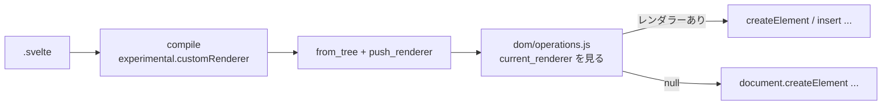

# 2026-11-21（土）

> 今日のひとこと：Svelte 5.59.0 に、DOM の代わりに自前の「描画先」へ出力できるカスタムレンダラー API（実験的）が入りました。issue を立てた 2025-03 から約 8 か月半での着地です。対象パッケージの新規の脆弱性は確認できず。

## 今日のリリース

- 【Svelte】svelte@5.59.0：カスタムレンダラー API（`experimental.customRenderer` と `svelte/renderer`）を追加（出典: https://github.com/sveltejs/svelte/blob/main/packages/svelte/CHANGELOG.md）
- 【Svelte】svelte@5.59.1：`hydrate` と `mount` の型パラメータを揃え、両者の union でも呼べるように（出典: https://github.com/sveltejs/svelte/pull/19357）
- 【Svelte】svelte@5.58.1：batch／fork まわりの fix（superseded な fork のコミットで throw しない、など）と `on()` の `stopPropagation()` 修正（出典: https://github.com/sveltejs/svelte/blob/main/packages/svelte/CHANGELOG.md）
- 【Vue】v3.6.0-rc.16：Vapor Mode の Teleport と transition まわりの修正が中心（出典: https://github.com/vuejs/core/commit/34d4d0728e937ce7bbf26e4b1bc4f975c704a9d2）
- 【Vue】v3.5.46：Teleport／Suspense／transition と SSR の CSS 変数注入の修正を多数（出典: https://github.com/vuejs/core/commit/7de9e41b）
- 【oxc】tsrs 7.1.0-beta.tsrs4：`--showConfig` 対応と、VFS まわりの panic 修正を含むベータ（出典: https://github.com/oxc-project/tsrs/commit/fd57202e）
- 【TypeScript】scriptc 0.4.15（`CHANGELOG.md` 上のバージョン。タグとリリースページは未確認）：`node:sqlite`、`node:http2`、`crypto` などの対応範囲を広げた（出典: https://github.com/vercel-labs/scriptc/commit/47e20e3ed）

## トップニュース

### Svelte が「DOM 以外に描く」ためのカスタムレンダラー API を入れる

【Svelte】Svelte 5.59.0 で、コンパイラに `experimental.customRenderer` が、ランタイムに `svelte/renderer` の `createRenderer()` が加わりました。コンポーネントを、ブラウザの DOM ではなく、利用者が定義した「木の操作」へ向けて描画できます。

**何が変わる**

- コンパイル時に `customRenderer` へレンダラーのモジュール（文字列、またはファイル名から文字列を返す関数）を渡す。
- 出力が変わる。テンプレートは `from_html`（HTML 文字列）ではなく `from_tree`（配列で書いた木）になり、コンポーネントの先頭で `push_renderer`、末尾で pop する。
- レンダラーは `createElement` `insert` `getNextSibling` など 19 個の DOM 風操作を実装して渡す。マウントは `renderer.render(Component, { target, props, context })`。
- DOM 専用の機能は無効になる。PR 本文によれば、通常要素の `bind:`、`transition:` `animate:` `in:` `out:`、`svelte:window` `svelte:body` `svelte:document` `svelte:head` などが禁止され、イベント委譲など DOM 向けの最適化も出力から外れる。

**なぜ変えた**

- Svelte 4 には Svelte Native 向けの foreign namespace があったが、Svelte 5 の新しいコンパイラで消え、ネイティブ描画ができなくなった（issue #15470 の要旨）。
- 実装者は PR 本文で、方針を見直して必要なコードが大幅に減ったこと、Syntax と SuppCo の出資する Custom Renderers initiative で専従できたことを挙げている。
- 設計の分担は、issue での議論どおり「リアクティビティは Svelte が持ち、DOM 操作だけを差し替え可能にする」。Vue と Solid のカスタムレンダラーが先行例として挙がっていた。

**何に効く・誰が困る**

- Svelte Native、Lynx、3D（Threlte）など、DOM のない描画先を持つ人に効く。Threlte のフィードバックで設計が作り直されたと issue にある。
- 一般のアプリ開発者には直接関係しない。PR 本文でも、日常的にレンダラーを作る人は少なく、主な利用者は Svelte チーム自身になるだろうと書かれている（推測を含む見込みの話）。
- 「実験的」の付く API で、PR 時点でドキュメントの整備やテストの追加が残っていた。

**ここまでの経緯**

- 2025-03-07：issue #15470 が立つ。Svelte 5 でネイティブ描画が止まったことが発端。
- 2025-04：Paolo Ricciuti が `<template>` 要素に頼らないテンプレート方式の PR #15538 を出し、Lynx でコンポーネントが描画できたと報告（4月30日）。
- 2025-10：Threlte のフィードバックで設計をやり直すことになり、作業が止まる。
- 2026-04-02：実装 PR #18042 が出る。
- 2026-11-20：#18042 が main に入り、5.59.0 として公開。issue もこの日にクローズ。

出典: https://github.com/sveltejs/svelte/pull/18042 ／ https://github.com/sveltejs/svelte/issues/15470

## 今日の深掘り

### Svelte のカスタムレンダラーは「現在のレンダラー」を差し替えるスタックでできている

DOM 操作が一か所に閉じているかどうかで、フレームワークの移植性は決まります。5.59.0 はそれを、コンパイラの出力の切り替えと、ランタイムの小さな状態管理で実現しました。読んだのは `8720544ff`（#18042）時点のソースです。

**背景**

Svelte のランタイムは、DOM 操作（`createElement`、`firstChild`、`nextSibling` など）をふだん直接呼んでいます。しかもコンパイラは、HTML 文字列を `<template>` から複製する、イベントを委譲する、といった DOM 専用の最適化を出力に埋め込みます。「DOM 操作を差し替える」だけでは足りず、出力そのものを変える必要がありました。

**変更点：ランタイム側**

核は `packages/svelte/src/internal/client/custom-renderer/state.js` です。モジュール変数 `current_renderer`（`null` が DOM）を、`push_renderer` / `pop_renderer` で入れ替えます。

```js
export function push_renderer(value) {
	var previous = current_renderer;
	current_renderer = value;
	depth += 1;
	// this is to allow hydration code to treeshake
	if (hydrating && value !== null) {
		set_hydrating(false);
		suspended_hydration_at.push(depth);
	}
	return previous;
}
```

（`packages/svelte/src/internal/client/custom-renderer/state.js`、コミット `8720544ff`）

`dom/operations.js` の各ヘルパーは、先頭で `current_renderer` を見て分岐します。たとえば `get_first_child` は、レンダラーがあれば `current_renderer.getFirstChild(node)` を返し、なければ DOM の `firstChild` を読みます。

- 呼び出しごとに前の値を返して復元させるので、レンダラーの入れ子（別の描画先のコンポーネントを内側に置く場合）も扱える。
- カスタムレンダラーは hydration しないので、有効な間は hydration を止め、pop で戻す。

**変更点：コンパイラ側**

`customRenderer` オプションは analyze と transform の両フェーズに効きます。PR の変更ファイルを見ると、analyze のビジターが `bind:`、`transition:`、`svelte:window` などで、レンダラー指定時にエラーを出す側に変わっています。transform では、`transform-client.js` が出力の先頭でレンダラーを import し、`RegularElement` が DOM 専用の最適化を外します。サーバー側の出力は変わりません（テスト `custom-renderer-server-noop` で確認できる）。

**周辺コード：バンドルに残さない工夫**

`packages/svelte/package.json` の `exports` に、新しい export 条件 `svelte-custom-renderer` が加わっています。`svelte`、`svelte/legacy`、`svelte/reactivity` などで、この条件のときだけ「レンダラー対応版」のクライアントコードを指します。`internal/flags/custom-renderer` も同様に、通常は空のフラグ版を指します。推測ですが、`current_renderer` の分岐を通常の DOM ビルドから外し、サイズと速度を守るための仕組みです。



**この変更から分かる設計思想**

- 実行時の分岐だけで済ませず、コンパイラの出力と package の export 条件まで含めて「DOM 専用の最適化を捨てる経路」を別に作った。
- 差し替える面を、DOM に似た最小の操作の集合（19 個）に限った。これはレンダラーを書く側へ「親子関係を自前で持つこと」を求める設計でもある。PR 本文は、親子の概念がない系では利用者が関係を管理する必要がある、と明記している。
- 実装の足場として、既存の巨大なテスト群ではなく、専用のテスト用レンダラー（`tests/custom-renderers/renderer.js`）を用意している。

出典: https://github.com/sveltejs/svelte/pull/18042

## 仕様の変更

### w3c/csswg-drafts

#### CSS Spatial が、アンカー位置指定を別の「コンテキスト」へ広げる

【CSS】`css-spatial-1`（空間的な UI のための新しい仕様）に、異なるコンテキスト間でのアンカー指定（`position-context: anchor`）、`portal-action: resize`、セキュリティ・プライバシー・a11y の考慮事項の節が、fantasai によって連続で追加された。
なぜ変えたか：PR 経由ではなくコミットで入っており、理由は不明（コミットメッセージのみを根拠にした）。
出典: https://github.com/w3c/csswg-drafts/commit/1995fb2a ／ https://github.com/w3c/csswg-drafts/commit/0c8d7c56 ／ https://github.com/w3c/csswg-drafts/commit/804b7b00

その他：

- `::scroll-button` の引数と `CSSPseudoElement.selectorText` の関係を明確化（[#14730](https://github.com/w3c/csswg-drafts/pull/14730)）
- `@environment-map` を、prelude に dashed-ident を取る形に変更（[4c55c724](https://github.com/w3c/csswg-drafts/commit/4c55c724)）
- 全 CSS のプロパティ表を別文書にまとめるスクリプトと、ビルドの整理（[699c4444](https://github.com/w3c/csswg-drafts/commit/699c4444)）

### w3c/wcag3

その他：

- ACT ルールにも成熟度のステータスを拡張（[#978](https://github.com/w3c/wcag3/pull/978)）

動きなし：whatwg/dom, whatwg/streams, whatwg/url, tc39/ecma262, tc39/proposals, w3c/aria, w3c/ServiceWorker（whatwg/html と whatwg/fetch は editorial のみで除外）

## OSSのPR

### Svelte

トップニュースと深掘りで扱った #18042 のほかは、#19347（hydration 中の更新が打ち消されないよう、hydration が走った state をコミットする fix）と、docs の整理。

その他：

- hydration が走った state をコミットし、hydration 保留中の更新が巻き戻らないように（[#19347](https://github.com/sveltejs/svelte/pull/19347)）
- `hydrate` と `mount` の型パラメータを揃える（[#19357](https://github.com/sveltejs/svelte/pull/19357)）

### oxc

#### oxc の AST で、プロパティキーが「computed かどうか」を型で持つ

【oxc】`PropertyKey` に `StaticIdentifier` `StaticStringLiteral` `StaticNumericLiteral` `StaticBigIntLiteral` が加わり、`Expression` から継承した変種は常に computed キーを表すようになった。各ノードの `computed: bool` は消え、`key.is_computed()` を使う。ESTree 出力は変わらない。
なぜ変えたか：`{ "a": 1 }` と `{ ["a"]: 1 }` が `__proto__`、クラスのコンストラクタ、重複名チェックで別の振る舞いをするのに、キーとフラグが食い違える状態が危険だったため（PR 本文）。
出典: https://github.com/oxc-project/oxc/pull/29907

#### 数値リテラルから `base` フィールドを外し、`raw` から求める

【oxc】`NumericLiteral` と `BigIntLiteral` の `base` フィールドと `NumberBase` / `BigintBase` 型が削除された（破壊的変更）。リンターやセマンティックなど利用側は `raw` から基数を導く。BigInt の変換の無駄も省かれた。
なぜ変えたか：PR 本文は確認していない（連続するコミットの内容から、AST を小さくして `raw` を唯一の情報源にする狙いと推測）。
出典: https://github.com/oxc-project/oxc/pull/29919 ／ https://github.com/oxc-project/oxc/pull/29920

その他：

- `import x = require()` を module syntax として扱う（[#29908](https://github.com/oxc-project/oxc/pull/29908)）
- 型引数に不正な型があるとき、parser と semantic で拒否（[#29945](https://github.com/oxc-project/oxc/pull/29945)）
- minifier が int32/uint32 式の加算ゼロとオフセットを畳む（[#29865](https://github.com/oxc-project/oxc/pull/29865)）
- 標準 decorators の互換性データを追加（[#29448](https://github.com/oxc-project/oxc/pull/29448)）
- mangler が末尾文字の頻度順に数字を含める perf（[#29437](https://github.com/oxc-project/oxc/pull/29437)）
- transformer の class fields / computed key / async-to-generator の fix 3件（[#29912](https://github.com/oxc-project/oxc/pull/29912)、[#29911](https://github.com/oxc-project/oxc/pull/29911)、[#29815](https://github.com/oxc-project/oxc/pull/29815)）
- 別の補助的な fix・リファクタ（CSS formatter、JSDoc、unicorn ルールの fix など）数件

### TypeScript

#### TypeScript の API に、AST 述語・チェッカー問い合わせ・診断ユーティリティが連続して入る

【TypeScript】Andrew Branch が、Go 版 TypeScript の新しい API に向けて、AST predicate API、Checker の query API、node builder API、diagnostic utility API を 1 日で連続して追加した。既存の JSDoc ヘルパーも export された。
なぜ変えたか：各 PR 本文は未確認（タイトルの `[api]` から、ネイティブ版向けの新しい公開 API の整備と読めるが推測）。
出典: https://github.com/microsoft/TypeScript/pull/65590 ／ https://github.com/microsoft/TypeScript/pull/65589 ／ https://github.com/microsoft/TypeScript/pull/65585 ／ https://github.com/microsoft/TypeScript/pull/65587

その他：

- 同形マップ型の構成要素のインスタンス化を、再インスタンス化キーでキャッシュ（[#65562](https://github.com/microsoft/TypeScript/pull/65562)）
- プロパティ／インデックスシグネチャの検索を高速化（[#65043](https://github.com/microsoft/TypeScript/pull/65043)）
- enum と namespace が同名のときのクラッシュを修正（[#64743](https://github.com/microsoft/TypeScript/pull/64743)）
- ラップされた private メンバー呼び出しで `this` を保持（[#65602](https://github.com/microsoft/TypeScript/pull/65602)）
- LS の挿入／クォートまわりの修正、flaky テストと CI のトークン変更（[#65608](https://github.com/microsoft/TypeScript/pull/65608)、[#65609](https://github.com/microsoft/TypeScript/pull/65609)、[#65604](https://github.com/microsoft/TypeScript/pull/65604)）

### oxc-project/tsrs

tsrs 7.1.0-beta.tsrs4 が出た（上の「今日のリリース」参照）。数字（tsgo との一致、速度）は README と `bench/RESULTS.md` の自己申告で、今回の確認では変化を見ていない。

その他：

- `--showConfig` に対応（[#1041](https://github.com/oxc-project/tsrs/pull/1041)）
- 参照パスを `ResolveFile` で解決し、VFS の panic を止める（[#1057](https://github.com/oxc-project/tsrs/pull/1057)）
- 大文字小文字の扱い、UTF-8 でないパス、include の基準パス、tsbuildinfo の長さ検査を Go 版に合わせる（[#1053](https://github.com/oxc-project/tsrs/pull/1053)、[#1051](https://github.com/oxc-project/tsrs/pull/1051)、[#1052](https://github.com/oxc-project/tsrs/pull/1052)、[#1050](https://github.com/oxc-project/tsrs/pull/1050)）
- type-aware lint の診断や提案の fix（[#1056](https://github.com/oxc-project/tsrs/pull/1056)、[#1055](https://github.com/oxc-project/tsrs/pull/1055)、[#1054](https://github.com/oxc-project/tsrs/pull/1054)）

動きなし（コミットなし）：pingdotgg/ts-rust、vercel-labs/tsc-ts

### vercel-labs/scriptc

0.4.15 が `CHANGELOG.md` に記録された。対応する Node.js API の範囲拡大（`node:sqlite`、`http2`、`stream`、`crypto`、`node:test` など）と、ループカウンターへの整数の事実の付与、promise を使わないプログラムで promise ユニットをリンクしない、といった性能面の変更が並ぶ。数字・対応範囲は自己申告。ほかに細かい修正 20 件前後（件数のみ）。
出典: https://github.com/vercel-labs/scriptc/commit/47e20e3ed

### Biome

その他：

- lint ルールを追加（`noUselessDefaultAssignment`、`noImmediateMutation`、`useTanstackQueryExhaustiveDependencies`、`useTanstackQueryMutationPropertyOrder`、`useExpectEqualityMatcher`、`noExpectToHaveBeenCalledOnce`、`noCanvasToImage`、`noUnsafeSqliteInterpolation`、`useEarlyContinue`、`useDescribeFunctionTitle`、`noVueNegationElse`、`noArrayDelete`。[#13217](https://github.com/biomejs/biome/pull/13217) ほか）
- Tailwind のクラス文字列を SIMD の一括パスで先に字句解析する perf（[#12403](https://github.com/biomejs/biome/pull/12403)）
- Sass の `@use` `@forward` `@import` を module graph で解決（[#12960](https://github.com/biomejs/biome/pull/12960)）
- type inference の fix 2件、HTML formatter の fix、rowan の fix、miri の CI 追加（[#13185](https://github.com/biomejs/biome/pull/13185)、[#13184](https://github.com/biomejs/biome/pull/13184)、[#13301](https://github.com/biomejs/biome/pull/13301)、[#13319](https://github.com/biomejs/biome/pull/13319)、[#13329](https://github.com/biomejs/biome/pull/13329)）

### Solid

対象は `main` と `next`。今回の約 25 件は、signals の fix と compiler/web の fix が中心。

その他：

- 削除された store の presence node を、キー走査なしで解放（[#5131](https://github.com/solidjs/solid/pull/5131)）
- 削除された行のクリーンアップが teardown 中に action を呼べるように（[#5124](https://github.com/solidjs/solid/pull/5124)）
- 全パッケージで MIT LICENSE を公開物に含める（[#5130](https://github.com/solidjs/solid/pull/5130)、[#5109](https://github.com/solidjs/solid/pull/5109)）
- 推測値のノードが 2 つの値を持つ形に整理（[#5137](https://github.com/solidjs/solid/pull/5137)）
- SSR の `<select>`、compiler の shadowing、`Repeat` の falsy count など compiler/web の fix 約 10 件（[#5127](https://github.com/solidjs/solid/pull/5127)、[#5125](https://github.com/solidjs/solid/pull/5125)、[#5115](https://github.com/solidjs/solid/pull/5115) ほか）
- optimistic write と signals の仕様を説明する docs（[#5138](https://github.com/solidjs/solid/pull/5138)、[#5135](https://github.com/solidjs/solid/pull/5135)）

### Vue

対象は `minor` ブランチ。

その他：

- Vapor：Teleport の作成順と同一ターゲットへの順序、mounted フックの前にコンテンツを mount、hydration 時の css vars の期待（[#16364](https://github.com/vuejs/core/pull/16364)、[#16365](https://github.com/vuejs/core/pull/16365)、[#16366](https://github.com/vuejs/core/pull/16366)）
- Vapor：out-in leave 後に描画された KeepAlive の分岐をキャッシュ（[#16352](https://github.com/vuejs/core/pull/16352)）
- transition：再利用された要素での古い enter／leave コールバックを無視（[#16358](https://github.com/vuejs/core/pull/16358)、[#16362](https://github.com/vuejs/core/pull/16362)）

### Next.js

その他：

- `next/dynamic` のローダー可用性を chunking から取る（[#101172](https://github.com/vercel/next.js/pull/101172)）
- Pages の data endpoint で `?server-data` を保つ（[#102099](https://github.com/vercel/next.js/pull/102099)）
- 読めないファイルシステムキャッシュを明確に報告（[#101980](https://github.com/vercel/next.js/pull/101980)）
- `jest-worker` を独自の worker pool に置き換え（[#100297](https://github.com/vercel/next.js/pull/100297)）
- Turbopack の dist dir メタデータを Rust から書く（[#101638](https://github.com/vercel/next.js/pull/101638)）
- 既定の `process` import 経由の `NODE_ENV` 評価を修正（[#102130](https://github.com/vercel/next.js/pull/102130)）
- `"use cache"` のタイムアウトエラーの投げられない箇所を省略、owner stack を遅延整形（[#102032](https://github.com/vercel/next.js/pull/102032)）
- turbo-tasks の job counter 再確認、Miri 向けテスト縮小（[#102142](https://github.com/vercel/next.js/pull/102142)、[#102135](https://github.com/vercel/next.js/pull/102135)）

### Vite

その他：

- build の import 解析フックを、影響のない chunk でスキップする perf（[#24150](https://github.com/vitejs/vite/pull/24150)）
- terser を使わないとき terser プラグインをスキップ（[#24149](https://github.com/vitejs/vite/pull/24149)）
- Windows で `safeRealpathSync` がドライブ文字の大文字小文字を保つ（[#24146](https://github.com/vitejs/vite/pull/24146)）

### React

その他：

- RN-FB のフラグで legacy mode の削除を再度試す（[#37736](https://github.com/facebook/react/pull/37736)）

### Bun（`bun check` / `bun fmt`）

`bun check` と `bun fmt` に関わる変更はなかった（それ以外のランタイムの変更は件数も書かない方針）。

### wado-lang/wado

コミットは約 80 件。コンパイラの性能（heap-effect の循環を ranked fixpoint で解く、ループネストを線形時間で解く、など）に関する連続した変更が中心で、`docs/wep-2026-05-21-resource-ownership.md` と `docs/wep-2026-09-19-wasi-webgpu.md` も更新された。詳しくは追っていない。
出典: https://github.com/wado-lang/wado/pull/2701

動きなし：ghc/ghc

## 脆弱性

新規のアドバイザリは確認できなかった。react、next.js、vite、svelte、vuejs/core、oxc、astro、nuxt、TanStack/router の各アドバイザリ一覧は、2026-11-20 以降の公開分なし。GitHub Advisory Database（npm）の全体一覧でも、11-20 付けは対象外パッケージの 4 件のみ。各一覧は 1 ページ目（新しい順）だけを見ており、日付は日単位でしか確認できていない。
出典: https://github.com/advisories?query=ecosystem%3Anpm+type%3Areviewed+sort%3Apublished-desc
