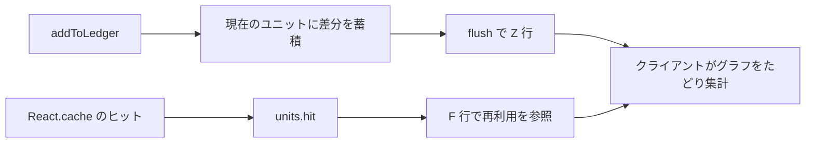

# 2026-11-22（日）

> 今日のひとこと：React の Flight に、サーバーで書いた値をクライアントで集計して読む仕組み「Ledgers」の書き込み側（#37590）が入りました。読み取り側は次の PR 待ちです。対象パッケージの新規の脆弱性は確認できず。

## 今日のリリース

- 【TypeScript】scriptc v0.4.16：Node.js 互換の API（http2 の `respondWithFile`、perf_hooks のヒストグラムなど）の対応範囲を広げた。数字は自己申告（出典: https://github.com/vercel-labs/scriptc/commit/056568bfe）
- 【Wado】v0.0.39：タグのみ確認。リリースノートは未確認（出典: https://github.com/wado-lang/wado/tags）

## トップニュース

### React Flight が Ledgers のエントリをレスポンスストリームに書き始める

【React】Server Components のストリーム（Flight）に、`addToLedger` で書いた値を専用の行として流す実装が入りました。クライアント側で読む処理は未実装で、次の PR で入る予定です（フラグ `enableFlightLedgers` の裏）。

**何が変わる**

- サーバーが、通常のデータとは別の行（`K` `Y` `Q` `Z` `F`）で Ledger の書き込みを流す。
- 行の役割：`K` は Ledger の型の宣言、`Y` は `captureLedgers` の1回分、`Q` は「ユニット」の宣言、`Z` は書き込みの差分、`F` は再利用された計算への参照。
- 同じ flush の間に同じ Ledger へ複数回書くと、`Z` 行1つにまとまる。

**なぜ変えた（PR本文から）**

- Ledger がメインのデータの描画を止めないこと、Flight のキャッシュを邪魔しないこと。
- サーバーに集計の状態を持たせず、足し合わせ（materialize）はクライアントが、誰かが await したときだけ遅延して行う。
- 「サーバーに複雑さを足すと、ストリーミングやキャッシュの性能を損なう」ので、計算はクライアントへ寄せる、という方針。

**何に効く・誰が困る**

- 今は内部実装で、利用者が使える API ではない。公開 API や仕様は、この PR からは分からない（不明）。
- 作者の合成ベンチマーク（約1,000コンポーネント、170KB、`React.cache` ヒット500回）では、ユニット追跡のオーバーヘッドは Flight のシリアライズの約2%、データ待ちのあるリクエスト全体の0.1%未満。数字は自己申告。

**ここまでの経緯**

- 2026-09-26 の号：Flight に Ledgers の骨組みがフラグ付きで入った（#37588）。→ [09-26](2026-09-26.md)
- 2026-11-19 の号：dedupe map に行 ID が追加された（#37589）。→ [11-19](2026-11-19.md)
- 2026-11-20（米東部時間）：今回の書き込み側（#37590）がマージ。
- 次：クライアントのデコード側（PR 本文で「次の PR」と予告）。

出典: https://github.com/facebook/react/pull/37590

## 今日の深掘り

### Ledgers の「ユニット」：再利用される計算の書き込みをどう再利用するか

**選んだ理由**：キャッシュと重複排除が絡むとき、副作用的な書き込みをどう再現するか、という設計が読みどころなので。

**背景**

`React.cache` や Flight のタスクは、結果を再利用する。再利用された結果が、途中で Ledger に書き込んでいたら、再利用した側にもその書き込みを反映しないと、集計が合わなくなる。

**変更点**（`packages/react-server/src/ReactFlightServer.js`、コミット `043ce5953`）

```js
type Unit = {
  request: Request,
  id: number,            // タスクの行 ID と共有
  creator: null | Unit,
  declared: boolean,
  dirtyDeltas: null | Map<Ledger<empty>, LedgerCell>,
  dirtyReferences: null | number | Set<number>,
};
```

- ユニットは「再利用できる計算の単位」で、Flight のタスクか `React.cache` のエントリ。
- 作った側（`creator`）と再利用の参照でグラフになる。クライアントはこのグラフをたどり、各 capture に属する書き込みを決める。
- `Task` に `unit` が足され、`AsyncDispatcher` に `units`（`hit` と `miss` のフック）が足された。`React.cache` がこれで、再利用を Flight に知らせる。



**周辺コード**

- `Q` 行（ユニットの宣言）は、最初の書き込みのときに遅延して書かれる。ただしユニット自体は、書き込みがあるか分からない段階から追跡する必要がある。PR 本文は、これが「Ledger の使用量に比例しない唯一のオーバーヘッド」だと認めている。
- 型の骨組みは `packages/react-server/src/ReactFlightLedgers.js` にある。いまは `kind: 1`（mask）だけで、他の種類は後続（コード中の TODO）。

**この変更から分かる設計思想**

サーバーは「何が起きたか」の記録だけを流し、解釈はクライアントの遅延処理に任せる。ホイストされる preload ヒントとは違い、Ledger はヒントと同様の別行でも、「どの計算が書いたか」を残す点が新しい。

出典: https://github.com/facebook/react/pull/37590

## OSSのPR

### React

トップニュースで扱った #37590 のほか：

- Flight の中断される書き込みのテストで、壊れたチャンクを専用の flush に書くようにした（[#38326](https://github.com/facebook/react/pull/38326)）

### oxc

#### minifier が、再代入された `@__NO_SIDE_EFFECTS__` 関数の呼び出しを消さなくなる

【oxc】`/* @__NO_SIDE_EFFECTS__ */` は宣言された関数の値についての注釈だが、minifier は束縛が再代入された後も、その名前の呼び出しを pure として消していた。`Scoping::symbol_is_mutated` が真なら注釈を無視するようにした。
なぜ変えたか：再代入された別の関数の呼び出しが消え、出力の挙動が変わっていたため（Issue #29972）。
出典: https://github.com/oxc-project/oxc/pull/29974

#### oxlint に型認識ルール `typescript/no-unsafe-class-instance-assignment` が入る

【oxc】`suspicious` カテゴリで、既定では無効（opt-in）。構造的に互換なオブジェクトリテラルや、無関係なクラスのインスタンスの代入を報告する。型情報が要るので oxlint-tsgolint 7.0.2008 を必須にする更新（#29981）も同時に入った。
なぜ変えたか：PR本文からは不明。
出典: https://github.com/oxc-project/oxc/pull/29982

その他：

- transformer：保持されるクラスで TypeScript の代入の意味を保つ（[#29930](https://github.com/oxc-project/oxc/pull/29930)）
- `jsx-curly-brace-presence` が、エスケープシーケンスを含む props を報告・修正しない（[#29976](https://github.com/oxc-project/oxc/pull/29976)）
- checkstyle と junit のレポーターでファイル名とルール名をエスケープ（[#28962](https://github.com/oxc-project/oxc/pull/28962)）

### TypeScript

その他：

- 使われていない `immediate` キーワードを削除（[#65612](https://github.com/microsoft/TypeScript/pull/65612)）

### oxc-project/tsrs

その他（自己申告ベースの tsgo との差分の修正が中心。PR 本文は一部のみ確認）：

- 【oxc】`mapRoot` を source map で使う前に解決（`a/../m` を tsgo と同じ `m` に畳む）（[#1063](https://github.com/oxc-project/tsrs/pull/1063)）
- 同じ lint ルール `no-unsafe-class-instance-assignment` を追加（[#1059](https://github.com/oxc-project/tsrs/pull/1059)）
- ルートファイル名・パスの解決を tsgo の `ResolveFile` / `ParseCommandLine` に合わせる修正が6件（[#1060](https://github.com/oxc-project/tsrs/pull/1060)、[#1061](https://github.com/oxc-project/tsrs/pull/1061)、[#1062](https://github.com/oxc-project/tsrs/pull/1062)、[#1064](https://github.com/oxc-project/tsrs/pull/1064)、[#1065](https://github.com/oxc-project/tsrs/pull/1065)、[#1066](https://github.com/oxc-project/tsrs/pull/1066)）

### Next.js

#### Turbopack が App Router のディレクトリ内の順序をファイルシステムに依存させなくなる

【Next.js】`route.go` と `route.ts` が同じディレクトリにあるとき、どちらが勝つかがファイルシステムの返す順序で決まっていた。ソート順で解決するようにして、`Conflicting App Router handlers` のエラーが常に出る。
なぜ変えたか：canary の CI が壊れていたため（PR本文）。
出典: https://github.com/vercel/next.js/pull/102186

その他：

- Switchyard に、アプリの `route.go` パスとワーカーを伝える（[#102101](https://github.com/vercel/next.js/pull/102101)）
- Switchyard のテストコメントを元に戻す（[#102082](https://github.com/vercel/next.js/pull/102082)）
- Route Handler の AI SDK ストリーミング例を更新（docs のみ、[#102192](https://github.com/vercel/next.js/pull/102192)）

### Biome

その他：

- Svelte のスニペットブロックで型パラメータをパース（[#13345](https://github.com/biomejs/biome/pull/13345)）
- grit のマッチ履歴コピーと行インデックスの perf 改善2件（[#13344](https://github.com/biomejs/biome/pull/13344)、[#13342](https://github.com/biomejs/biome/pull/13342)）
- パス処理のリファクタリング（[#13343](https://github.com/biomejs/biome/pull/13343)）

### Solid

`main` で、signals と compiler の fix が6件（optimistic の同期、`import()` を JSX で動的のまま保つなど）。個別の PR 本文は確認せず、コミットタイトルのみ（[#5156](https://github.com/solidjs/solid/pull/5156)、[#5113](https://github.com/solidjs/solid/pull/5113)、[#5149](https://github.com/solidjs/solid/pull/5149)、[#5148](https://github.com/solidjs/solid/pull/5148)、[#5147](https://github.com/solidjs/solid/pull/5147)、[#5140](https://github.com/solidjs/solid/pull/5140)）。

### vercel-labs/scriptc

リリース 0.4.16 を含むコミット約56件。Node.js 互換 API の細かい対応と CI の調整が中心。

### Wado

コミット約123件（ほとんどが elaborator の推論まわりの修正と `chore`）。`docs/wep-*.md` の動きは確認していない。

### Svelte

docs のみ（`svelte/renderer` の例）。

動きなし：vitejs/vite、whatwg/html、whatwg/fetch

## 続報

- 11-21 の号で取り上げた Svelte のカスタムレンダラーは、今日は docs の修正（#19362）のみ。→ [11-21](2026-11-21.md)
- 09-26 / 11-19 の号の React Ledgers は、書き込み側が入った。残りはクライアントのデコード。→ [11-19](2026-11-19.md)

## 取得できなかったもの

- 次は今回調べられず、「動きなし」とは言えない：whatwg/dom・streams・url、tc39/proposals・ecma262、w3c/aria・ServiceWorker・wcag3（clone に失敗）、csswg-drafts（ページ上は 11-20 までしか見えず）、vuejs/core `minor`（11-20 が最新）、ts-rust（ページ上は 10-28 まで）、oxc-project/tsrs 以外の tsc-ts、議論ウォッチの対象全般、脆弱性の個別アドバイザリ一覧（Advisory DB の npm 一覧で対象パッケージの 11-21 以降の新規は見えず。11-19 の next 5件は前回までの範囲）。
