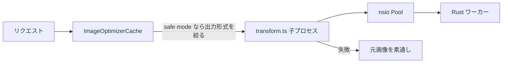

# 2026-11-23（月）

> 今日のひとこと：Next.js の画像最適化に、sharp の代わりにサンドボックス化した Rust ワーカーを使う実験的オプションが入りました。今日は週末明けで全体に静かな日で、新規の脆弱性は確認できた範囲ではありません。

## トップニュース

### Next.js の画像最適化が、sharp から「安全モード」の別実装へ切り替えられるように

【Next.js】`experimental.imgOptSafeMode.nextImage` を有効にすると、`next/image` の最適化が sharp ではなく `@next/safe-image-optimization`（nsio）で動きます。nsio は「サンドボックス化した Rust ワーカープロセスのプール」だと、PR 上の自動レビューは説明しています。

**何が変わる**
- 画像のデコードと再エンコードを、Node 本体の外のワーカーに任せる。入力形式は許可リスト方式で、リストにない形式は例外にする
- 出力は gif / jpeg / png / webp のみ。AVIF など、nsio が書けない形式は `images.formats` から除かれる（`config.ts` が警告を出す）
- 未設定なら従来どおり sharp。既定は変わらない

**なぜ変えたか**
- PR 本文は一行だけで、動機は書かれていません（不明）
- ただしコード内のコメントは、過去のアドバイザリ GHSA-7qx7-33qx-rqx2 を挙げて「許可リスト外の入力を拒否することで、型の取り違え（type confusion）を防ぐ」と書いています。画像最適化は 9月・10月にも重大なアドバイザリが出た箇所です（推測：その流れでの対策）

**何に効く・誰が困る**
- 自分でホストする Next.js で、画像最適化の攻撃面を減らしたい人に効く
- 注意点：PNG に `quality` が効かない、操作キャッシュが無い、AVIF が出せない。ディスクキャッシュが前段にあるので影響は限定的、とコードのコメントにある

**ここまでの経緯**
- 2026-09-22 / 10-14：`next/og` と画像最適化 API の RCE アドバイザリ（Critical）が公開
- 2026-11-03：画像最適化の SVG 拒否の回避など、Moderate が複数公開
- 2026-11-21（現地）：#101254 が canary にマージ

出典: https://github.com/vercel/next.js/pull/101254

## 今日の深掘り

### 許可リストと「失敗したら素通し」：nsio 連携のつくり

【Next.js】選んだ理由：画像処理を「信頼しない入力を扱う部品」として切り出す設計が、数十行のコードに凝縮されているからです。読んだのは `vercel/next.js` の `257bb842e2`。

**背景**
画像最適化は、外部から来たバイト列を解釈する処理です。形式を取り違えるバグが、そのまま攻撃経路になります。そこで「何を読ませてよいか」を呼び出し側が先に決めます。

**変更点**
`packages/next/src/shared/lib/image-optimizer-constants.ts` に、入力と出力の許可リストが定義されました。

```ts
export const NSIO_INPUT_FORMATS = [
  'avif', 'gif', 'jpeg', 'png', 'tiff', 'webp',
] as const
```

コメントによると、これは sharp 側の許可形式から HEIC/HEIF（別の所で遮断）と SVG（最適化せず素通し）を除いたものです。

変換は `packages/next/src/server/image-optimizer/nsio.ts` の `nsioOptimizeImage()` にあります。要所はパイプラインの組み立てです。

```ts
getPool(concurrency, logger)
  .prepare(buffer)
  .allowInputFormats(NSIO_INPUT_FORMATS)
  .timeoutMs(timeoutInSeconds * 1000)
  .autoOrient()
  .resize(width, null, { withoutEnlargement: true })
```

形式の許可、タイムアウト、（指定があれば）入力画素数の上限を、変換の前に宣言します。

**周辺コード**



- `ImageOptimizerCache` が、safe mode のとき `images.formats` を nsio が書ける形式に絞ってから `Accept` ヘッダーと突き合わせる
- `getSupportedMimeType` に「候補が空なら空文字を返す」分岐が足された。空の候補を渡すと、クライアントの第一希望がそのまま返ってしまうため
- `nsio.ts` は子プロセスから読まれるので、import を最小にしてある。`@next/safe-image-optimization` 自体は使うときに初めて `require` する
- 初期化に失敗しても呼び出し側は無最適化の画像で応答する。そのままだと誤設定に気づけないので、`warnOnce` で警告を出す

**設計思想**
- 「許可するもの」を列挙し、それ以外は落とす（deny ではなく allow）
- 危険な処理は別プロセスに隔離し、失敗時は機能を落として動き続ける（fail-open）。ただし PR 上のレビューでは、最適化されない画像が出ることが「セキュリティ問題か」が議論され、SVG を除けば通常は問題視しない、という整理でした
- 既定は変えず、実験フラグで導入する

出典: https://github.com/vercel/next.js/pull/101254

## 仕様の変更

### whatwg/html

#### optgroup の label は、select の外では描画されない

【HTML】`<select>` の外にある `<optgroup>` は、`<option>` と同じく子だけを描画する、という期待に変わりました。以前は、base appearance で描画されないときは常に label を出すと書かれており、select の外の optgroup も含んでいました。
なぜ変えたか：WebKit の挙動に合わせ、WPT のテスト（web-platform-tests/wpt#58172、#58228）と整合させるため。
出典: https://github.com/whatwg/html/commit/6eac2b5

動きなし：whatwg/dom, whatwg/fetch, whatwg/streams, whatwg/url, tc39/ecma262, tc39/proposals, w3c/csswg-drafts, w3c/aria, w3c/ServiceWorker（前回の実行以降のコミットなし。w3c/wcag3 は未確認）

## OSSのPR

### React

#### Ledgers：サーバー側の `captureLedgers` が入る

【React】Flight の Ledgers の続きです。`captureLedgers` が、レンダリンググラフの一部を包んで Ledger への書き込みを捕まえます。ラッパー型として `LedgerDataObject`（元のデータと同じに描画され、書き込みを追跡する）と `LedgerTotal`（クライアントのストリームが閉じたとき解決する thenable）が入りました。クライアント側のデコードは未実装で、後続 PR です。
なぜ変えたか：再利用された結果に、それを作ったときの書き込みも一緒に付いてくるようにするため（コードのコメントより）。
本への影響: なし（Ledgers は実験的 API）
出典: https://github.com/facebook/react/commit/33e52451f

### Next.js

その他：

- 永続キャッシュが読めないとき、起動時に回復する（[#101954](https://github.com/vercel/next.js/pull/101954)）
- turbo-tasks で、タスク欠落の panic に呼び出し元の位置を出す（[#102169](https://github.com/vercel/next.js/pull/102169)）
- Go エンドポイントのハンドラーが外れた後は出力を公開しない（[#102166](https://github.com/vercel/next.js/pull/102166)）

### Biome

#### Astro ファイル対応が、意味モデル（semantic model）の段階へ

【Biome】#13000 から #13018 まで、Astro 向けの変更が連続して入りました。フロントマターの参照解決、クライアントスクリプトのスコープ、style の `define:vars`、言語をまたいだ参照の追跡などで、lint ルールが Astro の埋め込み言語を横断して使えるようになる土台です。
なぜ変えたか：PR 本文は確認していません（不明）。コミットのタイトルからの推測です。
出典: https://github.com/biomejs/biome/commit/64bffda813

その他：

- Svelte の `{#if}`、`{#each}` ブロックが、隣の要素と離れないよう整形を修正（[#13375](https://github.com/biomejs/biome/pull/13375)）
- Tailwind のクラス解析で、aarch64 の NEON を使って高速化（[#13332](https://github.com/biomejs/biome/pull/13332)）
- 依存の脆弱性対応（[#13364](https://github.com/biomejs/biome/pull/13364)）、rowan のトークン走査の整理（[#13355](https://github.com/biomejs/biome/pull/13355)）、フォーマッターのメモリレイアウト境界の修正（[#13362](https://github.com/biomejs/biome/pull/13362)）
- Astro 関連の細かい修正と機能追加が約15件（#13001〜#13018 の範囲）

### oxc

#### minifier が、定数畳み込みと文字列結合の平坦化を広げる

【oxc】`x - 0` や `x * 1` のような数値の恒等式の畳み込み（#29926）、ネストした文字列連結と template literal の平坦化（#30015、#29993）、case が1つと default だけの switch を if-else にする変換（#29990）が入りました。
なぜ変えたか：出力サイズの削減。PR 本文は未確認です。
出典: https://github.com/oxc-project/oxc/pull/29926

その他：

- minifier：除算の畳み込み（[#29994](https://github.com/oxc-project/oxc/pull/29994)）、`String.fromCodePoint` が投げる場合を保つ（[#30014](https://github.com/oxc-project/oxc/pull/30014)）、直接 eval から見えるブロックスコープの var をインライン化しない（[#29992](https://github.com/oxc-project/oxc/pull/29992)）
- ecmascript：`ToNumber` の単項式評価、RegExp フラグの正規化、shadow された `NaN` の扱いなど（[#30009](https://github.com/oxc-project/oxc/pull/30009)、[#30008](https://github.com/oxc-project/oxc/pull/30008)、[#30005](https://github.com/oxc-project/oxc/pull/30005)）
- linter：`no-extra-boolean-cast`、`operator-assignment`、`exhaustive-deps`、`branches-sharing-code` の修正（[#30012](https://github.com/oxc-project/oxc/pull/30012)、[#30013](https://github.com/oxc-project/oxc/pull/30013)、[#29986](https://github.com/oxc-project/oxc/pull/29986)、[#30006](https://github.com/oxc-project/oxc/pull/30006)）
- oxlint：診断のオフセットを行インデックスで位置に変換して高速化（[#29987](https://github.com/oxc-project/oxc/pull/29987)）

### oxc-project/tsrs

その他：

- `--type-check` のグローバル診断をドキュメント化（[#1068](https://github.com/oxc-project/tsrs/pull/1068)）

### GHC

その他：コミットメッセージのみを根拠にした一覧です（マージリクエストはGitLabで読めず）。

- bang pattern の desugar の改善、`\cases` の Quote の型修正、zonking のバグ修正
- x86 NCG：CFG の維持（i386）、現在ブロックの追跡、jump table の宛先の重複排除
- Cmm：CBE で除去済みブロックをグラフから落とす
- `ghc -M` が link ノードを JSON 出力に対応、IOManager テストの競合修正、nightly CI の修正

### Wado

その他：2026-11-22 の1日で約35コミット。docs/wep 関連は「function-type impl target は effect parameter を束縛しない」を記録するコミット（f2525c9）のみ確認（ファイル名は未確認）。

動きなし：vitejs/vite, microsoft/TypeScript, sveltejs/svelte, vuejs/core（minor）, solidjs/solid（next）, oven-sh/bun（`bun check`・`bun fmt` に関わるものは確認できず。タイトルのみで判定）, pingdotgg/ts-rust（最新は10-28で、以降のコミットは確認できず）。vercel-labs/tsc-ts、vercel-labs/scriptc は今回確認せず。

## 議論ウォッチ

取得できず（今回は各リポジトリの Discussions・Issue・標準化ポジションを確認していない）。

## 続報

- 11月22日の号で取り上げた React Flight の Ledgers（#37590、ワイヤープロトコルと `Y` 行）が、今日サーバー側の `captureLedgers`（#37591）まで進みました。クライアント側のデコードは次以降。[2026-11-22 の号](2026-11-22.md)
- 11月20日の号の Switchyard は、今日の号の範囲ではコミットなし。[2026-11-20 の号](2026-11-20.md)

## 脆弱性

新規のアドバイザリは、確認できた範囲では見つかりませんでした。

- 確認：vercel/next.js（最新は11-03）、vitejs/vite（最新は11-10）、sveltejs/svelte（最新は05-14）、withastro/astro（先頭ページで最新は11-09）
- 取得できず（今回は未確認）：react、vuejs/core、oxc、nuxt、TanStack/router
