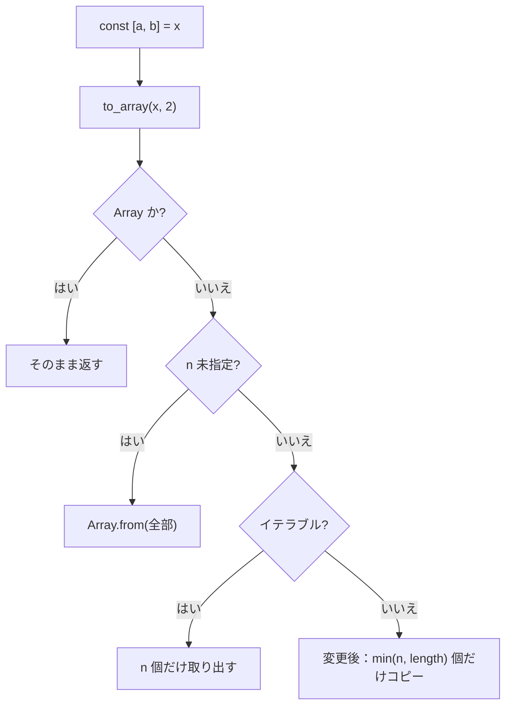

# 2026-11-26（木）

> 今日のひとこと：昨日の号で「非公開の fork から入った」と書いた Svelte の修正2件が、Svelte 5.59.2 とアドバイザリ2件（Low と Moderate）として公開されました。Vue の SSR にも High の DoS アドバイザリが出ています。

## 今日のリリース

- 【Svelte】5.59.2：fork から入った2件のセキュリティ修正（XSS と無制限アロケーション）を含むパッチ版（出典: https://github.com/sveltejs/svelte/releases/tag/svelte%405.59.2）
- 【Vite】8.4.0-beta.2（2026-11-25 公開）：タグのみ確認。変更内容は不明（出典: https://github.com/vitejs/vite/releases/tag/v8.4.0-beta.2）

## トップニュース

### Svelte の非公開修正2件が、アドバイザリとパッチ版として公開される

【Svelte】2026-11-25 に Svelte 5.59.2 が出て、昨日の号の2コミット（`967218863`、`dba8d14bf`）に対応するアドバイザリ2件が公開されました。詳細は脆弱性の節にあります。

**何が変わる**

- 1つは、スプレッド属性（`{...props}`）のクライアント側で、`onClick` のような大文字を含むイベントハンドラー名が DOM 属性として書かれていた問題（GHSA-p965-6jxv-r66x、Low）。
- もう1つは、配列風オブジェクトの分割代入で、要素数の上限を守らず `length` 分だけ確保していた問題（GHSA-6mgr-mcq2-29qx、Moderate）。

**なぜ変えた**

どちらも、サーバー側（SSR）では守られていた性質が、クライアント側や別の経路では抜けていたことが原因です。前者は SSR とクライアントの不一致、後者は「必要な個数だけ取る」という前提の欠落です。

**何に効く・誰が困る**

- 前者は、属性のキーを攻撃者が決められる形でスプレッドしているアプリ。SSR の HTML は影響を受けません。
- 後者は、信頼できない JSON を `$state` / `$derived` の配列分割代入に渡しているアプリ。
- 5.59.2 へ更新すれば解消します。

**ここまでの経緯**

- 2026-11-24：fork からのマージ2件が main に入る（[11-25 の号](2026-11-25.md)）
- 2026-11-25：5.59.2 公開、アドバイザリ2件公開

出典: https://github.com/sveltejs/svelte/security/advisories/GHSA-p965-6jxv-r66x / https://github.com/sveltejs/svelte/security/advisories/GHSA-6mgr-mcq2-29qx

## 今日の深掘り

### Svelte：`to_array` が「イテラブルでない配列風オブジェクト」にも上限を守る

選んだ理由は、`const [a, b] = x` という1行が、ランタイムではどんな関数になり、どこに穴があったかが小さな diff で見えるからです。コミットは `dba8d14bf`（`packages/svelte/src/internal/shared/utils.js`）です。

**背景**

`$state` や `$derived` で配列を分割代入すると、コンパイラは値を `to_array(value, n)` に通します。`n` は、パターンが必要とする要素数です。

イテラブルが無限に続く場合でも、`n` 個だけ取れば止まります。そのため、`n` を渡す設計になっていました。

**変更前**

```js
// n が未指定（rest 要素）か、イテラブルでなければ Array.from
if (n === undefined || !(Symbol.iterator in value)) {
	return Array.from(value);
}
```

「イテラブルでない」ものは `n` を無視して `Array.from(value)` に回っていました。`{ length: 1e9 }` のような配列風オブジェクトだと、必要なのが2個でも `length` 分を確保しようとします。

**変更後**

```js
if (n === undefined) {
	return Array.from(value);
}

// array-like だがイテラブルでない：最大 n 個だけコピー
if (!(Symbol.iterator in value)) {
	const length = Math.min(n, value.length);
	return Array.from({ length }, (_, i) => value[i]);
}
```

条件を2つに割り、`n` が分かっているときは、イテラブルでなくても `Math.min(n, length)` で打ち切ります。`n` がないのは rest 要素（`...rest`）のときだけで、そのときは全部必要なので `Array.from` のままです。

**周辺コード**



**設計思想**

- 「必要な分だけ取る」という不変条件を、入り口の関数で一貫して守る。
- 型の判定（イテラブルか）と上限の判定（`n` があるか）を、別の条件に分ける。

分岐が「または」で繋がっていると、片方の条件のために、もう片方の性質が落ちます。今回はそれが穴になっていました。なお、攻撃の成立条件はアドバイザリの記述に基づきます。

出典: https://github.com/sveltejs/svelte/commit/dba8d14bfa2b26e0fdbb03b31f967e37ac185f59

## 仕様の変更

### whatwg/html

#### `customelementregistry` グローバル属性と、DOM 側の「null を保つ」フラグ

【HTML】【DOM】HTML に `customelementregistry` グローバル属性が入り（`7b79d79`）、DOM には、意図的に `null` にしたカスタム要素レジストリをクローンや採用（adopt）で保つための仕組みが入りました（whatwg/dom `ddfb52f`）。DOM 側のコミットは、HTML がそれを保持できるようにするためと説明しています。
なぜ変えたか：スコープ付きレジストリで「レジストリなし」を明示した要素が、クローンで既定のレジストリに戻るのを防ぐためだと読めます（コミットメッセージからの推測を含みます）。
出典: https://github.com/whatwg/html/commit/7b79d79 / https://github.com/whatwg/dom/commit/ddfb52f

その他：

- フォーム要素に removing steps を追加（[2a4e786](https://github.com/whatwg/html/commit/2a4e786)）
- 別オリジンの `NavigateEvent` の `sourceElement` を隠す（[d5be172](https://github.com/whatwg/html/commit/d5be172)）
- `sizes=auto` の文法・パース・省略時のフォールバックを修正（[46f1cb2](https://github.com/whatwg/html/commit/46f1cb2)）

### w3c/csswg-drafts

その他：

- css-spatial-1 の `environment-map` と `environment` ショートハンドをレイヤーごとに変更、`z-align-self`/`z-align-items` の初期値の取り違えを修正、`place-self`/`place-items` の拡張を partial propdef に（[9c7ee531](https://github.com/w3c/csswg-drafts/commit/9c7ee531)、[043c6ab5](https://github.com/w3c/csswg-drafts/commit/043c6ab5)、[4bb74b13](https://github.com/w3c/csswg-drafts/commit/4bb74b13)）。editorial 2件は除外

動きなし：whatwg/fetch, whatwg/streams, whatwg/url, tc39/ecma262, tc39/proposals, w3c/aria, w3c/ServiceWorker, w3c/wcag3

## OSSのPR

### React

#### Ledgers に組み込みの kind が出そろい、デコード済みレスポンスからも転送できる

【React】Ledgers は、コンポーネントからの書き込みを集めて「合計」にする仕組みです。今回、Bit / Mask / Min / Max / Set の5種（`createBitLedger` など）が入りました（#37593）。汎用のコンストラクターは「設計上ない」とされています。
なぜ変えたか：書き込みが単調（打ち消さない）、可換（順序に依存しない）、結合的（部分合計を併合できる）であれば、並列のストリームをバッファせずに流せ、部分プリレンダーで途中で閉じても合計が成り立つため、とコミットメッセージは説明しています。
他に、デコード済みレスポンスからの転送（#37634）と、テストスイート（#37594）が入っています。
続報：[11-22](2026-11-22.md)、[11-23](2026-11-23.md) の続きです。
出典: https://github.com/facebook/react/pull/37593

その他：

- `disableLegacyMode` を削除（[#38368](https://github.com/facebook/react/pull/38368)）
- レガシーテストを concurrent モードへ移行（[#38380](https://github.com/facebook/react/pull/38380)）

### Next.js

その他：

- 開発時に lazy dynamic imports を既定で有効にした変更を、準備不足としてリバート（[#102379](https://github.com/vercel/next.js/pull/102379)、元は [#101873](https://github.com/vercel/next.js/pull/101873)）
- `output: 'standalone'` を `experimental.goRoutes` と併用可能に（[#102362](https://github.com/vercel/next.js/pull/102362)）
- Turbopack：編集後に現在のソース内容でローダーを実行（[#102288](https://github.com/vercel/next.js/pull/102288)）
- 動的な `process.env` アクセスの限定的なエスケープ解析と、durable な use cache エントリの deopt（[#102093](https://github.com/vercel/next.js/pull/102093)、[#102094](https://github.com/vercel/next.js/pull/102094)）
- turbo-tasks-backend：エラー連鎖の再構築でのパニックを修正（[#102231](https://github.com/vercel/next.js/pull/102231)）
- エージェント向けアップグレードで CLI の環境変数が漏れる問題を修正（[#102070](https://github.com/vercel/next.js/pull/102070)）

### Vite

その他：

- `cssCodeSplit: false` のとき、インライン化された共通チャンクの CSS を重複排除（[#24168](https://github.com/vitejs/vite/pull/24168)）
- `server.fs.strict: 'extended'` のときだけ、安全なモジュールへの参照を登録（[#24206](https://github.com/vitejs/vite/pull/24206)）

### Svelte

#### 非 async アプリから async 専用コードをツリーシェイクできる

【Svelte】`experimental.async` のときだけ動く `Batch` と `Boundary` の関数15か所に `async_mode_flag` のガードを足し、バンドラーが無効時にコードを落とせるようにしました（#19422）。PR 本文は Discord でのバンドルサイズの相談が発端だとしています。
なぜ変えたか：async を使わないアプリのバンドルを小さくするため。
出典: https://github.com/sveltejs/svelte/pull/19422

その他：

- `duration: 0` のトランジションでスタイルが正しく当たらない問題を修正（[#19444](https://github.com/sveltejs/svelte/pull/19444)）
- 書き込みが拒否されたとき、リアクティブクラスと `$state` プロキシを変更しないままにする（[#19405](https://github.com/sveltejs/svelte/pull/19405)）
- 未登録のカスタム要素のセッターをキャッシュしない（[#19441](https://github.com/sveltejs/svelte/pull/19441)）
- devalue 5 が解決されたとき `hydratable` の promise をシリアライズ（[#19427](https://github.com/sveltejs/svelte/pull/19427)）
- `svelte/internal/init-operations` をサーバーで noop に（[#19449](https://github.com/sveltejs/svelte/pull/19449)）

### oxc

oxc は63件（うちパーサーの回復・拒否まわりの修正が多数）。

#### パーサーが不正なデコレーターや JSX を拒否する修正が続く

【oxc】Cameron 氏による `fix(parser)` が、デコレーターの位置（非クラスの export、クラスのコンストラクター）、JSX スプレッド属性の無括弧カンマ、ソースフェーズ import の扱い（#30295、破壊的変更の印 `!` 付き）などを一日で多数直しています。
なぜ変えたか：テスト用の適合スイートとの差を埋めているためと見えますが、PR 本文までは読めておらず不明です。
出典: https://github.com/oxc-project/oxc/pull/30295

その他：

- 診断で長いソーススパンを折りたたむ（[#28995](https://github.com/oxc-project/oxc/pull/28995)）
- トランスフォーマーのスコープ付け替えの修正が複数（[#30214](https://github.com/oxc-project/oxc/pull/30214)、[#30216](https://github.com/oxc-project/oxc/pull/30216)、[#30218](https://github.com/oxc-project/oxc/pull/30218)、[#30220](https://github.com/oxc-project/oxc/pull/30220)）
- リンターの jsdoc ルール追加・修正、`no-duplicate-enum-values` がテンプレートリテラルに対応（[#30279](https://github.com/oxc-project/oxc/pull/30279)、[#30277](https://github.com/oxc-project/oxc/pull/30277)、[#30294](https://github.com/oxc-project/oxc/pull/30294)）
- oxfmt / yaml / htmlish フォーマッターの修正が複数（[#30225](https://github.com/oxc-project/oxc/pull/30225)、[#30222](https://github.com/oxc-project/oxc/pull/30222)、[#30217](https://github.com/oxc-project/oxc/pull/30217)）
- oxlint の JS/TS 設定から experimental の表記を削除（docs のみ、[#30238](https://github.com/oxc-project/oxc/pull/30238)）

### oxc-project/tsrs

その他（【oxc】、7件。数字の変化は確認できず）：

- lint の tsconfig を1リクエストで1回だけパース（[#1086](https://github.com/oxc-project/tsrs/pull/1086)）
- チェッカーのパニック修正2件、宣言出力のパニック修正（[#1091](https://github.com/oxc-project/tsrs/pull/1091)、[#1090](https://github.com/oxc-project/tsrs/pull/1090)、[#1093](https://github.com/oxc-project/tsrs/pull/1093)）
- 拡張子違いの import を設定済みプログラムで lint（[#1094](https://github.com/oxc-project/tsrs/pull/1094)）

### TypeScript

#### enum リテラルとのインターセクションが `never` にならなくなる

【TypeScript】`Enum.A & "a"` が `never` ではなく `Enum.A` になるよう修正されました（#65658）。計算プロパティ名には非ウィデニングのリテラル型を使うようにもなっています（#65659）。
なぜ変えたか：PR 本文は読めておらず不明です。
出典: https://github.com/microsoft/TypeScript/pull/65658

その他：

- ジェネリックなインデックスアクセス型の制約をキャッシュ（[#65664](https://github.com/microsoft/TypeScript/pull/65664)）
- LSP で後続のプロジェクト参照の再ビルドを避ける（[#64936](https://github.com/microsoft/TypeScript/pull/64936)）
- API ノードの更新・複製でテキスト範囲を保持（[#65649](https://github.com/microsoft/TypeScript/pull/65649)）
- ツール系：ESLint 有効化、リリース保守ワークフロー移行、自律 PR の AI 情報要求（[#65648](https://github.com/microsoft/TypeScript/pull/65648)、[#65663](https://github.com/microsoft/TypeScript/pull/65663)、[#65671](https://github.com/microsoft/TypeScript/pull/65671)）

### vercel-labs/scriptc

【TypeScript】13件前後（Node.js API の互換性の追加が中心。数字は自己申告で、今回は確認していません）。

その他：

- `exec`/`execFile` を signal で中断（[#4143](https://github.com/vercel-labs/scriptc/pull/4143)）
- HTTP/2 のセッションプロパティ・破棄・`Expect: 100-continue` に対応（[#4158](https://github.com/vercel-labs/scriptc/pull/4158)）
- `node:test` で関数名からテスト名を付ける（[#4161](https://github.com/vercel-labs/scriptc/pull/4161)）
- `Writable.toWeb` が writable 風オブジェクトを受け付ける（[#3973](https://github.com/vercel-labs/scriptc/pull/3973)）

### Biome

その他：

- lint ルール `useConsistentBooleanProps` を追加（[#12903](https://github.com/biomejs/biome/pull/12903)）
- svelte の each ブロックのパースを修正（[#13418](https://github.com/biomejs/biome/pull/13418)）
- `noUnnecessaryConditions` が `while (true)` を報告しない（[#13367](https://github.com/biomejs/biome/pull/13367)）
- `useErrorCause` が末尾のオプション引数を許容（[#12587](https://github.com/biomejs/biome/pull/12587)）
- フォーマッター：括弧付き論理演算子のオペランドを1回目で平坦化（[#12550](https://github.com/biomejs/biome/pull/12550)）
- バイナリサイズ削減のリファクタリング・CI（[#13422](https://github.com/biomejs/biome/pull/13422)、[#13423](https://github.com/biomejs/biome/pull/13423)、[#13424](https://github.com/biomejs/biome/pull/13424)）

### Vue

その他：

- JSX のテキスト内容プロパティの型を追加（[#16392](https://github.com/vuejs/core/pull/16392)）

動きなし：Solid（リリース用ワークフローの修正2件のみ）、ts-rust、tsc-ts、Bun（対象外の動きのみ）、ghc/ghc、wado-lang/wado（今回は確認していない）

## 脆弱性

### Svelte：スプレッド属性の XSS（GHSA-p965-6jxv-r66x、Low）

- 影響：svelte 5.59.1 以前。修正は 5.59.2。
- 攻撃原理：スプレッド属性のクライアントランタイムが、大文字を含むイベントハンドラー名（`onClick` など）を属性として DOM に書く。キーを攻撃者が決められると、ハンドラーが実行される。
- 成立条件：外部データを要素にスプレッドし、そのキーを攻撃者が制御できること。SSR の HTML は影響を受けない。
- 修正の diff（`967218863`、`attributes.js`）：`set_attributes` に、プレフィックスが大文字小文字を無視して `on` に当たり、かつ `on` そのものではないキーを `continue` で飛ばす1行を追加。SSR と同じ扱いにした。

```js
// omit event handler attributes regardless of casing, matching SSR
if (prefix !== 'on' && key.length > 2 && prefix.toLowerCase() === 'on') continue;
```

出典: https://github.com/sveltejs/svelte/security/advisories/GHSA-p965-6jxv-r66x

### Svelte：配列分割代入の無制限アロケーション（GHSA-6mgr-mcq2-29qx、Moderate）

- 影響：svelte 5.33.5〜5.59.1。修正は 5.59.2。
- 攻撃原理と修正：今日の深掘りの通り。巨大な `length` を持つ配列風オブジェクトで、SSR 中に大量のメモリを確保させられる。
- 成立条件：信頼できないデータを `$state` / `$derived` の配列分割代入に渡すこと。

出典: https://github.com/sveltejs/svelte/security/advisories/GHSA-6mgr-mcq2-29qx

### Vue：SSR の属性・プロップ名キャッシュによる DoS（GHSA-4vq7-jqv7-j374、High、CVSS 7.5）

- 影響：`@vue/shared` が 3.5.46 未満、および 3.6.0-alpha.1 以上 3.6.0-rc.15 未満。修正は 3.5.46 と 3.6.0-rc.15。
- 攻撃原理：2つ。
  - `isSSRSafeAttrName` が `attrValidationCache.hasOwnProperty(name)` で引くため、属性名が `hasOwnProperty` だとメソッドが上書きされ、以後の描画が例外になる（再起動まで）。
  - `camelize`、`hyphenate`、`capitalize`、`toHandlerKey`、属性検証のキャッシュが全キーを保持し、一意なキーで heap を使い切れる。
- 成立条件：SSR で、信頼できない入力のキーを属性・プロップ・`style` のキーとして描画すること。前者はカスタム要素（名前に `-`）か `h()` の SVG ルートが必要。コンパイル済みテンプレートの `<svg>` ルートとクライアントのみの描画は影響を受けない。
- 修正：`isSSRSafeAttrName` がキャッシュしなくなり、他のキャッシュは10,000件で頭打ちになる、とアドバイザリは書いている。修正コミット：不明（アドバイザリページに記載なし）。
- 同種のパターン：今日の Svelte の件と同じく、「入力が決めるキーや長さに、上限や安全な参照がない」型。

出典: https://github.com/vuejs/core/security/advisories/GHSA-4vq7-jqv7-j374

確認した他のパッケージ（next, react, vite, astro, nuxt, TanStack, oxc）に、今回の期間の新規アドバイザリは見つかりませんでした。ただし astro と TanStack は一覧の1ページ目のみの確認です。
