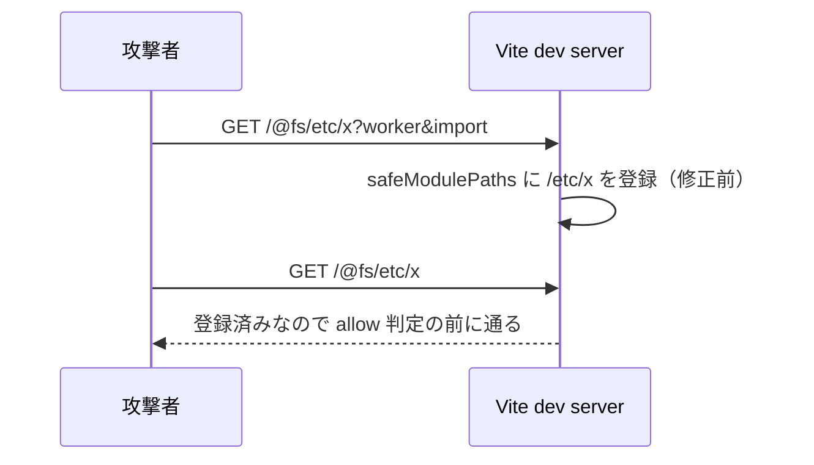

# 2026-11-27（金）

> 今日のひとこと：Vite 8.4.0 が安定版になり、`server.fs.strict: 'extended'` で「dev サーバーが返してよいファイル」の判定が広がりました。同じ機能の beta.1 に入っていたファイル漏えい（Moderate）のアドバイザリも公開されています。

## 今日のリリース

- 【Vite】8.4.0：dev サーバーの「safe module」の仕組み（`environment.addSafeModule`、`server.fs.strict: 'extended'`）と、SSR でのバンドル dev モードが入った安定版（出典: https://github.com/vitejs/vite/releases/tag/v8.4.0）
- 【Vite】create-vite 9.4.0：テンプレートの案内が `oxlint-tsgolint` から `tsrs` に変わった（出典: https://github.com/vitejs/vite/commit/dbb01aae3）
- 【Next.js】v16.5.0-preview.0：プレビュー版。リリースノートは確認できていない（出典: https://github.com/vercel/next.js/releases/tag/v16.5.0-preview.0）
- 【scriptc】v0.4.17：タグのみ確認。変更内容は不明（出典: https://github.com/vercel-labs/scriptc/releases/tag/v0.4.17）

## トップニュース

### Vite 8.4.0 が出て、dev サーバーのファイル配信ルールに「extended」モードが加わる

【Vite】8.4.0 は、dev サーバーが `server.fs.allow` の外のファイルを返してよい条件を、設定で広げられるようにしました。広げた分の穴は、同じ日にアドバイザリになった beta 版の不具合の形で見えています。

**何が変わる**

- `server.fs.strict: 'extended'`（#23972）。ソースやHTMLが参照した「安全なモジュール」を、リクエスト単位で許可リストに足す。
- `environment.addSafeModule`（#23974）と、環境ごとの `safeModulePaths`（#23973）。プラグインが「このファイルは返してよい」と宣言できる。
- そのほか、SSR でバンドル dev モード、WebAssembly の source phase import、CSS の `url()` でサブパス import、ビルドの manifest に worker チャンクを含める、`optimizeDeps.rollupOptions` の削除、など（リリースノートより）。

**なぜ変えた**

PR 本文までは読めていません。コミット構成（#23167 から #23974）からみると、`server.fs.allow` を空にしても動く構成を目指したようです。ただしこれは推測です。

**何に効く・誰が困る**

- `extended` を使わない人は、既定の挙動のまま。
- beta.1 を `--host` 付きで動かしていた人は、更新が必要（脆弱性の節）。
- `css.devSourcemap` が `dev.sourcemap.css` に移ったので、設定を確認する。

**ここまでの経緯**

- 2026-11-12：safe module 関連の5コミットが入る（#23167、#23168、#23169、#23972〜#23974）
- 2026-11-25：8.4.0-beta.2。参照の登録を `extended` のときだけにする修正（#24206）を含む（[11-26 の号](2026-11-26.md)）
- 2026-11-26：8.4.0 安定版、アドバイザリ公開

出典: https://github.com/vitejs/vite/releases/tag/v8.4.0

## 今日の深掘り

### Vite：「2回目のリクエストで通る」ファイル漏えいと、その直し方

beta 版のアドバイザリ GHSA-qppr-rxr4-jjq2 の修正（a78fb8a28、#24206）を読みます。「許可リストに足す」設計がどこで漏れるかが、そのまま見える修正です。

**背景**

dev サーバーは `/@fs/<絶対パス>` でファイルを返せます。返してよいかは `server.fs.allow` と `server.fs.deny` で決まります。ところが `?worker&import` や `?wasm` のように、別の経路で処理されるリクエストでは、このチェックが走らない場合があります。

そこで #23168 は、ソースが参照したファイルを `safeModulePaths` に登録し、「あとで来るリクエストは返してよい」とする仕組みを足しました。この登録が、ファイルを返す前の判定より先に効きました。

**変更点（アドバイザリの説明と、修正 diff の対応）**

1. 1回目：`/@fs/<パス>?worker&import` を送る。ここで `fileToUrl` が呼ばれ、そのパスが `safeModulePaths` に登録される。
2. 2回目：クエリなしの `/@fs/<パス>` を送る。登録済みなので、`server.fs.allow` の判定より先に通り、ファイルが返る。

修正は、登録を条件つきにしました。

```ts
// packages/vite/src/node/plugins/asset.ts（a78fb8a28）
if (
  !publicFile &&
  environment.mode === 'dev' &&
  // `fileToUrl` may be called for modules that are not checked by the
  // `server.fs` check for `server.fs.strict: true`
  config.server.fs.strict === 'extended'
) {
  const { safeModulePaths } = config.environments.client
  const requestId = id.split('#', 1)[0]
  safeModulePaths.addId(requestId)
  ...
}
```

つまり「`strict: 'extended'` を明示した人だけが、参照の登録を受ける」形です。worker 用には `workerFileToDevUrl` が新設され、登録するのは `file + postfix` に `worker_file&type=...` を足した完全なキーだけです。素のパスは登録されません。



**周辺コード**

登録の入口は `fileToDevUrl`（`plugins/asset.ts`）で、worker は `plugins/worker.ts` と `workerImportMetaUrl.ts` がここを呼びます。修正は、呼び出し側の3箇所を `workerFileToDevUrl` にまとめる整理もしています。

**設計思想**

「一度見たものを許す」許可リストは、キー（パスだけか、クエリ込みか）の粒度が緩いと、そのまま迂回路になります。修正は、登録を既定で止め、登録するキーを細くしています。

影響範囲は8.4.0-beta.1 だけです。出典: https://github.com/vitejs/vite/commit/a78fb8a28 / https://github.com/vitejs/vite/security/advisories/GHSA-qppr-rxr4-jjq2

### Next.js：Go プロキシが `...rsc` の後ろの「ドット区間」で認可を迂回される

Switchyard（[11-20 の号](2026-11-20.md)）と同じ系統の Go プロキシで、パス正規化の順序が原因の認可バイパスが直りました（#102444、0dd68a50f0）。実験的な Go のサポートの中の話で、安定版の Next.js の脆弱性ではありません。

**背景**

アダプターが作る `proxy.go` は、認可のために URL を正規化します。RSC のリクエストには、パスの末尾に転送用の接尾辞が付きます。その接尾辞を外すと、`/a/..` のような「ドット区間」が現れることがあります。

**変更点**

```go
// crates/next-api/src/templates/go_proxy_handler.go（0dd68a50f0）
path = nextGoNormalizeRSCPath(path)
// ... 接尾辞を外した結果にドット区間が出ると、
// プロキシは親パスを認可し、アダプターは元のパスを保護された
// ハンドラーへ回す
reparsedPath := nextGoParsePath(path)
if reparsedPath != path {
	return false
}
```

修正前は、接尾辞を外したあとで再度パースして、親パスに正規化した結果で認可していました。下流の Go ルートには元の URL が渡るので、認可した対象と実際に動くハンドラーがずれました。修正後は、再パースで形が変わるパスを拒否します。リテラルと `%2e` などのパーセントエンコードの両方が対象です。

PR 本文によれば、新しい回帰テストは修正前に 200、修正後に 404 を返しました。通常の保護パスは 403、公開パスは 200 のままです（自己申告）。

**設計思想**

「認可する側が見るパス」と「ルーティングする側が見るパス」は、同じ正規化を通さないと食い違います。ここでは、正規化をやり直す代わりに、食い違いそのものを拒否する直し方を選んでいます。

出典: https://github.com/vercel/next.js/pull/102444

## 仕様の変更

### whatwg/html

#### `blur()` が、フォーカスできなくなった要素にも効くようになる

【HTML】unfocusing steps から「古いフォーカス対象がフォーカス可能領域でなければ return」という1行が消えました。フォーカス中の textarea の祖先を隠したあとに `blur()` を呼ぶと、次の描画更新（focus fixup）を待たず、その場でフォーカスがビューポートに移ります。
なぜ変えたか：コミットメッセージによれば、Chromium、Gecko、WebKit の実際の挙動に合わせるため。
出典: https://github.com/whatwg/html/commit/0162cee0c42a82267354d38fbc6a2503ee295b77

### w3c/aria

#### 要素の role は ASCII 大文字小文字を区別しない、と明記される

【ARIA】`role` 属性の値から「最初の非抽象ロール名に一致するトークン」を選ぶ手順に、「[=ASCII case-insensitive=] に一致する」という条件が加わりました。導入部にあった重複する段落は削除されています。`role="Button"` が `button` として扱われる、という実装の通説が仕様に書かれた形です。
なぜ変えたか：PR の説明は読めていません。タイトルは「Clarify」で、挙動の明確化とみられます（推測）。
出典: https://github.com/w3c/aria/commit/714e22ab732ff816173ad97f97aca948b6cb4706

その他：

- editorial：role image の説明の文言、Dependabot 設定の重複削除（除外）

動きなし：whatwg/dom, whatwg/fetch, whatwg/streams, whatwg/url, tc39/ecma262, w3c/ServiceWorker, w3c/wcag3, w3c/csswg-drafts（前日の css-spatial-1 以降なし）

## OSSのPR

### Next.js

#### 耐久的な `"use cache"` エントリが Turbopack の本番ビルドで既定になる

【Next.js】`durableUseCacheEntries` の既定値が true になりました（#101922）。デプロイをまたいで `"use cache"` のリモートキャッシュを再利用できます。
なぜ変えたか：PR 本文によれば、対応するビルドが、オプトインなしでキャッシュを再利用できるようにするため。
出典: https://github.com/vercel/next.js/pull/101922

その他：

- `next/go` SDK を追加し、Go プロキシのヘルパーを移動（[#101874](https://github.com/vercel/next.js/pull/101874)）
- Go ルートを `package main` ではなく import 可能なパッケージとしてコンパイル（[#101898](https://github.com/vercel/next.js/pull/101898)）
- Turbopack：node_modules から import した画像が `StaticImageData` を返す（[#102389](https://github.com/vercel/next.js/pull/102389)）
- `experimental_prepare()` を、フラグが無効のときクライアントバンドルから外す（[#102423](https://github.com/vercel/next.js/pull/102423)）
- dev サーバーで `instant()` を使ってリンクを検査（[#102453](https://github.com/vercel/next.js/pull/102453)）
- `@next/mcp` を private に（[#102446](https://github.com/vercel/next.js/pull/102446)）
- image optimizer の safe mode オプションの説明から ImageResponse への言及を削除（[#102402](https://github.com/vercel/next.js/pull/102402)）
- Cache Components まわりのエラー文の修正 3件（[#101250](https://github.com/vercel/next.js/pull/101250)、[#102398](https://github.com/vercel/next.js/pull/102398)、[#102386](https://github.com/vercel/next.js/pull/102386)）
- 他は docs、テスト、リリース用CI、canary（67〜69）

### Solid

#### ストアが「キーごとに1つのシグナル」の薄いエンジンに載り、旧エンジンが消える

【Solid】`createStore`、`reconcile`、snapshot、optimistic ストアが、触れたキーごとに1つのコアシグナルを持つ「thin」エンジンに載りました。旧エンジンの `store/store.ts`（約3,000行）と `optimistic.ts`、`reconcile.ts` は削除され、`thin.ts` などが加わっています（69ファイル、+4,844 / −5,657行）。
なぜ変えたか：コミット履歴では spike として始まり、既存のテストを移して「thin-on」の失敗を減らしていった流れです。動機の説明は読めていません。
出典: https://github.com/solidjs/solid/commit/46e665b7

その他：

- 再度保留された reader が、読み込み中に破棄された保留中のソースを落とす不具合を修正（[#5218](https://github.com/solidjs/solid/pull/5218)）
- `NoFn` 型を export（[#5199](https://github.com/solidjs/solid/pull/5199)）
- 関数でない effect cleanup を本番で保存しない（[#5209](https://github.com/solidjs/solid/pull/5209)）
- ベンチと size 記録の更新 2件（[#5216](https://github.com/solidjs/solid/pull/5216)、[#5215](https://github.com/solidjs/solid/pull/5215)）

### oxc

#### AST が、オブジェクトリテラルのメソッドを別ノードに分ける（破壊的変更）

【oxc】`{ a() {} }` と `{ a: function() {} }` は、どちらも `ObjectProperty` で、`method: bool` で区別されていました。これを `ObjectMethodProperty`（`kind`、`key`、`value: Function`）に分け、`ObjectProperty` は key-value とショートハンドだけになりました。
なぜ変えたか：PR 本文によれば、`kind`、`method`、`value` が互いに食い違う不正な組み合わせを、型で作れなくするため。
出典: https://github.com/oxc-project/oxc/pull/29951

その他（この日の oxc は約60コミット。大半は linter と formatter の修正）：

- linter：eslint 系・typescript 系ルールの修正と fixer の安全化が約40件（例：[#30385](https://github.com/oxc-project/oxc/pull/30385)、[#30387](https://github.com/oxc-project/oxc/pull/30387)、[#30378](https://github.com/oxc-project/oxc/pull/30378)）
- formatter_css：コメント付き at-rule の整形をPrettierに合わせる修正が10件超（例：[#30308](https://github.com/oxc-project/oxc/pull/30308)、[#30309](https://github.com/oxc-project/oxc/pull/30309)）
- oxlint / oxfmt：設定ファイルの探索で、ディレクトリを読む前に stat する（[#30324](https://github.com/oxc-project/oxc/pull/30324)、[#29952](https://github.com/oxc-project/oxc/pull/29952)）
- allocator：アリーナのチャンクを親アロケーターから取れるように（[#29903](https://github.com/oxc-project/oxc/pull/29903)）
- parser：TSX で `extends` の前の `await`/`yield` を要素名として扱う（[#30366](https://github.com/oxc-project/oxc/pull/30366)）、巻き戻し時の注釈コメント（[#30167](https://github.com/oxc-project/oxc/pull/30167)）
- transformer / runtime / mangler の修正（[#30326](https://github.com/oxc-project/oxc/pull/30326)、[#30322](https://github.com/oxc-project/oxc/pull/30322)、[#27975](https://github.com/oxc-project/oxc/pull/27975)）

### Biome

#### lint ルールが一度に13本入る

【Biome】`useElseIf`、`noArrayReduce`、`useSetMethods`、`noMutableExports`、`noDuplicateExports`、`noUselessReExportAll`、`useConsistentDefaultExportStyle`、`useNegativeIndex`、Convex 向けの5本、が入りました。同じ作者の連続した feat です。
なぜ変えたか：個別の説明は読めていません。
出典: https://github.com/biomejs/biome/pull/13371

その他：

- CLI：走査しながらファイルを処理し、祖先の ignore チェックを省く（[#13431](https://github.com/biomejs/biome/pull/13431)）
- core：ワークスペースのメモリ削減（[#13469](https://github.com/biomejs/biome/pull/13469)）、scanner の依存の修正（[#13420](https://github.com/biomejs/biome/pull/13420)）
- js formatter：kind の書き換えによる高速化（[#13468](https://github.com/biomejs/biome/pull/13468)）
- vue：構文ノードから参照を引く整理 2件（[#13409](https://github.com/biomejs/biome/pull/13409)、[#13410](https://github.com/biomejs/biome/pull/13410)）
- mimalloc の固定、警告の除去、ルール docs のスキル調整

### TypeScript

その他：

- mapped type が、置換制約つきで homomorphic と扱われない不具合を修正（[#63905](https://github.com/microsoft/TypeScript/pull/63905)）
- commonjs 変換：postfix 更新で export バインディングを保つ（[#65701](https://github.com/microsoft/TypeScript/pull/65701)）、catch 束縛の参照を書き換える（[#65702](https://github.com/microsoft/TypeScript/pull/65702)）

### oxc-project/tsrs

その他（tsgo との差分の修正が続いている。数字は取らなかった）：

- checker：readonly 代入での誤った TS7022 を止める（[#1099](https://github.com/oxc-project/tsrs/pull/1099)）、別ドライブへの相対 import の TS2878（[#1100](https://github.com/oxc-project/tsrs/pull/1100)）
- printer：マルチバイト文字の位置での source map の panic を修正（[#1096](https://github.com/oxc-project/tsrs/pull/1096)）
- モジュール解決と `^/` ディレクトリまわりの修正が10件前後（例：[#1102](https://github.com/oxc-project/tsrs/pull/1102)、[#1108](https://github.com/oxc-project/tsrs/pull/1108)）

### Vue

その他：

- hydration：キャッシュされた transition の appear の子を本番で unwrap（[#16428](https://github.com/vuejs/core/pull/16428)）
- vue-compat の README を compat フラグに合わせる、size report の整形（[#16449](https://github.com/vuejs/core/pull/16449)、[#16440](https://github.com/vuejs/core/pull/16440)）

### Svelte

その他：

- カスタムレンダラーで、関数値のスプレッド属性を保つ（[#19433](https://github.com/sveltejs/svelte/pull/19433)）
- 境界がエラーを捕まえたあと、ミスマッチしたブロックの hydration を続ける（[#19021](https://github.com/sveltejs/svelte/pull/19021)）

### Vite

その他：

- docs の recommend を `oxlint-tsgolint` から `tsrs` に（[#24201](https://github.com/vitejs/vite/pull/24201)）
- 内部の整理（[#24220](https://github.com/vitejs/vite/pull/24220)）。8.4 のブログ記事（[#24210](https://github.com/vitejs/vite/pull/24210)）は docs のため除外

### scriptc

その他：

- v0.4.17 の準備とCIの整理 3件（[#4268](https://github.com/vercel-labs/scriptc/pull/4268)、[#4282](https://github.com/vercel-labs/scriptc/pull/4282)、[#4334](https://github.com/vercel-labs/scriptc/pull/4334)）

### wado-lang/wado

- コミットは約60件。大半はエージェントによる elaborator / niri の修正と整理、HashMap の `clear` の最適化など
- `#[timeout_ms(N)]` を `#[timeout(seconds = N)]` に置き換え（コミット 14a7031c74）
- `wado-from-idl`：読み取り専用の再宣言が継承した setter を隠す、など（コミット b895b19593）
- `docs/wep-*.md` の新規追加は確認できなかった

動きなし：facebook/react（最後のコミットは 11-25 の Ledgers）, vercel-labs/tsc-ts（OG画像のみ）, pingdotgg/ts-rust, ghc/ghc（コミットは見えたが読んでいない）

## 続報

- [11-20 の号](2026-11-20.md)で取り上げた Next.js の Switchyard と同じ Go プロキシで、認可バイパスの修正が入りました（深掘り参照）。実験的な機能が、実装段階で最初のセキュリティ修正を受けた形です。
- [11-26 の号](2026-11-26.md)で「タグのみ」としていた Vite 8.4.0-beta.2 の中身は、beta.1 のアドバイザリへの修正でした（深掘り・脆弱性の節）。
- Solid 2.0 系（[11-18 の号](2026-11-18.md)で安定版）は、安定後もストアの内部を大きく入れ替えています。

## 議論ウォッチ

取得できず（今回の実行では、WICG、standards-positions、各 RFC リポジトリ、Discussions を確認していない）。

## 脆弱性

### Vite：beta.1 のみ、2回のリクエストで `server.fs` の外のファイルが読める（GHSA-qppr-rxr4-jjq2、Moderate）

【脆弱性】公開日は 2026-11-26。CVSS v4 は 6.9。

- **影響するパッケージ**：`vite` 8.4.0-beta.1 のみ。8.4.0-beta.2 以降で修正済み。
- **攻撃原理**：1回目の `/@fs/<パス>?worker&import` で、パスが `safeModulePaths` に登録される。2回目の素の `/@fs/<パス>` が、`server.fs.allow` の判定より先に通る。`?sharedworker&import`、`?wasm`、`?init&import`、`?source&import` でも同じ。
- **成立条件**：dev サーバーがネットワークに公開されている（`--host` または `server.host`）。対象が `server.fs.deny` に当たらない。8.4.0-beta.1 を使っている。
- **修正**：a78fb8a28（#24206）。diff は深掘りで解説。
- **同種のパターン**：キャッシュや許可リストに一度入れた結果を、別のリクエストで信用する形。今年の Vite の `server.fs.deny` 系（GHSA-8g5g-mxqh-grgj ほか）と同じ領域。

出典: https://github.com/vitejs/vite/security/advisories/GHSA-qppr-rxr4-jjq2

そのほか、react、next、svelte、vue、oxc、astro、nuxt、TanStack のアドバイザリ一覧を確認し、前回の実行（11-26）以降の新規公開は見つかりませんでした。Vue の GHSA-4vq7-jqv7-j374（High）は 11-25 公開で、[11-26 の号](2026-11-26.md)で扱い済みです。
