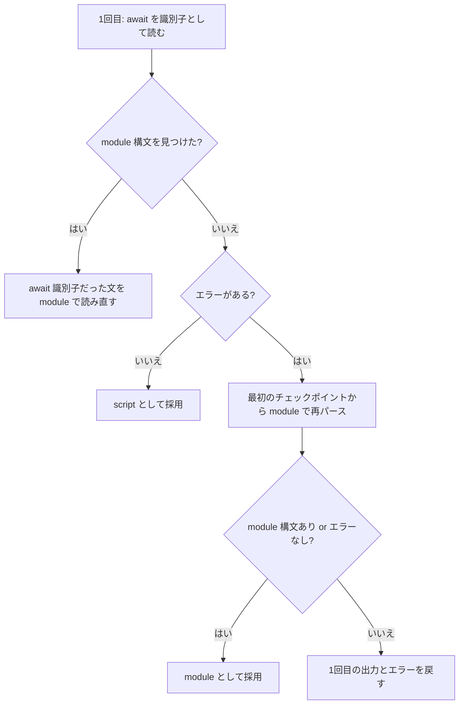

# 2026-11-28（土）

> 今日のひとこと：oxc のパーサーが、`await` が識別子か予約語か決まらない「unambiguous」モードで、1回目のパースが失敗しても module として読み直すようになりました。新規の脆弱性は確認できませんでした。

## 今日のリリース

- 【Vue】3.6.0-rc.17：タグとリリースページのみ確認。変更内容は不明（リリースページは CHANGELOG の参照だけで、`minor` ブランチの CHANGELOG は取得が途中で切れて読めなかった）（出典: https://github.com/vuejs/core/releases/tag/v3.6.0-rc.17）

## トップニュース

### oxc のパーサーが「module か script か分からないソース」を、失敗後に module として読み直す

【oxc】oxc のパーサーは、unambiguous モード（`import`/`export` があれば module、なければ script とみなす）で、1回目のパースが致命的エラーで止まっても、`await` を使った最初の文に巻き戻して module として読み直すようになりました。Babel と同じ振る舞いです。

**何が変わる**

- 例：`await { then() {} };` の次に `export {};` があるソース。1回目は `await` を識別子として読むので `await {` で致命的エラーになり、module 構文の `export` に届かず script 扱いで構文エラーになっていた。
- 今回は、`await` が識別子だった最初の文までチェックポイントで巻き戻し、残りを module として再パースする。module 構文が見つかるか、エラーがなければ module として採用する。
- どちらでもなければ、1回目の出力とエラーをそのまま戻す。この処理は1回目にエラーがあった入力でだけ動く（コミットメッセージより）。

**なぜ変えた**

コミットメッセージによると、TypeScript はエラーから回復して `export` を見つけ、Babel は module として再パースする。oxc はどちらもせず、正しい module コードに構文エラーを出していた。フォーマッターとトランスフォーマーの round-trip 失敗（#30125）の原因でもあった。出力に含まれる `await /x/;` は、`await` が識別子だと正規表現リテラルとして読めない。

**何に効く・誰が困る**

- ESM かどうかを拡張子で決められないツール（バンドラ、リンター、変換）が、トップレベル `await` の書き方に当たる誤検出を減らせる。
- 逆に、1回目のパースで失敗する script は再パースを1回余分に走らせる。ただし「エラーがあった入力だけ」なので、正常な入力の速度には影響しない設計。

**ここまでの経緯**

- 同日 11:01 UTC：#30125「TypeScript の `reparseTopLevelAwait` と同様に再パースする」が入る（module 構文が見つかった場合の再パース）
- 同日 14:00 UTC：#30127 が、見つからなかった場合の再パースを足す

出典: https://github.com/oxc-project/oxc/pull/30127

## 今日の深掘り

### oxc：「あとから module と分かる」ソースを、チェックポイントで巻き戻して読み直す

選んだ理由：パーサーが「先に読んだ結果が間違っていたかもしれない」ときにどう巻き戻すかが、モジュールのドキュメントコメントにそのまま書かれているためです。読んだのは e45ad77d0（`crates/oxc_parser/src/top_level_await.rs`）です。

**背景**

`await` は script では識別子、module では演算子です。`await /x/u;` は、script なら割り算2回、module なら正規表現の `await` です。unambiguous モードでは、`import`/`export` に出会うまでどちらか分かりません。

そのため oxc は、module 構文が見つかるまで `await` を識別子として読み、見つかったら前の文を module として読み直します。これは TypeScript の `reparseTopLevelAwait` に倣っています（モジュールコメントより）。

**変更点**

ファイル先頭のコメントが、処理を3つの経路に分けています。

1. module 構文が見つかった：`await` が識別子だった文を module として読み直し、1回目の文のうち読み直し不要な部分は、トークン・トリビア・エラー・モジュール記録ごと再利用する。
2. module 構文はないがエラーがある（今回の追加）：最初のチェックポイントから module として読み直す。module 構文が見つかるかエラーがなければ採用、そうでなければ1回目の出力を戻す。
3. module 構文もエラーもない：script として1回目を採用する。

1回目の結果を「退避できる形」にするために、`FirstParse` という構造体が追加されています。チェックポイントと、読み直しで捨てられる出力（文、モジュール記録、致命的エラー）をまとめて持ち、失敗したら元に戻せます。`cursor.rs` の `resume` では、致命的エラーを一時的に外してから再開できるように、`debug_assert` が緩められています。

**この変更から分かる設計思想**

- 「どちらか分からない」入力は、先に決め打ちして進み、必要になったら巻き戻す。ただし巻き戻しは、エラーがあった入力だけに限る。
- 仕様の曖昧さは、先行する実装（TypeScript、Babel）の振る舞いに合わせて埋める。コミットメッセージが両者との差を明記している。
- 巻き戻しが前提にしている不変条件（出力は構文解析の順に追記される、など）を、コメントに列挙している。

出典: https://github.com/oxc-project/oxc/commit/e45ad77d0

## 仕様の変更

### whatwg/html

#### ナビゲーションのタイミング情報を、fetch controller の full timing info から取る

【HTML】ドキュメントを作るとき、`navigationParams` の fetch controller から full timing info を取り出し、`PerformanceNavigationTiming` の作成を一本化しました。controller が null の場合（`about:srcdoc` と `javascript:` URL）は、アルゴリズム冒頭で取った時刻を丸めて代わりに使います。未束縛だった `navigationTimingType` 変数も直っています。
なぜ変えたか：Issue #12887 の修正。ナビゲーションの計測が複数の箇所で重複して作られていたため（コミットメッセージより）。
出典: https://github.com/whatwg/html/commit/30f7046

その他：

- ハイパーリンクのダウンロードで、要素の referrer policy を適用するように（[commit bb960a8](https://github.com/whatwg/html/commit/bb960a8)、Fixes #5623）
- `img` のリクエストの initiator type を `"img"` に設定。以前の整理で設定が落ち、img の読み込みが Resource Timing に出なくなっていた（[commit 80371bf](https://github.com/whatwg/html/commit/80371bf)）
- editorial 3件は除外

### w3c/csswg-drafts

- CSS 名前空間を Window 以外（Worker、PaintWorklet、LayoutWorklet）にも公開。css-typed-om の `[Exposed=(Window, Worker)]` の partial が、WebIDL の規則で不正だったため。既存メンバーは Window に固定して、挙動は変えない（[commit 6f177f4c](https://github.com/w3c/csswg-drafts/commit/6f177f4c)、#14229）
- 空白の整形のみの1件は除外（editorial）

動きなし：whatwg/dom, whatwg/fetch, whatwg/streams, whatwg/url, tc39/ecma262, tc39/proposals, w3c/aria（Prettier の整形のみ）, w3c/ServiceWorker

## OSSのPR

### Svelte

#### 切断された derived の再実行が、チェーンの長さに対して指数的になる不具合を修正

【Svelte】`experimental.async` で別のバッチが保留中のとき、追跡されない場所で読まれた derived のチェーンが、長さに対して指数的に再実行されていました（5.58.1 の #19030 以降）。10行×20段のチェーンで、200回で済むところが 5,243,070 回になる例が挙げられています。
原因：切断状態の derived が `view_cache` に入らず、依存の版を `-1` と記録するため、`is_current` が毎回「古い」と判定して再実行していた。修正は、読んだ時点の版を実行ごとのマップに記録して使う。
なぜ変えたか：Issue #19366 の修正。
出典: https://github.com/sveltejs/svelte/pull/19368

#### diamond 型の依存で切断された derived の `is_dirty` を保持する

【Svelte】diamond 型の derived 依存グラフで、切断された derived の `is_dirty` の結果を保持する perf。PR 本文には、これがないとアプリが固まりうるとある。
なぜ変えたか：Issue #19155 の、より遠回りな対処の置き換え。
出典: https://github.com/sveltejs/svelte/pull/19311

その他：

- 保留中のバッチがあるとき、不要になった derived の辺を刈り込む（[#19461](https://github.com/sveltejs/svelte/pull/19461)）
- 未使用の async 機能をツリーシェイクできるように（[#19453](https://github.com/sveltejs/svelte/pull/19453)）

### Solid（`main`）

その他：

- キー付き reconcile で、購読者がいない行の proxy を保持（[#5222](https://github.com/solidjs/solid/pull/5222)）
- cleanup 中の書き込みを、その cleanup が属するフェーズで判定（[#5244](https://github.com/solidjs/solid/pull/5244)）
- 着地済みトランザクションが次の flush に引き継がれないように修正（[#5236](https://github.com/solidjs/solid/pull/5236)）
- ネストした Loading が先に失敗したとき、Errored がシェルでフォールバックを描くように（[#5225](https://github.com/solidjs/solid/pull/5225)）
- hydration 中の ref 読み取りが、サーバーから届いた要素を捨てないように（[#5235](https://github.com/solidjs/solid/pull/5235)）
- `createRoot` のラッパークロージャを削除（[#5228](https://github.com/solidjs/solid/pull/5228)）
- 文字列タグの動的 spread の effect 名をタグから付ける（[#5221](https://github.com/solidjs/solid/pull/5221)）

### oxc

#### パーサー：unambiguous ソースの module 読み直し

トップニュースと深掘りで扱った（#30127、#30125）。

その他：

- フォーマッター：単一要素の fill を、走査せずに測定して出力する perf（[#28454](https://github.com/oxc-project/oxc/pull/28454)）
- GraphQL フォーマッター：そのまま出力できる名前・値・文字列を、ソースの切り出しで出力する perf（[#28455](https://github.com/oxc-project/oxc/pull/28455)）
- フォーマッター（CSS / GraphQL / JS）の修正4件（[#30395](https://github.com/oxc-project/oxc/pull/30395)、[#30392](https://github.com/oxc-project/oxc/pull/30392)、[#30396](https://github.com/oxc-project/oxc/pull/30396)、[#30391](https://github.com/oxc-project/oxc/pull/30391)）と、CSS の演算子 fill の共通化（[#30393](https://github.com/oxc-project/oxc/pull/30393)）
- リンター：ESLint / typescript-eslint 由来のルールの報告位置・括弧・コメント保持・autofix の条件を直す修正が約20件（例：[#30415](https://github.com/oxc-project/oxc/pull/30415)、[#30417](https://github.com/oxc-project/oxc/pull/30417)、[#30414](https://github.com/oxc-project/oxc/pull/30414)、[#30400](https://github.com/oxc-project/oxc/pull/30400)）

### Next.js

その他：

- `next upgrade --ci`：CI での自動アップグレード用に、handoff ファイル、CI 設定、モデルと effort の質問、シークレット登録を追加（[#102427](https://github.com/vercel/next.js/pull/102427)、[#102432](https://github.com/vercel/next.js/pull/102432)、[#102433](https://github.com/vercel/next.js/pull/102433)、[#102422](https://github.com/vercel/next.js/pull/102422)）
- キャッシュコンポーネント（`[CC]`）の逐次タスクのスケジューリングを再構成（[#102486](https://github.com/vercel/next.js/pull/102486)）
- バンドルされる docs にエラーページを含める（[#102499](https://github.com/vercel/next.js/pull/102499)）

### Biome

#### lint ルールが3つ追加される

【Biome】`noAmd`（#13387）、`noDuplicateIfBranches`（#13395）、`noTailwindLegacyImportant`（#13474）が入りました。型推論では、Promise、Error、disposable の型の lowering override を削除しています（#13484、#13485）。
なぜ変えたか：PR 本文までは読めていない。
出典: https://github.com/biomejs/biome/pull/13474

その他：

- package の trust チェックで、SPDX の末尾 `+` 演算子に対応（[#13491](https://github.com/biomejs/biome/pull/13491)）

### Vue

その他：

- コメントの古い関数参照を更新（[#16455](https://github.com/vuejs/core/pull/16455)）

動きなし：React, Vite（docs のみ）, TypeScript, tsrs, tsc-ts, scriptc

## 脆弱性

新規のアドバイザリは確認できませんでした（react、next、vite、svelte、vuejs/core、oxc、astro、nuxt、TanStack/router の公開一覧を確認。最新は Svelte と Vue が 2026-11-25、Vite が 2026-11-26 の GHSA-qppr-rxr4-jjq2 で、いずれも [11-26](2026-11-26.md)・[11-27](2026-11-27.md) の号で扱い済み）。
